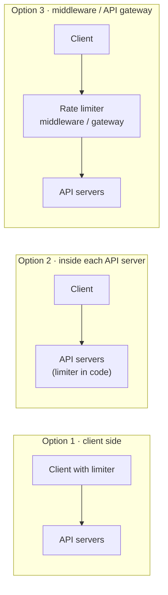
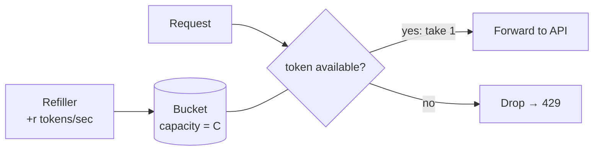
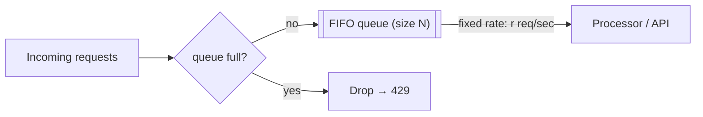
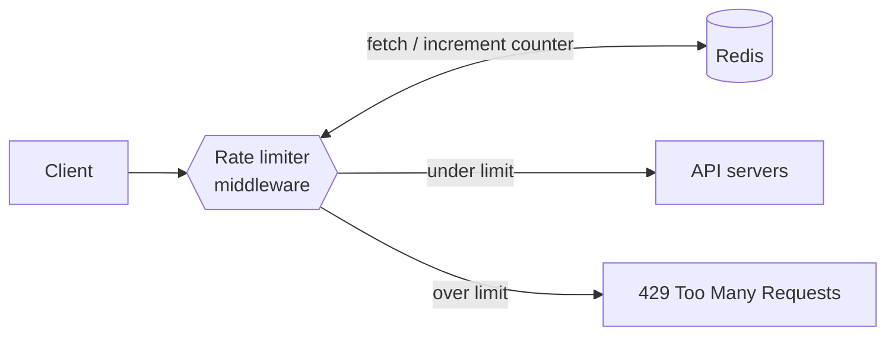
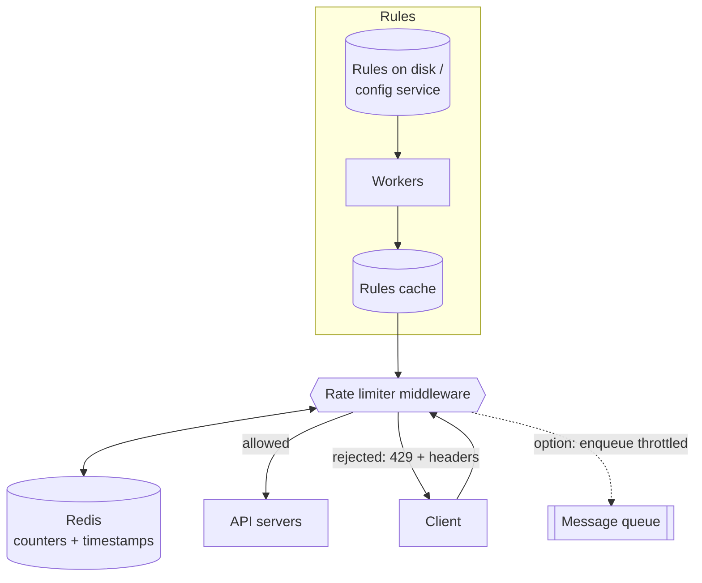

# 04 · Design a Rate Limiter

<div class="chapter-meta" markdown>
<span>⏱ 50 min read</span>
<span class="hot">🔥 Very common standalone question + used inside every other design</span>
<span>Book: Chapter 4</span>
</div>

!!! abstract "TL;DR"
    - A rate limiter caps how many requests a **client** (user, IP, API key, device) can make in a **time window**; excess requests get **HTTP 429 Too Many Requests**.
    - Put it on the **server side**, usually as **middleware / in the API gateway** — never trust the client.
    - Five algorithms: **token bucket** (bursts OK, most popular), **leaky bucket** (smooth fixed outflow), **fixed window** (simple, but 2× burst at window edges), **sliding log** (exact, memory-hungry), **sliding window counter** (approximate, cheap — the usual best choice).
    - Store counters in **Redis** (in-memory, `INCR` + `EXPIRE`), and make check-and-update **atomic with a Lua script** to avoid race conditions.
    - Rules live in config files (cached by the limiter); tell clients their quota with `X-RateLimit-*` / `Retry-After` headers; **fail open** if the limiter itself breaks.

## The intuition: the metro turnstile

At a busy metro station, turnstiles let people through one at a time. When a train empties out, the
staff close some gates so the platform doesn't overflow — people wait or take another route. Nobody
inside the station is harmed by the crowd outside.

A rate limiter is that turnstile for your API. Examples of rules:

- A user can post at most **2 times per second**.
- At most **5 sign-ups per hour** from one IP address.
- A device can claim a reward at most **5 times per week**.
- An OTP can be requested at most **3 times per 10 minutes** per phone number.

### Why bother?

1. **Stop resource starvation / DoS** — accidental (a buggy client in a retry loop) or deliberate. Almost every public API (GitHub, Twitter/X, Google APIs, Stripe) enforces limits.
2. **Control cost** — fewer servers; and crucially, protect calls to **paid third-party APIs** (credit checks, SMS, payments, LLM calls) that bill per request.
3. **Prevent overload** — filter out bots and misbehaving users so legitimate traffic stays fast.
4. **Fairness** — one heavy tenant shouldn't degrade everyone else in a multi-tenant system.

---

## Step 1 · Scope the problem

!!! example "Clarifying conversation"
    **You:** Are we protecting our own HTTP APIs, or limiting calls we make to someone else? — **Interviewer:** Our own public APIs.
    **You:** What identifies a client — API key, user, IP? — **I:** All of those; different endpoints use different keys.
    **You:** Roughly how much traffic? — **I:** Peak of a few hundred thousand requests per second.
    **You:** One server or a fleet behind a load balancer? — **I:** A large fleet, in two regions.
    **You:** Strict limits, or is small overshoot OK? — **I:** Small overshoot is fine for most endpoints; login must be strict.
    **You:** Should clients learn their remaining quota? — **I:** Yes, return it in responses.

**Requirements**

| Functional | Non-functional |
|---|---|
| Limit requests per configurable key (user, IP, API key, endpoint) | **Low latency** — must not noticeably slow requests (< 1–2 ms added) |
| Support many rules at once (per endpoint, per tier) | **Accurate** — don't let a lot of excess through; don't block legit users |
| Tell throttled clients clearly (429 + headers) | **Memory-efficient** — millions of keys |
| | **Distributed** — shared across all API servers / processes |
| | **Fault-tolerant** — if the limiter's cache dies, the API keeps working |

---

## Step 2 · Where does the rate limiter live?



- **Client side** — unreliable: anyone can modify or forge client requests, and you often don't control the client. (It's still polite for SDKs to self-throttle, but never rely on it.)
- **In the API server** — full control, but every service re-implements it, and limits are per-process unless state is shared.
- **Middleware / API gateway** — the common answer. Gateways (Kong, Envoy, NGINX, AWS API Gateway, Apigee) already do auth, TLS termination, IP allow-lists — rate limiting fits naturally.

Example: limit = 2 req/s. A client sends 3 requests in one second → the middleware forwards the first two and answers the third itself with **429 Too Many Requests**.

**How to decide** — it's a judgement call, so say what would tip you either way:

- **Already running a gateway** for auth/TLS? Then that's the natural home — one hop, one config.
- **Need an unusual algorithm** or per-request cost weighting? Building it yourself (a library or sidecar) gives full control; off-the-shelf gateways support a fixed menu.
- **Hot-path cost** — the check runs on *every* request, so it must be cheap in your runtime (a Redis round trip ≈ 0.5–1 ms in-DC).
- **Team size** — a managed gateway is often the right call for a small team; building and operating your own is real work.

---

## The five algorithms

Use the simulator to feel the most popular one before reading the theory:

<div class="sd-widget" data-widget="token-bucket"></div>

### 1 · Token bucket

A bucket holds up to **capacity** tokens. A refiller adds tokens at a fixed **refill rate**; once the
bucket is full, extra tokens overflow and are lost. Each request **takes one token**; if the bucket is
empty, the request is rejected.



**Worked trace** — capacity 5, refill 1 token every 2 seconds (added at :02, :04, :06 …), bucket starts full at 10:00:00:

| Time | Event | Tokens before | Decision | Tokens after |
|---|---|---|---|---|
| 10:00:00 | 4 requests (page load) | 5 | ✅✅✅✅ | 1 |
| 10:00:01 | 2 requests | 1 | ✅ ❌ | 0 |
| 10:00:02 | +1 refill, 1 request | 0 → 1 | ✅ | 0 |
| 10:00:03 | 1 request | 0 | ❌ 429 | 0 |
| 10:00:12 | +5 refills (capped at 5) | 0 → 5 | — | 5 |
| 10:00:12 | 5 requests | 5 | ✅✅✅✅✅ | 0 |

The burst at 10:00:00 sails through (that's the point of capacity), but the **sustained** rate can never
exceed 1 request every 2 seconds.

You don't actually need a background "refiller". Store `tokens` and `lastRefillTime`, and **refill lazily**
on each request based on elapsed time:

```java
public final class TokenBucket {
    private final long capacity;
    private final double refillPerNano;     // tokens added per nanosecond
    private double tokens;
    private long lastRefill;

    public TokenBucket(long capacity, double tokensPerSecond) {
        this.capacity = capacity;
        this.refillPerNano = tokensPerSecond / 1_000_000_000.0;
        this.tokens = capacity;             // start full: allows an initial burst
        this.lastRefill = System.nanoTime();
    }

    public synchronized boolean tryAcquire() {
        long now = System.nanoTime();
        tokens = Math.min(capacity, tokens + (now - lastRefill) * refillPerNano);
        lastRefill = now;
        if (tokens >= 1) { tokens -= 1; return true; }
        return false;
    }
}
```

**Parameters:** bucket size (max burst) and refill rate (sustained rate).

**How many buckets?** One per *(key, rule)*:

- Per-endpoint rules: "1 post/sec, 150 friend-adds/day, 5 likes/sec" → **3 buckets per user**.
- Per-IP throttling → one bucket per IP.
- A global cap ("10,000 req/s total") → one shared global bucket.

| ✅ Pros | ❌ Cons |
|---|---|
| Simple, memory-efficient (2 numbers per key) | Two parameters that can be tricky to tune |
| **Allows short bursts** (up to capacity) while enforcing an average rate | Bursts may be unwanted when the downstream needs smooth load |

*Used by:* AWS API Gateway, Stripe (among many others).

### 2 · Leaky bucket

Like a bucket with a hole: requests enter a **FIFO queue** of fixed size; a worker **drains** it at a
**fixed outflow rate**. If the queue is full, new requests are dropped.



**Parameters:** bucket (queue) size and outflow rate.

| ✅ Pros | ❌ Cons |
|---|---|
| Memory-bounded (queue size) | A burst fills the queue with **old** requests; newer ones get dropped even if they're more important |
| **Perfectly smooth output** — great when downstream needs a stable rate (e.g. a payment provider that allows exactly 100 TPS) | Adds queueing latency; two parameters to tune |

*Used by:* Shopify's API (leaky-bucket style). Also the classic traffic-shaping algorithm in networking.

!!! tip "Token vs leaky bucket in one line"
    **Token bucket limits the *average* rate and permits bursts. Leaky bucket enforces a *constant* output rate and absorbs bursts in a queue.**

### 3 · Fixed window counter

Split time into fixed windows (e.g. each calendar second or minute). Keep a counter per window; each
request increments it; once it hits the limit, reject until the next window starts.

```java
// Redis-style: key = "rl:{user}:{epochMinute}"
long window = System.currentTimeMillis() / 60_000;
String key = "rl:" + userId + ":" + window;
long count = redis.incr(key);
if (count == 1) redis.expire(key, 60);   // first hit in this window sets the TTL
boolean allowed = count <= LIMIT;
```

**The edge problem.** Limit = 100 per minute, windows start on round minutes. A script fires 100
requests between 9:14:50 and 9:14:59, then 100 more between 9:15:00 and 9:15:09. Each window sees
exactly 100 — all allowed. But in the 20 seconds around the boundary, **200 requests got through: double
the per-minute limit.**

<figure class="diagram" markdown>
<svg viewBox="0 0 640 150" xmlns="http://www.w3.org/2000/svg" role="img" aria-label="Fixed window edge burst">
  <line x1="20" y1="90" x2="620" y2="90" class="stroke" stroke-width="2"/>
  <line x1="20" y1="70" x2="20" y2="110" class="stroke" stroke-width="2"/>
  <line x1="320" y1="70" x2="320" y2="110" class="stroke" stroke-width="2"/>
  <line x1="620" y1="70" x2="620" y2="110" class="stroke" stroke-width="2"/>
  <text x="20" y="128" font-size="12" text-anchor="middle">9:14:00</text>
  <text x="320" y="128" font-size="12" text-anchor="middle">9:15:00</text>
  <text x="620" y="128" font-size="12" text-anchor="middle">9:16:00</text>
  <text x="170" y="60" font-size="12" text-anchor="middle">window 1: 100 req ✓</text>
  <text x="470" y="60" font-size="12" text-anchor="middle">window 2: 100 req ✓</text>
  <g class="accent">
    <circle cx="250" cy="90" r="6"/><circle cx="265" cy="90" r="6"/><circle cx="280" cy="90" r="6"/><circle cx="295" cy="90" r="6"/><circle cx="310" cy="90" r="6"/>
    <circle cx="330" cy="90" r="6"/><circle cx="345" cy="90" r="6"/><circle cx="360" cy="90" r="6"/><circle cx="375" cy="90" r="6"/><circle cx="390" cy="90" r="6"/>
  </g>
  <rect x="170" y="20" width="300" height="20" rx="4" fill="none" stroke="#e36414" stroke-width="2" stroke-dasharray="5 4"/>
  <text x="320" y="35" font-size="12" text-anchor="middle">20 s around the boundary → 200 requests (2× the per-minute limit)</text>
</svg>
<figcaption>Bursts on both sides of a window boundary let twice the limit through.</figcaption>
</figure>

| ✅ Pros | ❌ Cons |
|---|---|
| Very memory-efficient (1 counter per key) | **Up to 2× the limit at window edges** |
| Easy to understand and implement | Synchronised resets: everyone's quota resets at the same instant → thundering herd |
| Quota resetting on round time units fits some products ("1,000 calls per day") | |

### 4 · Sliding window log

Fixes the edge problem exactly. Keep a **log of request timestamps** per key (e.g. a Redis **sorted set**,
score = timestamp). On each request:

1. Remove timestamps older than `now − window`.
2. Add the new request's timestamp.
3. If the log size ≤ limit → allow; else reject.

**Trace** — limit 3 requests per 10 seconds (log stores every request, accepted or not):

| Arrives | Log after cleanup + insert | Size | Decision |
|---|---|---|---|
| 12:00:01 | [:01] | 1 | ✅ |
| 12:00:03 | [:01, :03] | 2 | ✅ |
| 12:00:04 | [:01, :03, :04] | 3 | ✅ |
| 12:00:07 | [:01, :03, :04, :07] | 4 | ❌ (timestamp still stored) |
| 12:00:12 | window is (12:00:02, 12:00:12] → drop :01 → [:03, :04, :07, :12] | 4 | ❌ |
| 12:00:15 | drop :03, :04 → [:07, :12, :15] | 3 | ✅ |

```java
public boolean allow(String key, long nowMs) {
    Deque<Long> log = logs.computeIfAbsent(key, k -> new ArrayDeque<>());
    synchronized (log) {
        while (!log.isEmpty() && log.peekFirst() <= nowMs - WINDOW_MS) log.pollFirst();
        log.addLast(nowMs);                 // book's variant: rejected requests are logged too
        return log.size() <= LIMIT;
    }
}
```

!!! note "A design choice hidden in step 2"
    The variant above logs **rejected** requests too — so a client that keeps hammering stays blocked
    (it's punished for retrying). Many implementations only log **accepted** requests, which lets a client
    back in as soon as old requests expire. Mention which one you're choosing.

| ✅ Pros | ❌ Cons |
|---|---|
| **Exact** — no rolling window ever exceeds the limit | **Memory-hungry**: one entry per request (100 req/min limit × 1M users = 100M timestamps) |
| | Cleanup work on every request |

### 5 · Sliding window counter (the hybrid)

Keep just **two fixed-window counters** — current and previous — and estimate the rolling count by
assuming the previous window's requests were spread evenly:

```text
estimated = current_count + previous_count × (overlap of rolling window with previous window)
```

**Example:** limit 10/min. The previous minute had 8 requests; the current minute has 4 so far. A new
request arrives 40% into the current minute → the rolling window still overlaps the last 60% of the previous minute.

`estimated = 4 + 8 × 0.6 = 8.8` → 8.8 < 10 → **allow** (current becomes 5). Two more requests at the same
moment would push the estimate to 10.8 → the second one is rejected. (Whether you compare the raw estimate
or round it up/down is a policy choice — rounding down is slightly more permissive.)

<figure class="diagram" markdown>
<svg viewBox="0 0 640 140" xmlns="http://www.w3.org/2000/svg" role="img" aria-label="Sliding window counter">
  <rect x="20" y="60" width="300" height="34" rx="4" class="ink" opacity="0.25"/>
  <rect x="320" y="60" width="300" height="34" rx="4" class="ink" opacity="0.45"/>
  <text x="170" y="82" font-size="13" text-anchor="middle">previous minute: 8 requests</text>
  <text x="470" y="82" font-size="13" text-anchor="middle">current minute: 4 so far</text>
  <rect x="140" y="44" width="300" height="66" rx="6" fill="none" stroke="#e36414" stroke-width="2.5" stroke-dasharray="6 4"/>
  <text x="290" y="36" font-size="12" text-anchor="middle">rolling 1-minute window</text>
  <text x="230" y="128" font-size="12" text-anchor="middle">60% of previous</text>
  <text x="380" y="128" font-size="12" text-anchor="middle">40% into current</text>
  <line x1="440" y1="40" x2="440" y2="114" stroke="#e36414" stroke-width="2"/>
  <text x="440" y="22" font-size="12" text-anchor="middle">now</text>
</svg>
<figcaption>estimate = 4 + 8 × 0.6 = 8.8 requests in the last minute.</figcaption>
</figure>

```java
public synchronized boolean allow(String key, long nowMs) {
    long window = nowMs / WINDOW_MS;
    double elapsedFraction = (nowMs % WINDOW_MS) / (double) WINDOW_MS;
    long curr = counters.getOrDefault(key + ":" + window, 0L);
    long prev = counters.getOrDefault(key + ":" + (window - 1), 0L);
    double estimated = curr + prev * (1.0 - elapsedFraction);
    if (estimated >= LIMIT) return false;
    counters.merge(key + ":" + window, 1L, Long::sum);  // (old windows expire via TTL in Redis)
    return true;
}
```

| ✅ Pros | ❌ Cons |
|---|---|
| Smooths edge spikes (uses the previous window's average) | **Approximate** — assumes the previous window was uniform |
| **Memory-efficient** — 2 counters per key | Not suitable when the limit must be strict to the request |

How bad is the approximation in practice? Cloudflare measured it on **400 million requests**: only
**0.003%** were wrongly allowed or rate-limited. That's why it's often the best default.

### Algorithm comparison

| Algorithm | Memory / key | Accuracy | Bursts | Best when |
|---|---|---|---|---|
| Token bucket | O(1) — tokens + timestamp | Good | ✅ allows up to capacity | General APIs; bursts are fine |
| Leaky bucket | O(queue size) | Good | ❌ smoothed into queue | Downstream needs constant rate |
| Fixed window | O(1) — 1 counter | ❌ 2× at edges | ⚠ edge bursts | Simple quotas ("1,000/day") |
| Sliding log | O(limit) timestamps | ✅ exact | ❌ | Low limits needing exactness (OTP, login attempts) |
| Sliding window counter | O(1) — 2 counters | ≈ (99.997%) | Smoothed | High-volume APIs — **the usual best pick** |

---

## High-level architecture

All algorithms need the same primitive: a **fast shared counter per key with expiry**. A database is
too slow (disk). An **in-memory store like Redis** is ideal: it's fast and supports time-based expiry.

- `INCR key` — atomically increment a counter (creates it at 1 if missing).
- `EXPIRE key seconds` — auto-delete the key after a timeout.



1. The client sends a request to the rate-limiter middleware.
2. The middleware fetches the counter for the right bucket from Redis and checks the limit.
3. Over the limit → reject (429). Under → forward to the API servers and increment the counter.

---

## Step 3 · Deep dive

### Rules: where they live and what they look like

Rules are usually written in **config files** (YAML) and stored on disk / in a config service. Here's an
illustrative format, similar in spirit to the descriptor-based config used by Envoy's open-source rate-limit service:

```yaml
domain: public_api
descriptors:
  - key: plan
    value: free
    rate_limit: { unit: minute, requests_per_unit: 60 }     # free tier: 60 calls/min per API key
  - key: plan
    value: pro
    rate_limit: { unit: minute, requests_per_unit: 1000 }   # paid tier
---
domain: otp
descriptors:
  - key: phone_number
    rate_limit: { unit: hour, requests_per_unit: 5 }        # at most 5 OTP sends per phone per hour
```

**Workers** periodically pull rules from disk/config service and keep them in a local **cache** inside the
rate limiter, so rule lookup costs nothing on the hot path.

### Telling clients they're throttled

Return **HTTP 429 Too Many Requests** with headers so well-behaved clients can back off:

| Header | Meaning |
|---|---|
| `X-RateLimit-Limit` | How many calls the client may make per window |
| `X-RateLimit-Remaining` | How many are left in the current window |
| `X-RateLimit-Retry-After` (or standard `Retry-After`) | Seconds to wait before retrying |

(There's an IETF draft standardising these as `RateLimit-Limit`, `RateLimit-Remaining`, `RateLimit-Reset`.)

Throttled requests can be **dropped**, or **enqueued** for later processing (e.g. orders throttled during a
spike shouldn't just vanish).

### The detailed design



### Problem 1 — race conditions

Two API servers handle requests from the same user at the same instant. Limit = 4, counter = 3.

```text
Server A: GET counter → 3          Server B: GET counter → 3
Server A: 3 < 4 → allow, SET 4     Server B: 3 < 4 → allow, SET 4
Result: 5 requests allowed, counter says 4.  ❌
```

The read-check-write isn't atomic. Fixes:

- **Locks** — correct but slow; a distributed lock on every request kills latency.
- **Atomic operations** — `INCR` *then* check (`INCR` returns the new value atomically).
- **Lua scripts in Redis** — Redis runs a script atomically, so the whole read-modify-write happens as one step.
- **Redis sorted sets** (for the sliding log) inside a `MULTI`/Lua block.

A token-bucket check as one atomic Lua script:

```lua
-- KEYS[1] = bucket key ; ARGV = capacity, refill_per_sec, now_ms, cost
local cap    = tonumber(ARGV[1])
local rate   = tonumber(ARGV[2])
local now    = tonumber(ARGV[3])
local cost   = tonumber(ARGV[4])
local b      = redis.call('HMGET', KEYS[1], 'tokens', 'ts')
local tokens = tonumber(b[1]) or cap
local ts     = tonumber(b[2]) or now
tokens = math.min(cap, tokens + (now - ts) / 1000 * rate)   -- lazy refill
local allowed = 0
if tokens >= cost then tokens = tokens - cost; allowed = 1 end
redis.call('HMSET', KEYS[1], 'tokens', tokens, 'ts', now)
redis.call('PEXPIRE', KEYS[1], math.ceil(cap / rate * 1000) * 2)
return { allowed, math.floor(tokens) }
```

Called from Java with Jedis/Lettuce via `EVALSHA` (the script is loaded once and referenced by its SHA).

### Problem 2 — synchronisation across many limiters

You'll run many rate-limiter instances. With **stateless web tiers**, consecutive requests from one client
can hit **different** limiter instances. If each kept counters in local memory, the client would get N× its limit.

- **Sticky sessions** (always route a client to the same limiter) — works but isn't scalable or flexible. Avoid.
- **Centralised data store** (Redis) — all instances share the same counters. ✅ The standard answer.

### Problem 3 — performance

- **Multi-data-center / edge**: latency to a far-away Redis is high for distant users. Put rate limiters at **edge locations** close to users (Cloudflare runs limiting across hundreds of edge servers) and route traffic to the nearest.
- **Eventual consistency between DCs**: sync counters asynchronously across regions; a tiny over-allowance during sync is an acceptable trade for low latency.
- **Local pre-check**: keep a small local token bucket per instance that absorbs most decisions and periodically reconciles with Redis — fewer network round-trips at the cost of slight inaccuracy.

### Problem 4 — monitoring

Collect metrics to check that the limiter is **effective**:

- **Is the algorithm right?** If you see bursty flash-sale traffic being dropped heavily, token bucket (which tolerates bursts) may suit better than a strict window.
- **Are the rules right?** If many legitimate requests get 429s, the rules are too strict — relax them.
- Track: allowed vs throttled per rule, p99 added latency, Redis errors, top throttled keys (abuse detection).

### Failure mode: fail open or fail closed?

If Redis is unreachable, should requests be **allowed** (fail open) or **blocked** (fail closed)?
For most APIs: **fail open** — availability matters more than perfect limiting, and the requirement said a
limiter failure must not take down the system. For security-critical limits (login attempts, OTP sends)
consider **fail closed** or a conservative local fallback limiter.

---

## Step 4 · Wrap up — extra topics

- **Hard vs soft limits.** Hard: never exceed the threshold. Soft: may exceed briefly (useful for bursty but benign traffic).
- **Limiting at other layers.** We built a Layer-7 (HTTP) limiter. You can also limit at Layer 3 by IP with `iptables`/firewalls — cheap, but coarse (can't see users or endpoints). OSI layers: physical, data link, network (3), transport (4), session, presentation, application (7).
- **Client best practices** to avoid being limited:
    - Cache responses to avoid repeat calls.
    - Understand the limits and don't send bursts in a short time.
    - Catch 429s/errors and recover gracefully.
    - Retry with **exponential backoff + jitter**, respecting `Retry-After`.
- **Tiered limits** — free vs paid plans with different buckets; per-tenant fairness in SaaS.

---

## Interviewer follow-ups

??? question "Token bucket or sliding window counter for a public REST API? Justify."
    For a general public API I'd pick **token bucket** if I want to allow short legitimate bursts (page loads fire many
    calls) with O(1) memory, or **sliding window counter** if I want a smoother "N per minute" semantic without edge
    spikes. Both are O(1) per key and easy to implement atomically in Redis. I'd avoid fixed window (edge bursts) and
    sliding log (memory) unless the limit is tiny and must be exact (login attempts).

??? question "Your Redis cluster handling counters goes down. What happens?"
    The limiter should **fail open**: catch the error/timeout quickly (tight client timeout ~5–10 ms), allow the request,
    emit a metric and alert. Optionally fall back to a per-instance in-memory limiter with conservative limits so abusive
    clients are still somewhat constrained. Run Redis with replicas + automatic failover (Sentinel/Cluster) to make this rare.

??? question "How do you rate-limit across 3 regions with 1 global quota per user?"
    Options: (1) route each user to a **home region** that owns their counter (simple, accurate); (2) each region keeps a
    local counter and **asynchronously syncs** — allow a small over-limit during sync lag; (3) **split the quota** between
    regions (e.g. by recent traffic share) and rebalance periodically. Strict global accuracy would need a cross-region
    round trip per request — too slow — so we accept approximate enforcement.

??? question "How much memory do counters need for 10M users and 3 rules each?"
    Sliding window counter: 2 counters per (user, rule). Key ~40 bytes + value 8 bytes + Redis overhead ~50 bytes ≈ 100 B
    per counter → 10M × 3 × 2 × 100 B = **6 GB** — fits easily on a small Redis cluster. A sliding log with limit 100
    would need up to 100 entries per key → ~100× more (hundreds of GB).

??? question "Where should the user ID come from if the limiter runs before auth?"
    Either run limiting **after** authentication in the gateway (so it can read the verified user/API key), or use
    layered limits: a coarse **per-IP** limit before auth (protects the auth service itself from credential stuffing), then
    **per-user / per-key** limits after auth.

??? question "Should rejected requests count against the client?"
    It's a policy choice. Counting them (as in the sliding-log variant) punishes clients that ignore 429s and keep
    hammering. Not counting them is friendlier for clients that retry correctly. For abuse-sensitive endpoints, count
    them; for normal APIs, usually don't — and publish `Retry-After` so good clients wait.

---

## Common mistakes

!!! warning "Avoid these"
    - Putting the limiter only on the **client**.
    - Using a **relational database** for counters (disk latency on every request).
    - Get-then-set without atomicity → **race conditions** let extra requests through.
    - Per-instance in-memory counters behind a load balancer → each client gets **N× the limit**.
    - Forgetting to say what happens when the **limiter itself fails**.
    - Returning 500/403 instead of **429** + retry information.

---

## Practice

??? example "Practice 1 — Trace the token bucket"
    Capacity 3, refill 1 token/second, starts full at t=0. Requests arrive at t = 0, 0, 0, 0, 0.5, 1.2, 1.3, 3.0.
    Which are allowed?

    **Solution.**
    t=0: tokens 3 → allow (2), allow (1), allow (0), **reject** (0).
    t=0.5: tokens 0.5 → **reject**.
    t=1.2: tokens 1.2 → allow (0.2).
    t=1.3: tokens 0.3 → **reject**.
    t=3.0: tokens 0.3 + 1.7 = 2.0 → allow (1.0).
    Allowed: 5 of 8.

??? example "Practice 2 — Sliding window counter"
    Limit 100/min. Previous minute: 84 requests. Current minute: 36 requests so far. A request arrives 25% into
    the current minute. Allow or reject?

    **Solution.** Overlap with previous = 75%. Estimate = 36 + 84 × 0.75 = 36 + 63 = **99** < 100 → **allow** (count becomes 37).
    The next request at the same moment would estimate 100 → reject.

??? example "Practice 3 — Design an OTP limiter"
    Requirements: max 3 OTP requests per phone per 10 minutes, max 10 per phone per day, and max 100 per IP per hour.
    Which algorithm(s) and data structures?

    **Solution.** Low limits that must be exact → **sliding window log** in Redis sorted sets for the 10-minute rule
    (`ZREMRANGEBYSCORE`, `ZADD`, `ZCARD` in one Lua script). Daily rule → **fixed window** counter keyed by
    `phone:yyyy-mm-dd` (calendar-day semantics are fine). IP rule → **sliding window counter**. Check all three
    atomically; reject if any fails; **fail closed** if Redis is down (SMS costs money and is an abuse target).

??? example "Practice 4 — Leaky bucket sizing"
    A downstream payment gateway allows exactly 50 TPS. Your checkout traffic peaks at 200 TPS for ~20 seconds during
    flash sales. Design the limiter.

    **Solution.** A **leaky bucket** draining at 50/s in front of the gateway. A 20 s spike at 200/s brings 4,000 requests
    of which 1,000 drain during the spike → queue needs ~3,000 slots to avoid drops, and the last request waits ~60 s.
    That's too long for a synchronous checkout → accept the order, enqueue the payment, return "processing", and
    notify on completion; or add a waiting-room in front of the sale.

---

## Revision checklist

- [ ] I can explain why rate limiting is needed (DoS, cost, overload, fairness).
- [ ] I can compare client-side, in-server and gateway placement.
- [ ] I can explain all five algorithms with a trace, pros/cons, and when to use each.
- [ ] I can show the fixed-window edge problem with numbers and compute a sliding-window-counter estimate.
- [ ] I can draw the architecture with Redis, rules cache and 429 responses with headers.
- [ ] I can explain the race condition and fix it with atomic ops / Lua.
- [ ] I know how to sync limiters across instances and data centers, and fail-open vs fail-closed.

[Next: 05 · Consistent Hashing :material-arrow-right:](05-consistent-hashing.md){ .md-button .md-button--primary }
