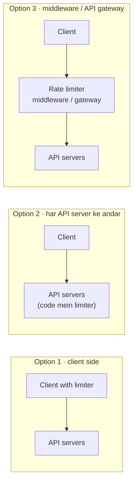
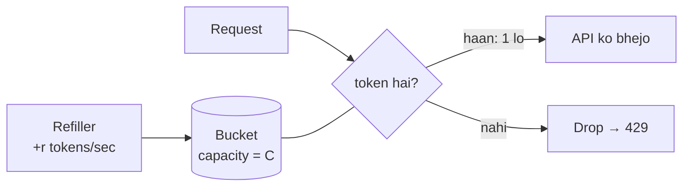
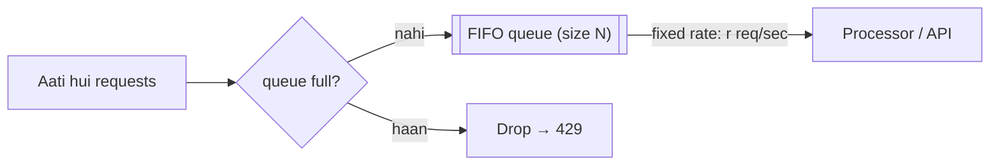
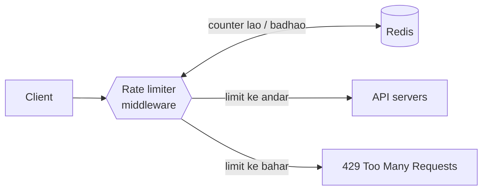
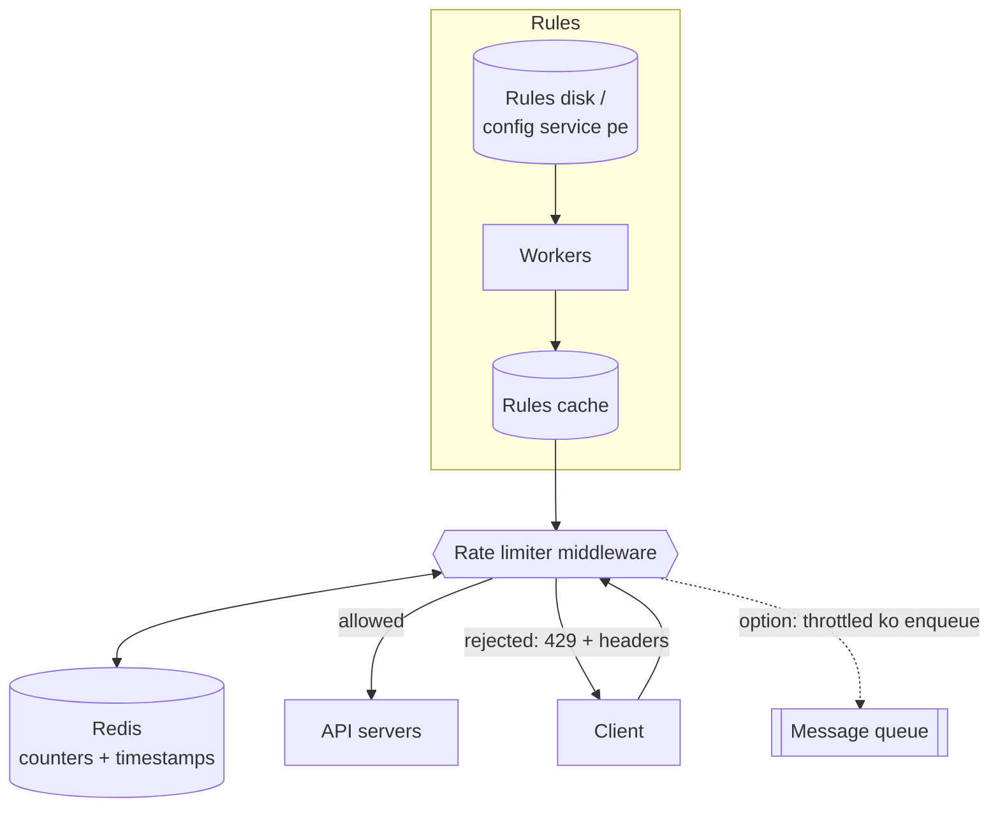

# 04 · Rate Limiter Design karo

<div class="chapter-meta" markdown>
<span>⏱ 50 min read</span>
<span class="hot">🔥 Standalone question bhi, aur har doosre design ke andar bhi</span>
<span>Book: Chapter 4</span>
</div>

!!! abstract "TL;DR"
    - Rate limiter ek **client** (user, IP, API key, device) ki ek **time window** mein requests ki limit lagata hai; extra requests ko **HTTP 429 Too Many Requests** milta hai.
    - Ise **server side** rakho, aam taur pe **middleware / API gateway** mein — client pe kabhi bharosa mat karo.
    - Paanch algorithms: **token bucket** (bursts chalenge, sabse popular), **leaky bucket** (smooth fixed outflow), **fixed window** (simple, par window edges pe 2× burst), **sliding log** (exact, memory khaata hai), **sliding window counter** (approximate, sasta — aksar best choice).
    - Counters **Redis** mein (in-memory, `INCR` + `EXPIRE`), aur race conditions se bachne ke liye check-and-update ko **Lua script se atomic** banao.
    - Rules config files mein (limiter cache karta hai); clients ko `X-RateLimit-*` / `Retry-After` headers se quota batao; limiter khud toote toh **fail open**.

## Intuition: metro ka turnstile

Bheed waale metro station pe turnstiles ek-ek karke logon ko andar jaane dete hain. Jab platform bhar jaata hai,
staff kuch gates band kar deta hai taaki overflow na ho — log wait karte hain ya doosra raasta lete hain. Andar wale
logon ko bahar ki bheed se koi nuksaan nahi hota.

Rate limiter tumhari API ka wahi turnstile hai. Rules ke examples:

- Ek user **1 second mein max 2 posts** kar sakta hai.
- Ek IP address se **ghante mein max 5 sign-ups**.
- Ek device **hafte mein max 5 baar** reward claim kar sakta hai.
- Ek phone number pe **10 minute mein max 3 OTP**.

### Kyun chahiye?

1. **Resource starvation / DoS rokna** — galti se (retry loop mein phansa buggy client) ya jaan-bujh ke. Lagbhag har public API (GitHub, Twitter/X, Google APIs, Stripe) limits lagata hai.
2. **Cost control** — kam servers; aur sabse important, **paid third-party APIs** (credit check, SMS, payments, LLM calls) jo har request ka paisa lete hain, unki raksha.
3. **Overload rokna** — bots aur badtameez users ko filter karo taaki genuine traffic tez rahe.
4. **Fairness** — multi-tenant system mein ek bhaari tenant baaki sab ko slow na kare.

---

## Step 1 · Problem scope karo

!!! example "Clarifying baatcheet"
    **Tum:** Hum apni HTTP APIs bacha rahe hain, ya kisi aur ko jaane waali calls limit kar rahe hain? — **Interviewer:** Apni public APIs.
    **Tum:** Client ki pehchaan kaise — API key, user, IP? — **I:** Sab; alag endpoints alag keys use karte hain.
    **Tum:** Traffic roughly kitna? — **I:** Peak pe kuch lakh requests per second.
    **Tum:** Ek server ya load balancer ke peeche poori fleet? — **I:** Badi fleet, do regions mein.
    **Tum:** Strict limits, ya thoda overshoot chalega? — **I:** Zyada tar endpoints pe thoda overshoot theek; login strict hona chahiye.
    **Tum:** Kya clients ko bacha hua quota pata chalna chahiye? — **I:** Haan, response mein bhejo.

**Requirements**

| Functional | Non-functional |
|---|---|
| Configurable key (user, IP, API key, endpoint) pe requests limit karo | **Low latency** — requests noticeably slow na hon (< 1–2 ms extra) |
| Ek saath kai rules (per endpoint, per tier) | **Accurate** — zyada excess andar na aaye; genuine users block na hon |
| Throttled clients ko saaf batao (429 + headers) | **Memory-efficient** — millions of keys |
| | **Distributed** — saare API servers / processes mein shared |
| | **Fault-tolerant** — limiter ka cache mar jaaye toh bhi API chalti rahe |

---

## Step 2 · Rate limiter rehta kahan hai?



- **Client side** — bharosemand nahi: koi bhi client requests modify ya forge kar sakta hai, aur aksar client tumhare control mein nahi hota. (SDKs ka khud-throttle karna achhi baat hai, par uspe depend mat karo.)
- **API server ke andar** — poora control, par har service khud implement karegi, aur state share na ho toh limits per-process ho jaati hain.
- **Middleware / API gateway** — common answer. Gateways (Kong, Envoy, NGINX, AWS API Gateway, Apigee) pehle se auth, TLS termination, IP allow-lists karte hain — rate limiting yahan naturally fit hoti hai.

Example: limit = 2 req/s. Client ek second mein 3 requests bhejta hai → middleware pehli do aage bhej deta hai aur teesri ko khud **429 Too Many Requests** de deta hai.

**Kaise decide karein** — judgement call hai, toh batao kya tumhe kis taraf le jaayega:

- Auth/TLS ke liye **pehle se gateway chal raha hai**? Toh wahi natural ghar hai — ek hop, ek config.
- **Koi unusual algorithm** ya per-request cost weighting chahiye? Khud banana (library ya sidecar) poora control deta hai; off-the-shelf gateways ka menu fixed hota hai.
- **Hot-path cost** — check *har* request pe chalta hai, toh tumhare runtime mein sasta hona chahiye (DC ke andar Redis round trip ≈ 0.5–1 ms).
- **Team size** — chhoti team ke liye managed gateway aksar sahi hai; apna banana aur chalana asli kaam hai.

---

## Paanch algorithms

Theory padhne se pehle sabse popular waale ko mehsoos karo:

<div class="sd-widget" data-widget="token-bucket"></div>

### 1 · Token bucket

Ek bucket mein max **capacity** tokens aa sakte hain. Ek refiller fixed **refill rate** pe tokens daalta hai; bucket full
ho toh extra tokens bah jaate hain. Har request **ek token leti hai**; bucket khaali ho toh request reject.



**Worked trace** — capacity 5, har 2 second mein 1 token (:02, :04, :06 … pe add hota hai), bucket 10:00:00 pe full:

| Time | Event | Pehle tokens | Decision | Baad mein tokens |
|---|---|---|---|---|
| 10:00:00 | 4 requests (page load) | 5 | ✅✅✅✅ | 1 |
| 10:00:01 | 2 requests | 1 | ✅ ❌ | 0 |
| 10:00:02 | +1 refill, 1 request | 0 → 1 | ✅ | 0 |
| 10:00:03 | 1 request | 0 | ❌ 429 | 0 |
| 10:00:12 | +5 refills (5 pe cap) | 0 → 5 | — | 5 |
| 10:00:12 | 5 requests | 5 | ✅✅✅✅✅ | 0 |

10:00:00 ka burst aaram se nikal gaya (capacity ka yahi matlab hai), par **lagatar** rate kabhi 2 second mein 1 request se zyada nahi ho sakta.

Asal mein background "refiller" ki zaroorat nahi. `tokens` aur `lastRefillTime` store karo, aur har request pe beete time ke hisaab se **lazily refill** karo:

```java
public final class TokenBucket {
    private final long capacity;
    private final double refillPerNano;     // har nanosecond mein kitne tokens
    private double tokens;
    private long lastRefill;

    public TokenBucket(long capacity, double tokensPerSecond) {
        this.capacity = capacity;
        this.refillPerNano = tokensPerSecond / 1_000_000_000.0;
        this.tokens = capacity;             // full se shuru: shuruaati burst allowed
        this.lastRefill = System.nanoTime();
    }

    public synchronized boolean tryAcquire() {
        long now = System.nanoTime();
        tokens = Math.min(capacity, tokens + (now - lastRefill) * refillPerNano);
        lastRefill = now;
        if (tokens >= 1) { tokens -= 1; return true; }
        return false;
    }
}
```

**Parameters:** bucket size (max burst) aur refill rate (lagatar rate).

**Kitne buckets?** Har *(key, rule)* ka ek:

- Per-endpoint rules: "1 post/sec, 150 friend-adds/din, 5 likes/sec" → **har user ke 3 buckets**.
- Per-IP throttling → har IP ka ek bucket.
- Global cap ("total 10,000 req/s") → ek shared global bucket.

| ✅ Fayde | ❌ Nuksaan |
|---|---|
| Simple, memory-efficient (har key ke 2 numbers) | Do parameters jinhe tune karna tricky ho sakta hai |
| **Chhote bursts chalte hain** (capacity tak) jabki average rate enforce hota hai | Agar downstream ko smooth load chahiye toh bursts problem hain |

*Kaun use karta hai:* AWS API Gateway, Stripe (aur bahut saare).

### 2 · Leaky bucket

Jaise chhed waali baalti: requests ek fixed size ki **FIFO queue** mein aati hain; ek worker use **fixed outflow rate** pe
**khaali** karta hai. Queue full ho toh nayi requests drop.



**Parameters:** bucket (queue) size aur outflow rate.

| ✅ Fayde | ❌ Nuksaan |
|---|---|
| Memory bounded (queue size) | Burst queue ko **purani** requests se bhar deta hai; nayi drop hoti hain chahe zyada important hon |
| **Ekdum smooth output** — jab downstream ko stable rate chahiye (jaise payment provider jo exactly 100 TPS allow karta hai) | Queueing latency badhti hai; do parameters tune karne hain |

*Kaun use karta hai:* Shopify ki API (leaky-bucket style). Networking mein traffic shaping ka classic algorithm bhi yahi hai.

!!! tip "Token vs leaky bucket ek line mein"
    **Token bucket *average* rate limit karta hai aur bursts allow karta hai. Leaky bucket *constant* output rate enforce karta hai aur bursts ko queue mein sokh leta hai.**

### 3 · Fixed window counter

Time ko fixed windows mein baant do (jaise har calendar second ya minute). Har window ka ek counter; har request use badhati
hai; limit pe pahunche toh agli window shuru hone tak reject.

```java
// Redis-style: key = "rl:{user}:{epochMinute}"
long window = System.currentTimeMillis() / 60_000;
String key = "rl:" + userId + ":" + window;
long count = redis.incr(key);
if (count == 1) redis.expire(key, 60);   // window ki pehli hit TTL set karti hai
boolean allowed = count <= LIMIT;
```

**Edge problem.** Limit = 100 per minute, windows round minutes pe shuru hoti hain. Ek script 9:14:50 se 9:14:59 ke beech
100 requests bhejti hai, phir 9:15:00 se 9:15:09 ke beech 100 aur. Har window ko exactly 100 dikhti hain — sab allowed.
Par boundary ke aas-paas ke 20 seconds mein **200 requests nikal gayi: per-minute limit ka double.**

<figure class="diagram" markdown>
<svg viewBox="0 0 640 150" xmlns="http://www.w3.org/2000/svg" role="img" aria-label="Fixed window edge burst">
  <line x1="20" y1="90" x2="620" y2="90" class="stroke" stroke-width="2"/>
  <line x1="20" y1="70" x2="20" y2="110" class="stroke" stroke-width="2"/>
  <line x1="320" y1="70" x2="320" y2="110" class="stroke" stroke-width="2"/>
  <line x1="620" y1="70" x2="620" y2="110" class="stroke" stroke-width="2"/>
  <text x="20" y="128" font-size="12" text-anchor="middle">9:14:00</text>
  <text x="320" y="128" font-size="12" text-anchor="middle">9:15:00</text>
  <text x="620" y="128" font-size="12" text-anchor="middle">9:16:00</text>
  <text x="170" y="60" font-size="12" text-anchor="middle">window 1: 100 req ✓</text>
  <text x="470" y="60" font-size="12" text-anchor="middle">window 2: 100 req ✓</text>
  <g class="accent">
    <circle cx="250" cy="90" r="6"/><circle cx="265" cy="90" r="6"/><circle cx="280" cy="90" r="6"/><circle cx="295" cy="90" r="6"/><circle cx="310" cy="90" r="6"/>
    <circle cx="330" cy="90" r="6"/><circle cx="345" cy="90" r="6"/><circle cx="360" cy="90" r="6"/><circle cx="375" cy="90" r="6"/><circle cx="390" cy="90" r="6"/>
  </g>
  <rect x="170" y="20" width="300" height="20" rx="4" fill="none" stroke="#e36414" stroke-width="2" stroke-dasharray="5 4"/>
  <text x="320" y="35" font-size="12" text-anchor="middle">boundary ke aas-paas 20 s → 200 requests (limit ka 2×)</text>
</svg>
<figcaption>Window boundary ke dono taraf bursts limit ka double andar aane dete hain.</figcaption>
</figure>

| ✅ Fayde | ❌ Nuksaan |
|---|---|
| Bahut memory-efficient (har key ka 1 counter) | **Window edges pe limit ka 2× tak** |
| Samajhna aur banana aasaan | Sabka quota ek hi pal mein reset → thundering herd |
| Round time units pe reset kuch products ke liye fit hai ("1,000 calls/din") | |

### 4 · Sliding window log

Edge problem ko exactly fix karta hai. Har key ke liye **request timestamps ka log** rakho (jaise Redis **sorted set**,
score = timestamp). Har request pe:

1. `now − window` se purane timestamps hatao.
2. Nayi request ka timestamp jodo.
3. Log size ≤ limit → allow; warna reject.

**Trace** — limit 10 second mein 3 requests (log har request store karta hai, accept ho ya na ho):

| Aayi | Cleanup + insert ke baad log | Size | Decision |
|---|---|---|---|
| 12:00:01 | [:01] | 1 | ✅ |
| 12:00:03 | [:01, :03] | 2 | ✅ |
| 12:00:04 | [:01, :03, :04] | 3 | ✅ |
| 12:00:07 | [:01, :03, :04, :07] | 4 | ❌ (timestamp phir bhi store) |
| 12:00:12 | window (12:00:02, 12:00:12] → :01 hata → [:03, :04, :07, :12] | 4 | ❌ |
| 12:00:15 | :03, :04 hate → [:07, :12, :15] | 3 | ✅ |

```java
public boolean allow(String key, long nowMs) {
    Deque<Long> log = logs.computeIfAbsent(key, k -> new ArrayDeque<>());
    synchronized (log) {
        while (!log.isEmpty() && log.peekFirst() <= nowMs - WINDOW_MS) log.pollFirst();
        log.addLast(nowMs);                 // is variant mein rejected requests bhi log hoti hain
        return log.size() <= LIMIT;
    }
}
```

!!! note "Step 2 mein chhupa ek design choice"
    Upar waala variant **rejected** requests ko bhi log karta hai — toh jo client lagatar thok raha hai woh blocked hi rehta
    hai (retry karne ki saza). Bahut implementations sirf **accepted** requests log karti hain, jisse purani requests expire
    hote hi client wapas aa sakta hai. Batao tum kaunsa chun rahe ho.

| ✅ Fayde | ❌ Nuksaan |
|---|---|
| **Exact** — koi bhi rolling window limit cross nahi karti | **Memory khaata hai**: har request ki ek entry (100 req/min limit × 1M users = 100M timestamps) |
| | Har request pe cleanup ka kaam |

### 5 · Sliding window counter (hybrid)

Sirf **do fixed-window counters** rakho — current aur previous — aur rolling count ka estimate lagao yeh maan ke ki previous
window ki requests barabar phaili thi:

```text
estimated = current_count + previous_count × (rolling window ka previous window ke saath overlap)
```

**Example:** limit 10/min. Pichle minute mein 8 requests thi; current minute mein ab tak 4. Ek nayi request current minute ke
40% pe aati hai → rolling window ab bhi pichle minute ke aakhri 60% ko cover karti hai.

`estimated = 4 + 8 × 0.6 = 8.8` → 8.8 < 10 → **allow** (current 5 ho gaya). Usi pal do aur requests aayein toh estimate 10.8
pahunchega → doosri reject. (Raw estimate compare karo ya round up/down — policy choice hai; round down thoda zyada lenient hai.)

<figure class="diagram" markdown>
<svg viewBox="0 0 640 140" xmlns="http://www.w3.org/2000/svg" role="img" aria-label="Sliding window counter">
  <rect x="20" y="60" width="300" height="34" rx="4" class="ink" opacity="0.25"/>
  <rect x="320" y="60" width="300" height="34" rx="4" class="ink" opacity="0.45"/>
  <text x="170" y="82" font-size="13" text-anchor="middle">pichla minute: 8 requests</text>
  <text x="470" y="82" font-size="13" text-anchor="middle">current minute: ab tak 4</text>
  <rect x="140" y="44" width="300" height="66" rx="6" fill="none" stroke="#e36414" stroke-width="2.5" stroke-dasharray="6 4"/>
  <text x="290" y="36" font-size="12" text-anchor="middle">rolling 1-minute window</text>
  <text x="230" y="128" font-size="12" text-anchor="middle">pichle ka 60%</text>
  <text x="380" y="128" font-size="12" text-anchor="middle">current mein 40%</text>
  <line x1="440" y1="40" x2="440" y2="114" stroke="#e36414" stroke-width="2"/>
  <text x="440" y="22" font-size="12" text-anchor="middle">abhi</text>
</svg>
<figcaption>estimate = 4 + 8 × 0.6 = 8.8 requests pichle ek minute mein.</figcaption>
</figure>

```java
public synchronized boolean allow(String key, long nowMs) {
    long window = nowMs / WINDOW_MS;
    double elapsedFraction = (nowMs % WINDOW_MS) / (double) WINDOW_MS;
    long curr = counters.getOrDefault(key + ":" + window, 0L);
    long prev = counters.getOrDefault(key + ":" + (window - 1), 0L);
    double estimated = curr + prev * (1.0 - elapsedFraction);
    if (estimated >= LIMIT) return false;
    counters.merge(key + ":" + window, 1L, Long::sum);  // (Redis mein purani windows TTL se expire)
    return true;
}
```

| ✅ Fayde | ❌ Nuksaan |
|---|---|
| Edge spikes smooth karta hai (previous window ka average use karta hai) | **Approximate** — maanta hai previous window uniform thi |
| **Memory-efficient** — har key ke 2 counters | Jahan har request pe strict limit chahiye wahan nahi chalega |

Practice mein approximation kitna bura hai? Cloudflare ne **40 crore requests** pe naapa: sirf **0.003%** galti se allow ya
rate-limit hui. Isliye yeh aksar best default hai.

### Algorithm comparison

| Algorithm | Memory / key | Accuracy | Bursts | Kab best |
|---|---|---|---|---|
| Token bucket | O(1) — tokens + timestamp | Achhi | ✅ capacity tak | General APIs; bursts theek hain |
| Leaky bucket | O(queue size) | Achhi | ❌ queue mein smooth | Downstream ko constant rate chahiye |
| Fixed window | O(1) — 1 counter | ❌ edges pe 2× | ⚠ edge bursts | Simple quotas ("1,000/din") |
| Sliding log | O(limit) timestamps | ✅ exact | ❌ | Chhoti limits jo exact honi chahiye (OTP, login attempts) |
| Sliding window counter | O(1) — 2 counters | ≈ (99.997%) | Smooth | High-volume APIs — **usual best pick** |

---

## High-level architecture

Saare algorithms ko ek hi primitive chahiye: **har key ka tez, shared counter with expiry**. Database bahut slow hai (disk).
**Redis jaisa in-memory store** ideal hai: tez hai aur time-based expiry support karta hai.

- `INCR key` — counter ko atomically badhao (na ho toh 1 se bana do).
- `EXPIRE key seconds` — timeout ke baad key apne aap delete.



1. Client request rate-limiter middleware ko bhejta hai.
2. Middleware Redis se sahi bucket ka counter laata hai aur limit check karta hai.
3. Limit cross → reject (429). Andar → API servers ko forward aur counter increment.

---

## Step 3 · Deep dive

### Rules: kahan rehte hain aur dikhte kaise hain

Rules aam taur pe **config files** (YAML) mein likhe jaate hain aur disk / config service mein store hote hain. Ek illustrative
format, Envoy ki open-source rate-limit service ke descriptor-based config jaisa:

```yaml
domain: public_api
descriptors:
  - key: plan
    value: free
    rate_limit: { unit: minute, requests_per_unit: 60 }     # free tier: har API key 60 calls/min
  - key: plan
    value: pro
    rate_limit: { unit: minute, requests_per_unit: 1000 }   # paid tier
---
domain: otp
descriptors:
  - key: phone_number
    rate_limit: { unit: hour, requests_per_unit: 5 }        # har phone pe ghante mein max 5 OTP
```

**Workers** samay-samay pe disk/config service se rules kheench ke rate limiter ke andar local **cache** mein rakhte hain,
taaki hot path pe rule lookup ka kharcha zero ho.

### Clients ko batana ki woh throttle hue

**HTTP 429 Too Many Requests** headers ke saath return karo taaki samajhdaar clients ruk sakein:

| Header | Matlab |
|---|---|
| `X-RateLimit-Limit` | Client ek window mein kitni calls kar sakta hai |
| `X-RateLimit-Remaining` | Current window mein kitni bachi hain |
| `X-RateLimit-Retry-After` (ya standard `Retry-After`) | Retry se pehle kitne second rukna hai |

(Ek IETF draft inhe `RateLimit-Limit`, `RateLimit-Remaining`, `RateLimit-Reset` ke naam se standardise kar raha hai.)

Throttled requests **drop** ki ja sakti hain, ya baad mein process karne ke liye **enqueue** (jaise spike mein throttle hue orders gayab nahi hone chahiye).

### Detailed design



### Problem 1 — race conditions

Do API servers ek hi user ki requests ek hi pal mein handle karte hain. Limit = 4, counter = 3.

```text
Server A: GET counter → 3          Server B: GET counter → 3
Server A: 3 < 4 → allow, SET 4     Server B: 3 < 4 → allow, SET 4
Result: 5 requests allowed, counter bolta hai 4.  ❌
```

Read-check-write atomic nahi hai. Fixes:

- **Locks** — sahi par slow; har request pe distributed lock latency maar deta hai.
- **Atomic operations** — pehle `INCR` *phir* check (`INCR` naya value atomically return karta hai).
- **Redis mein Lua scripts** — Redis script ko atomically chalata hai, toh poora read-modify-write ek step mein.
- Sliding log ke liye `MULTI`/Lua block ke andar **Redis sorted sets**.

Token-bucket check ek atomic Lua script ki tarah:

```lua
-- KEYS[1] = bucket key ; ARGV = capacity, refill_per_sec, now_ms, cost
local cap    = tonumber(ARGV[1])
local rate   = tonumber(ARGV[2])
local now    = tonumber(ARGV[3])
local cost   = tonumber(ARGV[4])
local b      = redis.call('HMGET', KEYS[1], 'tokens', 'ts')
local tokens = tonumber(b[1]) or cap
local ts     = tonumber(b[2]) or now
tokens = math.min(cap, tokens + (now - ts) / 1000 * rate)   -- lazy refill
local allowed = 0
if tokens >= cost then tokens = tokens - cost; allowed = 1 end
redis.call('HMSET', KEYS[1], 'tokens', tokens, 'ts', now)
redis.call('PEXPIRE', KEYS[1], math.ceil(cap / rate * 1000) * 2)
return { allowed, math.floor(tokens) }
```

Java se Jedis/Lettuce ke through `EVALSHA` se call karo (script ek baar load hoti hai aur SHA se refer hoti hai).

### Problem 2 — kai limiters ke beech synchronisation

Tum kai rate-limiter instances chalaoge. **Stateless web tiers** ke saath, ek client ki lagatar requests **alag-alag** limiter
instances pe ja sakti hain. Agar har instance counters local memory mein rakhe, toh client ko apni limit ka N× mil jaayega.

- **Sticky sessions** (client ko hamesha same limiter pe bhejo) — chalta hai par na scalable, na flexible. Bacho.
- **Centralised data store** (Redis) — saare instances same counters share karte hain. ✅ Standard answer.

### Problem 3 — performance

- **Multi-data-center / edge**: door ke users ke liye door waale Redis ki latency zyada hai. Rate limiters ko users ke paas **edge locations** pe rakho (Cloudflare saikdon edge servers pe limiting chalata hai) aur traffic sabse paas waale pe bhejo.
- **DCs ke beech eventual consistency**: regions ke across counters async sync karo; sync ke dauraan thoda over-allowance low latency ke liye acceptable trade hai.
- **Local pre-check**: har instance pe ek chhota local token bucket rakho jo zyada tar decisions le aur samay-samay pe Redis se reconcile kare — kam network round-trips, thodi inaccuracy ki keemat pe.

### Problem 4 — monitoring

Metrics collect karo ye check karne ke liye ki limiter **effective** hai:

- **Algorithm sahi hai?** Agar flash-sale ka bursty traffic bahut drop ho raha hai, toh strict window ki jagah token bucket (jo bursts sehta hai) better ho sakta hai.
- **Rules sahi hain?** Agar bahut saari genuine requests ko 429 mil raha hai, rules zyada strict hain — dheele karo.
- Track karo: har rule pe allowed vs throttled, p99 added latency, Redis errors, top throttled keys (abuse detection).

### Failure mode: fail open ya fail closed?

Redis unreachable ho toh requests **allow** karein (fail open) ya **block** (fail closed)? Zyada tar APIs ke liye: **fail open**
— perfect limiting se availability zyada important hai, aur requirement thi ki limiter ki failure system ko na giraye.
Security-critical limits (login attempts, OTP sends) ke liye **fail closed** ya conservative local fallback limiter socho.

---

## Step 4 · Wrap up — extra topics

- **Hard vs soft limits.** Hard: threshold kabhi cross nahi. Soft: thodi der ke liye cross ho sakta hai (bursty par benign traffic ke liye kaam ka).
- **Doosri layers pe limiting.** Humne Layer-7 (HTTP) limiter banaya. Layer 3 pe IP se `iptables`/firewalls se bhi limit kar sakte ho — sasta, par mota (users ya endpoints nahi dikhte). OSI layers: physical, data link, network (3), transport (4), session, presentation, application (7).
- **Client best practices** limit se bachne ke liye:
    - Responses cache karo taaki baar-baar call na karni pade.
    - Limits samjho aur thode time mein bursts mat bhejo.
    - 429s/errors pakdo aur gracefully recover karo.
    - **Exponential backoff + jitter** ke saath retry karo, `Retry-After` ka respect karte hue.
- **Tiered limits** — free vs paid plans ke alag buckets; SaaS mein per-tenant fairness.

---

## Interviewer follow-ups

??? question "Public REST API ke liye token bucket ya sliding window counter? Justify karo."
    General public API ke liye main **token bucket** lunga agar chhote genuine bursts allow karne hain (page load pe kai calls
    jaati hain) O(1) memory ke saath, ya **sliding window counter** agar edge spikes ke bina smooth "N per minute" semantic
    chahiye. Dono per key O(1) hain aur Redis mein atomically banana aasaan hai. Fixed window (edge bursts) aur sliding log
    (memory) se bachunga jab tak limit chhoti aur exact na chahiye (login attempts).

??? question "Counters waala Redis cluster down ho gaya. Kya hoga?"
    Limiter ko **fail open** karna chahiye: error/timeout jaldi pakdo (tight client timeout ~5–10 ms), request allow karo,
    metric emit karo aur alert karo. Optionally conservative limits ke saath per-instance in-memory limiter pe fall back karo
    taaki abusive clients kuch had tak ruke rahein. Redis ko replicas + automatic failover (Sentinel/Cluster) ke saath chalao
    taaki aisa kam ho.

??? question "3 regions ke across har user ka 1 global quota kaise rate-limit karoge?"
    Options: (1) har user ko ek **home region** pe route karo jo uska counter own kare (simple, accurate); (2) har region local
    counter rakhe aur **asynchronously sync** kare — sync lag ke dauraan thoda over-limit chalne do; (3) **quota ko regions mein
    baant do** (jaise recent traffic share se) aur samay-samay pe rebalance karo. Strict global accuracy ke liye har request pe
    cross-region round trip chahiye — bahut slow — isliye approximate enforcement accept karte hain.

??? question "10M users aur har ek ke 3 rules ke counters ko kitni memory chahiye?"
    Sliding window counter: har (user, rule) ke 2 counters. Key ~40 bytes + value 8 bytes + Redis overhead ~50 bytes ≈ 100 B
    per counter → 10M × 3 × 2 × 100 B = **6 GB** — chhote Redis cluster mein aaram se. Limit 100 waale sliding log ko per key
    100 entries tak chahiye → ~100× zyada (saikdon GB).

??? question "Agar limiter auth se pehle chalta hai toh user ID kahan se aayega?"
    Ya toh limiting gateway mein authentication ke **baad** chalao (taaki verified user/API key padh sake), ya layered limits:
    auth se pehle mota **per-IP** limit (auth service ko credential stuffing se bachata hai), phir auth ke baad **per-user / per-key** limits.

??? question "Kya rejected requests client ke against count honi chahiye?"
    Policy choice hai. Unhe count karna (sliding-log variant jaisa) un clients ko saza deta hai jo 429 ignore karke thokte rehte
    hain. Na count karna sahi retry karne waale clients ke liye friendly hai. Abuse-sensitive endpoints pe count karo; normal APIs
    pe usually nahi — aur `Retry-After` publish karo taaki achhe clients wait karein.

---

## Common mistakes

!!! warning "Inse bacho"
    - Limiter sirf **client** pe lagana.
    - Counters ke liye **relational database** (har request pe disk latency).
    - Bina atomicity ke get-then-set → **race conditions** extra requests andar aane dete hain.
    - Load balancer ke peeche per-instance in-memory counters → har client ko **N× limit**.
    - Yeh batana bhool jaana ki **limiter khud fail** ho toh kya hoga.
    - **429** + retry info ki jagah 500/403 return karna.

---

## Practice

??? example "Practice 1 — Token bucket trace karo"
    Capacity 3, refill 1 token/second, t=0 pe full. Requests t = 0, 0, 0, 0, 0.5, 1.2, 1.3, 3.0 pe aati hain.
    Kaunsi allow hongi?

    **Solution.**
    t=0: tokens 3 → allow (2), allow (1), allow (0), **reject** (0).
    t=0.5: tokens 0.5 → **reject**.
    t=1.2: tokens 1.2 → allow (0.2).
    t=1.3: tokens 0.3 → **reject**.
    t=3.0: tokens 0.3 + 1.7 = 2.0 → allow (1.0).
    8 mein se 5 allowed.

??? example "Practice 2 — Sliding window counter"
    Limit 100/min. Pichla minute: 84 requests. Current minute: ab tak 36. Ek request current minute ke 25% pe aati hai.
    Allow ya reject?

    **Solution.** Previous ke saath overlap = 75%. Estimate = 36 + 84 × 0.75 = 36 + 63 = **99** < 100 → **allow** (count 37).
    Usi pal agli request ka estimate 100 → reject.

??? example "Practice 3 — OTP limiter design karo"
    Requirements: har phone pe 10 minute mein max 3 OTP requests, din mein max 10, aur har IP pe ghante mein max 100.
    Kaunse algorithm(s) aur data structures?

    **Solution.** Chhoti limits jo exact honi chahiye → 10-minute rule ke liye Redis sorted sets mein **sliding window log**
    (`ZREMRANGEBYSCORE`, `ZADD`, `ZCARD` ek Lua script mein). Daily rule → `phone:yyyy-mm-dd` se keyed **fixed window** counter
    (calendar-day semantics theek hai). IP rule → **sliding window counter**. Teeno atomically check karo; koi bhi fail ho toh
    reject; Redis down ho toh **fail closed** (SMS mein paisa lagta hai aur abuse ka target hai).

??? example "Practice 4 — Leaky bucket sizing"
    Downstream payment gateway exactly 50 TPS allow karta hai. Flash sales mein tumhara checkout traffic ~20 seconds ke liye
    200 TPS pe peak karta hai. Limiter design karo.

    **Solution.** Gateway ke aage 50/s pe drain hone waala **leaky bucket**. 200/s ka 20 s spike 4,000 requests laata hai, jinme
    se spike ke dauraan 1,000 drain hoti hain → drops se bachne ke liye queue ko ~3,000 slots chahiye, aur aakhri request ~60 s
    wait karti hai. Synchronous checkout ke liye yeh bahut lamba hai → order accept karo, payment enqueue karo, "processing"
    return karo, aur complete hone pe notify karo; ya sale ke aage waiting-room lagao.

---

## Revision checklist

- [ ] Rate limiting kyun chahiye (DoS, cost, overload, fairness) samjha sakta hoon.
- [ ] Client-side, in-server aur gateway placement compare kar sakta hoon.
- [ ] Paancho algorithms trace, pros/cons aur kab use karna hai ke saath samjha sakta hoon.
- [ ] Fixed-window edge problem numbers se dikha sakta hoon aur sliding-window-counter estimate nikaal sakta hoon.
- [ ] Redis, rules cache aur headers waale 429 responses ke saath architecture bana sakta hoon.
- [ ] Race condition samjha ke atomic ops / Lua se fix kar sakta hoon.
- [ ] Instances aur data centers ke across limiters sync karna, aur fail-open vs fail-closed pata hai.

[Aage: 05 · Consistent Hashing :material-arrow-right:](05-consistent-hashing.md){ .md-button .md-button--primary }
