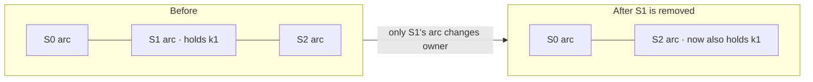
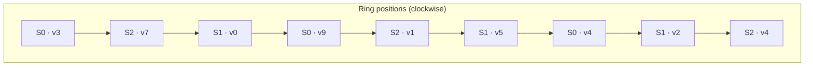

# 05 · Design Consistent Hashing

<div class="chapter-meta" markdown>
<span>⏱ 35 min read</span>
<span class="hot">🔥 Shows up inside caches, KV stores, sharding, load balancers</span>
<span>Book: Chapter 5</span>
</div>

!!! abstract "TL;DR"
    - `server = hash(key) % N` spreads keys evenly — until **N changes**. Then almost **every** key maps to a different server → cache-miss storm / massive data movement.
    - **Consistent hashing** places servers *and* keys on a **ring** (the hash space bent into a circle). A key belongs to the **first server clockwise** from it.
    - Adding or removing a server only moves the keys in **one arc** of the ring — on average **k/n keys** (k keys, n servers), not ~all of them.
    - Plain rings give **uneven arcs**. Fix: **virtual nodes** — each server appears at 100–200 points on the ring, so load evens out (std-dev drops to ~5–10%).
    - Implement with a **sorted map** (`TreeMap.ceilingEntry`) → O(log V) lookup. Used by Dynamo, Cassandra, Riak, Discord, Akamai, Envoy/Maglev-style LBs.

## The intuition: assigning students to exam halls

A college assigns students to exam halls by `roll_number % number_of_halls`. Works fine — until one
hall's AC breaks on exam morning. Now it's `% 3` instead of `% 4`, and **almost every student** is sent
to a different hall, not just the ones from the broken hall. Chaos at every door.

A smarter rule: arrange halls around a circular corridor; each student walks clockwise from their
"seat number" position and enters the **first open hall**. If one hall closes, only *its* students walk a
bit further to the next hall. Everyone else is unaffected. That's consistent hashing.

---

## The rehashing problem

With **N** cache servers, the obvious way to pick a server is:

```text
serverIndex = hash(key) % N
```

Let's use 4 servers and 8 keys. (Pretend `hash()` returns these small numbers so the maths is easy.)

| Key | hash | hash % 4 | Server (N = 4) |
|---|---|---|---|
| user:alpha | 10 | 2 | S2 |
| user:bravo | 21 | 1 | S1 |
| user:charlie | 32 | 0 | S0 |
| user:delta | 43 | 3 | S3 |
| user:echo | 54 | 2 | S2 |
| user:foxtrot | 65 | 1 | S1 |
| user:golf | 76 | 0 | S0 |
| user:hotel | 87 | 3 | S3 |

Each server holds exactly 2 keys — beautiful. Now **S1 crashes**. The pool is `[S0, S2, S3]`, so we use `% 3`:

| Key | hash % 3 | New server | Moved? |
|---|---|---|---|
| user:alpha | 1 | S2 | — stays |
| user:bravo | 0 | S0 | ✔ (had to — S1 died) |
| user:charlie | 2 | S3 | ✔ moved for no reason |
| user:delta | 1 | S2 | ✔ moved for no reason |
| user:echo | 0 | S0 | ✔ moved for no reason |
| user:foxtrot | 2 | S3 | ✔ (had to — S1 died) |
| user:golf | 1 | S2 | ✔ moved for no reason |
| user:hotel | 0 | S0 | ✔ moved for no reason |

**7 of 8 keys moved**, although only 2 lived on the dead server. For a cache, that means a sudden
**storm of cache misses** that hammers the database. For a sharded database, it means **moving most of the data**.
In general, going from N to N±1 servers relocates about **N/(N+1)** of all keys — nearly everything.

---

## Consistent hashing

> Consistent hashing is a hashing scheme where, when the number of slots changes, only about **k/n**
> keys need to move on average (k = keys, n = slots), instead of nearly all of them.

### Step 1 · The hash space becomes a ring

Pick a hash function with a big output range — e.g. SHA-1 outputs 0 … 2¹⁶⁰ − 1 (in practice systems use
fast non-cryptographic hashes like MurmurHash or xxHash with a 32/64-bit range). Bend that range into a circle,
so the largest value is followed by 0. That's the **hash ring**.

### Step 2 · Place servers on the ring

Hash each server's name or IP with the **same** hash function, and put it at that point on the ring.

### Step 3 · Place keys on the ring

Hash each key onto the same ring. Note: there's **no `% N`** any more.

### Step 4 · Lookup — walk clockwise

A key is stored on the **first server you meet walking clockwise** from the key's position.

<figure class="diagram" markdown>
<svg viewBox="0 0 420 420" xmlns="http://www.w3.org/2000/svg" role="img" aria-label="Hash ring with four servers and keys">
  <circle cx="210" cy="210" r="150" fill="none" class="stroke" stroke-width="3"/>
  <!-- servers: at 20°, 110°, 200°, 290° (clockwise from top) -->
  <g>
    <rect x="253" y="58" width="22" height="22" rx="4" class="ink"/><text x="290" y="58" font-size="14" font-weight="700">S0</text>
    <rect x="348" y="246" width="22" height="22" rx="4" class="ink"/><text x="378" y="266" font-size="14" font-weight="700">S1</text>
    <rect x="148" y="342" width="22" height="22" rx="4" class="ink"/><text x="118" y="384" font-size="14" font-weight="700">S2</text>
    <rect x="50" y="146" width="22" height="22" rx="4" class="ink"/><text x="14" y="146" font-size="14" font-weight="700">S3</text>
  </g>
  <!-- keys -->
  <g class="accent">
    <circle cx="210" cy="60" r="7"/><circle cx="349" cy="153" r="7"/><circle cx="263" cy="350" r="7"/><circle cx="70" cy="263" r="7"/>
  </g>
  <text x="196" y="44" font-size="13">k0</text>
  <text x="362" y="150" font-size="13">k1</text>
  <text x="270" y="378" font-size="13">k2</text>
  <text x="40" y="290" font-size="13">k3</text>
  <!-- clockwise arrows key -> server -->
  <path d="M220 58 A150 150 0 0 1 250 64" fill="none" stroke="#e36414" stroke-width="2.5" marker-end="url(#ah)"/>
  <path d="M353 165 A150 150 0 0 1 357 240" fill="none" stroke="#e36414" stroke-width="2.5" marker-end="url(#ah)"/>
  <path d="M253 354 A150 150 0 0 1 176 357" fill="none" stroke="#e36414" stroke-width="2.5" marker-end="url(#ah)"/>
  <path d="M65 252 A150 150 0 0 1 61 175" fill="none" stroke="#e36414" stroke-width="2.5" marker-end="url(#ah)"/>
  <defs><marker id="ah" viewBox="0 0 10 10" refX="8" refY="5" markerWidth="6" markerHeight="6" orient="auto-start-reverse"><path d="M0,0 L10,5 L0,10 z" fill="#e36414"/></marker></defs>
  <text x="210" y="205" font-size="13" text-anchor="middle">walk clockwise</text>
  <text x="210" y="224" font-size="13" text-anchor="middle">→ first server owns the key</text>
</svg>
<figcaption>Each key (orange) is owned by the first server (teal) clockwise from it: k0→S0, k1→S1, k2→S2, k3→S3.</figcaption>
</figure>

### Adding a server

Add **S4** on the ring between k0 and S0. Walking clockwise from k0, the first server is now S4, so **only
k0 moves** (from S0 to S4). k1, k2 and k3 don't move at all.

**Which keys move?** Exactly those in the arc between S4 and the **previous server going anticlockwise**
(S3). Those keys used to belong to S0; now S4 takes them.

### Removing a server

Remove **S1**. Only the keys in the arc between S0 (anticlockwise neighbour) and S1 — here k1 — move,
and they move to the **next server clockwise** (S2). Everyone else stays put.



Try it yourself — add and remove servers, and compare how many keys move versus `hash % N`:

<div class="sd-widget" data-widget="hash-ring"></div>

!!! tip "What to notice in the widget"
    With **1 virtual node** per server, the load bars are wildly uneven and "max/avg" is often 2× or worse.
    Slide virtual nodes up to 50+ and watch the spread collapse towards 1.1×. Then add a server: consistent
    hashing moves roughly `1/(N+1)` of the keys; `hash % N` moves most of them.

---

## Two problems with the basic ring

1. **Uneven partitions.** Servers land at random points, so the arcs between them have random sizes. One server
   may own 40% of the ring while another owns 5%. And when a server is removed, its whole arc goes to **one**
   neighbour, which suddenly carries double load.
2. **Non-uniform key distribution.** Even with equal arcs, real keys can cluster (hot ranges), piling onto one server.

## Virtual nodes (vnodes)

Instead of placing each physical server once, place it **many times** — e.g. `S0#0, S0#1, … S0#199` — each a
**virtual node** that maps back to the physical server S0.



Why it works:

- Each server now owns **many small arcs** scattered around the ring, so its total share averages out. With
  ~100 vnodes per server, the standard deviation of load is roughly **10%** of the mean; with ~200, about **5%**.
- When a server leaves, its many small arcs are absorbed by **many different** neighbours — the load spreads
  instead of dumping on one server.
- **Heterogeneous hardware:** give a big server 300 vnodes and a small one 100 → it gets ~3× the keys.

The cost: more ring entries to store (metadata) and slightly more work when membership changes. With a
sorted structure that's trivial — 100 servers × 200 vnodes = 20,000 entries.

---

## Implementation in Java

```java
import java.nio.charset.StandardCharsets;
import java.security.MessageDigest;
import java.util.*;

public final class ConsistentHashRing<N> {
    private final NavigableMap<Long, N> ring = new TreeMap<>();
    private final int virtualNodes;

    public ConsistentHashRing(int virtualNodes) { this.virtualNodes = virtualNodes; }

    public synchronized void addNode(N node) {
        for (int i = 0; i < virtualNodes; i++) ring.put(hash(node + "#" + i), node);
    }

    public synchronized void removeNode(N node) {
        for (int i = 0; i < virtualNodes; i++) ring.remove(hash(node + "#" + i));
    }

    /** First node clockwise from the key's position (wraps around at the end). */
    public synchronized N nodeFor(String key) {
        if (ring.isEmpty()) throw new IllegalStateException("no nodes");
        Map.Entry<Long, N> e = ring.ceilingEntry(hash(key));
        return (e != null ? e : ring.firstEntry()).getValue();
    }

    /** N distinct physical nodes clockwise — the replica "preference list" (Chapter 6). */
    public synchronized List<N> nodesFor(String key, int replicas) {
        LinkedHashSet<N> out = new LinkedHashSet<>();
        for (N n : ring.tailMap(hash(key), true).values()) { out.add(n); if (out.size() == replicas) return new ArrayList<>(out); }
        for (N n : ring.values())                           { out.add(n); if (out.size() == replicas) break; }
        return new ArrayList<>(out);
    }

    private static long hash(String s) {
        try {
            byte[] d = MessageDigest.getInstance("MD5").digest(s.getBytes(StandardCharsets.UTF_8));
            long h = 0;
            for (int i = 0; i < 8; i++) h = (h << 8) | (d[i] & 0xff);   // first 64 bits
            return h;
        } catch (Exception e) { throw new RuntimeException(e); }
    }
}
```

- Lookup is `ceilingEntry` on a red-black tree → **O(log V)** where V = total virtual nodes.
- MD5 is used here only because it's in the JDK; production systems use **MurmurHash3 / xxHash** (much faster, non-cryptographic).
- Every client (or the router) must see the **same ring**. Membership is usually spread with **gossip** or kept in a coordination service like ZooKeeper/etcd (Chapter 6).

---

## Going deeper: alternatives you can mention

| Technique | Idea | Why/when |
|---|---|---|
| **Rendezvous (HRW) hashing** | For each key, compute `score = hash(key, server)` for every server; pick the highest | No ring or vnodes; perfectly even; O(N) per lookup — fine for tens of servers |
| **Jump consistent hash** (Google) | A tiny arithmetic function maps key → bucket 0..N−1 with minimal movement | O(ln N), no memory — but buckets can only be added/removed **at the end** (great for numbered shards, bad for arbitrary node failures) |
| **Maglev hashing** (Google LB) | Builds a fixed-size lookup table with near-perfect balance | Very fast lookups for load balancers; small disruption on changes |
| **Consistent hashing with bounded loads** | Cap each server at (1+ε) × average; overflow goes to the next server | Prevents hotspots — used in some proxies/caches (e.g. HAProxy option, Vimeo) |

## Where it's used in the real world

- **Partitioning in Dynamo-style databases** — Amazon Dynamo, Apache Cassandra, Riak (Chapter 6 builds on this).
- **Discord** — routing chat traffic for a guild/channel to the right server.
- **Akamai** — the original 1997 paper was about distributing web caches across CDN servers.
- **Load balancers / proxies** — Envoy's ring-hash and Maglev load-balancing policies, NGINX `hash … consistent`.
- **Distributed caches** — Memcached client libraries (ketama), Redis client-side sharding.

---

## Interviewer follow-ups

??? question "Exactly which keys move when a server is added?"
    Only keys whose position lies in the arc between the **new server** and the **previous server anticlockwise**.
    They move from the new server's clockwise successor onto the new server. With vnodes, that's many small arcs — one
    per new vnode — each taking keys from a different successor, so the load is drawn evenly from the existing servers.

??? question "How many virtual nodes should I use?"
    Enough to bring load imbalance within your tolerance — typically **100–256 per server**. More vnodes = better
    balance but more metadata and more ring entries to update on membership changes. Cassandra historically defaulted to
    256 tokens per node, later recommending fewer (e.g. 16) combined with a smarter token-allocation algorithm.

??? question "Consistent hashing gives an even spread of keys — does that guarantee even load?"
    No. It balances **key count**, not **traffic**. A single hot key (a celebrity profile, a viral video) still lands on one
    server. Mitigations: cache hot keys in front, replicate hot keys to several servers and spread reads, split the key
    (`key#1..#n`), or use bounded-load consistent hashing.

??? question "How do clients know the current ring?"
    Either (1) a **router/proxy** tier owns the ring and clients talk to it; or (2) every node holds the ring and
    membership changes propagate via **gossip**; or (3) a coordination service (ZooKeeper/etcd) stores membership and
    clients watch it. Brief disagreement during changes is tolerated — a node receiving a key it doesn't own forwards it.

??? question "Why not just use hash % N and re-shard offline?"
    For a cache, re-sharding means a **miss storm** that can take down the database. For a database, it means moving
    ~100% of the data, during which you need double-reads or downtime. Consistent hashing makes membership changes cheap
    and incremental, which matters when nodes fail routinely at scale.

---

## Practice

??? example "Practice 1 — Movement fraction"
    You have 9 cache servers with consistent hashing (many vnodes) and 90 million keys. You add a 10th server.
    Roughly how many keys move? What if you were using `hash % N`?

    **Solution.** Consistent hashing: the new server takes ~1/10 of the ring → **~9M keys** move.
    `hash % N`: a key stays only if `h % 9 == h % 10`, which happens for ~1/10 of keys → **~81M keys** move (90%).

??? example "Practice 2 — Weighted servers"
    You have three servers with 64 GB, 64 GB and 128 GB RAM. How do you make the 128 GB server hold twice the keys?

    **Solution.** Give it twice as many virtual nodes (e.g. 200, 200, 400). Its share of the ring ≈ 400/800 = 50%,
    the others 25% each.

??? example "Practice 3 — Trace a lookup"
    Ring positions (0–99): S_A at 15, S_B at 40, S_C at 72. Keys hash to 5, 16, 40, 41, 80, 99.
    Who owns each? Then S_B is removed — who owns them now?

    **Solution.** Clockwise to the first server ≥ key (wrapping): 5→S_A, 16→S_B, 40→S_B (equal counts as owner),
    41→S_C, 80→S_A (wraps), 99→S_A. After removing S_B: 16→S_C, 40→S_C; all others unchanged. Only S_B's 2 keys moved.

---

## Revision checklist

- [ ] I can show with numbers why `hash % N` relocates most keys when N changes.
- [ ] I can explain the ring, clockwise lookup, and exactly which keys move on add/remove.
- [ ] I can explain the two problems of the basic ring and how virtual nodes fix them (incl. weighting).
- [ ] I can implement the ring with a `TreeMap` and get N replicas from it.
- [ ] I know that even key spread ≠ even traffic, and how to handle hot keys.
- [ ] I can name real systems using it and at least two alternatives (rendezvous, jump hash).

[Next: 06 · Key-Value Store :material-arrow-right:](06-key-value-store.md){ .md-button .md-button--primary }
