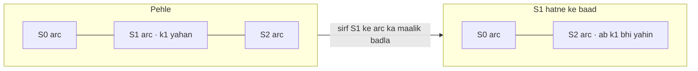
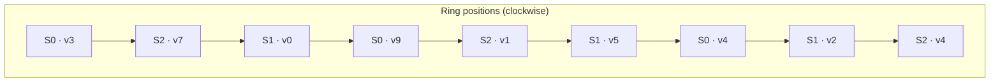

# 05 · Consistent Hashing Design karo

<div class="chapter-meta" markdown>
<span>⏱ 35 min read</span>
<span class="hot">🔥 Caches, KV stores, sharding, load balancers — sabke andar</span>
<span>Book: Chapter 5</span>
</div>

!!! abstract "TL;DR"
    - `server = hash(key) % N` keys ko barabar baant-ta hai — jab tak **N na badle**. Badla toh lagbhag **har** key alag server pe chali jaati hai → cache-miss ka toofan / bahut saara data move.
    - **Consistent hashing** servers *aur* keys dono ko ek **ring** pe rakhta hai (hash space ko gol mod diya). Key ka maalik hai **clockwise chalte hue pehla server**.
    - Server add/remove karne pe sirf ring ke **ek arc** ki keys move hoti hain — average **k/n keys** (k keys, n servers), lagbhag saari nahi.
    - Plain ring mein **arcs uneven** hote hain. Fix: **virtual nodes** — har server ring pe 100–200 jagah aata hai, toh load barabar ho jaata hai (std-dev ~5–10%).
    - **Sorted map** (`TreeMap.ceilingEntry`) se implement karo → O(log V) lookup. Dynamo, Cassandra, Riak, Discord, Akamai, Envoy/Maglev-style LBs use karte hain.

## Intuition: students ko exam halls mein bhejna

College students ko halls mein `roll_number % halls_ki_ginti` se bhejta hai. Mast chalta hai — jab tak exam ki subah ek hall
ka AC kharab na ho jaaye. Ab `% 4` ki jagah `% 3`, aur **lagbhag har student** alag hall mein bheja jaata hai, sirf kharab hall
waale nahi. Har darwaze pe hungama.

Smart rule: halls ko ek gol corridor mein lagao; har student apne "seat number" waali jagah se clockwise chale aur **pehle khule
hall** mein ghus jaaye. Ek hall band hua toh sirf *uske* students thoda aage agle hall tak chalte hain. Baaki sab pe koi asar nahi.
Yahi consistent hashing hai.

---

## Rehashing problem

**N** cache servers hon toh server chunne ka seedha tareeka:

```text
serverIndex = hash(key) % N
```

4 servers aur 8 keys lete hain. (Maan lo `hash()` yeh chhote numbers deta hai taaki hisaab aasaan rahe.)

| Key | hash | hash % 4 | Server (N = 4) |
|---|---|---|---|
| user:alpha | 10 | 2 | S2 |
| user:bravo | 21 | 1 | S1 |
| user:charlie | 32 | 0 | S0 |
| user:delta | 43 | 3 | S3 |
| user:echo | 54 | 2 | S2 |
| user:foxtrot | 65 | 1 | S1 |
| user:golf | 76 | 0 | S0 |
| user:hotel | 87 | 3 | S3 |

Har server pe exactly 2 keys — khoobsurat. Ab **S1 crash** ho gaya. Pool `[S0, S2, S3]` hai, toh `% 3`:

| Key | hash % 3 | Naya server | Move hui? |
|---|---|---|---|
| user:alpha | 1 | S2 | — wahin |
| user:bravo | 0 | S0 | ✔ (zaroori tha — S1 mar gaya) |
| user:charlie | 2 | S3 | ✔ bina wajah move |
| user:delta | 1 | S2 | ✔ bina wajah move |
| user:echo | 0 | S0 | ✔ bina wajah move |
| user:foxtrot | 2 | S3 | ✔ (zaroori tha — S1 mar gaya) |
| user:golf | 1 | S2 | ✔ bina wajah move |
| user:hotel | 0 | S0 | ✔ bina wajah move |

**8 mein se 7 keys move hui**, jabki dead server pe sirf 2 thi. Cache ke liye iska matlab hai achanak **cache misses ka toofan**
jo database ko pit deta hai. Sharded database ke liye matlab **zyada tar data move karna**. General rule: N se N±1 servers pe
jaane se lagbhag **N/(N+1)** keys relocate hoti hain — almost sab kuch.

---

## Consistent hashing

> Consistent hashing aisi hashing scheme hai jisme slots ki ginti badalne pe average sirf **k/n** keys move karni padti hain
> (k = keys, n = slots), lagbhag saari nahi.

### Step 1 · Hash space ring ban jaata hai

Badi output range waala hash function lo — jaise SHA-1 ka output 0 … 2¹⁶⁰ − 1 (practice mein systems MurmurHash ya xxHash
jaise tez non-cryptographic hashes 32/64-bit range ke saath use karte hain). Is range ko gol mod do, taaki sabse bade value
ke baad 0 aaye. Yahi hai **hash ring**.

### Step 2 · Servers ko ring pe rakho

Har server ke naam ya IP ko **same** hash function se hash karo, aur us point pe ring pe rakh do.

### Step 3 · Keys ko ring pe rakho

Har key ko same ring pe hash karo. Dhyaan do: ab **`% N` nahi** hai.

### Step 4 · Lookup — clockwise chalo

Key us server pe store hoti hai jo key ki position se **clockwise chalte hue pehla milta hai**.

<figure class="diagram" markdown>
<svg viewBox="0 0 420 420" xmlns="http://www.w3.org/2000/svg" role="img" aria-label="Chaar servers aur keys waala hash ring">
  <circle cx="210" cy="210" r="150" fill="none" class="stroke" stroke-width="3"/>
  <g>
    <rect x="253" y="58" width="22" height="22" rx="4" class="ink"/><text x="290" y="58" font-size="14" font-weight="700">S0</text>
    <rect x="348" y="246" width="22" height="22" rx="4" class="ink"/><text x="378" y="266" font-size="14" font-weight="700">S1</text>
    <rect x="148" y="342" width="22" height="22" rx="4" class="ink"/><text x="118" y="384" font-size="14" font-weight="700">S2</text>
    <rect x="50" y="146" width="22" height="22" rx="4" class="ink"/><text x="14" y="146" font-size="14" font-weight="700">S3</text>
  </g>
  <g class="accent">
    <circle cx="210" cy="60" r="7"/><circle cx="349" cy="153" r="7"/><circle cx="263" cy="350" r="7"/><circle cx="70" cy="263" r="7"/>
  </g>
  <text x="196" y="44" font-size="13">k0</text>
  <text x="362" y="150" font-size="13">k1</text>
  <text x="270" y="378" font-size="13">k2</text>
  <text x="40" y="290" font-size="13">k3</text>
  <path d="M220 58 A150 150 0 0 1 250 64" fill="none" stroke="#e36414" stroke-width="2.5" marker-end="url(#ah2)"/>
  <path d="M353 165 A150 150 0 0 1 357 240" fill="none" stroke="#e36414" stroke-width="2.5" marker-end="url(#ah2)"/>
  <path d="M253 354 A150 150 0 0 1 176 357" fill="none" stroke="#e36414" stroke-width="2.5" marker-end="url(#ah2)"/>
  <path d="M65 252 A150 150 0 0 1 61 175" fill="none" stroke="#e36414" stroke-width="2.5" marker-end="url(#ah2)"/>
  <defs><marker id="ah2" viewBox="0 0 10 10" refX="8" refY="5" markerWidth="6" markerHeight="6" orient="auto-start-reverse"><path d="M0,0 L10,5 L0,10 z" fill="#e36414"/></marker></defs>
  <text x="210" y="205" font-size="13" text-anchor="middle">clockwise chalo</text>
  <text x="210" y="224" font-size="13" text-anchor="middle">→ pehla server key ka maalik</text>
</svg>
<figcaption>Har key (orange) ka maalik clockwise pehla server (teal) hai: k0→S0, k1→S1, k2→S2, k3→S3.</figcaption>
</figure>

### Server add karna

**S4** ko ring pe k0 aur S0 ke beech add karo. k0 se clockwise chalne pe ab pehla server S4 hai, toh **sirf k0 move hoti hai**
(S0 se S4 pe). k1, k2 aur k3 bilkul nahi hilti.

**Kaunsi keys move hoti hain?** Exactly woh jo S4 aur **anticlockwise pichle server** (S3) ke beech ke arc mein hain. Pehle woh
S0 ki thi; ab S4 le leta hai.

### Server hatana

**S1** hatao. Sirf S0 (anticlockwise padosi) aur S1 ke beech ke arc ki keys — yahan k1 — move hoti hain, aur **agle clockwise
server** (S2) pe jaati hain. Baaki sab wahin rehte hain.



Khud try karo — servers add/remove karo, aur dekho `hash % N` ke muqable kitni keys move hoti hain:

<div class="sd-widget" data-widget="hash-ring"></div>

!!! tip "Widget mein kya notice karna hai"
    Har server ka **1 virtual node** ho toh load bars bahut uneven hain aur "max/avg" aksar 2× ya usse bura. Virtual nodes ko 50+
    tak le jao aur dekho spread 1.1× ki taraf simat jaata hai. Phir server add karo: consistent hashing lagbhag `1/(N+1)` keys move
    karta hai; `hash % N` zyada tar keys hila deta hai.

---

## Basic ring ki do problems

1. **Uneven partitions.** Servers random points pe girte hain, toh unke beech ke arcs random size ke hote hain. Ek server ring ka
   40% own kar sakta hai aur doosra 5%. Aur server hatne pe uska poora arc **ek hi** padosi ko milta hai, jis pe achanak double load aa jaata hai.
2. **Non-uniform key distribution.** Arcs barabar hon tab bhi asli keys cluster ho sakti hain (hot ranges), aur ek server pe dher lag jaata hai.

## Virtual nodes (vnodes)

Har physical server ko ek baar rakhne ki jagah **kai baar** rakho — jaise `S0#0, S0#1, … S0#199` — har ek ek **virtual node**
jo wapas physical server S0 pe map hota hai.



Yeh kaam kyun karta hai:

- Har server ab ring pe bikhre **kai chhote arcs** own karta hai, toh uska total share average ho jaata hai. Har server ke ~100
  vnodes ke saath load ka standard deviation mean ka lagbhag **10%**; ~200 ke saath lagbhag **5%**.
- Server jaane pe uske kai chhote arcs **kai alag** padosi sokh lete hain — load ek server pe girne ki jagah phail jaata hai.
- **Alag-alag hardware:** bade server ko 300 vnodes do aur chhote ko 100 → bade ko ~3× keys milengi.

Keemat: ring ki zyada entries store karni (metadata) aur membership badalne pe thoda zyada kaam. Sorted structure ke saath yeh
kuch bhi nahi — 100 servers × 200 vnodes = 20,000 entries.

---

## Java mein implementation

```java
import java.nio.charset.StandardCharsets;
import java.security.MessageDigest;
import java.util.*;

public final class ConsistentHashRing<N> {
    private final NavigableMap<Long, N> ring = new TreeMap<>();
    private final int virtualNodes;

    public ConsistentHashRing(int virtualNodes) { this.virtualNodes = virtualNodes; }

    public synchronized void addNode(N node) {
        for (int i = 0; i < virtualNodes; i++) ring.put(hash(node + "#" + i), node);
    }

    public synchronized void removeNode(N node) {
        for (int i = 0; i < virtualNodes; i++) ring.remove(hash(node + "#" + i));
    }

    /** Key ki position se clockwise pehla node (end pe wrap around). */
    public synchronized N nodeFor(String key) {
        if (ring.isEmpty()) throw new IllegalStateException("no nodes");
        Map.Entry<Long, N> e = ring.ceilingEntry(hash(key));
        return (e != null ? e : ring.firstEntry()).getValue();
    }

    /** Clockwise N alag physical nodes — replica "preference list" (Chapter 6). */
    public synchronized List<N> nodesFor(String key, int replicas) {
        LinkedHashSet<N> out = new LinkedHashSet<>();
        for (N n : ring.tailMap(hash(key), true).values()) { out.add(n); if (out.size() == replicas) return new ArrayList<>(out); }
        for (N n : ring.values())                           { out.add(n); if (out.size() == replicas) break; }
        return new ArrayList<>(out);
    }

    private static long hash(String s) {
        try {
            byte[] d = MessageDigest.getInstance("MD5").digest(s.getBytes(StandardCharsets.UTF_8));
            long h = 0;
            for (int i = 0; i < 8; i++) h = (h << 8) | (d[i] & 0xff);   // pehle 64 bits
            return h;
        } catch (Exception e) { throw new RuntimeException(e); }
    }
}
```

- Lookup red-black tree pe `ceilingEntry` hai → **O(log V)**, jahan V = total virtual nodes.
- MD5 yahan sirf isliye kyunki JDK mein hai; production systems **MurmurHash3 / xxHash** use karte hain (bahut tez, non-cryptographic).
- Har client (ya router) ko **same ring** dikhni chahiye. Membership aam taur pe **gossip** se phailti hai ya ZooKeeper/etcd jaisi coordination service mein rehti hai (Chapter 6).

---

## Thoda gehraai mein: alternatives jo bata sakte ho

| Technique | Idea | Kyun/kab |
|---|---|---|
| **Rendezvous (HRW) hashing** | Har key ke liye har server ka `score = hash(key, server)` nikalo; sabse bada wala chuno | Na ring, na vnodes; perfectly even; har lookup O(N) — das-bees servers ke liye theek |
| **Jump consistent hash** (Google) | Ek chhota arithmetic function key → bucket 0..N−1 map karta hai, minimal movement ke saath | O(ln N), memory nahi — par buckets sirf **end pe** add/remove ho sakte hain (numbered shards ke liye mast, random node failures ke liye bura) |
| **Maglev hashing** (Google LB) | Fixed-size lookup table banata hai, lagbhag perfect balance | Load balancers ke liye bahut tez lookups; changes pe chhota disruption |
| **Bounded loads ke saath consistent hashing** | Har server ko average ke (1+ε) × pe cap karo; overflow agle server pe | Hotspots rokta hai — kuch proxies/caches use karte hain (jaise HAProxy option, Vimeo) |

## Asli duniya mein kahan use hota hai

- **Dynamo-style databases mein partitioning** — Amazon Dynamo, Apache Cassandra, Riak (Chapter 6 isi pe banta hai).
- **Discord** — kisi guild/channel ka chat traffic sahi server pe route karna.
- **Akamai** — 1997 ka original paper CDN servers pe web caches baantne ke baare mein tha.
- **Load balancers / proxies** — Envoy ki ring-hash aur Maglev load-balancing policies, NGINX `hash … consistent`.
- **Distributed caches** — Memcached client libraries (ketama), Redis client-side sharding.

---

## Interviewer follow-ups

??? question "Server add karne pe exactly kaunsi keys move hoti hain?"
    Sirf woh keys jinki position **naye server** aur **anticlockwise pichle server** ke beech ke arc mein hai. Woh naye server ke
    clockwise successor se naye server pe aati hain. Vnodes ke saath yeh kai chhote arcs hain — har naye vnode ka ek — aur har ek alag
    successor se keys leta hai, toh load existing servers se barabar khinchta hai.

??? question "Kitne virtual nodes use karein?"
    Itne ki load imbalance tumhari tolerance ke andar aa jaaye — aam taur pe **har server ke 100–256**. Zyada vnodes = better balance
    par zyada metadata aur membership change pe zyada ring entries update. Cassandra ka purana default har node pe 256 tokens tha,
    baad mein smarter token-allocation algorithm ke saath kam (jaise 16) recommend kiye.

??? question "Consistent hashing keys barabar baant-ta hai — kya isse load barabar ki guarantee hai?"
    Nahi. Yeh **key count** balance karta hai, **traffic** nahi. Ek hot key (celebrity profile, viral video) phir bhi ek server pe hi
    girti hai. Mitigations: hot keys ko aage cache karo, hot keys ko kai servers pe replicate karke reads baanto, key ko tod do
    (`key#1..#n`), ya bounded-load consistent hashing use karo.

??? question "Clients ko current ring kaise pata chalti hai?"
    Ya toh (1) ek **router/proxy** tier ring own karta hai aur clients usse baat karte hain; ya (2) har node ke paas ring hai aur
    membership changes **gossip** se phailte hain; ya (3) coordination service (ZooKeeper/etcd) membership store karti hai aur clients
    use watch karte hain. Changes ke dauraan thodi der ki asehmati tolerate hoti hai — jis node pe galat key aaye woh forward kar deta hai.

??? question "hash % N use karke offline re-shard kyun nahi kar lete?"
    Cache ke liye re-sharding matlab **miss storm** jo database gira sakta hai. Database ke liye matlab ~100% data move karna, jiske
    dauraan double-reads ya downtime chahiye. Consistent hashing membership changes ko sasta aur incremental banata hai, jo scale pe
    zaroori hai jahan nodes roz fail hote hain.

---

## Practice

??? example "Practice 1 — Kitna hissa move hoga"
    Consistent hashing (bahut vnodes) ke saath 9 cache servers aur 9 crore keys hain. 10th server add karte ho. Roughly kitni keys
    move hongi? Agar `hash % N` use karte toh?

    **Solution.** Consistent hashing: naya server ring ka ~1/10 leta hai → **~90 lakh keys** move.
    `hash % N`: key tabhi wahin rehti hai jab `h % 9 == h % 10`, jo ~1/10 keys ke liye hota hai → **~8.1 crore keys** move (90%).

??? example "Practice 2 — Weighted servers"
    Teen servers hain jinki RAM 64 GB, 64 GB aur 128 GB hai. 128 GB waale ko double keys kaise do?

    **Solution.** Use double virtual nodes do (jaise 200, 200, 400). Uska ring share ≈ 400/800 = 50%, baaki dono 25% each.

??? example "Practice 3 — Lookup trace karo"
    Ring positions (0–99): S_A 15 pe, S_B 40 pe, S_C 72 pe. Keys ke hash 5, 16, 40, 41, 80, 99 hain. Har ek ka maalik kaun?
    Phir S_B hata diya — ab kaun?

    **Solution.** Clockwise pehla server ≥ key (wrap ke saath): 5→S_A, 16→S_B, 40→S_B (barabar ho toh wahi maalik), 41→S_C,
    80→S_A (wrap), 99→S_A. S_B hatne ke baad: 16→S_C, 40→S_C; baaki sab same. Sirf S_B ki 2 keys move hui.

---

## Revision checklist

- [ ] Numbers se dikha sakta hoon ki N badalne pe `hash % N` zyada tar keys kyun relocate karta hai.
- [ ] Ring, clockwise lookup, aur add/remove pe exactly kaunsi keys move hoti hain — samjha sakta hoon.
- [ ] Basic ring ki do problems aur virtual nodes unhe kaise fix karte hain (weighting ke saath) — samjha sakta hoon.
- [ ] `TreeMap` se ring implement kar sakta hoon aur usse N replicas nikaal sakta hoon.
- [ ] Pata hai ki keys ka barabar spread ≠ barabar traffic, aur hot keys kaise handle karein.
- [ ] Ise use karne waale real systems aur kam se kam do alternatives (rendezvous, jump hash) bata sakta hoon.

[Aage: 06 · Key-Value Store :material-arrow-right:](06-key-value-store.md){ .md-button .md-button--primary }
