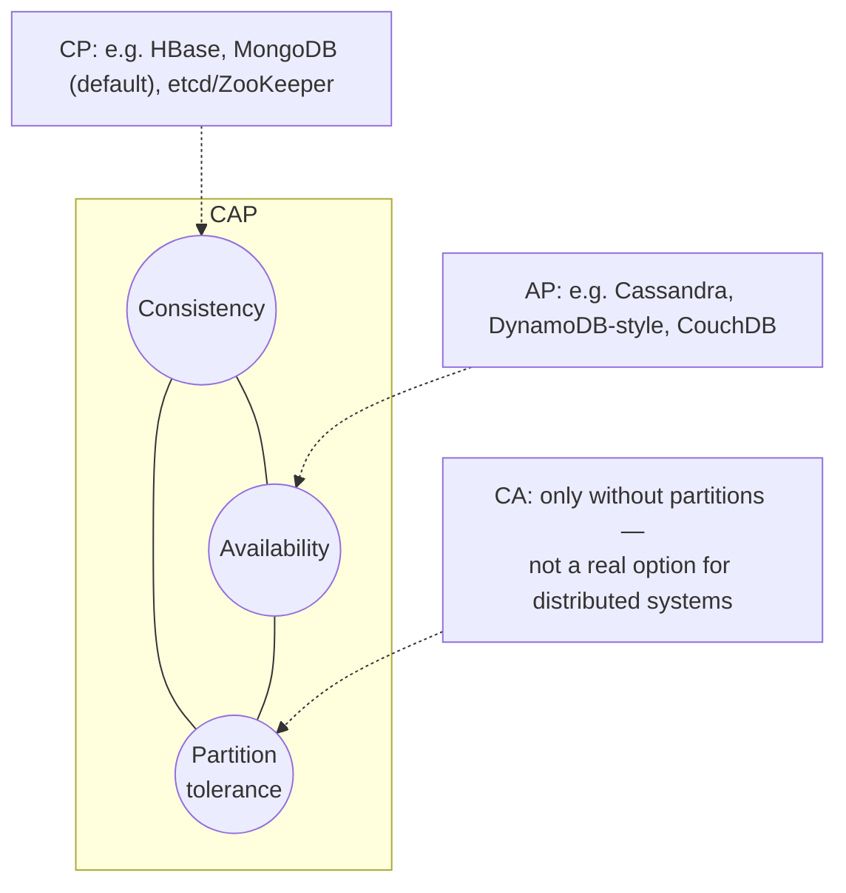
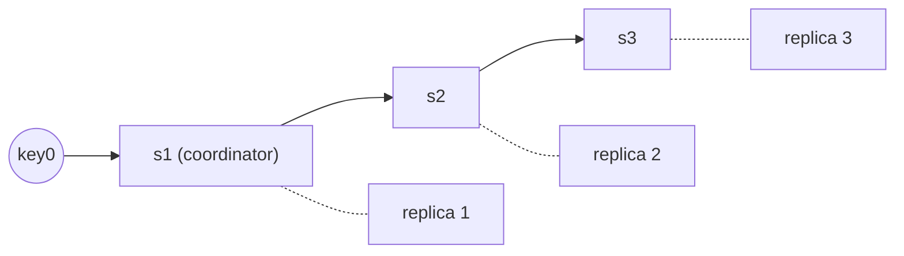
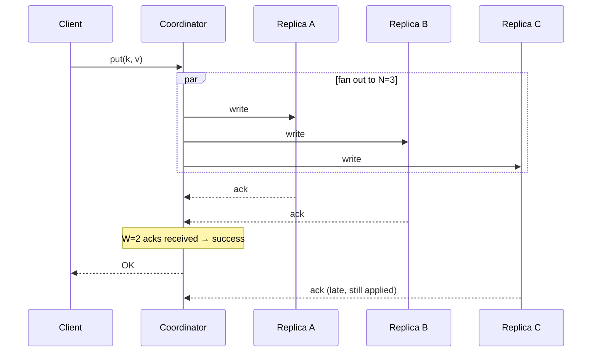
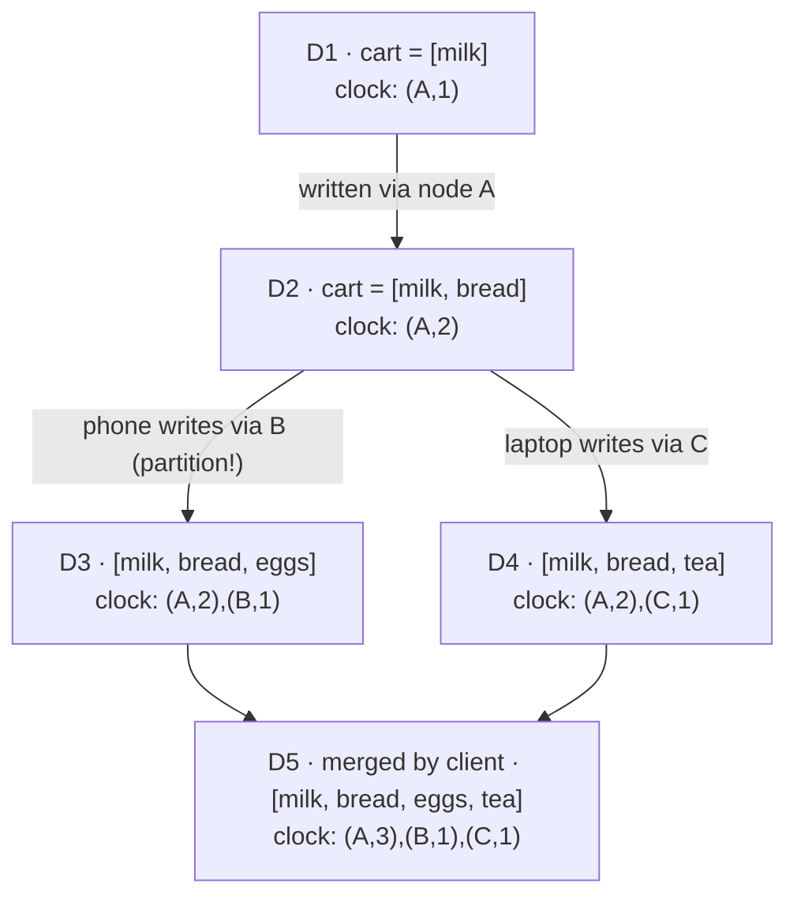
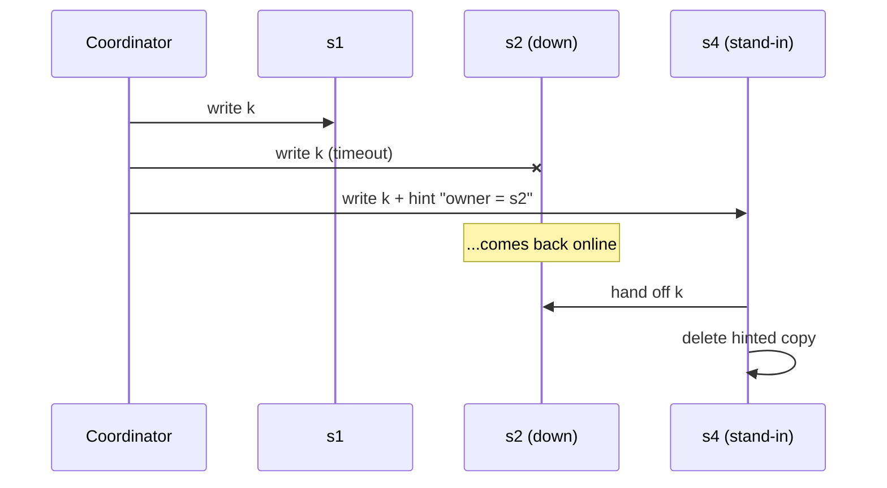
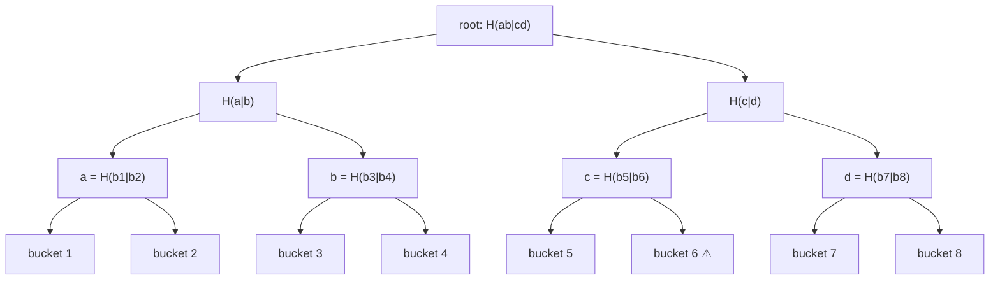
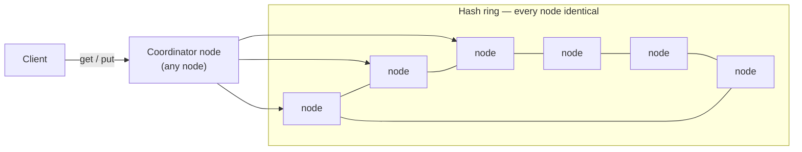
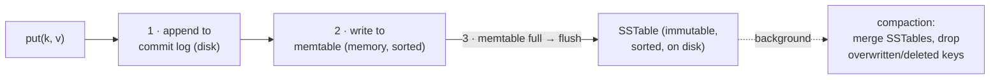
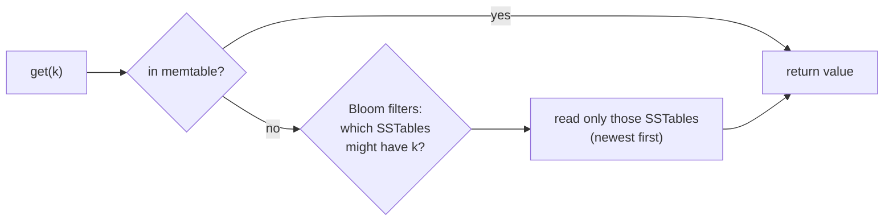

# 06 · Design a Key-Value Store

<div class="chapter-meta" markdown>
<span>⏱ 60 min read</span>
<span class="hot">🔥 The densest chapter — distributed-systems core</span>
<span>Book: Chapter 6</span>
</div>

!!! abstract "TL;DR"
    - A key-value store is a giant `Map<key, value>` with `put(key, value)` and `get(key)`. One machine is easy; the challenge is spreading it over **hundreds of machines that fail**.
    - **CAP:** during a network partition you must choose **consistency** (CP — refuse some requests) or **availability** (AP — answer, maybe stale). Dynamo/Cassandra choose **AP + eventual consistency**.
    - **Partition** with consistent hashing (+ vnodes), **replicate** each key to the next **N** distinct servers on the ring, and tune consistency with **quorums**: `W + R > N` ⇒ reads see the latest write.
    - Detect conflicts with **vector clocks**; detect failures with **gossip**; survive temporary failures with **sloppy quorum + hinted handoff**; repair permanent divergence with **Merkle trees**.
    - Storage engine: **commit log → memtable → SSTables** (LSM tree). Reads check memtable, then a **Bloom filter** per SSTable to skip files that can't contain the key.

## The intuition: a library with many branches

Imagine a city library system storing millions of books across 50 branches.

- **Which branch holds which book?** A rule based on the book's ID → *partitioning*.
- **What if a branch floods?** Keep copies of each book in 3 nearby branches → *replication*.
- **Two branches update the same book's catalog card differently while their phone line is down?** You need a way to notice the conflict and merge → *versioning / vector clocks*.
- **How do branches know another branch is closed?** They chat with a few neighbours every few minutes and pass the news along → *gossip*.
- **A branch is closed for a day — where do new returns go?** A neighbour holds them temporarily and hands them back later → *hinted handoff*.
- **After a long outage, how do two branches find which cards differ without comparing all million?** Compare summaries of shelves, then only the shelves that differ → *Merkle trees*.

---

## Step 1 · Scope

A KV store (also called a key-value database) stores **unique keys** mapped to **values**. Keys can be
plain text (`"user:42:profile"`) or hashed; values are opaque blobs — strings, lists, JSON — the store doesn't
care. Well-known examples: **Amazon DynamoDB**, **Redis**, **Memcached**, **Apache Cassandra**, **etcd**, **RocksDB** (embedded).

**API:**

```java
void put(String key, byte[] value);
byte[] get(String key);
```

**Requirements we'll design for** (every design is a set of trade-offs — these are ours):

| Requirement | Target (our assumptions) |
|---|---|
| Value size | Typically ≤ 1 KB, hard cap 64 KB (big blobs belong in object storage) |
| Total data | Hundreds of TB, growing — far beyond one machine |
| Availability | Reads and writes keep working while individual nodes or a rack are down |
| Durability | An acknowledged write is never lost |
| Elasticity | Add or remove nodes without downtime; data rebalances itself |
| Consistency | **Per-request tunable** — eventual by default, stronger when the caller asks |
| Latency | p99 under ~10 ms inside a region |

---

## Single-server key-value store

Easy: an in-memory hash table. Two tricks extend it:

- **Compress** values.
- Keep only **hot data in memory**, the rest on **disk**.

But a single server runs out of memory and disk eventually, and it's a single point of failure. We need a
**distributed** key-value store (a *distributed hash table*).

---

## CAP theorem

A distributed system can't simultaneously guarantee all three of:

- **Consistency (C)** — every client sees the **same data at the same time**, no matter which node it talks to.
- **Availability (A)** — every request gets a (non-error) response, even if some nodes are down.
- **Partition tolerance (P)** — the system keeps working despite **network partitions** (lost/delayed messages between nodes).



**The key insight:** in a distributed system, **network partitions will happen** (switches fail, cables get cut,
GC pauses look like partitions). So "P" isn't optional. The real choice is **what to do *during* a partition**:

### A worked scenario

Three replicas **n1, n2, n3** hold the key `stock:item-77 = 10`. The network splits: **n3** can no longer talk to n1/n2.

- A client writes `stock:item-77 = 9` to **n1**. n1 replicates to n2 — but can't reach n3.
- Another client reads from **n3**.

| Choice | What happens | Good for |
|---|---|---|
| **CP** | n3 (and possibly the minority side) **refuses** reads/writes it can't confirm are up to date → returns an error/timeout until the partition heals | Bank balances, inventory with strict no-oversell, leader election |
| **AP** | n3 **answers with 10** (stale). Writes are accepted on both sides; conflicts are **reconciled after** the partition heals | Shopping carts, social feeds, likes, session data |

!!! tip "PACELC — the more complete version"
    CAP only talks about partitions. **PACELC** adds: **E**lse (no partition), you still trade **L**atency vs
    **C**onsistency — e.g. waiting for all replicas is consistent but slow. Dynamo/Cassandra: PA/EL. Spanner: PC/EC.

Our store: **AP with tunable consistency.**

---

## System components

We'll build up the design from these pieces, most of them borrowed from Amazon's **Dynamo** paper and
Cassandra/BigTable:

1. Data partitioning
2. Data replication
3. Consistency (quorums)
4. Inconsistency resolution (versioning, vector clocks)
5. Handling failures (gossip, sloppy quorum, hinted handoff, Merkle trees, DC outages)
6. System architecture
7. Write path
8. Read path

### 1 · Data partitioning

Big data can't fit on one server, so we split it. Two goals: **spread data evenly** and **minimise movement
when nodes join/leave**. That's exactly **consistent hashing** (Chapter 5):

- Servers (as virtual nodes) sit on a hash ring; a key belongs to the first server clockwise.
- **Automatic scaling:** adding/removing servers moves only neighbouring arcs.
- **Heterogeneity:** bigger servers get more virtual nodes.

### 2 · Data replication

For durability and availability, each key is stored on **N** servers (N is configurable, commonly 3). Walk
**clockwise** from the key's position and pick the first **N distinct physical servers** — this is the key's
**preference list**.



- With virtual nodes, the next N positions might belong to the same physical server → **skip duplicates** so you get N *distinct* machines.
- Servers in one data center can fail together (power, network) → spread replicas across **racks / availability zones / data centers**.

### 3 · Consistency with quorums

Replicas must be kept in sync. Define:

- **N** = number of replicas
- **W** = write quorum: a write succeeds after **W replicas acknowledge** it
- **R** = read quorum: a read succeeds after **R replicas respond**

A **coordinator** (any node that receives the request — a proxy between client and replicas) forwards the
request to all N replicas and waits for W (or R) responses.



**Why `W + R > N` gives strong consistency:** the set of W nodes that took the write and the set of R nodes
you read from must **overlap in at least one node** — so at least one reply carries the latest version.

| Config (N = 3) | Behaviour | Use when |
|---|---|---|
| **W=1, R=3** | Writes fast, reads must hit everyone | Write-heavy, reads rare |
| **W=3, R=1** | Reads fast, writes wait for all | Read-heavy, writes rare |
| **W=2, R=2** | W+R=4 > 3 → **strong consistency** (overlap guaranteed), balanced latency | The classic default |
| **W=1, R=1** | W+R=2 ≤ 3 → fastest, **eventual consistency** only | Caches, metrics, likes |

Latency is determined by the **slowest of the W (or R) replicas you wait for**, so smaller quorums are faster.

### Consistency models

| Model | Promise |
|---|---|
| **Strong** | A read always returns the most recently written value. Never stale. |
| **Weak** | A read may not see the latest write — no guarantees on when. |
| **Eventual** | A special case of weak: if writes stop, **all replicas converge** to the same value eventually. |

Strong consistency usually requires a replica to **refuse new reads/writes until all replicas agree** on the
current write — bad for availability. Dynamo and Cassandra choose **eventual consistency**: concurrent writes
can land on different replicas, so the system must **detect and reconcile conflicts**. That's what versioning does.

### 4 · Inconsistency resolution: versioning and vector clocks

**Versioning** treats every modification as a **new immutable version** of the value. The problem is telling
apart "B replaced A" (just keep B) from "A and B were written concurrently" (a **conflict** to merge).

A **vector clock** is a list of `[server, counter]` pairs attached to each version: `D([S1, v1], [S2, v2], …)`.
When server Si writes a version:

- If `[Si, vi]` exists in the clock, increment vi.
- Otherwise, add `[Si, 1]`.

**Comparing two versions X and Y:**

- X is an **ancestor** of Y (no conflict — Y wins) if **every counter in X ≤ the matching counter in Y**.
- X and Y are **siblings** (conflict) if each has some counter **greater** than the other's.

**Worked example — a shopping cart under a partition:**



1. Node A writes `[milk]` → D1 `(A,1)`; then `[milk, bread]` → D2 `(A,2)`. D1 is an ancestor of D2 — D1 can be discarded.
2. A partition happens. The user's **phone** adds eggs via node **B** → D3 `(A,2),(B,1)`. The **laptop** adds tea via node **C** → D4 `(A,2),(C,1)`.
3. A later read gets **both** D3 and D4. Compare: D3 has `B:1 > 0`, D4 has `C:1 > 0` → neither is an ancestor → **conflict**.
4. The **client** reconciles (for a cart: union of items) and writes back via A → D5 `(A,3),(B,1),(C,1)`, which descends from both.

```java
enum Order { BEFORE, AFTER, EQUAL, CONCURRENT }

static Order compare(Map<String,Integer> x, Map<String,Integer> y) {
    boolean xBigger = false, yBigger = false;
    Set<String> nodes = new HashSet<>(x.keySet()); nodes.addAll(y.keySet());
    for (String n : nodes) {
        int a = x.getOrDefault(n, 0), b = y.getOrDefault(n, 0);
        if (a > b) xBigger = true;
        if (b > a) yBigger = true;
    }
    if (xBigger && yBigger) return Order.CONCURRENT;   // siblings → conflict
    if (xBigger) return Order.AFTER;                   // x descends from y
    if (yBigger) return Order.BEFORE;                  // y descends from x
    return Order.EQUAL;
}
```

**Downsides of vector clocks:**

- **Complexity pushed to clients** — they must implement merge logic per data type.
- **Clocks grow** with every server that coordinated a write. Fix: cap the length (e.g. 10 entries) and drop the oldest; this can occasionally fail to detect ancestry (rare, accepted in Dynamo's experience).

!!! tip "Alternatives you can mention"
    **Last-write-wins (LWW)** with timestamps (Cassandra's default): simple, but silently **loses** one of two concurrent
    writes and depends on clock sync. **CRDTs** (conflict-free replicated data types — counters, sets, maps that merge
    automatically) avoid client-side merge code; used by Riak, Redis Enterprise, collaborative editors.

### 5 · Handling failures

At scale, failures aren't exceptional — they're constant. We need to **detect** them and **resolve** them.

#### Failure detection: gossip

You can't declare a server dead because *one* other server says so. Asking every node to ping every other node
(**all-to-all multicasting**) is correct but O(n²) messages — too much with hundreds of nodes.

**Gossip protocol** (decentralised failure detection):

1. Each node keeps a **membership list**: member ID → heartbeat counter + local time it last increased.
2. Each node **increments its own heartbeat** periodically.
3. Periodically, each node sends its list to a few **random** nodes, who merge it (keeping the higher counters) and pass it on.
4. If a member's heartbeat hasn't increased for a **threshold** period, it's considered **offline**.

| Node s0's view | Heartbeat | Last increased (s0's clock) |
|---|---|---|
| s0 | 1820 | 10:41:07 |
| s1 | 1793 | 10:41:05 |
| **s2** | **1650** | **10:39:22** ← stale for 100 s → suspect s2 is down |
| s3 | 1802 | 10:41:06 |

s0 then gossips "s2 looks down" to others; once several independently agree, s2 is marked down.

#### Temporary failures: sloppy quorum + hinted handoff

A strict quorum blocks reads/writes when too few of the key's *designated* N replicas are up — bad for availability.

**Sloppy quorum:** instead of insisting on the designated replicas, pick the **first W (or R) healthy servers**
on the ring, skipping the dead ones.

**Hinted handoff:** if server s2 is down, its writes go to the next healthy server, say s4, **with a hint**
("this belongs to s2"). When s2 comes back (gossip tells us), s4 **hands the data back** and deletes its copy.



#### Permanent failures: anti-entropy with Merkle trees

If a replica is gone for a long time (or hinted data was lost), replicas **diverge**. We need to sync them, but
comparing every key across terabytes is too expensive. A **Merkle tree** (hash tree) lets two replicas find the
differences while transferring very little.

**Building it** (say keys hash into a range split into 8 buckets):

1. Split the key space into **buckets**.
2. Hash each key's value; then compute **one hash per bucket** from its keys' hashes.
3. Build a binary tree upward: each parent = hash(left child + right child). The root summarises everything.



**Comparing two replicas:** compare roots. Equal → in sync, done. Different → compare the two children, recurse
only into the subtree whose hashes differ. Here only the path root → CD → c → bucket 6 differs, so only
**bucket 6's keys** are exchanged.

Work is proportional to the **differences**, not the data size. Example: 1 billion keys in 1 million buckets
→ ~1,000 keys per bucket; if one key differs, you walk ~20 levels and ship ~1,000 keys instead of 1 billion.

#### Data center outage

Power cuts, network failures and natural disasters take out whole DCs. Replicate across **multiple data centers**
so users can still read/write from another one.

### 6 · System architecture



There is **no master**. Any node can receive a client's `get`/`put`; for that request it acts as the
**coordinator**, works out the key's preference list from the ring, and talks to those replicas. Because every
node runs identical software — request handling, gossip membership, replication, hinted-handoff storage,
anti-entropy and the local LSM storage engine — you scale by adding identical boxes, and losing any one box
loses nothing unique. (Some clients skip the extra hop by being "ring-aware" and sending the request straight
to a replica.)

### 7 · Write path (LSM-tree, as in Cassandra)



1. The write is appended to a **commit log** (sequential disk write — fast, and lets us recover the memtable after a crash).
2. It's inserted into the **memtable**, an in-memory sorted structure.
3. When the memtable reaches a threshold, it's **flushed** to disk as an **SSTable** (Sorted String Table): an immutable, sorted file of key-value pairs.
4. **Compaction** merges SSTables in the background, discarding overwritten values and **tombstones** (deletion markers).

Why this design? Writes are **sequential** (no random disk seeks — recall Chapter 2's latency table), so write
throughput is huge.

### 8 · Read path



1. Check the **memtable** — if found, return it.
2. Otherwise, consult each SSTable's **Bloom filter** to find which SSTables *might* contain the key.
3. Read those SSTables (newest first) and return the value.

**Bloom filter** in one paragraph: a bit array plus k hash functions. To add a key, set the k bits it hashes to.
To query, check those k bits: if **any is 0**, the key is **definitely not** there; if all are 1, it's
**probably** there. No false negatives, tunable false positives (~1% with ~10 bits per key). It lets the read
path skip almost every SSTable that can't contain the key.

```java
final class BloomFilter {
    private final BitSet bits; private final int m, k;
    BloomFilter(int m, int k) { this.bits = new BitSet(m); this.m = m; this.k = k; }
    private int idx(String key, int i) {                 // double hashing: h1 + i*h2
        int h1 = key.hashCode(), h2 = (h1 >>> 16) | 1;
        return Math.floorMod(h1 + i * h2, m);
    }
    void add(String key)              { for (int i = 0; i < k; i++) bits.set(idx(key, i)); }
    boolean mightContain(String key)  { for (int i = 0; i < k; i++) if (!bits.get(idx(key, i))) return false; return true; }
}
```

---

## Putting it together: the request's journey

The fastest way to revise this chapter is to follow one write and one read through every mechanism:

| Moment | What happens | Mechanism | What it costs |
|---|---|---|---|
| Client calls `put(k, v)` | Any node becomes coordinator; it hashes `k` onto the ring | Consistent hashing + vnodes | Ring metadata on every node |
| Coordinator picks replicas | First N distinct physical nodes clockwise, across racks/DCs | Preference list | Cross-DC bandwidth |
| One replica is down | Next healthy node stores the write with a hint | Sloppy quorum + hinted handoff | Quorum overlap no longer guaranteed |
| W acks arrive | Client gets OK; stragglers still apply it | Quorum (N, W, R) | Latency = slowest of the W |
| On each replica | Append to commit log, insert into memtable, later flush to SSTable | LSM storage engine | Compaction I/O in the background |
| Later, `get(k)` | Coordinator asks replicas, waits for R; sees two versions | Vector clocks | Clients must merge siblings |
| Versions differed | Coordinator writes the newest back to stale replicas | Read repair | Extra writes on reads |
| On a replica, looking up `k` | Memtable first, then only SSTables whose Bloom filter says "maybe" | Bloom filters | ~10 bits of RAM per key |
| All the while | Nodes exchange heartbeats with random peers | Gossip | Detection takes seconds, not milliseconds |
| Periodically | Replicas compare hash trees and sync only differing ranges | Merkle-tree anti-entropy | Tree rebuilds when ranges change |

---

## Interviewer follow-ups

??? question "With N=3, W=2, R=2, can a read still return stale data?"
    In the steady state, no — the read set and write set overlap. But edge cases exist: with a **sloppy quorum**, the W
    acks may come from stand-in nodes outside the designated replicas, so the overlap guarantee breaks; concurrent writes
    can produce siblings; and a write that failed (fewer than W acks) may still have landed on some replicas. That's why
    Dynamo-style systems call this "tunable" consistency, not linearizability.

??? question "What's read repair?"
    When a coordinator does a quorum read and sees replicas returning **different versions**, it returns the newest (or
    siblings) to the client and **writes the latest version back** to the stale replicas. It fixes divergence on hot keys
    cheaply; Merkle-tree anti-entropy handles cold keys that are rarely read.

??? question "Why not just use timestamps (last-write-wins) instead of vector clocks?"
    LWW is simpler and widely used (Cassandra). But clocks on different machines drift, and LWW **silently drops** one of
    two concurrent writes — fine for "last known location", wrong for a shopping cart where both additions matter.
    Vector clocks *detect* concurrency so you can merge; CRDTs merge automatically for suitable data types.

??? question "How would you delete a key in this system?"
    You can't just remove it — a replica that missed the delete would "resurrect" the key during anti-entropy. Instead
    write a **tombstone** (a deletion marker with a version). Tombstones propagate like normal writes and are purged during
    compaction only after a grace period long enough for all replicas to have seen them (Cassandra: `gc_grace_seconds`).

??? question "When would you choose a CP store instead?"
    When correctness under partition beats availability: leader election and locks (etcd/ZooKeeper), financial ledgers,
    inventory where overselling is unacceptable, unique-username registration. These use consensus (Raft/Paxos) and
    reject requests on the minority side of a partition.

??? question "How does a node joining the cluster get its data?"
    It's assigned vnodes (tokens) on the ring; for each new arc, it **streams** the relevant key ranges from the current
    owners (the next replicas clockwise). Until streaming finishes, reads can still be served by the old owners; gossip
    spreads the new membership so coordinators start routing to it.

---

## Practice

??? example "Practice 1 — Pick N, W, R"
    (a) A session store: 10:1 reads to writes, stale-by-a-second is fine, must stay up. (b) A configuration store where a
    read must reflect the last write. N=3 in both. Choose W and R.

    **Solution.** (a) **W=1, R=1** (or W=2,R=1) — fast and highly available; eventual consistency is acceptable.
    (b) **W=2, R=2** (W+R > N), or W=3, R=1 if writes are rare and reads must be fastest. If a partition must never yield
    stale reads, use a CP system (etcd) instead.

??? example "Practice 2 — Compare vector clocks"
    For each pair, say ancestor/descendant or conflict:
    (i) `(A,2),(B,1)` vs `(A,3),(B,1)` · (ii) `(A,1),(C,2)` vs `(A,2),(B,1)` · (iii) `(A,1)` vs `(A,1),(B,4)`

    **Solution.** (i) first is an **ancestor** of the second (2≤3, 1≤1). (ii) **conflict** — first has C:2 > 0, second has
    A:2 > 1 and B:1 > 0. (iii) first is an **ancestor** (missing B counts as 0 ≤ 4).

??? example "Practice 3 — Bloom filter sizing"
    A node has 200 million keys across its SSTables. You want ~1% false positives. Roughly how much memory do the Bloom
    filters need?

    **Solution.** ~9.6 bits/key for 1% (optimal k ≈ 7) → 200M × 9.6 bits ≈ 1.92 × 10⁹ bits ≈ **240 MB**. Cheap compared to
    avoiding disk reads for absent keys.

??? example "Practice 4 — Merkle tree savings"
    Two replicas each hold 500M keys in 2²⁰ (~1M) buckets. 300 keys differ, all in different buckets. How many buckets'
    worth of keys are transferred?

    **Solution.** Only the 300 differing buckets (~500 keys each) → ~150K keys transferred, instead of 500M — about
    0.03% of the data. The tree walk compares ~300 × 20 node hashes.

---

## Revision checklist

- [ ] I can state CAP correctly ("during a partition, choose C or A") and give CP/AP examples, plus PACELC.
- [ ] I can explain partitioning + replication with a preference list of N distinct servers.
- [ ] I can explain N/W/R, why `W + R > N` gives overlap, and pick values for a use case.
- [ ] I can define strong / weak / eventual consistency.
- [ ] I can run a vector-clock example and decide ancestor vs conflict; I know LWW and CRDTs as alternatives.
- [ ] I can explain gossip, sloppy quorum, hinted handoff, Merkle trees and tombstones.
- [ ] I can draw the LSM write path and read path and explain how a Bloom filter works.

[Next: 07 · Unique ID Generator :material-arrow-right:](07-unique-id-generator.md){ .md-button .md-button--primary }
