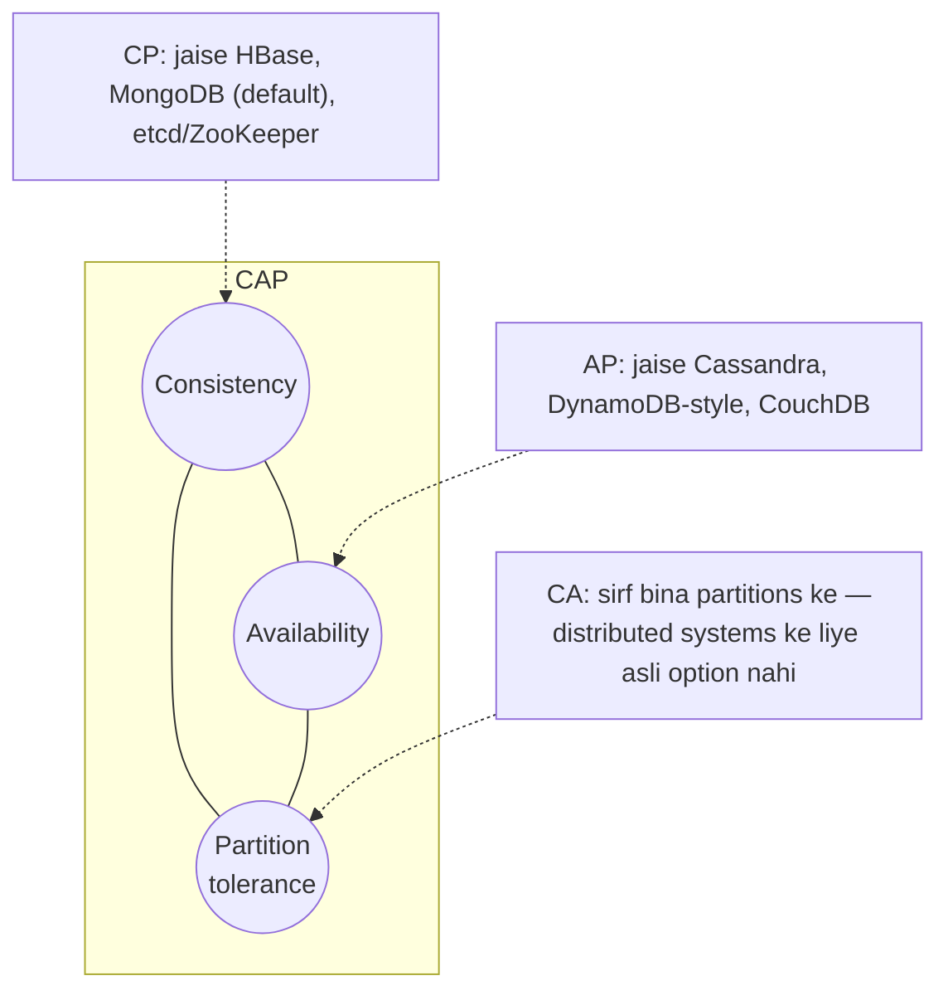
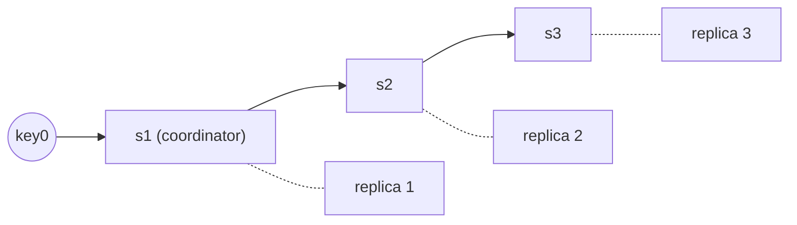
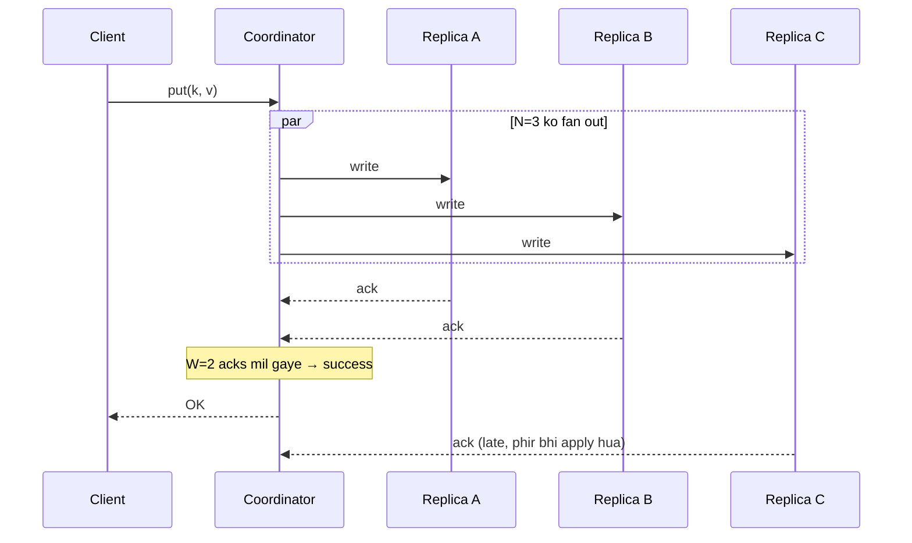
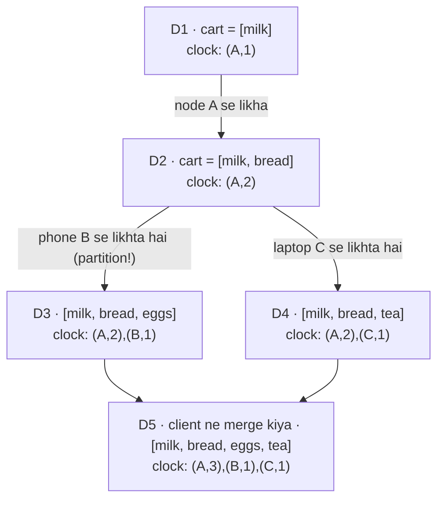
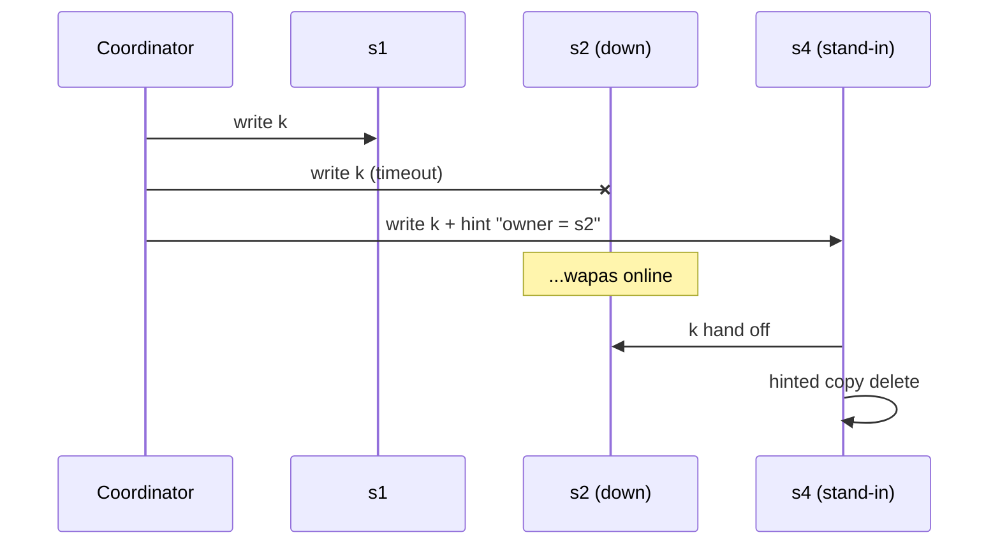
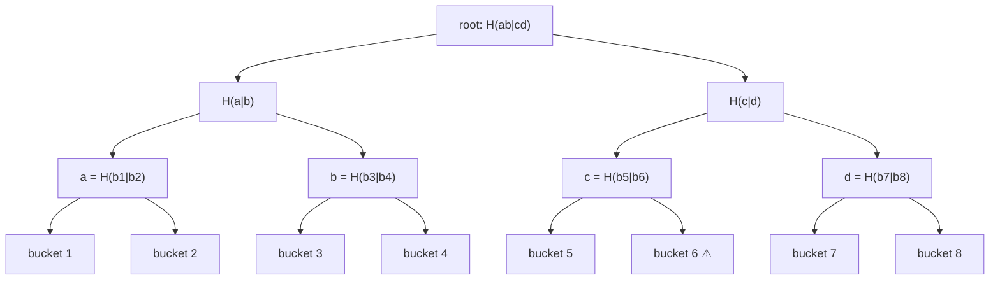
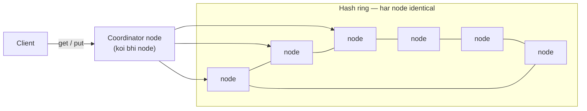
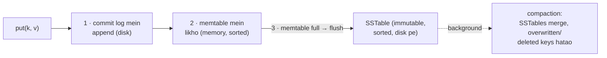
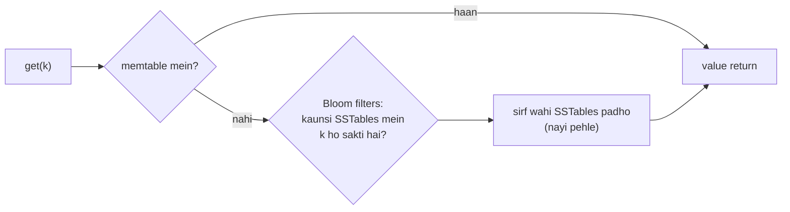

# 06 · Key-Value Store Design karo

<div class="chapter-meta" markdown>
<span>⏱ 60 min read</span>
<span class="hot">🔥 Sabse dense chapter — distributed systems ka core</span>
<span>Book: Chapter 6</span>
</div>

!!! abstract "TL;DR"
    - Key-value store ek bahut bada `Map<key, value>` hai jisme `put(key, value)` aur `get(key)` hain. Ek machine pe aasaan; asli challenge hai ise **saikdon machines pe phailana jo fail hoti rehti hain**.
    - **CAP:** network partition ke dauraan tumhe chunna padta hai **consistency** (CP — kuch requests mana karo) ya **availability** (AP — jawab do, shayad stale). Dynamo/Cassandra **AP + eventual consistency** chunte hain.
    - Consistent hashing (+ vnodes) se **partition** karo, har key ko ring pe agle **N** alag servers pe **replicate** karo, aur **quorums** se consistency tune karo: `W + R > N` ⇒ reads latest write dekhte hain.
    - Conflicts **vector clocks** se pakdo; failures **gossip** se; temporary failures **sloppy quorum + hinted handoff** se jhelo; permanent divergence **Merkle trees** se repair karo.
    - Storage engine: **commit log → memtable → SSTables** (LSM tree). Reads pehle memtable dekhte hain, phir har SSTable ka **Bloom filter** jo un files ko skip karwata hai jinme key ho hi nahi sakti.

## Intuition: kai branches waali library

Socho ek shehar ka library system 50 branches mein crore kitaabein rakhta hai.

- **Kaunsi kitaab kis branch mein?** Kitaab ki ID pe based ek rule → *partitioning*.
- **Ek branch mein baadh aa gayi toh?** Har kitaab ki copy 3 paas waali branches mein → *replication*.
- **Phone line band hai aur do branches same kitaab ka catalog card alag-alag update kar deti hain?** Conflict pakadne aur merge karne ka tareeka chahiye → *versioning / vector clocks*.
- **Branches ko kaise pata chale ki doosri branch band hai?** Har kuch minute kuch padosiyon se baat karti hain aur khabar aage badhati hain → *gossip*.
- **Ek branch ek din band hai — wapas aayi kitaabein kahan jaayein?** Padosi temporarily rakh leta hai aur baad mein lauta deta hai → *hinted handoff*.
- **Lambe outage ke baad do branches kaise pata karein ki kaunse cards alag hain, bina saare 10 lakh compare kiye?** Shelves ke summary compare karo, phir sirf alag waali shelves → *Merkle trees*.

---

## Step 1 · Scope

KV store (key-value database bhi kehte hain) **unique keys** ko **values** se map karta hai. Keys plain text (`"user:42:profile"`)
ya hashed ho sakti hain; values opaque blobs hain — strings, lists, JSON — store ko fark nahi padta. Famous examples:
**Amazon DynamoDB**, **Redis**, **Memcached**, **Apache Cassandra**, **etcd**, **RocksDB** (embedded).

**API:**

```java
void put(String key, byte[] value);
byte[] get(String key);
```

**Hum kin requirements ke liye design kar rahe hain** (har design trade-offs ka set hai — yeh hamare hain):

| Requirement | Target (hamare assumptions) |
|---|---|
| Value size | Aam taur pe ≤ 1 KB, hard cap 64 KB (bade blobs object storage mein) |
| Total data | Saikdon TB, badh raha hai — ek machine se kahin zyada |
| Availability | Individual nodes ya ek rack down ho tab bhi reads aur writes chalte rahein |
| Durability | Acknowledge hua write kabhi na khoye |
| Elasticity | Bina downtime nodes add/remove; data khud rebalance ho |
| Consistency | **Har request pe tunable** — default eventual, caller maange toh stronger |
| Latency | Region ke andar p99 ~10 ms se kam |

---

## Single-server key-value store

Aasaan: in-memory hash table. Do tricks ise aage badhati hain:

- Values ko **compress** karo.
- Sirf **hot data memory mein**, baaki **disk pe**.

Par ek server ki memory aur disk aakhir khatam hogi, aur woh single point of failure hai. Hume **distributed** key-value store
(*distributed hash table*) chahiye.

---

## CAP theorem

Distributed system teeno ek saath guarantee nahi kar sakta:

- **Consistency (C)** — har client ko **ek hi time pe same data** dikhe, chahe kisi bhi node se baat kare.
- **Availability (A)** — har request ko (non-error) response mile, kuch nodes down hon tab bhi.
- **Partition tolerance (P)** — **network partitions** (nodes ke beech messages khona/late hona) ke bawajood system chalta rahe.



**Key insight:** distributed system mein **network partitions honge hi** (switches fail, cables kat-te hain, GC pauses partition
jaise dikhte hain). Toh "P" optional nahi. Asli choice hai **partition ke *dauraan* kya karna hai**:

### Ek worked scenario

Teen replicas **n1, n2, n3** ke paas key `stock:item-77 = 10` hai. Network toot-ta hai: **n3** ab n1/n2 se baat nahi kar sakta.

- Ek client **n1** pe `stock:item-77 = 9` likhta hai. n1 n2 ko replicate karta hai — par n3 tak nahi pahunch pata.
- Doosra client **n3** se padhta hai.

| Choice | Kya hota hai | Kiske liye achha |
|---|---|---|
| **CP** | n3 (aur shayad minority side) woh reads/writes **mana** karta hai jinke up-to-date hone ka confirm nahi kar sakta → partition theek hone tak error/timeout | Bank balances, strict no-oversell inventory, leader election |
| **AP** | n3 **10 ke saath jawab** deta hai (stale). Dono taraf writes accept; conflicts partition theek hone ke **baad** reconcile | Shopping carts, social feeds, likes, session data |

!!! tip "PACELC — zyada complete version"
    CAP sirf partitions ki baat karta hai. **PACELC** jodta hai: **E**lse (partition nahi), tab bhi tum **L**atency vs **C**onsistency
    trade karte ho — jaise saare replicas ka wait karna consistent hai par slow. Dynamo/Cassandra: PA/EL. Spanner: PC/EC.

Hamara store: **AP with tunable consistency.**

---

## System components

Design inhi tukdon se banayenge, zyada tar Amazon ke **Dynamo** paper aur Cassandra/BigTable se liye hue:

1. Data partitioning
2. Data replication
3. Consistency (quorums)
4. Inconsistency resolution (versioning, vector clocks)
5. Failures handle karna (gossip, sloppy quorum, hinted handoff, Merkle trees, DC outages)
6. System architecture
7. Write path
8. Read path

### 1 · Data partitioning

Bada data ek server mein nahi aata, toh hum use todte hain. Do goals: **data barabar baanto** aur **nodes join/leave hone pe kam
se kam movement**. Yeh exactly **consistent hashing** hai (Chapter 5):

- Servers (virtual nodes ki tarah) hash ring pe; key ka maalik clockwise pehla server.
- **Automatic scaling:** servers add/remove karne se sirf padosi arcs move hote hain.
- **Heterogeneity:** bade servers ko zyada virtual nodes.

### 2 · Data replication

Durability aur availability ke liye har key **N** servers pe store hoti hai (N configurable, aam taur pe 3). Key ki position se
**clockwise** chalo aur pehle **N alag physical servers** chuno — yeh key ki **preference list** hai.



- Virtual nodes ke saath agli N positions same physical server ki ho sakti hain → **duplicates skip** karo taaki N *alag* machines milein.
- Ek data center ke servers saath mein fail ho sakte hain (power, network) → replicas ko **racks / availability zones / data centers** mein phailao.

### 3 · Quorums se consistency

Replicas ko sync rakhna hai. Define karo:

- **N** = replicas ki ginti
- **W** = write quorum: write tab successful jab **W replicas acknowledge** karein
- **R** = read quorum: read tab successful jab **R replicas jawab** dein

**Coordinator** (jo bhi node request receive kare — client aur replicas ke beech proxy) request saare N replicas ko bhejta hai aur W (ya R) responses ka wait karta hai.



**`W + R > N` strong consistency kyun deta hai:** jin W nodes ne write liya aur jin R nodes se tum padhte ho, unme **kam se kam ek node
common** hona hi chahiye — toh kam se kam ek reply latest version laayega.

| Config (N = 3) | Behaviour | Kab use karein |
|---|---|---|
| **W=1, R=3** | Writes tez, reads ko sabse poochna padta hai | Write-heavy, reads kam |
| **W=3, R=1** | Reads tez, writes sabka wait karte hain | Read-heavy, writes kam |
| **W=2, R=2** | W+R=4 > 3 → **strong consistency** (overlap guaranteed), balanced latency | Classic default |
| **W=1, R=1** | W+R=2 ≤ 3 → sabse tez, sirf **eventual consistency** | Caches, metrics, likes |

Latency un **W (ya R) replicas mein sabse slow** se decide hoti hai jinka wait karte ho, isliye chhote quorums tez hain.

### Consistency models

| Model | Promise |
|---|---|
| **Strong** | Read hamesha sabse recent likha value deta hai. Kabhi stale nahi. |
| **Weak** | Read shayad latest write na dekhe — kab dikhega, koi guarantee nahi. |
| **Eventual** | Weak ka special case: writes ruk jaayein toh **saare replicas aakhir same value pe aa jaate hain**. |

Strong consistency ke liye aam taur pe replica ko **naye reads/writes tab tak mana karne padte hain jab tak saare replicas current
write pe agree na karein** — availability ke liye bura. Dynamo aur Cassandra **eventual consistency** chunte hain: concurrent writes alag
replicas pe gir sakte hain, toh system ko **conflicts pakadne aur reconcile karne** padte hain. Yahi versioning karta hai.

### 4 · Inconsistency resolution: versioning aur vector clocks

**Versioning** har modification ko value ka **naya immutable version** maanta hai. Problem hai fark karna "B ne A ko replace kiya"
(bas B rakho) aur "A aur B concurrently likhe gaye" (**conflict** jo merge karna hai) ke beech.

**Vector clock** `[server, counter]` pairs ki list hai jo har version ke saath judi hoti hai: `D([S1, v1], [S2, v2], …)`.
Jab server Si ek version likhta hai:

- Agar clock mein `[Si, vi]` hai, toh vi badhao.
- Warna `[Si, 1]` jodo.

**Do versions X aur Y compare karna:**

- X, Y ka **ancestor** hai (conflict nahi — Y jeetta hai) agar **X ka har counter ≤ Y ka matching counter**.
- X aur Y **siblings** hain (conflict) agar dono mein koi counter doosre se **bada** hai.

**Worked example — partition ke dauraan shopping cart:**



1. Node A `[milk]` likhta hai → D1 `(A,1)`; phir `[milk, bread]` → D2 `(A,2)`. D1, D2 ka ancestor hai — D1 discard kar sakte hain.
2. Partition hota hai. User ka **phone** node **B** se eggs jodta hai → D3 `(A,2),(B,1)`. **Laptop** node **C** se tea jodta hai → D4 `(A,2),(C,1)`.
3. Baad ka read **dono** D3 aur D4 laata hai. Compare: D3 mein `B:1 > 0`, D4 mein `C:1 > 0` → koi ancestor nahi → **conflict**.
4. **Client** reconcile karta hai (cart ke liye: items ka union) aur A se wapas likhta hai → D5 `(A,3),(B,1),(C,1)`, jo dono se descend karta hai.

```java
enum Order { BEFORE, AFTER, EQUAL, CONCURRENT }

static Order compare(Map<String,Integer> x, Map<String,Integer> y) {
    boolean xBigger = false, yBigger = false;
    Set<String> nodes = new HashSet<>(x.keySet()); nodes.addAll(y.keySet());
    for (String n : nodes) {
        int a = x.getOrDefault(n, 0), b = y.getOrDefault(n, 0);
        if (a > b) xBigger = true;
        if (b > a) yBigger = true;
    }
    if (xBigger && yBigger) return Order.CONCURRENT;   // siblings → conflict
    if (xBigger) return Order.AFTER;                   // x, y se descend karta hai
    if (yBigger) return Order.BEFORE;                  // y, x se descend karta hai
    return Order.EQUAL;
}
```

**Vector clocks ke nuksaan:**

- **Complexity clients pe** — unhe har data type ke liye merge logic likhna padta hai.
- **Clocks badhti jaati hain** har us server ke saath jisne write coordinate kiya. Fix: length cap karo (jaise 10 entries) aur sabse purani hatao; isse kabhi-kabhi ancestry detect nahi hoti (rare, Dynamo ke experience mein accepted).

!!! tip "Alternatives jo bata sakte ho"
    Timestamps ke saath **Last-write-wins (LWW)** (Cassandra ka default): simple, par do concurrent writes mein se ek ko chupchaap
    **kho deta hai** aur clock sync pe depend karta hai. **CRDTs** (conflict-free replicated data types — counters, sets, maps jo apne
    aap merge hote hain) client-side merge code se bachate hain; Riak, Redis Enterprise, collaborative editors use karte hain.

### 5 · Failures handle karna

Scale pe failures exception nahi — roz ki baat hain. Unhe **detect** aur **resolve** karna hai.

#### Failure detection: gossip

Ek server ko sirf isliye dead declare nahi kar sakte kyunki *ek* doosra server aisa bolta hai. Har node se har node ko ping karwana
(**all-to-all multicasting**) sahi hai par O(n²) messages — saikdon nodes ke saath bahut zyada.

**Gossip protocol** (decentralised failure detection):

1. Har node ek **membership list** rakhta hai: member ID → heartbeat counter + local time jab woh aakhri baar badha.
2. Har node apna **heartbeat** samay-samay pe badhata hai.
3. Samay-samay pe har node apni list kuch **random** nodes ko bhejta hai, jo merge karte hain (bade counters rakhte hue) aur aage badhate hain.
4. Agar kisi member ka heartbeat ek **threshold** time tak nahi badha, use **offline** maana jaata hai.

| Node s0 ka view | Heartbeat | Aakhri baar badha (s0 ki ghadi) |
|---|---|---|
| s0 | 1820 | 10:41:07 |
| s1 | 1793 | 10:41:05 |
| **s2** | **1650** | **10:39:22** ← 100 s se stale → s2 down hone ka shak |
| s3 | 1802 | 10:41:06 |

s0 phir doosron ko gossip karta hai "s2 down lag raha hai"; jab kai nodes alag-alag agree karte hain, s2 down mark hota hai.

#### Temporary failures: sloppy quorum + hinted handoff

Strict quorum reads/writes ko block kar deta hai jab key ke *designated* N replicas mein se kam up hon — availability ke liye bura.

**Sloppy quorum:** designated replicas pe zid karne ki jagah ring pe **pehle W (ya R) healthy servers** chuno, dead waale skip karke.

**Hinted handoff:** agar server s2 down hai, uske writes agle healthy server, maan lo s4, pe **hint ke saath** jaate hain ("yeh s2 ka hai").
Jab s2 wapas aata hai (gossip batata hai), s4 **data wapas de deta hai** aur apni copy delete kar deta hai.



#### Permanent failures: Merkle trees ke saath anti-entropy

Agar replica lambe time ke liye gayab hai (ya hinted data kho gaya), replicas **diverge** ho jaate hain. Unhe sync karna hai, par terabytes
mein har key compare karna bahut mehenga hai. **Merkle tree** (hash tree) do replicas ko bahut kam data transfer karke differences dhoondhne deta hai.

**Banana** (maan lo keys ek range mein hash hoti hain jo 8 buckets mein bati hai):

1. Key space ko **buckets** mein baanto.
2. Har key ki value hash karo; phir har bucket ki keys ke hashes se **ek bucket hash** nikalo.
3. Upar ki taraf binary tree banao: har parent = hash(left child + right child). Root sab kuch summarise karta hai.



**Do replicas compare karna:** roots compare karo. Barabar → sync mein, khatam. Alag → dono children compare karo, sirf usi subtree mein
recurse karo jiske hashes alag hain. Yahan sirf root → CD → c → bucket 6 ka path alag hai, toh sirf **bucket 6 ki keys** exchange hoti hain.

Kaam **differences** ke proportional hai, data size ke nahi. Example: 1 billion keys 10 lakh buckets mein → har bucket mein ~1,000 keys;
agar ek key alag hai, toh ~20 levels chalte ho aur 1 billion ki jagah ~1,000 keys bhejte ho.

#### Data center outage

Power cut, network failure aur natural disasters poore DCs gira dete hain. **Kai data centers** mein replicate karo taaki users doosre se padh/likh sakein.

### 6 · System architecture



Koi **master nahi** hai. Koi bhi node client ka `get`/`put` le sakta hai; us request ke liye woh **coordinator** banta hai, ring se key
ki preference list nikaalta hai, aur un replicas se baat karta hai. Kyunki har node same software chalata hai — request handling, gossip
membership, replication, hinted-handoff storage, anti-entropy aur local LSM storage engine — tum identical boxes jod ke scale karte ho,
aur koi ek box khone se kuch unique nahi khota. (Kuch clients "ring-aware" hoke request seedha replica ko bhej dete hain aur extra hop bacha lete hain.)

### 7 · Write path (LSM-tree, Cassandra jaisa)



1. Write **commit log** mein append hota hai (sequential disk write — tez, aur crash ke baad memtable recover karne deta hai).
2. **Memtable** mein insert hota hai, ek in-memory sorted structure.
3. Memtable threshold pe pahunche toh disk pe **SSTable** (Sorted String Table) ki tarah **flush** hota hai: key-value pairs ki immutable, sorted file.
4. **Compaction** background mein SSTables merge karta hai, overwritten values aur **tombstones** (deletion markers) hata deta hai.

Yeh design kyun? Writes **sequential** hain (random disk seeks nahi — Chapter 2 ki latency table yaad karo), toh write throughput bahut zyada hai.

### 8 · Read path



1. **Memtable** check karo — mili toh return.
2. Warna har SSTable ka **Bloom filter** dekho ki kaunsi SSTables mein key *ho sakti* hai.
3. Wahi SSTables padho (nayi pehle) aur value return karo.

**Bloom filter** ek paragraph mein: ek bit array plus k hash functions. Key add karne ke liye, jin k bits pe woh hash hoti hai unhe set karo.
Query ke liye woh k bits dekho: **koi bhi 0** hai toh key **pakka nahi** hai; saare 1 hain toh **shayad** hai. False negatives nahi, false
positives tunable (~10 bits per key pe ~1%). Isse read path lagbhag har us SSTable ko skip kar deta hai jisme key ho hi nahi sakti.

```java
final class BloomFilter {
    private final BitSet bits; private final int m, k;
    BloomFilter(int m, int k) { this.bits = new BitSet(m); this.m = m; this.k = k; }
    private int idx(String key, int i) {                 // double hashing: h1 + i*h2
        int h1 = key.hashCode(), h2 = (h1 >>> 16) | 1;
        return Math.floorMod(h1 + i * h2, m);
    }
    void add(String key)              { for (int i = 0; i < k; i++) bits.set(idx(key, i)); }
    boolean mightContain(String key)  { for (int i = 0; i < k; i++) if (!bits.get(idx(key, i))) return false; return true; }
}
```

---

## Sab jodke: ek request ka safar

Is chapter ko revise karne ka sabse tez tareeka hai ek write aur ek read ko har mechanism se guzarte hue dekhna:

| Pal | Kya hota hai | Mechanism | Keemat kya hai |
|---|---|---|---|
| Client `put(k, v)` call karta hai | Koi bhi node coordinator banta hai; `k` ko ring pe hash karta hai | Consistent hashing + vnodes | Har node pe ring metadata |
| Coordinator replicas chunta hai | Clockwise pehle N alag physical nodes, racks/DCs ke across | Preference list | Cross-DC bandwidth |
| Ek replica down hai | Agla healthy node write ko hint ke saath rakhta hai | Sloppy quorum + hinted handoff | Quorum overlap ki guarantee nahi rehti |
| W acks aate hain | Client ko OK; late waale bhi apply karte hain | Quorum (N, W, R) | Latency = W mein sabse slow |
| Har replica pe | Commit log mein append, memtable mein insert, baad mein SSTable flush | LSM storage engine | Background mein compaction I/O |
| Baad mein `get(k)` | Coordinator replicas se poochta hai, R ka wait; do versions dikhte hain | Vector clocks | Clients ko siblings merge karne padte hain |
| Versions alag the | Coordinator sabse naya stale replicas pe wapas likhta hai | Read repair | Reads pe extra writes |
| Replica pe `k` dhoondhna | Pehle memtable, phir sirf woh SSTables jinka Bloom filter "shayad" bole | Bloom filters | Har key ka ~10 bits RAM |
| Poore time | Nodes random peers se heartbeats exchange karte hain | Gossip | Detection mein seconds lagte hain, milliseconds nahi |
| Samay-samay pe | Replicas hash trees compare karke sirf alag ranges sync karte hain | Merkle-tree anti-entropy | Ranges badalne pe tree rebuild |

---

## Interviewer follow-ups

??? question "N=3, W=2, R=2 ke saath kya read ab bhi stale data de sakta hai?"
    Steady state mein nahi — read set aur write set overlap karte hain. Par edge cases hain: **sloppy quorum** mein W acks designated
    replicas ke bahar ke stand-in nodes se aa sakte hain, toh overlap guarantee toot jaati hai; concurrent writes siblings bana sakte hain;
    aur fail hua write (W se kam acks) phir bhi kuch replicas pe gir chuka ho sakta hai. Isliye Dynamo-style systems ise "tunable" consistency
    kehte hain, linearizability nahi.

??? question "Read repair kya hai?"
    Jab coordinator quorum read karte hue dekhta hai ki replicas **alag versions** de rahe hain, woh client ko sabse naya (ya siblings)
    deta hai aur stale replicas pe **latest version wapas likh deta hai**. Hot keys pe divergence sasta fix hota hai; Merkle-tree anti-entropy
    un cold keys ko sambhalta hai jo kam padhi jaati hain.

??? question "Vector clocks ki jagah timestamps (last-write-wins) kyun nahi?"
    LWW simple hai aur bahut use hota hai (Cassandra). Par alag machines ki ghadiyan drift karti hain, aur LWW do concurrent writes mein se
    ek ko **chupchaap gira deta hai** — "last known location" ke liye theek, shopping cart ke liye galat jahan dono additions matter karte hain.
    Vector clocks concurrency *detect* karte hain taaki merge kar sako; suitable data types ke liye CRDTs apne aap merge karte hain.

??? question "Is system mein key delete kaise karoge?"
    Seedha hata nahi sakte — jis replica ne delete miss kiya woh anti-entropy ke dauraan key ko "zinda" kar dega. Iski jagah ek **tombstone**
    likho (version ke saath deletion marker). Tombstones normal writes ki tarah phailte hain aur compaction mein tabhi purge hote hain jab
    itna grace period beet jaaye ki saare replicas ne dekh liya ho (Cassandra: `gc_grace_seconds`).

??? question "CP store kab chunoge?"
    Jab partition mein correctness availability se zyada important ho: leader election aur locks (etcd/ZooKeeper), financial ledgers,
    inventory jahan oversell bilkul nahi chalega, unique-username registration. Yeh consensus (Raft/Paxos) use karte hain aur partition ki
    minority side pe requests reject karte hain.

??? question "Cluster join karne waale node ko data kaise milta hai?"
    Use ring pe vnodes (tokens) assign hote hain; har naye arc ke liye woh current owners (clockwise agle replicas) se relevant key ranges
    **stream** karta hai. Streaming khatam hone tak purane owners reads serve kar sakte hain; gossip nayi membership phailata hai taaki
    coordinators use route karna shuru karein.

---

## Practice

??? example "Practice 1 — N, W, R chuno"
    (a) Session store: reads writes ke 10:1, ek second stale chalega, hamesha up rehna chahiye. (b) Configuration store jahan read ko
    aakhri write dikhna chahiye. Dono mein N=3. W aur R chuno.

    **Solution.** (a) **W=1, R=1** (ya W=2,R=1) — tez aur highly available; eventual consistency chalegi.
    (b) **W=2, R=2** (W+R > N), ya agar writes kam hain aur reads sabse tez chahiye toh W=3, R=1. Agar partition mein bhi kabhi stale read
    nahi chahiye, toh CP system (etcd) use karo.

??? example "Practice 2 — Vector clocks compare karo"
    Har pair ke liye batao ancestor/descendant ya conflict:
    (i) `(A,2),(B,1)` vs `(A,3),(B,1)` · (ii) `(A,1),(C,2)` vs `(A,2),(B,1)` · (iii) `(A,1)` vs `(A,1),(B,4)`

    **Solution.** (i) pehla doosre ka **ancestor** (2≤3, 1≤1). (ii) **conflict** — pehle mein C:2 > 0, doosre mein A:2 > 1 aur B:1 > 0.
    (iii) pehla **ancestor** (missing B ko 0 ≤ 4 maano).

??? example "Practice 3 — Bloom filter sizing"
    Ek node ki SSTables mein 20 crore keys hain. ~1% false positives chahiye. Bloom filters ko roughly kitni memory chahiye?

    **Solution.** 1% ke liye ~9.6 bits/key (optimal k ≈ 7) → 200M × 9.6 bits ≈ 1.92 × 10⁹ bits ≈ **240 MB**. Absent keys ke disk reads
    bachane ke muqable sasta.

??? example "Practice 4 — Merkle tree ki bachat"
    Do replicas mein 50 crore keys 2²⁰ (~10 lakh) buckets mein hain. 300 keys alag hain, sab alag buckets mein. Kitne buckets ki keys transfer hongi?

    **Solution.** Sirf 300 alag buckets (~500 keys each) → ~1.5 lakh keys transfer, 50 crore ki jagah — data ka ~0.03%. Tree walk ~300 × 20
    node hashes compare karta hai.

---

## Revision checklist

- [ ] CAP sahi bol sakta hoon ("partition ke dauraan C ya A chuno") aur CP/AP examples de sakta hoon, plus PACELC.
- [ ] N alag servers ki preference list ke saath partitioning + replication samjha sakta hoon.
- [ ] N/W/R, `W + R > N` overlap kyun deta hai, aur use case ke liye values chun sakta hoon.
- [ ] Strong / weak / eventual consistency define kar sakta hoon.
- [ ] Vector-clock example chala ke ancestor vs conflict decide kar sakta hoon; LWW aur CRDTs alternatives pata hain.
- [ ] Gossip, sloppy quorum, hinted handoff, Merkle trees aur tombstones samjha sakta hoon.
- [ ] LSM write path aur read path bana sakta hoon aur Bloom filter kaise kaam karta hai samjha sakta hoon.

[Aage: 07 · Unique ID Generator :material-arrow-right:](07-unique-id-generator.md){ .md-button .md-button--primary }
