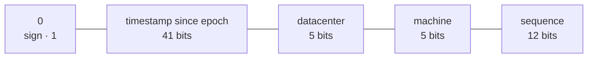

# 07 · Design a Unique ID Generator in Distributed Systems

<div class="chapter-meta" markdown>
<span>⏱ 35 min read</span>
<span class="hot">🔥 Needed by URL shortener, chat, feeds, payments…</span>
<span>Book: Chapter 7</span>
</div>

!!! abstract "TL;DR"
    - A single database's `AUTO_INCREMENT` can't keep up across many machines and is a single point of failure.
    - Options: **multi-master with step** (simple, not time-sortable, hard to scale), **UUID** (no coordination, but 128-bit and random), **ticket server / range allocation** (central counter, numeric, but a coordination point), **Snowflake** (64-bit = timestamp + datacenter + machine + sequence).
    - **Snowflake** fits the classic requirements: 64-bit, numeric, **roughly time-ordered**, ~4 million IDs/sec per machine, no coordination per ID.
    - Its weak spot is the **clock**: if a machine's clock goes backwards, it could repeat IDs — detect it and wait/fail. Its other limit: only **~69 years** of timestamps from a custom epoch.
    - Modern alternatives: **UUIDv7 / ULID** — time-ordered 128-bit IDs that keep UUID's no-coordination property and index nicely.

## The intuition: token numbers at a hospital

A hospital with one reception desk hands out token numbers 1, 2, 3… — easy, but the queue for the token
itself becomes the bottleneck, and if that desk closes, nobody gets a token.

Open 5 desks? You need a rule so no two desks hand out the same number. Desk 1 gives 1, 6, 11…; desk 2
gives 2, 7, 12… That works until you open a 6th desk. Or each token could be "**time + desk number + a
counter**" — e.g. `10:42:07 · desk 3 · #12`. Unique without any desk talking to another, and you can still
roughly sort patients by arrival. That last idea is Snowflake.

---

## Step 1 · Scope

!!! example "Clarifying conversation"
    **You:** What must the IDs satisfy beyond uniqueness? — **Interviewer:** Numeric only, and fit in a 64-bit integer.
    **You:** Do they need to be sortable? — **I:** Yes — if A was created clearly before B, A's ID should be smaller. Strict per-millisecond order isn't required.
    **You:** Throughput? — **I:** At least 10,000 IDs per second overall, with room to grow.
    **You:** Can IDs be guessable? — **I:** That's fine for this system (they're internal row IDs).
    **You:** Many data centers? — **I:** Yes, several.

**Requirements:** unique · numeric · 64-bit · ordered by creation time (approximately) · ≥10K IDs/s · no single point of failure · low latency (generated locally, no network hop ideally).

Why not just use the DB's auto-increment? In a distributed system there are **many databases** (shards), each
with its own counter → duplicates. And a single global counter DB is a bottleneck and a SPOF.

---

## Step 2 · The candidate approaches

### Option 1 · Multi-master replication with a step

Use `AUTO_INCREMENT` on each of **k** database servers, but increase by **k** instead of 1:

```text
k = 3 servers
DB1: 1, 4, 7, 10, …     (start 1, step 3)
DB2: 2, 5, 8, 11, …     (start 2, step 3)
DB3: 3, 6, 9, 12, …     (start 3, step 3)
```

| ✅ | ❌ |
|---|---|
| Uses plain DB features; numeric; scales a bit with more DBs | IDs are **not time-ordered across servers** (DB3's #9 may be created after DB1's #10) |
| | **Adding/removing a server** changes k → renumbering mess |
| | Doesn't scale well across **multiple data centers** |

### Option 2 · UUID

A **UUID** is a 128-bit number generated locally (e.g. `09c93e62-50b4-468d-bf8a-c07e1040bfb2`). The common
**version 4** is random: 122 random bits. Collisions are astronomically unlikely — you'd need to generate
about **10⁹ UUIDs per second for ~86 years** to reach a 50% chance of a single duplicate.

```java
String id = java.util.UUID.randomUUID().toString();   // no coordination at all
```

| ✅ | ❌ |
|---|---|
| Trivial; every server generates independently — no coordination, no SPOF | **128 bits**, not 64 |
| Scales perfectly — add servers freely | **Not time-ordered** (v4 is random) |
| | Can be non-numeric (hex string with dashes) |
| | Random keys scatter writes across a B-tree index → page splits, poor cache locality |

### Option 3 · Ticket server

A single, dedicated database whose only job is to hand out numbers (Flickr popularised this):

```sql
-- a table with one row; REPLACE bumps the auto-increment and returns a fresh ID
REPLACE INTO tickets64 (stub) VALUES ('a');
SELECT LAST_INSERT_ID();
```

Every service calls the ticket server for an ID.

| ✅ | ❌ |
|---|---|
| Numeric, simple, works well at small-to-medium scale | **Single point of failure** — if it's down, nobody can create anything |
| | Every ID costs a network round trip |
| | Running two ticket servers (odd/even) brings back sync problems |

**Range allocation (hi/lo)** — the practical upgrade: instead of one ID per call, the ticket server hands out a
**block** (e.g. 10,000 IDs). Each app server burns through its block locally and asks for the next block when
it's nearly empty. Network calls drop by 10,000×, and a ticket-server outage only hurts once blocks run out.
Downside: IDs are only roughly ordered, and a crashed server "wastes" the rest of its block (gaps are fine).

### Option 4 · Twitter Snowflake

Divide a 64-bit ID into sections, each meaning something:

<div class="sd-widget" data-widget="snowflake"></div>

| Section | Bits | Meaning |
|---|---|---|
| Sign | 1 | Always 0 (keeps the number positive in signed 64-bit types) |
| **Timestamp** | 41 | Milliseconds since a **custom epoch** |
| **Datacenter ID** | 5 | 2⁵ = 32 data centers |
| **Machine ID** | 5 | 2⁵ = 32 machines per data center |
| **Sequence** | 12 | Counter within the same millisecond on the same machine; 2¹² = 4,096 values; resets to 0 every ms |



Datacenter and machine IDs are assigned at **startup** (from config or a coordination service like ZooKeeper)
and don't change while the process runs. Timestamp and sequence are generated **as the program runs**.

### Comparison

| Approach | Size | Sortable by time | Coordination per ID | SPOF | Scales across DCs |
|---|---|---|---|---|---|
| Multi-master step | 64 | ❌ | No | No | Poorly |
| UUIDv4 | 128 | ❌ | No | No | ✅ |
| Ticket server | 64 | ✅ (globally) | **Yes** (network call) | **Yes** | ❌ |
| Range allocation | 64 | ~ (per block) | Rarely | Partly | OK |
| **Snowflake** | **64** | **✅ (≈ by ms)** | **No** | **No** | **✅** |
| UUIDv7 / ULID | 128 | ✅ (by ms) | No | No | ✅ |

Snowflake meets all our requirements → let's go deep.

---

## Step 3 · Deep dive on Snowflake

### The timestamp

41 bits of milliseconds. Shift the bits back to get the time:

```text
id → binary → take bits 63..22 (41 bits) → decimal → add the epoch → Unix ms → date
```

**How long does it last?** `2⁴¹ − 1 ms ≈ 2.2 × 10¹² ms ≈ 69.7 years`.

That's why you use a **custom epoch** close to your launch date rather than 1970. Twitter's epoch is
**1288834974657** (Nov 04 2010, 01:42:54 UTC) → their IDs run out around 2080. Starting from 1970 you'd have
already burned 40+ of those 69 years.

Because the timestamp sits in the **high bits**, IDs **sort by time** — and since IDs grow over time, new rows
append at the end of B-tree indexes (good locality, unlike random UUIDs).

### The sequence number

12 bits → 4,096 IDs per millisecond per machine → **~4 million IDs/sec per machine**. If a machine somehow
needs more than 4,096 in one millisecond, it **waits until the next millisecond**.

### Capacity check

`32 DCs × 32 machines × 4,096 IDs/ms` ≈ **4.2 billion IDs per millisecond** cluster-wide. Our requirement
was 10K/s. Massive headroom.

### Java implementation

```java
public final class Snowflake {
    private static final long EPOCH = 1_288_834_974_657L;         // custom epoch (ms)
    private static final int  DC_BITS = 5, MACHINE_BITS = 5, SEQ_BITS = 12;
    private static final long MAX_SEQ = (1L << SEQ_BITS) - 1;      // 4095
    private static final int  MACHINE_SHIFT = SEQ_BITS;            // 12
    private static final int  DC_SHIFT = SEQ_BITS + MACHINE_BITS;  // 17
    private static final int  TS_SHIFT = DC_SHIFT + DC_BITS;       // 22

    private final long datacenterId, machineId;
    private long lastTs = -1L, sequence = 0L;

    public Snowflake(long datacenterId, long machineId) {
        if (datacenterId < 0 || datacenterId > 31 || machineId < 0 || machineId > 31)
            throw new IllegalArgumentException("ids must be 0..31");
        this.datacenterId = datacenterId; this.machineId = machineId;
    }

    public synchronized long nextId() {
        long ts = System.currentTimeMillis();
        if (ts < lastTs) {                                    // clock moved backwards!
            long drift = lastTs - ts;
            if (drift > 5) throw new IllegalStateException("clock moved back " + drift + " ms");
            ts = waitUntil(lastTs);                           // small drift: just wait it out
        }
        if (ts == lastTs) {
            sequence = (sequence + 1) & MAX_SEQ;
            if (sequence == 0) ts = waitUntil(lastTs + 1);    // 4,096 used up this ms
        } else {
            sequence = 0;
        }
        lastTs = ts;
        return ((ts - EPOCH) << TS_SHIFT) | (datacenterId << DC_SHIFT)
             | (machineId << MACHINE_SHIFT) | sequence;
    }

    private static long waitUntil(long target) {
        long now = System.currentTimeMillis();
        while (now < target) { Thread.onSpinWait(); now = System.currentTimeMillis(); }
        return now;
    }
}
```

---

## Step 4 · Wrap-up: the hard parts

### Clock synchronisation

Snowflake assumes each machine's clock is sane. In reality:

- Clocks drift; **NTP** corrects them, and a correction can move a clock **backwards**. If `ts < lastTs`, naïvely we'd reuse old timestamps and could **repeat an ID**. The code above waits for small drift and refuses (alerts) for large drift.
- Leap seconds and VM pauses cause similar surprises. Many companies "smear" leap seconds across a day to avoid jumps.
- Across machines, IDs are only **roughly** ordered — two machines' clocks differ by a few ms, so an ID from machine A can be smaller than one generated slightly earlier on machine B. That's usually fine ("k-sorted").

### Tuning the bit sections

The 41/5/5/12 split isn't sacred:

- Low traffic but long lifetime → fewer sequence bits, more timestamp bits.
- Many machines, one DC → merge datacenter + machine into a 10-bit **worker ID** (1,024 workers).
- Need more than 4,096/ms on a machine → more sequence bits.

### Assigning machine IDs safely

Two processes with the same `(datacenter, machine)` would generate duplicates. Assign worker IDs via
**ZooKeeper/etcd ephemeral nodes**, a database lease table, or Kubernetes StatefulSet ordinals — never by hand-editing config.

### High availability

The generator is a library inside each service (no network hop) — or a tiny stateless service behind a load
balancer. Either way there's no shared state to lose.

### Privacy / guessability

Snowflake IDs leak **creation time** and roughly how many IDs a machine produced. For public-facing IDs where
that matters (e.g. invoice numbers, user IDs in URLs), add an opaque layer: encrypt/permute the ID or expose a
separate random public ID.

---

## Going deeper: UUIDv7, ULID, KSUID

Newer formats keep UUID's "no coordination, 128 bits" model but put a **timestamp first**, so they sort by time:

| Format | Layout | Notes |
|---|---|---|
| **UUIDv7** (RFC 9562, 2024) | 48-bit Unix ms timestamp + version bits + 74 random bits | Standard UUID type, time-ordered → **index-friendly** in Postgres/MySQL. A great default today when 128 bits is OK. |
| **ULID** | 48-bit ms timestamp + 80 random bits, encoded as 26-char Crockford base-32 | Lexicographically sortable strings; URL-safe |
| **KSUID** (Segment) | 32-bit seconds timestamp + 128 random bits → 160 bits, base-62 string | Sortable to the second |

When the requirement says **64-bit numeric**, Snowflake (or a variant like Sonyflake, Instagram's
Postgres-based shard IDs, or Discord's Snowflake) is still the answer.

---

## Interviewer follow-ups

??? question "Your NTP daemon moves a server's clock back by 2 seconds. What happens?"
    For up to 2 seconds that machine would produce timestamps it has already used. If the sequence also restarts, it
    could emit **duplicate IDs**. Mitigations: detect `now < lastTs`; for small drift, spin until the clock catches up;
    for large drift, refuse to generate (fail the request / take the node out of rotation) and alert. Also configure NTP to
    **slew** (adjust gradually) rather than step the clock.

??? question "How do you guarantee two machines never share a machine ID?"
    Don't rely on static config. On startup, acquire a worker ID from a coordination service — e.g. create an ephemeral
    sequential node in ZooKeeper, or claim a row with a lease in a DB and renew it periodically. If the lease is lost, stop
    generating IDs. In Kubernetes, StatefulSet pod ordinals are another stable source.

??? question "Are Snowflake IDs strictly increasing?"
    Per machine, yes (monotonic within a process). Globally, only **approximately** — ordered by millisecond, then by
    datacenter/machine bits, and different machines' clocks differ slightly. If you need a strict global order you need a
    single sequencer (or a consensus log), which reintroduces a bottleneck.

??? question "Why not just use UUIDv4 as a primary key?"
    It works, but it's 16 bytes (vs 8) — bigger indexes in every table that references it — and random inserts cause
    B-tree page splits and poor cache locality, hurting write throughput at scale. UUIDv7 fixes the ordering problem if
    128 bits is acceptable.

??? question "You need 50,000 IDs per millisecond on one machine. What do you change?"
    4,096/ms isn't enough. Steal bits: e.g. 8 bits of machine space (if you have few machines per DC) → 16-bit sequence =
    65,536/ms. Or run several generator instances with distinct worker IDs on the same host.

---

## Practice

??? example "Practice 1 — Decode by hand"
    A Snowflake-style ID (Twitter layout) has the binary sections: timestamp = 1,000,000,000 ms after the epoch,
    datacenter = 3, machine = 17, sequence = 5. Write the formula for the 64-bit ID.

    **Solution.** `id = (1_000_000_000 << 22) | (3 << 17) | (17 << 12) | 5`
    = 4,194,304,000,000,000 + 393,216 + 69,632 + 5 = **4,194,304,000,462,853**.
    (Verify with the widget by setting the timestamp to epoch + 1,000,000,000.)

??? example "Practice 2 — Lifetime"
    You redesign the layout as 1 sign + 39 timestamp bits (units of 10 ms) + 16 worker bits + 8 sequence bits
    (this is roughly Sonyflake). How long does it last, and what's the max rate per worker?

    **Solution.** 2³⁹ × 10 ms ≈ 5.5 × 10¹² ms ≈ **174 years**. Rate: 2⁸ = 256 IDs per 10 ms = **25,600 IDs/s per worker**,
    with up to 65,536 workers.

??? example "Practice 3 — Choose an approach"
    For each, pick an ID scheme: (a) order IDs in a single-region monolith with Postgres; (b) chat message IDs for a
    global chat app; (c) public share links that shouldn't reveal volume.

    **Solution.** (a) A Postgres `BIGSERIAL`/sequence is fine — one primary, no distribution needed. (b) **Snowflake** —
    64-bit, time-ordered, generated locally on each chat server (Chapter 12 uses this). (c) **Random IDs** (UUIDv4 or a random
    base-62 string) or an encrypted Snowflake — avoid exposing creation time and counts.

---

## Revision checklist

- [ ] I can explain why DB auto-increment fails in a distributed system.
- [ ] I can compare multi-master step, UUID, ticket server, range allocation and Snowflake on size, ordering, coordination, SPOF.
- [ ] I can draw Snowflake's 1/41/5/5/12 layout and explain each section.
- [ ] I can compute the 69-year lifetime and 4,096 IDs/ms/machine limit, and why a custom epoch matters.
- [ ] I can implement Snowflake in Java including the clock-going-backwards case.
- [ ] I know UUIDv7/ULID and when to prefer them.

[Next: 08 · URL Shortener :material-arrow-right:](../case-studies/08-url-shortener.md){ .md-button .md-button--primary }
