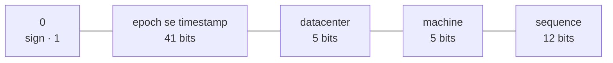

# 07 · Distributed Systems mein Unique ID Generator Design karo

<div class="chapter-meta" markdown>
<span>⏱ 35 min read</span>
<span class="hot">🔥 URL shortener, chat, feeds, payments… sabko chahiye</span>
<span>Book: Chapter 7</span>
</div>

!!! abstract "TL;DR"
    - Ek database ka `AUTO_INCREMENT` kai machines ke saath nahi chal pata aur single point of failure hai.
    - Options: **multi-master with step** (simple, time-sortable nahi, scale karna mushkil), **UUID** (coordination nahi, par 128-bit aur random), **ticket server / range allocation** (central counter, numeric, par coordination point), **Snowflake** (64-bit = timestamp + datacenter + machine + sequence).
    - **Snowflake** classic requirements pe fit hai: 64-bit, numeric, **roughly time-ordered**, har machine pe ~40 lakh IDs/sec, har ID ke liye koi coordination nahi.
    - Kamzor point hai **ghadi (clock)**: machine ki ghadi peeche chali gayi toh IDs repeat ho sakti hain — detect karo aur wait/fail karo. Doosri limit: custom epoch se sirf **~69 saal** ke timestamps.
    - Modern alternatives: **UUIDv7 / ULID** — time-ordered 128-bit IDs jo UUID ki no-coordination khoobi rakhti hain aur achhe se index hoti hain.

## Intuition: hospital ke token numbers

Ek reception desk waala hospital token 1, 2, 3… deta hai — aasaan, par token ki line hi bottleneck ban jaati hai, aur woh desk band hua
toh kisi ko token nahi milta.

5 desks khol do? Rule chahiye taaki do desks same number na dein. Desk 1 deta hai 1, 6, 11…; desk 2 deta hai 2, 7, 12… Chhatha desk
khulne tak chalta hai. Ya har token ho "**time + desk number + counter**" — jaise `10:42:07 · desk 3 · #12`. Bina kisi desk ke doosre se
baat kiye unique, aur patients ko aane ke order se roughly sort bhi kar sakte ho. Yahi idea Snowflake hai.

---

## Step 1 · Scope

!!! example "Clarifying baatcheet"
    **Tum:** Uniqueness ke alawa IDs ko kya satisfy karna hai? — **Interviewer:** Sirf numeric, aur 64-bit integer mein fit ho.
    **Tum:** Sortable honi chahiye? — **I:** Haan — agar A saaf taur pe B se pehle bana, toh A ki ID chhoti ho. Har millisecond ka strict order zaroori nahi.
    **Tum:** Throughput? — **I:** Total kam se kam 10,000 IDs per second, aur badhne ki gunjaish.
    **Tum:** IDs guess ho sakti hain toh chalega? — **I:** Is system ke liye chalega (yeh internal row IDs hain).
    **Tum:** Kai data centers? — **I:** Haan, kai.

**Requirements:** unique · numeric · 64-bit · creation time se ordered (approx) · ≥10K IDs/s · koi single point of failure nahi · low latency (local generate, ideally koi network hop nahi).

DB ka auto-increment kyun nahi? Distributed system mein **kai databases** (shards) hote hain, har ek ka apna counter → duplicates. Aur
ek global counter DB bottleneck aur SPOF hai.

---

## Step 2 · Candidate approaches

### Option 1 · Step ke saath multi-master replication

**k** database servers mein se har ek pe `AUTO_INCREMENT` use karo, par 1 ki jagah **k** se badhao:

```text
k = 3 servers
DB1: 1, 4, 7, 10, …     (start 1, step 3)
DB2: 2, 5, 8, 11, …     (start 2, step 3)
DB3: 3, 6, 9, 12, …     (start 3, step 3)
```

| ✅ | ❌ |
|---|---|
| Plain DB features; numeric; zyada DBs ke saath thoda scale | IDs **servers ke across time-ordered nahi** (DB3 ka #9, DB1 ke #10 ke baad ban sakta hai) |
| | **Server add/remove** karne se k badalta hai → renumbering ka jhanjhat |
| | **Kai data centers** ke across achhe se scale nahi hota |

### Option 2 · UUID

**UUID** ek 128-bit number hai jo locally generate hota hai (jaise `09c93e62-50b4-468d-bf8a-c07e1040bfb2`). Common **version 4** random
hai: 122 random bits. Collision ka chance bahut hi kam — ek duplicate ke 50% chance tak pahunchne ke liye **~86 saal tak har second 10⁹ UUIDs**
banane padenge.

```java
String id = java.util.UUID.randomUUID().toString();   // koi coordination nahi
```

| ✅ | ❌ |
|---|---|
| Bahut aasaan; har server khud generate karta hai — na coordination, na SPOF | **128 bits**, 64 nahi |
| Perfectly scale — servers freely jodo | **Time-ordered nahi** (v4 random hai) |
| | Non-numeric ho sakti hai (dashes waali hex string) |
| | Random keys B-tree index mein writes bikher deti hain → page splits, kharab cache locality |

### Option 3 · Ticket server

Ek akela, dedicated database jiska sirf kaam hai numbers dena (Flickr ne popular kiya):

```sql
-- ek row waali table; REPLACE auto-increment badhata hai aur nayi ID deta hai
REPLACE INTO tickets64 (stub) VALUES ('a');
SELECT LAST_INSERT_ID();
```

Har service ID ke liye ticket server ko call karti hai.

| ✅ | ❌ |
|---|---|
| Numeric, simple, small-to-medium scale pe achha | **Single point of failure** — down hua toh koi kuch create nahi kar sakta |
| | Har ID ke liye ek network round trip |
| | Do ticket servers (odd/even) chalao toh sync problems wapas |

**Range allocation (hi/lo)** — practical upgrade: har call pe ek ID ki jagah ticket server ek **block** deta hai (jaise 10,000 IDs). Har
app server apna block locally khatam karta hai aur lagbhag khaali hone pe agla block maangta hai. Network calls 10,000× kam, aur ticket
server ka outage tabhi chubhta hai jab blocks khatam ho jaayein. Nuksaan: IDs sirf roughly ordered, aur crash hua server apne block ka
baaki hissa "barbaad" karta hai (gaps chalte hain).

### Option 4 · Twitter Snowflake

64-bit ID ko sections mein baanto, har ek ka matlab:

<div class="sd-widget" data-widget="snowflake"></div>

| Section | Bits | Matlab |
|---|---|---|
| Sign | 1 | Hamesha 0 (signed 64-bit types mein number positive rakhta hai) |
| **Timestamp** | 41 | **Custom epoch** se milliseconds |
| **Datacenter ID** | 5 | 2⁵ = 32 data centers |
| **Machine ID** | 5 | Har data center mein 2⁵ = 32 machines |
| **Sequence** | 12 | Same machine pe same millisecond ke andar counter; 2¹² = 4,096 values; har ms 0 pe reset |



Datacenter aur machine IDs **startup** pe assign hoti hain (config ya ZooKeeper jaisi coordination service se) aur process chalte hue
nahi badalti. Timestamp aur sequence **program chalte hue** bante hain.

### Comparison

| Approach | Size | Time se sortable | Har ID pe coordination | SPOF | DCs ke across scale |
|---|---|---|---|---|---|
| Multi-master step | 64 | ❌ | Nahi | Nahi | Kharab |
| UUIDv4 | 128 | ❌ | Nahi | Nahi | ✅ |
| Ticket server | 64 | ✅ (globally) | **Haan** (network call) | **Haan** | ❌ |
| Range allocation | 64 | ~ (per block) | Kabhi-kabhi | Thoda | Theek |
| **Snowflake** | **64** | **✅ (≈ ms se)** | **Nahi** | **Nahi** | **✅** |
| UUIDv7 / ULID | 128 | ✅ (ms se) | Nahi | Nahi | ✅ |

Snowflake hamari saari requirements meet karta hai → gehraai mein chalte hain.

---

## Step 3 · Snowflake ka deep dive

### Timestamp

41 bits milliseconds ke. Bits wapas shift karke time nikaalo:

```text
id → binary → bits 63..22 lo (41 bits) → decimal → epoch jodo → Unix ms → date
```

**Kitne din chalega?** `2⁴¹ − 1 ms ≈ 2.2 × 10¹² ms ≈ 69.7 saal`.

Isliye 1970 ki jagah launch date ke paas ka **custom epoch** use karte hain. Twitter ka epoch **1288834974657** hai (04 Nov 2010, 01:42:54 UTC)
→ unki IDs lagbhag 2080 ke aas-paas khatam hongi. 1970 se shuru karte toh 69 mein se 40+ saal pehle hi kharch ho chuke hote.

Timestamp **high bits** mein hai, isliye IDs **time se sort** hoti hain — aur kyunki IDs time ke saath badhti hain, nayi rows B-tree indexes
ke end pe append hoti hain (achhi locality, random UUIDs ke ulat).

### Sequence number

12 bits → har machine pe har millisecond 4,096 IDs → **har machine ~40 lakh IDs/sec**. Agar kisi machine ko ek millisecond mein 4,096 se
zyada chahiye, toh woh **agle millisecond tak wait** karti hai.

### Capacity check

`32 DCs × 32 machines × 4,096 IDs/ms` ≈ poore cluster mein **har millisecond ~4.2 billion IDs**. Hamari requirement 10K/s thi. Bahut headroom.

### Java implementation

```java
public final class Snowflake {
    private static final long EPOCH = 1_288_834_974_657L;         // custom epoch (ms)
    private static final int  DC_BITS = 5, MACHINE_BITS = 5, SEQ_BITS = 12;
    private static final long MAX_SEQ = (1L << SEQ_BITS) - 1;      // 4095
    private static final int  MACHINE_SHIFT = SEQ_BITS;            // 12
    private static final int  DC_SHIFT = SEQ_BITS + MACHINE_BITS;  // 17
    private static final int  TS_SHIFT = DC_SHIFT + DC_BITS;       // 22

    private final long datacenterId, machineId;
    private long lastTs = -1L, sequence = 0L;

    public Snowflake(long datacenterId, long machineId) {
        if (datacenterId < 0 || datacenterId > 31 || machineId < 0 || machineId > 31)
            throw new IllegalArgumentException("ids must be 0..31");
        this.datacenterId = datacenterId; this.machineId = machineId;
    }

    public synchronized long nextId() {
        long ts = System.currentTimeMillis();
        if (ts < lastTs) {                                    // ghadi peeche chali gayi!
            long drift = lastTs - ts;
            if (drift > 5) throw new IllegalStateException("clock moved back " + drift + " ms");
            ts = waitUntil(lastTs);                           // chhota drift: bas wait kar lo
        }
        if (ts == lastTs) {
            sequence = (sequence + 1) & MAX_SEQ;
            if (sequence == 0) ts = waitUntil(lastTs + 1);    // is ms ke 4,096 khatam
        } else {
            sequence = 0;
        }
        lastTs = ts;
        return ((ts - EPOCH) << TS_SHIFT) | (datacenterId << DC_SHIFT)
             | (machineId << MACHINE_SHIFT) | sequence;
    }

    private static long waitUntil(long target) {
        long now = System.currentTimeMillis();
        while (now < target) { Thread.onSpinWait(); now = System.currentTimeMillis(); }
        return now;
    }
}
```

---

## Step 4 · Wrap-up: mushkil hisse

### Clock synchronisation

Snowflake maanta hai ki har machine ki ghadi theek hai. Asal mein:

- Ghadiyan drift karti hain; **NTP** unhe theek karta hai, aur correction ghadi ko **peeche** le ja sakta hai. Agar `ts < lastTs`, toh bhole-bhaale code mein purane timestamps dobara use honge aur **ID repeat** ho sakti hai. Upar ka code chhote drift pe wait karta hai aur bade drift pe mana (alert) karta hai.
- Leap seconds aur VM pauses bhi aise hi surprises dete hain. Kai companies jumps se bachne ke liye leap seconds ko poore din mein "smear" karti hain.
- Machines ke across IDs sirf **roughly** ordered hain — do machines ki ghadiyon mein kuch ms ka fark, toh machine A ki ID machine B pe thoda pehle bani ID se chhoti ho sakti hai. Aam taur pe theek hai ("k-sorted").

### Bit sections tune karna

41/5/5/12 ka split pathar ki lakeer nahi:

- Traffic kam par lifetime lambi → kam sequence bits, zyada timestamp bits.
- Kai machines, ek DC → datacenter + machine ko 10-bit **worker ID** mein merge (1,024 workers).
- Ek machine pe 4,096/ms se zyada chahiye → zyada sequence bits.

### Machine IDs safely assign karna

Same `(datacenter, machine)` waale do processes duplicates banayenge. Worker IDs **ZooKeeper/etcd ephemeral nodes**, DB lease table, ya
Kubernetes StatefulSet ordinals se assign karo — haath se config edit karke kabhi nahi.

### High availability

Generator har service ke andar ek library hai (koi network hop nahi) — ya load balancer ke peeche ek chhoti stateless service. Dono tarah
khone ko koi shared state nahi.

### Privacy / guessability

Snowflake IDs **creation time** aur machine ne roughly kitni IDs banayi, yeh leak karti hain. Public-facing IDs ke liye jahan yeh matter kare
(invoice numbers, URLs mein user IDs), ek opaque layer jodo: ID ko encrypt/permute karo ya alag random public ID dikhao.

---

## Thoda gehraai mein: UUIDv7, ULID, KSUID

Naye formats UUID ka "no coordination, 128 bits" model rakhte hain par **timestamp pehle** daalte hain, toh time se sort hote hain:

| Format | Layout | Notes |
|---|---|---|
| **UUIDv7** (RFC 9562, 2024) | 48-bit Unix ms timestamp + version bits + 74 random bits | Standard UUID type, time-ordered → Postgres/MySQL mein **index-friendly**. Jab 128 bits chalenge, aaj ka great default. |
| **ULID** | 48-bit ms timestamp + 80 random bits, 26-char Crockford base-32 mein | Lexicographically sortable strings; URL-safe |
| **KSUID** (Segment) | 32-bit seconds timestamp + 128 random bits → 160 bits, base-62 string | Second tak sortable |

Jab requirement **64-bit numeric** bolti hai, tab Snowflake (ya Sonyflake, Instagram ki Postgres-based shard IDs, Discord ka Snowflake jaise
variants) hi jawab hai.

---

## Interviewer follow-ups

??? question "Tumhara NTP daemon ek server ki ghadi 2 second peeche kar deta hai. Kya hoga?"
    2 second tak woh machine woh timestamps banayegi jo pehle use ho chuke hain. Sequence bhi restart hua toh **duplicate IDs** nikal
    sakti hain. Mitigations: `now < lastTs` detect karo; chhote drift pe ghadi ke aage aane tak spin karo; bade drift pe generate karna
    mana karo (request fail / node ko rotation se bahar) aur alert karo. NTP ko bhi ghadi **step** karne ki jagah **slew** (dheere-dheere
    adjust) karne ke liye configure karo.

??? question "Kaise guarantee karoge ki do machines kabhi same machine ID share na karein?"
    Static config pe bharosa mat karo. Startup pe coordination service se worker ID lo — jaise ZooKeeper mein ephemeral sequential node
    banao, ya DB mein lease ke saath row claim karo aur samay-samay pe renew karo. Lease kho gayi toh IDs banana band. Kubernetes mein
    StatefulSet pod ordinals bhi stable source hain.

??? question "Kya Snowflake IDs strictly increasing hain?"
    Har machine pe haan (process ke andar monotonic). Globally sirf **approximately** — millisecond se ordered, phir datacenter/machine bits
    se, aur alag machines ki ghadiyon mein thoda fark. Strict global order chahiye toh single sequencer (ya consensus log) chahiye, jo
    bottleneck wapas le aata hai.

??? question "UUIDv4 ko primary key kyun nahi banate?"
    Chalta hai, par 16 bytes hai (8 ki jagah) — use refer karne waali har table mein bade indexes — aur random inserts B-tree page splits aur
    kharab cache locality laate hain, jo scale pe write throughput girata hai. Agar 128 bits chalte hain toh UUIDv7 ordering problem fix kar deta hai.

??? question "Ek machine pe har millisecond 50,000 IDs chahiye. Kya badloge?"
    4,096/ms kaafi nahi. Bits churao: jaise machine space ke 8 bits (agar har DC mein machines kam hain) → 16-bit sequence = 65,536/ms.
    Ya same host pe alag worker IDs ke saath kai generator instances chalao.

---

## Practice

??? example "Practice 1 — Haath se encode karo"
    Snowflake-style ID (Twitter layout) ke sections: timestamp = epoch ke baad 1,000,000,000 ms, datacenter = 3, machine = 17, sequence = 5.
    64-bit ID ka formula likho.

    **Solution.** `id = (1_000_000_000 << 22) | (3 << 17) | (17 << 12) | 5`
    = 4,194,304,000,000,000 + 393,216 + 69,632 + 5 = **4,194,304,000,462,853**.
    (Widget mein timestamp = epoch + 1,000,000,000 set karke verify karo.)

??? example "Practice 2 — Lifetime"
    Layout redesign karo: 1 sign + 39 timestamp bits (10 ms ki units) + 16 worker bits + 8 sequence bits (lagbhag Sonyflake). Kitne saal
    chalega, aur har worker ka max rate kya hai?

    **Solution.** 2³⁹ × 10 ms ≈ 5.5 × 10¹² ms ≈ **174 saal**. Rate: 2⁸ = 256 IDs per 10 ms = **har worker 25,600 IDs/s**, 65,536 workers tak.

??? example "Practice 3 — Approach chuno"
    Har ek ke liye ID scheme chuno: (a) Postgres waale single-region monolith mein order IDs; (b) global chat app ke chat message IDs;
    (c) public share links jo volume reveal na karein.

    **Solution.** (a) Postgres `BIGSERIAL`/sequence theek hai — ek primary, distribution ki zaroorat nahi. (b) **Snowflake** — 64-bit,
    time-ordered, har chat server pe locally (Chapter 12 yahi use karta hai). (c) **Random IDs** (UUIDv4 ya random base-62 string) ya
    encrypted Snowflake — creation time aur counts expose mat karo.

---

## Revision checklist

- [ ] Samjha sakta hoon ki distributed system mein DB auto-increment kyun fail hota hai.
- [ ] Multi-master step, UUID, ticket server, range allocation aur Snowflake ko size, ordering, coordination, SPOF pe compare kar sakta hoon.
- [ ] Snowflake ka 1/41/5/5/12 layout bana ke har section samjha sakta hoon.
- [ ] 69 saal ki lifetime aur 4,096 IDs/ms/machine limit nikaal sakta hoon, aur custom epoch kyun zaroori hai.
- [ ] Clock-peeche-jaane waale case ke saath Java mein Snowflake implement kar sakta hoon.
- [ ] UUIDv7/ULID aur unhe kab prefer karna hai, pata hai.

[Aage: 08 · URL Shortener :material-arrow-right:](../case-studies/08-url-shortener.md){ .md-button .md-button--primary }
