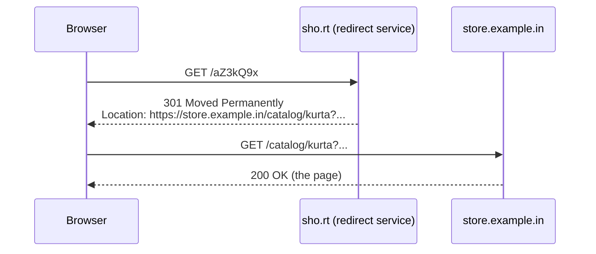
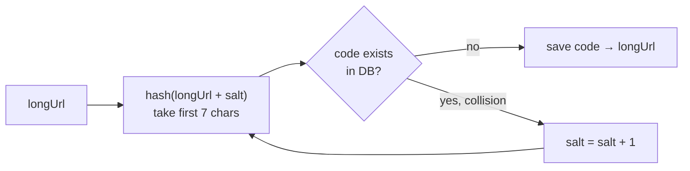
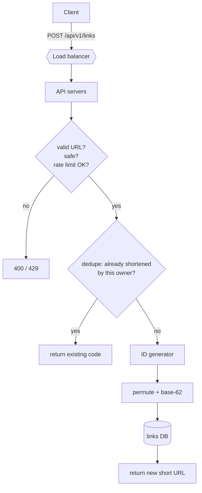
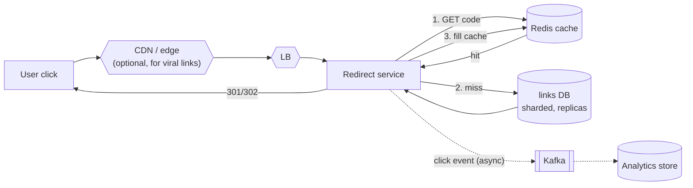

# 08 · Design a URL Shortener

<div class="chapter-meta" markdown>
<span>⏱ 40 min read</span>
<span class="hot">🔥 The most common "first" design question</span>
<span>Book: Chapter 8</span>
</div>

!!! abstract "TL;DR"
    - Two APIs: **shorten** (`POST` long URL → short code) and **redirect** (`GET /{code}` → `301/302` with `Location`).
    - Reads dwarf writes (tens of thousands of redirects/sec vs hundreds of creates/sec) → the redirect path must be **cache-first**.
    - 7 base-62 characters give **3.5 trillion** codes — plenty for hundreds of billions of links.
    - Code generation: **hash + collision check** (simple, needs a DB/Bloom-filter check), **unique ID → base-62** (no collisions, but sequential codes are guessable), or a **pre-generated key service** (fast, no collisions, an extra component).
    - **301** (permanent) lets browsers cache → less load, no per-click analytics. **302** (temporary) → every click hits you → analytics. Pick based on the product.

## The intuition: the cloakroom token

At a wedding cloakroom you hand over a bulky coat and get a small brass token "**K-47**". Later, you show
K-47 and get the coat back. The token is short, unique, and **meaningless by itself** — it only works because
the cloakroom keeps a register: `K-47 → Riya's red coat`.

A URL shortener is exactly that register: `aZ3kQ9x → https://example.in/very/long/path?with=params`.

---

## Step 1 · Scope

!!! example "Clarifying conversation"
    **You:** Who creates links — anyone anonymously, or signed-in users? — **Interviewer:** Mostly signed-in marketers, but anonymous creation is allowed.
    **You:** Roughly how many links are created, and how often is each opened? — **I:** About 40 million new links a day; a link gets around 50 clicks over its life.
    **You:** Do marketers need click counts? — **I:** Yes, eventually — but the redirect itself must stay fast.
    **You:** Any constraint on what the short part looks like? — **I:** Keep it short and URL-safe: digits and letters only.
    **You:** Do links live forever? — **I:** Default is long-lived (we'll say 15 years); users can set an earlier expiry.
    **You:** Vanity names like `/diwali-sale`? — **I:** Nice-to-have.

**Functional:** shorten a URL; redirect a short URL to the original. *(Stretch: custom alias, expiry, analytics.)*
**Non-functional:** very high availability and low latency on redirects; codes must not collide; scalable; codes shouldn't be trivially enumerable (nice to have).

### Estimates (from Chapter 2, worked example 4)

| Quantity | Value |
|---|---|
| New links | 40 M/day → ~460 writes/sec |
| Redirects (50:1) | ~23K/sec avg, ~45K/sec peak |
| Records in 15 years | ~219 B |
| Storage | ~250 B × 219 B ≈ 55 TB (plus replicas) |
| Code length | 62⁷ ≈ 3.5 T ≥ 219 B → **7 chars** |
| Hot-link cache (20% of 1 month of links ≈ 240 M × 250 B) | ~60 GB → a small Redis cluster |

---

## Step 2 · High-level design

### API

```http
POST /api/v1/links
     { "longUrl": "https://...", "alias": "diwali-sale" (optional), "expiresAt": "2027-01-01" (optional) }
  → 201 { "shortUrl": "https://sho.rt/aZ3kQ9x", "code": "aZ3kQ9x" }

GET /{code}
  → 301 or 302,  Location: https://...        (404 if unknown, 410 if expired)
```

### How a redirect works



### 301 vs 302 — a real product decision

| | **301 Moved Permanently** | **302 Found** (temporary; also 307) |
|---|---|---|
| Browser behaviour | Caches the mapping; later clicks go **straight to the target** | Asks the shortener **every time** |
| Load on us | Lower | Higher |
| Click analytics | ❌ we miss repeat clicks | ✅ every click is seen |
| Can we change the target later? | Hard (browsers cached it) | Yes |
| Typical choice | Pure redirect service, cost-sensitive | Marketing links, analytics products (bit.ly-style) |

(307/308 are the method-preserving versions of 302/301 — relevant only if a POST could hit the short URL.)

### The simplest version: a hash table

Conceptually it's a map `code → longUrl`. Two functions: `shorten(longUrl) → code` and `resolve(code) → longUrl`.
The interesting part is **how to generate the code**.

---

## Step 3 · Deep dive

### Data model

A relational table is fine to start; at 219 B rows you'll shard it (or use a KV store like DynamoDB/Cassandra,
since every access is by primary key).

```sql
CREATE TABLE links (
  code        VARCHAR(10) PRIMARY KEY,   -- 'aZ3kQ9x'
  long_url    TEXT        NOT NULL,
  owner_id    BIGINT,
  created_at  TIMESTAMP   NOT NULL,
  expires_at  TIMESTAMP   NULL
);
-- optional: dedupe identical long URLs per owner
CREATE INDEX idx_links_owner_url ON links (owner_id, long_url_hash);
```

### Code generation — three approaches

#### Approach A · Hash the long URL, then resolve collisions

Hash the long URL with a standard function and take the first 7 characters:

Hashing `https://store.example.in/catalog/kurta?colour=indigo&size=m` gives:

| Hash | Output size | Output (hex) |
|---|---|---|
| CRC32 | 32 bits → 8 hex chars | `7e4f6003` |
| MD5 | 128 bits → 32 hex chars | `ef6fccd4556105478a8f292ad9f21cf2` |
| SHA-1 | 160 bits → 40 hex chars | `6ab80c8af890410c521436aac154d5f54ace4960` |

Even the shortest is longer than 7, so we **truncate** — which increases collisions. Resolve them by
appending a **salt** (a predefined string or counter) and re-hashing until the code is free:



- Each attempt costs a **DB lookup** → expensive. Speed it up with a **Bloom filter** of existing codes in memory: "definitely not used" answers skip the DB.
- Nice property: the same long URL tends to produce the same code (natural dedupe), unless salted.

#### Approach B · Unique ID → base-62

Generate a **unique numeric ID** (Chapter 7 — Snowflake, or a range-allocated counter), then convert it to
base 62 using the alphabet `0-9 a-z A-Z`.

**Worked example:** ID = 3,141,592,653,589

```text
3141592653589 % 62 = 27  → 'r'     (quotient 50670849251)
50670849251   % 62 = 7   → '7'     (quotient 817271762)
817271762     % 62 = 38  → 'C'     (quotient 13181802)
13181802      % 62 = 44  → 'I'     (quotient 212609)
212609        % 62 = 11  → 'b'     (quotient 3429)
3429          % 62 = 19  → 'j'     (quotient 55)
55            % 62 = 55  → 'T'     (quotient 0)
read the remainders bottom → top:  "TjbIC7r"
```

Check (or try any number) with the converter:

<div class="sd-widget" data-widget="base62"></div>

```java
private static final char[] ALPHABET =
    "0123456789abcdefghijklmnopqrstuvwxyzABCDEFGHIJKLMNOPQRSTUVWXYZ".toCharArray();

static String toBase62(long n) {
    if (n == 0) return "0";
    StringBuilder sb = new StringBuilder();
    while (n > 0) { sb.append(ALPHABET[(int) (n % 62)]); n /= 62; }
    return sb.reverse().toString();
}

static long fromBase62(String s) {
    long n = 0;
    for (char c : s.toCharArray()) n = n * 62 + new String(ALPHABET).indexOf(c);
    return n;
}
```

- **No collisions by construction** — unique ID in, unique code out. No DB existence check.
- Code length grows with the ID: a 64-bit Snowflake ID is up to 11 base-62 characters. To stay at 7, use a **counter-based ID** (range allocation) that starts small, or keep a dedicated 42-bit ID space.
- ⚠️ **Guessable:** sequential IDs → sequential codes. Anyone can enumerate `…aVuA`, `…aVuB` and scrape every link. Fix: pass the ID through a reversible **permutation** (e.g. a small Feistel cipher or multiply by a large odd constant modulo 62⁷) before encoding — still unique, no longer sequential.

#### Approach C · Pre-generated key service (KGS)

Generate random 7-character codes **offline**, store them in a `keys_unused` table, and have a small **Key
Generation Service** hand them out. App servers fetch **batches** (say 1,000) into memory so each create costs no
remote call. Used keys move to `keys_used` (or are just deleted from unused).

- ✅ Fast, no collisions, random-looking codes.
- ❌ Another stateful service to run and make highly available; two servers must never get the same batch (atomic "claim batch" in the DB); keys held by a crashed server are lost (fine — 3.5 T exist).

#### Comparison

| | A · Hash + check | B · ID → base-62 | C · Key service |
|---|---|---|---|
| Code length | Fixed (7) | Grows with ID | Fixed (7) |
| Collisions | Possible → retry | None | None |
| Extra lookups | DB/Bloom check per create | None | Batch fetch occasionally |
| Needs ID generator / KGS | No | Yes (ID generator) | Yes (KGS) |
| Guessable | No | **Yes** unless permuted | No |
| Same URL → same code | Naturally (unsalted) | No (needs lookup) | No (needs lookup) |

A good interview answer: **Approach B with a permuted counter**, mentioning A and C as alternatives.

### The shortening flow (Approach B)



1. Validate the URL (format, length limit e.g. 2 KB), check it against a malware/phishing list, rate-limit the caller (Chapter 4).
2. Optionally check if this owner already shortened this URL (lookup by `long_url_hash`) and return the existing code.
3. Get a new unique ID, permute, encode to base-62.
4. Insert the row; return the short URL.

### The redirect flow — make it fast

Redirects are ~50× the writes and must be fast and always up.



- **Cache-aside** with LRU: hot links stay in Redis. Our hot set (~60 GB) fits a small cluster.
- Links are **immutable** → caching is easy (no invalidation except on expiry/deletion).
- Read replicas serve cache misses; shard the table by `code` (hash-based) to spread data.
- For viral links, even the edge/CDN can cache a 301 response for a short TTL.
- Unknown code → `404`. Expired → `410 Gone` (and delete lazily).

### Extras worth mentioning

- **Custom aliases:** check availability (the alias is just a code); reserve a namespace so aliases can't collide with generated codes (e.g. generated codes are exactly 7 chars, aliases must be ≥ 8 or contain `-`).
- **Expiry:** store `expires_at`; check on read (lazy), plus a periodic batch job to purge expired rows; codes can optionally be recycled after a long quarantine.
- **Analytics:** don't write to the DB on the redirect path. Emit a click event (code, time, country from IP, referrer, device) to Kafka; aggregate into a columnar store (ClickHouse/BigQuery) for dashboards.
- **Abuse:** shorteners are loved by phishers. Scan target URLs (Google Safe Browsing-style), rate-limit creation per user/IP, let users report links, and show an interstitial warning for flagged domains.
- **Availability:** the redirect service is stateless; DB replicated across zones; cache replicated. Even if the DB is down, cached hot links still redirect.

---

## Interviewer follow-ups

??? question "Two users shorten the same long URL — same code or different?"
    Product decision. Same code saves space and gives shared analytics, but leaks that someone else shortened the URL and
    mixes their stats. Most products give **per-user** codes and dedupe only within an owner (lookup by `owner_id +
    hash(long_url)`). Anonymous links can be deduped globally.

??? question "How do you avoid people enumerating all short links?"
    Don't expose sequential IDs: use random codes (KGS / hash) or permute the counter before base-62 encoding. Also
    rate-limit `GET` per IP to slow scanners, and make sure private links (e.g. password-reset or document links) never rely on
    obscurity alone.

??? question "What happens at 10× the traffic?"
    Redirect QPS → ~450K at peak. Scale the stateless redirect tier horizontally, grow the Redis cluster (hot set still tiny),
    push more traffic to the CDN with short TTLs, and keep the DB mostly out of the hot path. Writes (~4.6K/s) are still
    easy for a sharded store.

??? question "How would you store 55 TB?"
    Shard by `code` across a KV store (DynamoDB/Cassandra) or sharded MySQL/Postgres with ~1–2 TB per shard → ~30–60
    shards, each replicated 3×. Every access is a point lookup by primary key, so this partitions perfectly.

??? question "Why not generate a random 7-char code and just try to insert it?"
    That's Approach A without the hash. It works: with 3.5 T possible codes and, say, 200 B used, the chance a random code
    is taken is ~6% — so a retry happens sometimes, rarely twice. Use a unique constraint on insert and retry on conflict. It
    gets worse as the space fills, which is why you'd plan to move to 8 chars eventually.

---

## Practice

??? example "Practice 1 — Code length for a different scale"
    A company-internal shortener creates 50K links/day and keeps them forever (assume 30 years). How many characters do
    you need with base-62? With base-36 (lower-case + digits only)?

    **Solution.** 50K × 365 × 30 ≈ 548 M codes. Base-62: 62⁵ ≈ 916 M ✓ → **5 chars**. Base-36: 36⁵ ≈ 60 M ✗, 36⁶ ≈ 2.2 B ✓
    → **6 chars**.

??? example "Practice 2 — Encode"
    Convert ID 11157 to base-62 with alphabet `0-9a-zA-Z`.

    **Solution.** 11157 % 62 = 59 → 'X', q = 179; 179 % 62 = 55 → 'T', q = 2; 2 → '2'. Read bottom→top: **"2TX"**.
    Check: 2 × 62² + 55 × 62 + 59 = 7688 + 3410 + 59 = 11157 ✓.

??? example "Practice 3 — Cache sizing"
    20% of last month's links get 80% of clicks. Each cache entry is ~300 bytes with overhead. How much cache?

    **Solution.** 40 M × 30 = 1.2 B links/month × 20% = 240 M entries × 300 B ≈ **72 GB** → e.g. 3 × 32 GB Redis nodes
    (+ replicas).

---

## Revision checklist

- [ ] I can write the two APIs and explain 301 vs 302 as a product trade-off.
- [ ] I can derive QPS, storage, code length and cache size from assumptions.
- [ ] I can explain hash + collision resolution, ID → base-62, and a key-generation service, with pros/cons.
- [ ] I can base-62 encode a number by hand and know why sequential codes are a problem.
- [ ] I can draw the shortening and redirect flows, cache-first.
- [ ] I can discuss custom aliases, expiry, analytics and abuse prevention.

[Next: 09 · Web Crawler :material-arrow-right:](09-web-crawler.md){ .md-button .md-button--primary }
