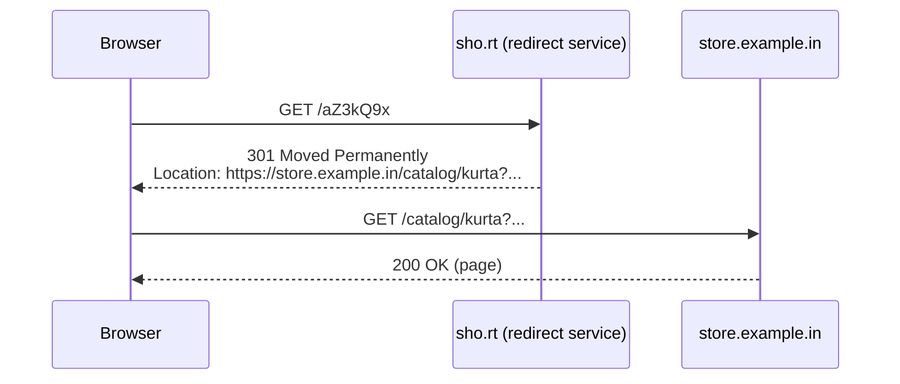
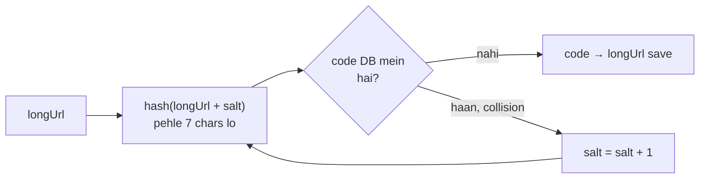
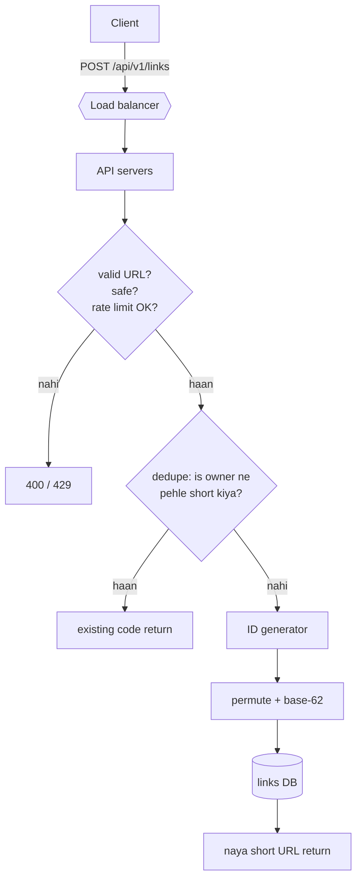
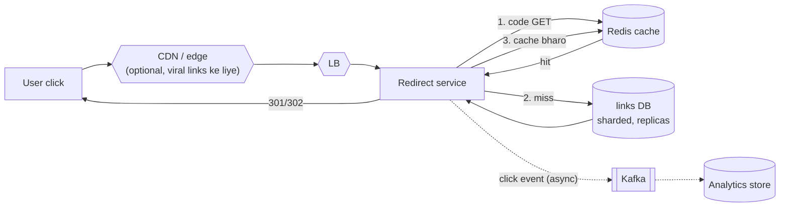

# 08 · URL Shortener Design karo

<div class="chapter-meta" markdown>
<span>⏱ 40 min read</span>
<span class="hot">🔥 Sabse common "pehla" design question</span>
<span>Book: Chapter 8</span>
</div>

!!! abstract "TL;DR"
    - Do APIs: **shorten** (`POST` long URL → short code) aur **redirect** (`GET /{code}` → `Location` ke saath `301/302`).
    - Reads writes se kahin zyada (das hazaaron redirects/sec vs saikdon creates/sec) → redirect path **cache-first** hona chahiye.
    - 7 base-62 characters **3.5 trillion** codes dete hain — saikdon billion links ke liye kaafi.
    - Code generation: **hash + collision check** (simple, DB/Bloom-filter check chahiye), **unique ID → base-62** (collisions nahi, par sequential codes guess ho sakte hain), ya **pre-generated key service** (tez, collisions nahi, ek extra component).
    - **301** (permanent) browser ko cache karne deta hai → kam load, per-click analytics nahi. **302** (temporary) → har click tumhare paas → analytics. Product ke hisaab se chuno.

## Intuition: cloakroom ka token

Shaadi ke cloakroom mein tum bhaari coat dete ho aur ek chhota peetal ka token milta hai "**K-47**". Baad mein K-47 dikhate ho aur coat
wapas. Token chhota hai, unique hai, aur **khud mein bematlab** — kaam sirf isliye karta hai kyunki cloakroom ek register rakhta hai:
`K-47 → Riya ka laal coat`.

URL shortener exactly wahi register hai: `aZ3kQ9x → https://example.in/very/long/path?with=params`.

---

## Step 1 · Scope

!!! example "Clarifying baatcheet"
    **Tum:** Links kaun banata hai — koi bhi anonymously, ya signed-in users? — **Interviewer:** Zyada tar signed-in marketers, par anonymous bhi allowed.
    **Tum:** Roughly kitne links bante hain, aur har ek kitni baar khulta hai? — **I:** Roz lagbhag 4 crore naye links; ek link apni zindagi mein ~50 clicks paata hai.
    **Tum:** Marketers ko click counts chahiye? — **I:** Haan, aage chalke — par redirect khud tez rehna chahiye.
    **Tum:** Short hissa kaisa dikhe, koi constraint? — **I:** Chhota aur URL-safe: sirf digits aur letters.
    **Tum:** Links hamesha zinda rehte hain? — **I:** Default lambi life (maan lo 15 saal); user pehle ki expiry set kar sakta hai.
    **Tum:** `/diwali-sale` jaise vanity names? — **I:** Nice-to-have.

**Functional:** URL short karo; short URL ko original pe redirect karo. *(Stretch: custom alias, expiry, analytics.)*
**Non-functional:** redirects pe bahut high availability aur low latency; codes collide na karein; scalable; codes aasaani se enumerate na ho sakein (nice to have).

### Estimates (Chapter 2, worked example 4 se)

| Cheez | Value |
|---|---|
| Naye links | 40 M/din → ~460 writes/sec |
| Redirects (50:1) | ~23K/sec avg, ~45K/sec peak |
| 15 saal mein records | ~219 B |
| Storage | ~250 B × 219 B ≈ 55 TB (plus replicas) |
| Code length | 62⁷ ≈ 3.5 T ≥ 219 B → **7 chars** |
| Hot-link cache (1 mahine ke links ka 20% ≈ 240 M × 250 B) | ~60 GB → chhota Redis cluster |

---

## Step 2 · High-level design

### API

```http
POST /api/v1/links
     { "longUrl": "https://...", "alias": "diwali-sale" (optional), "expiresAt": "2027-01-01" (optional) }
  → 201 { "shortUrl": "https://sho.rt/aZ3kQ9x", "code": "aZ3kQ9x" }

GET /{code}
  → 301 ya 302,  Location: https://...        (unknown ho toh 404, expired ho toh 410)
```

### Redirect kaise kaam karta hai



### 301 vs 302 — asli product decision

| | **301 Moved Permanently** | **302 Found** (temporary; 307 bhi) |
|---|---|---|
| Browser behaviour | Mapping cache karta hai; agle clicks **seedha target** pe | **Har baar** shortener se poochta hai |
| Hum pe load | Kam | Zyada |
| Click analytics | ❌ repeat clicks miss | ✅ har click dikhta hai |
| Baad mein target badal sakte hain? | Mushkil (browsers ne cache kar liya) | Haan |
| Typical choice | Pure redirect service, cost-sensitive | Marketing links, analytics products (bit.ly-style) |

(307/308, 302/301 ke method-preserving versions hain — tabhi relevant jab short URL pe POST aa sakta ho.)

### Sabse simple version: hash table

Concept mein yeh ek map hai `code → longUrl`. Do functions: `shorten(longUrl) → code` aur `resolve(code) → longUrl`. Interesting hissa hai
**code generate kaise karein**.

---

## Step 3 · Deep dive

### Data model

Shuru mein relational table theek hai; 219 B rows pe shard karoge (ya DynamoDB/Cassandra jaisa KV store, kyunki har access primary key se hai).

```sql
CREATE TABLE links (
  code        VARCHAR(10) PRIMARY KEY,   -- 'aZ3kQ9x'
  long_url    TEXT        NOT NULL,
  owner_id    BIGINT,
  created_at  TIMESTAMP   NOT NULL,
  expires_at  TIMESTAMP   NULL
);
-- optional: har owner ke liye identical long URLs dedupe
CREATE INDEX idx_links_owner_url ON links (owner_id, long_url_hash);
```

### Code generation — teen approaches

#### Approach A · Long URL hash karo, phir collisions resolve karo

Long URL ko standard function se hash karo aur pehle 7 characters lo. `https://store.example.in/catalog/kurta?colour=indigo&size=m`
hash karne pe:

| Hash | Output size | Output (hex) |
|---|---|---|
| CRC32 | 32 bits → 8 hex chars | `7e4f6003` |
| MD5 | 128 bits → 32 hex chars | `ef6fccd4556105478a8f292ad9f21cf2` |
| SHA-1 | 160 bits → 40 hex chars | `6ab80c8af890410c521436aac154d5f54ace4960` |

Sabse chhota bhi 7 se lamba hai, toh hum **truncate** karte hain — jisse collisions badhte hain. Inhe resolve karne ke liye ek **salt**
(predefined string ya counter) jodo aur tab tak re-hash karo jab tak code free na mile:



- Har attempt ek **DB lookup** hai → mehenga. Memory mein existing codes ka **Bloom filter** rakh ke tez karo: "pakka use nahi hua" waale jawab DB skip kar dete hain.
- Achhi baat: same long URL aam taur pe same code deta hai (natural dedupe), jab tak salt na lage.

#### Approach B · Unique ID → base-62

Ek **unique numeric ID** banao (Chapter 7 — Snowflake, ya range-allocated counter), phir use alphabet `0-9 a-z A-Z` se base 62 mein badlo.

**Worked example:** ID = 3,141,592,653,589

```text
3141592653589 % 62 = 27  → 'r'     (quotient 50670849251)
50670849251   % 62 = 7   → '7'     (quotient 817271762)
817271762     % 62 = 38  → 'C'     (quotient 13181802)
13181802      % 62 = 44  → 'I'     (quotient 212609)
212609        % 62 = 11  → 'b'     (quotient 3429)
3429          % 62 = 19  → 'j'     (quotient 55)
55            % 62 = 55  → 'T'     (quotient 0)
remainders neeche → upar padho:  "TjbIC7r"
```

Converter se check karo (ya koi bhi number try karo):

<div class="sd-widget" data-widget="base62"></div>

```java
private static final char[] ALPHABET =
    "0123456789abcdefghijklmnopqrstuvwxyzABCDEFGHIJKLMNOPQRSTUVWXYZ".toCharArray();

static String toBase62(long n) {
    if (n == 0) return "0";
    StringBuilder sb = new StringBuilder();
    while (n > 0) { sb.append(ALPHABET[(int) (n % 62)]); n /= 62; }
    return sb.reverse().toString();
}

static long fromBase62(String s) {
    long n = 0;
    for (char c : s.toCharArray()) n = n * 62 + new String(ALPHABET).indexOf(c);
    return n;
}
```

- **Banawat se hi collisions nahi** — unique ID andar, unique code bahar. Koi DB existence check nahi.
- Code length ID ke saath badhti hai: 64-bit Snowflake ID 11 base-62 characters tak jaati hai. 7 pe rehne ke liye chhote se shuru hone waala **counter-based ID** (range allocation) use karo, ya dedicated 42-bit ID space rakho.
- ⚠️ **Guess ho sakte hain:** sequential IDs → sequential codes. Koi bhi `…IC7r`, `…IC7s` enumerate karke saare links scrape kar sakta hai. Fix: encode se pehle ID ko reversible **permutation** se guzaro (jaise chhota Feistel cipher, ya 62⁷ modulo ek bade odd constant se multiply) — ab bhi unique, par sequential nahi.

#### Approach C · Pre-generated key service (KGS)

Random 7-character codes **offline** banao, `keys_unused` table mein rakho, aur ek chhoti **Key Generation Service** unhe baante. App
servers **batches** (maan lo 1,000) memory mein le aate hain taaki har create pe koi remote call na ho. Used keys `keys_used` mein chali
jaati hain (ya bas unused se delete).

- ✅ Tez, collisions nahi, random dikhne waale codes.
- ❌ Ek aur stateful service jo highly available chahiye; do servers ko kabhi same batch nahi milna chahiye (DB mein atomic "claim batch"); crash hue server ke keys kho jaate hain (theek hai — 3.5 T hain).

#### Comparison

| | A · Hash + check | B · ID → base-62 | C · Key service |
|---|---|---|---|
| Code length | Fixed (7) | ID ke saath badhti | Fixed (7) |
| Collisions | Ho sakte → retry | Nahi | Nahi |
| Extra lookups | Har create pe DB/Bloom check | Nahi | Kabhi-kabhi batch fetch |
| ID generator / KGS chahiye | Nahi | Haan (ID generator) | Haan (KGS) |
| Guessable | Nahi | **Haan** jab tak permute na karo | Nahi |
| Same URL → same code | Naturally (bina salt) | Nahi (lookup chahiye) | Nahi (lookup chahiye) |

Achha interview answer: **permuted counter ke saath Approach B**, A aur C ko alternatives ki tarah batate hue.

### Shortening flow (Approach B)



1. URL validate karo (format, length limit jaise 2 KB), malware/phishing list se check karo, caller ko rate-limit karo (Chapter 4).
2. Optionally check karo ki is owner ne yeh URL pehle short kiya hai ya nahi (`long_url_hash` se lookup) aur existing code return karo.
3. Nayi unique ID lo, permute karo, base-62 mein encode karo.
4. Row insert karo; short URL return karo.

### Redirect flow — ise tez banao

Redirects writes ke ~50× hain aur tez aur hamesha up hone chahiye.



- LRU ke saath **cache-aside**: hot links Redis mein rehte hain. Hamara hot set (~60 GB) chhote cluster mein fit.
- Links **immutable** hain → caching aasaan (expiry/deletion ke alawa invalidation nahi).
- Cache misses read replicas serve karte hain; table ko `code` se shard karo (hash-based) taaki data phaile.
- Viral links ke liye edge/CDN bhi 301 response ko chhote TTL ke liye cache kar sakta hai.
- Unknown code → `404`. Expired → `410 Gone` (aur lazily delete).

### Batane laayak extras

- **Custom aliases:** availability check karo (alias bhi bas ek code hai); namespace reserve karo taaki aliases generated codes se na takrayein (jaise generated codes exactly 7 chars, aliases ≥ 8 ya `-` waale).
- **Expiry:** `expires_at` store karo; read pe check (lazy), plus expired rows purge karne ke liye periodic batch job; codes lambe quarantine ke baad optionally recycle.
- **Analytics:** redirect path pe DB mein mat likho. Click event (code, time, IP se country, referrer, device) Kafka pe bhejo; dashboards ke liye columnar store (ClickHouse/BigQuery) mein aggregate karo.
- **Abuse:** phishers ko shorteners bahut pasand hain. Target URLs scan karo (Google Safe Browsing-style), creation ko per user/IP rate-limit karo, users ko report karne do, aur flagged domains ke liye interstitial warning dikhao.
- **Availability:** redirect service stateless; DB zones ke across replicated; cache replicated. DB down ho tab bhi cached hot links redirect hote rehte hain.

---

## Interviewer follow-ups

??? question "Do users same long URL short karte hain — same code ya alag?"
    Product decision. Same code space bachata hai aur shared analytics deta hai, par leak karta hai ki kisi aur ne bhi short kiya aur
    unke stats mix karta hai. Zyada tar products **per-user** codes dete hain aur sirf owner ke andar dedupe karte hain (`owner_id +
    hash(long_url)` se lookup). Anonymous links globally dedupe ho sakte hain.

??? question "Log saare short links enumerate na karein, iske liye kya karoge?"
    Sequential IDs expose mat karo: random codes (KGS / hash) use karo ya base-62 encoding se pehle counter permute karo. Scanners ko slow
    karne ke liye per IP `GET` rate-limit karo, aur dhyaan rakho ki private links (password-reset ya document links) sirf obscurity pe na tike hon.

??? question "10× traffic pe kya hoga?"
    Peak pe redirect QPS → ~450K. Stateless redirect tier horizontally scale karo, Redis cluster badhao (hot set ab bhi chhota), chhote
    TTLs ke saath zyada traffic CDN pe dhakelo, aur DB ko hot path se mostly bahar rakho. Writes (~4.6K/s) sharded store ke liye ab bhi aasaan.

??? question "55 TB kaise store karoge?"
    KV store (DynamoDB/Cassandra) ya sharded MySQL/Postgres mein `code` se shard karo, har shard ~1–2 TB → ~30–60 shards, har ek 3× replicated.
    Har access primary key se point lookup hai, toh yeh perfectly partition hota hai.

??? question "Random 7-char code banake seedha insert kyun nahi karte?"
    Yeh bina hash ke Approach A hai. Kaam karta hai: 3.5 T possible codes aur maan lo 200 B used ke saath random code ke taken hone ka chance
    ~6% hai — toh kabhi-kabhi retry, do baar shaayad hi. Insert pe unique constraint lagao aur conflict pe retry karo. Space bharne ke saath
    yeh bigadta hai, isliye aage chalke 8 chars pe jaane ka plan rakho.

---

## Practice

??? example "Practice 1 — Alag scale ke liye code length"
    Company-internal shortener roz 50K links banata hai aur hamesha rakhta hai (maan lo 30 saal). Base-62 mein kitne characters chahiye?
    Base-36 (lower-case + digits) mein?

    **Solution.** 50K × 365 × 30 ≈ 548 M codes. Base-62: 62⁵ ≈ 916 M ✓ → **5 chars**. Base-36: 36⁵ ≈ 60 M ✗, 36⁶ ≈ 2.2 B ✓ → **6 chars**.

??? example "Practice 2 — Encode karo"
    ID 11157 ko alphabet `0-9a-zA-Z` se base-62 mein badlo.

    **Solution.** 11157 % 62 = 59 → 'X', q = 179; 179 % 62 = 55 → 'T', q = 2; 2 → '2'. Neeche→upar padho: **"2TX"**.
    Check: 2 × 62² + 55 × 62 + 59 = 7688 + 3410 + 59 = 11157 ✓.

??? example "Practice 3 — Cache sizing"
    Pichle mahine ke 20% links ko 80% clicks milte hain. Har cache entry overhead ke saath ~300 bytes. Kitna cache?

    **Solution.** 40 M × 30 = 1.2 B links/mahina × 20% = 240 M entries × 300 B ≈ **72 GB** → jaise 3 × 32 GB Redis nodes (+ replicas).

---

## Revision checklist

- [ ] Do APIs likh sakta hoon aur 301 vs 302 ko product trade-off ki tarah samjha sakta hoon.
- [ ] Assumptions se QPS, storage, code length aur cache size nikaal sakta hoon.
- [ ] Hash + collision resolution, ID → base-62, aur key-generation service pros/cons ke saath samjha sakta hoon.
- [ ] Haath se number ko base-62 encode kar sakta hoon aur pata hai sequential codes problem kyun hain.
- [ ] Shortening aur redirect flows cache-first bana sakta hoon.
- [ ] Custom aliases, expiry, analytics aur abuse prevention discuss kar sakta hoon.

[Aage: 09 · Web Crawler :material-arrow-right:](09-web-crawler.md){ .md-button .md-button--primary }
