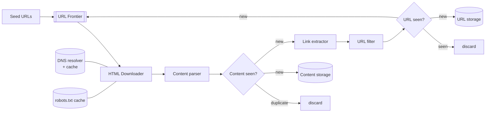
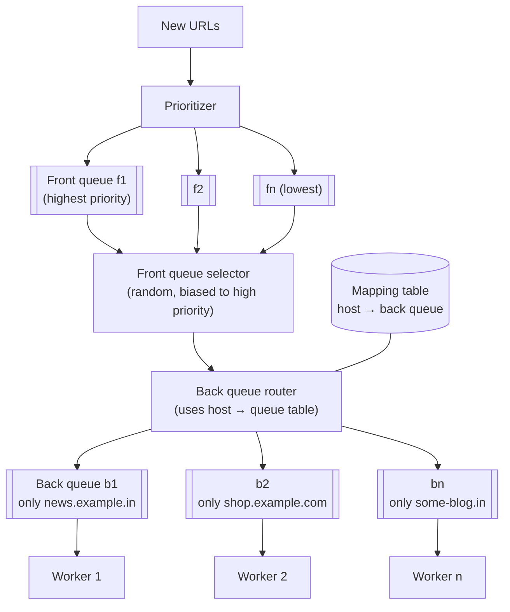
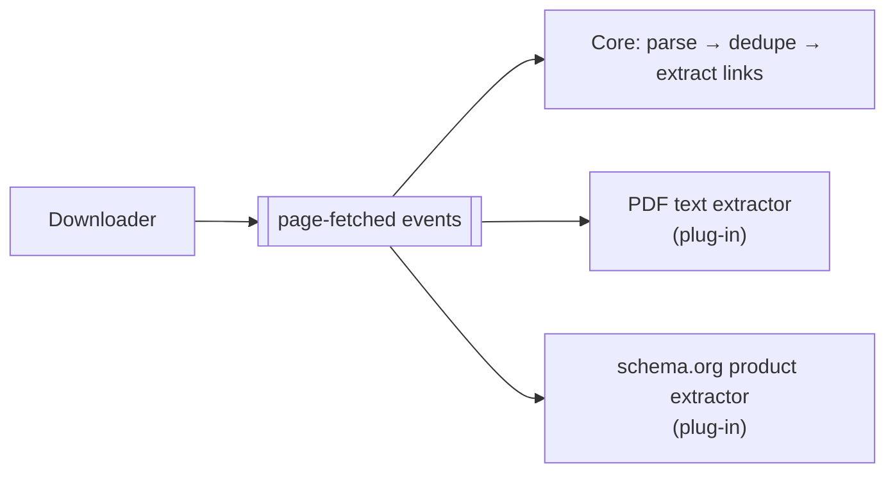

# 09 · Design a Web Crawler

<div class="chapter-meta" markdown>
<span>⏱ 45 min read</span>
<span class="hot">🔥 Tests queueing, dedup and politeness thinking</span>
<span>Book: Chapter 9</span>
</div>

!!! abstract "TL;DR"
    - A crawler repeatedly: **take a URL → download → parse → dedupe content → extract links → filter → dedupe URLs → enqueue**. It's **BFS** over the web graph.
    - The heart is the **URL frontier**: *front queues* decide **priority** (which pages matter more), *back queues* enforce **politeness** (one host per queue, a delay between requests to the same host).
    - Respect **robots.txt** (cached), cache **DNS** (it's slow), distribute crawlers **geographically**, use short **timeouts**.
    - Dedupe **content** with fingerprints/hashes (and SimHash for near-duplicates) and **URLs** with a **Bloom filter** / hash set.
    - Defend against **spider traps** (infinite URL spaces), redundant/low-value content, and keep pages **fresh** by recrawling in proportion to how often they change.

## The intuition: a newspaper's stringers

Imagine a newspaper that wants to read *every* local notice board in the country. It sends stringers out with a
list of starting addresses. At each board they photograph the notices, note any **new addresses** mentioned,
and add them to the office's to-visit list. Rules:

- Don't send ten stringers to the **same small office at once** — they'll throw you out (*politeness*).
- Visit the **important boards** (city centre) more often than a remote village (*priority, freshness*).
- Don't photograph a notice you've already got (*content dedup*), and don't revisit an address already on the list (*URL dedup*).
- Some buildings have a sign "no photography in the back room" (*robots.txt*).
- Watch out for a building with a staircase that never ends (*spider trap*).

---

## Step 1 · Scope

What is a crawler for? It changes the design:

| Purpose | Example | Emphasis |
|---|---|---|
| **Search engine indexing** | Googlebot, Bingbot | Scale, freshness, priority |
| **Web archiving** | Internet Archive, national libraries | Completeness, long-term storage |
| **Web mining / data collection** | Market research, training datasets | Targeted domains, extraction |
| **Web monitoring** | Brand/copyright/price monitoring | Specific sites, recrawl frequency |

!!! example "Clarifying conversation"
    **You:** What's the crawl for? — **Interviewer:** A search engine index.
    **You:** How many pages, how often? — **I:** About 2 billion pages a month.
    **You:** Content types? — **I:** HTML only for now.
    **You:** Include newly added/edited pages? — **I:** Yes, freshness matters.
    **You:** Do we store the pages? For how long? — **I:** Store raw HTML for 3 years.
    **You:** Duplicate pages? — **I:** Skip duplicate content.

**Characteristics a good crawler needs:**

- **Scalability** — billions of pages → massively parallel.
- **Robustness** — the web is full of broken HTML, unresponsive servers, crashes, malicious links. Don't fall over.
- **Politeness** — never hammer a site with too many requests in a short time.
- **Extensibility** — adding a new content type (images, PDFs) should be a plug-in, not a redesign.

### Estimates

| Quantity | Value |
|---|---|
| Pages/month | 2 B |
| Average download rate | 2 B / (30 × 86,400) ≈ **770 pages/s** |
| Peak (×2) | ~**1,500 pages/s** |
| Average page size | ~300 KB |
| Storage/month | 2 B × 300 KB = **600 TB** |
| Storage for 3 years | 600 TB × 36 ≈ **21.6 PB** (compress! HTML compresses 5–10×) |
| Download bandwidth | 1,500 × 300 KB ≈ 450 MB/s ≈ **3.6 Gbps** at peak |

---

## Step 2 · High-level design



| Component | Job |
|---|---|
| **Seed URLs** | Starting points. Pick to cover the web well — e.g. by **locality** (popular sites per country) or **topic** (news, shopping, sports, education…). |
| **URL Frontier** | The to-download list (FIFO at its simplest — but much smarter in practice, see below). |
| **HTML Downloader** | Fetches pages over HTTP. |
| **DNS Resolver** | Turns hostnames into IPs (cached). |
| **Content Parser** | Parses and validates HTML; malformed pages are dropped. Run as a separate component so slow parsing doesn't block downloads. |
| **Content Seen?** | Detects pages whose content we already have — a large share of the web is duplicate (mirrors, syndication, printer-friendly copies). Compare **hashes**, not full text. |
| **Content Storage** | Most content on disk (blob storage, compressed); popular content cached in memory. |
| **Link Extractor** | Pulls links out of the HTML and converts relative links to absolute (`/about` → `https://site.in/about`). |
| **URL Filter** | Drops unwanted URLs: certain file types/extensions, error-prone links, blacklisted sites. |
| **URL Seen?** | Skips URLs already visited or already queued (avoids loops and repeat work). Bloom filter or hash table. |
| **URL Storage** | Record of visited URLs. |

### The crawl loop, step by step

1. Add seed URLs to the frontier.
2. The downloader takes URLs from the frontier, resolves DNS, downloads the page.
3. The parser parses it and checks it's valid.
4. "Content seen?" — if this exact content exists, drop it.
5. Otherwise store it and send it to the link extractor.
6. Extracted links go through the URL filter.
7. "URL seen?" — new URLs go to URL storage and the frontier; known ones are dropped.
8. Repeat.

---

## Step 3 · Deep dive

### BFS, not DFS

The web is a directed graph: pages are nodes, links are edges. **DFS** dives arbitrarily deep into one site
and can get lost. **BFS** (a FIFO queue) is the usual base. But plain BFS has two problems:

1. **Impoliteness.** Most links on a page point to the **same host**. A FIFO queue full of `wiki.example.org/...`
   URLs means our parallel workers all hit that one host at once — effectively a DoS.
2. **No priority.** A random forum post and a major news homepage get equal treatment. We want important and
   frequently-changing pages first.

The URL frontier fixes both.

### The URL frontier



**Front queues → priority.** A **prioritizer** scores each URL — by PageRank/link popularity, site traffic,
update frequency, depth from the root — and puts it into one of n front queues (f1 = highest). A **queue
selector** picks from front queues randomly but **biased toward higher priority**, so important pages go first
while low-priority ones still make progress.

**Back queues → politeness.** Each back queue holds URLs from **only one host**. A **mapping table** records
`host → back queue`. Each back queue is drained by **one worker thread**, which downloads one page at a time
and **waits a delay** between requests (e.g. a few seconds, or whatever `Crawl-delay` in robots.txt says). So no
host ever sees more than one concurrent request from us.

| Mapping table | |
|---|---|
| `news.example.in` | b1 |
| `shop.example.com` | b2 |
| … | … |
| `some-blog.in` | bn |

```java
/** Minimal politeness scheduler: one queue per host, min delay between fetches to the same host. */
final class PoliteFrontier {
    private final Map<String, Deque<String>> perHost = new HashMap<>();
    private final PriorityQueue<Map.Entry<String, Long>> ready =      // host → earliest next-fetch time
        new PriorityQueue<>(Map.Entry.comparingByValue());
    private final long delayMs;

    PoliteFrontier(long delayMs) { this.delayMs = delayMs; }

    synchronized void add(String url) {
        String host = java.net.URI.create(url).getHost();
        Deque<String> q = perHost.computeIfAbsent(host, h -> new ArrayDeque<>());
        if (q.isEmpty()) ready.add(Map.entry(host, System.currentTimeMillis()));
        q.addLast(url);
    }

    /** Returns the next URL whose host is allowed to be hit now, or null. */
    synchronized String next() {
        Map.Entry<String, Long> head = ready.peek();
        if (head == null || head.getValue() > System.currentTimeMillis()) return null;
        ready.poll();
        Deque<String> q = perHost.get(head.getKey());
        String url = q.pollFirst();
        if (!q.isEmpty()) ready.add(Map.entry(head.getKey(), System.currentTimeMillis() + delayMs));
        return url;
    }
}
```

**Freshness.** Pages change; we must recrawl. Recrawling everything is wasteful, so:

- Recrawl based on each page's **update history** (a page that changed in the last 3 visits gets revisited sooner).
- Recrawl **important** pages more often.
- Use HTTP conditional requests (`If-Modified-Since` / `ETag`) so unchanged pages cost a tiny `304 Not Modified`.

**Frontier storage.** Hundreds of millions of URLs don't fit in memory, and pure disk is slow. **Hybrid**: keep
most of the frontier on disk, with in-memory **buffers** for enqueue/dequeue that are flushed/refilled in batches.

### HTML downloader

**robots.txt** (Robots Exclusion Protocol) tells crawlers what they may fetch. Fetch it per host **before**
crawling, cache it (refresh daily), and obey it:

```text
User-agent: *
Disallow: /cart/
Disallow: /search
Crawl-delay: 5

User-agent: MyCrawlerBot
Allow: /
```

**Making downloads fast.** At ~1,500 pages/s, the downloader spends most of its time *waiting*, so the wins come
from removing waits:

| Wait | Fix |
|---|---|
| DNS lookups (10–200 ms, often blocking) | A local DNS cache refreshed in the background; async resolver |
| Slow or dead servers | Aggressive connect/read timeouts (a few seconds) and move on |
| Long network paths | Run crawler fleets in several regions; each crawls hosts near it |
| One thread per request | Async HTTP clients holding thousands of connections across many hosts |
| One machine's capacity | Many crawler machines; partition the URL space **by host** with consistent hashing, so each host's politeness state lives on exactly one machine |

**Staying up.** Assume crashes, malformed HTML and hostile pages:

| Failure | Defence |
|---|---|
| A crawler machine dies | Its hosts re-hash to neighbours; frontier and seen-sets are checkpointed to durable storage, so work resumes rather than restarts |
| A page crashes the parser | Parse in an isolated worker with limits on size and time; catch everything, log, skip |
| Garbage data | Validate (content type, encoding, size) before storing |

### Extensibility

Treat everything after the downloader as a set of **subscribers** to a "page fetched" event. The core loop
(parse → dedupe → extract links) is one subscriber; new capabilities are added as more subscribers without
touching it. For example, a **PDF text extractor** that indexes documents, or a **structured-data extractor**
that pulls product prices and ratings out of schema.org markup:



### Dedup in detail

**Content seen?** Hash each page body (e.g. 64-bit fingerprint) and look it up in a set. Exact hashes catch
exact duplicates. For **near-duplicates** (same article with different ads/timestamps), use **SimHash** or
**MinHash**: similar documents produce fingerprints that differ in few bits, so you flag pages within a small
Hamming distance.

**URL seen?** Normalise URLs first (lower-case host, remove default ports, sort query params, strip fragments
`#…` and tracking params like `utm_*`). Then check a **Bloom filter**: 10 billion URLs × ~10 bits ≈ 12.5 GB of
memory, 1% false positives (meaning we occasionally skip a URL we haven't actually seen — acceptable for a crawler).

### Problematic content

- **Redundant content** — handled by content dedup.
- **Spider traps** — pages that generate infinite URLs, e.g. calendar links (`/calendar?month=…` forever) or
  `site.in/a/b/c/a/b/c/…`. Defences: max URL length, max depth per host, max pages per host per crawl,
  detecting repetitive path patterns, and manual blacklists for known traps.
- **Data noise** — ads, code snippets, spam pages; filter them out where possible.

---

## Step 4 · Wrap-up — what else

If time remains, these are the threads worth pulling:

- **JavaScript-heavy sites.** Many pages build their links and content in the browser. A pool of headless-browser renderers can handle them, but rendering costs 10–100× a plain fetch — route only sites that need it.
- **Quality over quantity.** A spam/low-quality classifier at the filter stage saves storage, bandwidth and index noise.
- **Scaling the stores.** The URL store and content store need sharding (by host or URL hash) and replication like any large dataset (Chapters 1 and 6).
- **Operations.** Dashboards for pages/s, error rate per host, robots.txt denials, frontier size and freshness lag; alerts when one host's URL count explodes (a trap) or the download rate drops.
- **Being a good citizen.** Identify the bot with a clear `User-Agent` and contact URL, back off on `429`/`503`, and honour site owners' requests.

---

## Interviewer follow-ups

??? question "How do you make sure two crawler machines don't hit the same host simultaneously?"
    Partition by **host**, not by URL: `hash(host) → crawler machine` (consistent hashing so machines can join/leave).
    Then all of a host's URLs land on one machine, which keeps one back queue per host and enforces the delay locally — no
    cross-machine coordination needed.

??? question "Your crawler is downloading 1,000 pages/s but CPU is idle. Where's the bottleneck?"
    Likely I/O waits: DNS lookups (no cache, or a synchronous resolver), slow servers without timeouts, or too few concurrent
    connections. Fixes: DNS cache + async resolver, aggressive timeouts, async/non-blocking HTTP clients with thousands of
    concurrent connections across many hosts, and check politeness queues aren't starving workers (too few distinct hosts in
    the frontier).

??? question "How would you prioritise which URLs to crawl first?"
    Score = f(page importance, change rate, staleness). Importance from link-based rank (PageRank), domain authority and
    traffic; change rate from past crawl history; staleness = time since last crawl. Map the score to front queues and bias the
    selector toward high-priority queues.

??? question "How do you avoid re-downloading unchanged pages?"
    Conditional GETs with `If-Modified-Since` / `If-None-Match` (ETag) → server answers `304 Not Modified` without the body.
    For servers that don't support it, compare the content fingerprint after download and skip reprocessing.

??? question "How do you handle a 'spider trap' you've never seen before?"
    Generic limits catch most: URL length cap, depth cap per host, page budget per host per crawl cycle, and detection of
    repeating path segments or query parameters that only change a counter. Alert when one host's discovered-URL count explodes
    relative to its PageRank — then a human can blacklist the pattern.

---

## Practice

??? example "Practice 1 — Politeness throughput"
    Your politeness rule is "one request per host every 2 seconds". To sustain 1,500 pages/s, how many distinct hosts must be
    active in the frontier at any moment?

    **Solution.** Each host contributes at most 0.5 pages/s → need ≥ 1,500 / 0.5 = **3,000 active hosts** (more in practice, since
    downloads take time and some hosts are slow). This is why the frontier must keep many hosts "hot", not just many URLs.

??? example "Practice 2 — Bloom filter memory"
    You expect 5 billion unique URLs and accept 1% false positives. Memory for the Bloom filter?

    **Solution.** ~9.6 bits per element → 5 × 10⁹ × 9.6 ≈ 4.8 × 10¹⁰ bits ≈ **6 GB**. Fits in RAM on one machine, or shard it by
    host alongside the frontier.

??? example "Practice 3 — Design a focused crawler"
    Design a crawler that watches 50,000 e-commerce product pages for price changes every hour. What changes vs a search crawler?

    **Solution.** No discovery (fixed URL list) → no link extraction, no URL-seen set. Frontier = scheduler keyed by next-due
    time. Politeness still matters (group by host, respect robots and rate limits). Use conditional GETs, extract just the price
    (selector per site, or headless rendering for JS-heavy pages), store a time series, and alert on changes. 50K/hour ≈ 14 req/s — tiny.

---

## Revision checklist

- [ ] I can list crawler use cases and the four properties: scalable, robust, polite, extensible.
- [ ] I can estimate QPS, storage and bandwidth for a crawl.
- [ ] I can draw the pipeline and explain each component.
- [ ] I can explain why plain BFS is impolite and unprioritised, and how front/back queues fix it.
- [ ] I know robots.txt, DNS caching, locality, timeouts, and partitioning by host.
- [ ] I can explain content dedup (hash, SimHash) and URL dedup (normalisation + Bloom filter).
- [ ] I can name spider-trap defences and freshness strategies.

[Next: 10 · Notification System :material-arrow-right:](10-notification-system.md){ .md-button .md-button--primary }
