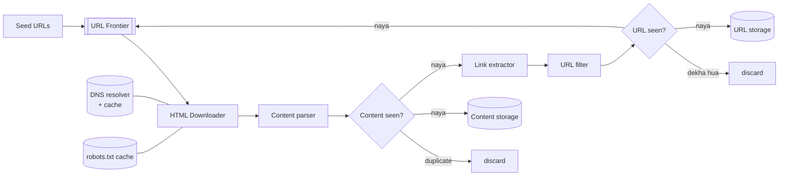
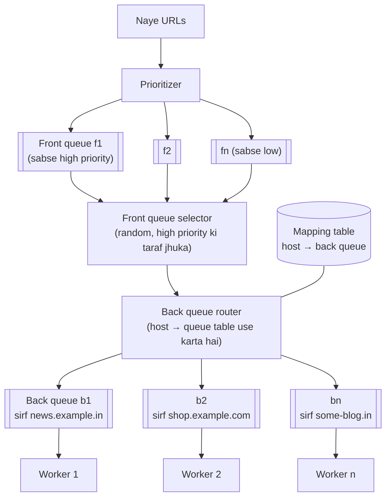
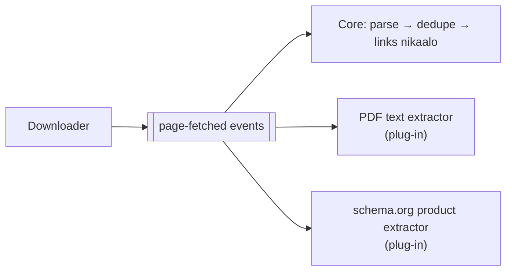

# 09 · Web Crawler Design karo

<div class="chapter-meta" markdown>
<span>⏱ 45 min read</span>
<span class="hot">🔥 Queueing, dedup aur politeness ki soch test karta hai</span>
<span>Book: Chapter 9</span>
</div>

!!! abstract "TL;DR"
    - Crawler baar-baar: **URL lo → download → parse → content dedupe → links nikaalo → filter → URLs dedupe → enqueue**. Yeh web graph pe **BFS** hai.
    - Dil hai **URL frontier**: *front queues* **priority** decide karti hain (kaunse pages zyada important), *back queues* **politeness** enforce karti hain (har queue mein ek host, same host ki requests ke beech delay).
    - **robots.txt** ki izzat karo (cached), **DNS** cache karo (slow hai), crawlers ko **geographically** baanto, chhote **timeouts** rakho.
    - **Content** ko fingerprints/hashes se dedupe karo (near-duplicates ke liye SimHash) aur **URLs** ko **Bloom filter** / hash set se.
    - **Spider traps** (infinite URL spaces), redundant/bekaar content se bacho, aur pages ko **fresh** rakho — jitna badalte hain utna recrawl.

## Intuition: akhbaar ke stringers

Socho ek akhbaar desh ka *har* local notice board padhna chahta hai. Woh stringers ko shuruaati addresses ki list deke bhejta hai. Har
board pe woh notices ki photo lete hain, likhe hue **naye addresses** note karte hain, aur office ki to-visit list mein jod dete hain. Rules:

- Ek hi chhote office pe **ek saath das stringers** mat bhejo — bahar nikaal denge (*politeness*).
- **Important boards** (shehar ka centre) door ke gaon se zyada baar dekho (*priority, freshness*).
- Jo notice pehle se hai uski dobara photo mat lo (*content dedup*), aur jo address pehle se list mein hai wahan dobara mat jao (*URL dedup*).
- Kuch buildings pe likha hai "peeche waale kamre mein photo mana hai" (*robots.txt*).
- Us building se bacho jiski seedhiyan kabhi khatam nahi hoti (*spider trap*).

---

## Step 1 · Scope

Crawler kis liye hai? Isse design badalta hai:

| Purpose | Example | Zor kis pe |
|---|---|---|
| **Search engine indexing** | Googlebot, Bingbot | Scale, freshness, priority |
| **Web archiving** | Internet Archive, national libraries | Completeness, long-term storage |
| **Web mining / data collection** | Market research, training datasets | Targeted domains, extraction |
| **Web monitoring** | Brand/copyright/price monitoring | Specific sites, recrawl frequency |

!!! example "Clarifying baatcheet"
    **Tum:** Crawl kis liye hai? — **Interviewer:** Search engine index ke liye.
    **Tum:** Kitne pages, kitni baar? — **I:** Mahine mein lagbhag 2 billion pages.
    **Tum:** Content types? — **I:** Abhi sirf HTML.
    **Tum:** Naye/edit hue pages bhi? — **I:** Haan, freshness matter karti hai.
    **Tum:** Pages store karne hain? Kitne time? — **I:** Raw HTML 3 saal.
    **Tum:** Duplicate pages? — **I:** Duplicate content skip karo.

**Achhe crawler ki khoobiyan:**

- **Scalability** — billions of pages → massively parallel.
- **Robustness** — web toote HTML, jawab na dene waale servers, crashes, malicious links se bhara hai. Girna nahi hai.
- **Politeness** — kisi site pe thode time mein bahut requests mat thoko.
- **Extensibility** — naya content type (images, PDFs) jodna plug-in hona chahiye, redesign nahi.

### Estimates

| Cheez | Value |
|---|---|
| Pages/mahina | 2 B |
| Average download rate | 2 B / (30 × 86,400) ≈ **770 pages/s** |
| Peak (×2) | ~**1,500 pages/s** |
| Average page size | ~300 KB |
| Storage/mahina | 2 B × 300 KB = **600 TB** |
| 3 saal ka storage | 600 TB × 36 ≈ **21.6 PB** (compress karo! HTML 5–10× compress hota hai) |
| Download bandwidth | 1,500 × 300 KB ≈ 450 MB/s ≈ peak pe **3.6 Gbps** |

---

## Step 2 · High-level design



| Component | Kaam |
|---|---|
| **Seed URLs** | Shuruaati points. Aise chuno ki web achhe se cover ho — jaise **locality** se (har desh ki popular sites) ya **topic** se (news, shopping, sports, education…). |
| **URL Frontier** | Download karne waali list (sabse simple mein FIFO — par practice mein kahin smarter, neeche dekho). |
| **HTML Downloader** | HTTP pe pages laata hai. |
| **DNS Resolver** | Hostnames ko IPs mein badalta hai (cached). |
| **Content Parser** | HTML parse aur validate karta hai; kharab pages drop. Alag component rakho taaki slow parsing downloads block na kare. |
| **Content Seen?** | Woh pages pakadta hai jinka content pehle se hai — web ka bada hissa duplicate hai (mirrors, syndication, printer-friendly copies). Poora text nahi, **hashes** compare karo. |
| **Content Storage** | Zyada tar content disk pe (blob storage, compressed); popular content memory mein cached. |
| **Link Extractor** | HTML se links nikaalta hai aur relative links ko absolute banata hai (`/about` → `https://site.in/about`). |
| **URL Filter** | Unwanted URLs hatata hai: kuch file types/extensions, error-prone links, blacklisted sites. |
| **URL Seen?** | Pehle visit ya queue hue URLs skip karta hai (loops aur repeat kaam se bachata hai). Bloom filter ya hash table. |
| **URL Storage** | Visit hue URLs ka record. |

### Crawl loop, step by step

1. Seed URLs frontier mein daalo.
2. Downloader frontier se URLs leta hai, DNS resolve karta hai, page download karta hai.
3. Parser parse karke check karta hai ki valid hai.
4. "Content seen?" — exact same content hai toh drop.
5. Warna store karo aur link extractor ko bhejo.
6. Nikle links URL filter se guzarte hain.
7. "URL seen?" — naye URLs URL storage aur frontier mein; jaane-pehchaane drop.
8. Repeat.

---

## Step 3 · Deep dive

### BFS, DFS nahi

Web ek directed graph hai: pages nodes, links edges. **DFS** ek site mein bewajah gehraai tak ghus jaata hai aur kho sakta hai. **BFS**
(FIFO queue) usual base hai. Par plain BFS ki do problems:

1. **Impoliteness.** Page ke zyada tar links **same host** ki taraf jaate hain. `wiki.example.org/...` URLs se bhari FIFO queue matlab
   hamare saare parallel workers ek saath us ek host pe gir padte hain — practically DoS.
2. **Priority nahi.** Random forum post aur badi news homepage ko barabar treatment. Hume important aur jaldi badalne waale pages pehle chahiye.

URL frontier dono fix karta hai.

### URL frontier



**Front queues → priority.** Ek **prioritizer** har URL ko score deta hai — PageRank/link popularity, site traffic, update frequency, root se
depth ke hisaab se — aur n front queues mein se ek mein daalta hai (f1 = sabse high). **Queue selector** front queues se random chunta hai
par **high priority ki taraf jhuka hua**, taaki important pages pehle jaayein aur low-priority waale bhi aage badhte rahein.

**Back queues → politeness.** Har back queue mein **sirf ek host** ke URLs. **Mapping table** `host → back queue` record karti hai. Har back
queue ko **ek worker thread** khaali karta hai, jo ek baar mein ek page download karta hai aur requests ke beech **delay** karta hai (jaise
kuch seconds, ya robots.txt mein jo `Crawl-delay` likha ho). Toh kisi host ko hamari taraf se kabhi ek se zyada concurrent request nahi milti.

| Mapping table | |
|---|---|
| `news.example.in` | b1 |
| `shop.example.com` | b2 |
| … | … |
| `some-blog.in` | bn |

```java
/** Minimal politeness scheduler: har host ki ek queue, same host ke fetches ke beech min delay. */
final class PoliteFrontier {
    private final Map<String, Deque<String>> perHost = new HashMap<>();
    private final PriorityQueue<Map.Entry<String, Long>> ready =      // host → sabse jaldi agla-fetch time
        new PriorityQueue<>(Map.Entry.comparingByValue());
    private final long delayMs;

    PoliteFrontier(long delayMs) { this.delayMs = delayMs; }

    synchronized void add(String url) {
        String host = java.net.URI.create(url).getHost();
        Deque<String> q = perHost.computeIfAbsent(host, h -> new ArrayDeque<>());
        if (q.isEmpty()) ready.add(Map.entry(host, System.currentTimeMillis()));
        q.addLast(url);
    }

    /** Agla URL jiske host ko abhi hit karna allowed hai, ya null. */
    synchronized String next() {
        Map.Entry<String, Long> head = ready.peek();
        if (head == null || head.getValue() > System.currentTimeMillis()) return null;
        ready.poll();
        Deque<String> q = perHost.get(head.getKey());
        String url = q.pollFirst();
        if (!q.isEmpty()) ready.add(Map.entry(head.getKey(), System.currentTimeMillis() + delayMs));
        return url;
    }
}
```

**Freshness.** Pages badalte hain; recrawl karna padta hai. Sab kuch recrawl karna barbaadi hai, toh:

- Har page ki **update history** ke hisaab se recrawl (jo page pichli 3 visits mein badla, use jaldi dobara dekho).
- **Important** pages zyada baar recrawl.
- HTTP conditional requests (`If-Modified-Since` / `ETag`) use karo taaki unchanged pages ka kharcha bas ek chhota sa `304 Not Modified` ho.

**Frontier storage.** Saikdon million URLs memory mein nahi aate, aur pure disk slow hai. **Hybrid**: frontier ka zyada hissa disk pe,
enqueue/dequeue ke liye in-memory **buffers** jo batches mein flush/refill hote hain.

### HTML downloader

**robots.txt** (Robots Exclusion Protocol) crawlers ko batata hai kya fetch kar sakte hain. Crawl karne se **pehle** har host ka laao, cache
karo (roz refresh), aur maano:

```text
User-agent: *
Disallow: /cart/
Disallow: /search
Crawl-delay: 5

User-agent: MyCrawlerBot
Allow: /
```

**Downloads tez banana.** ~1,500 pages/s pe downloader zyada time *wait* karta hai, toh fayda waits hatane se aata hai:

| Wait | Fix |
|---|---|
| DNS lookups (10–200 ms, aksar blocking) | Background mein refresh hone waala local DNS cache; async resolver |
| Slow ya mare hue servers | Aggressive connect/read timeouts (kuch seconds) aur aage badho |
| Lambe network paths | Kai regions mein crawler fleets; har ek apne paas ke hosts crawl kare |
| Har request pe ek thread | Async HTTP clients jo kai hosts ke across hazaaron connections rakhein |
| Ek machine ki capacity | Kai crawler machines; URL space ko consistent hashing se **host ke hisaab se** baanto, taaki har host ka politeness state exactly ek machine pe rahe |

**Zinda rehna.** Crashes, kharab HTML aur dushman pages maan ke chalo:

| Failure | Bachav |
|---|---|
| Crawler machine mar gayi | Uske hosts padosiyon pe re-hash; frontier aur seen-sets durable storage mein checkpoint, toh kaam resume hota hai, restart nahi |
| Page parser ko crash kar deta hai | Size aur time limits waale isolated worker mein parse; sab catch karo, log karo, skip karo |
| Kachra data | Store karne se pehle validate (content type, encoding, size) |

### Extensibility

Downloader ke baad sab kuch "page fetched" event ke **subscribers** ka set samjho. Core loop (parse → dedupe → links nikaalo) ek subscriber
hai; nayi capabilities aur subscribers ki tarah judti hain, core ko chhue bina. Jaise ek **PDF text extractor** jo documents index kare, ya
ek **structured-data extractor** jo schema.org markup se product prices aur ratings nikaale:



### Dedup detail mein

**Content seen?** Har page body ko hash karo (jaise 64-bit fingerprint) aur set mein dekho. Exact hashes exact duplicates pakadte hain.
**Near-duplicates** (same article, alag ads/timestamps) ke liye **SimHash** ya **MinHash**: milte-julte documents ke fingerprints kuch hi bits
mein alag hote hain, toh chhoti Hamming distance waale pages flag karo.

**URL seen?** Pehle URLs normalise karo (host lower-case, default ports hatao, query params sort karo, fragments `#…` aur `utm_*` jaise
tracking params hatao). Phir **Bloom filter** check karo: 10 billion URLs × ~10 bits ≈ 12.5 GB memory, 1% false positives (matlab kabhi-kabhi
aisa URL skip ho jaayega jo asal mein nahi dekha — crawler ke liye chalega).

### Problematic content

- **Redundant content** — content dedup sambhalta hai.
- **Spider traps** — pages jo infinite URLs banate hain, jaise calendar links (`/calendar?month=…` hamesha) ya `site.in/a/b/c/a/b/c/…`.
  Bachav: max URL length, har host pe max depth, har crawl mein har host ke max pages, repeat hote path patterns detect karna, aur jaane-maane
  traps ke liye manual blacklists.
- **Data noise** — ads, code snippets, spam pages; jahan ho sake filter karo.

---

## Step 4 · Wrap-up — aur kya

Time bache toh yeh dhaage kheencho:

- **JavaScript-heavy sites.** Kai pages apne links aur content browser mein banate hain. Headless-browser renderers ka pool sambhal sakta hai, par rendering plain fetch se 10–100× mehenga — sirf zaroori sites route karo.
- **Quantity se zyada quality.** Filter stage pe spam/low-quality classifier storage, bandwidth aur index noise bachata hai.
- **Stores scale karna.** URL store aur content store ko kisi bhi bade dataset ki tarah sharding (host ya URL hash se) aur replication chahiye (Chapters 1 aur 6).
- **Operations.** Pages/s, har host ka error rate, robots.txt denials, frontier size aur freshness lag ke dashboards; alerts jab ek host ka URL count phoot jaaye (trap) ya download rate gire.
- **Achha naagrik banna.** Bot ko saaf `User-Agent` aur contact URL ke saath identify karo, `429`/`503` pe peeche hato, aur site owners ki requests maano.

---

## Interviewer follow-ups

??? question "Kaise ensure karoge ki do crawler machines ek saath same host ko hit na karein?"
    URL nahi, **host** se partition karo: `hash(host) → crawler machine` (consistent hashing taaki machines join/leave kar sakein). Phir host ke
    saare URLs ek machine pe girte hain, jo har host ki ek back queue rakhti hai aur delay locally enforce karti hai — machines ke beech koi
    coordination nahi chahiye.

??? question "Tumhara crawler 1,000 pages/s download kar raha hai par CPU idle hai. Bottleneck kahan hai?"
    Shayad I/O waits: DNS lookups (cache nahi, ya synchronous resolver), bina timeouts ke slow servers, ya bahut kam concurrent connections.
    Fixes: DNS cache + async resolver, aggressive timeouts, async/non-blocking HTTP clients jo kai hosts ke across hazaaron concurrent
    connections rakhein, aur check karo ki politeness queues workers ko bhookha to nahi rakh rahi (frontier mein bahut kam alag hosts).

??? question "Kaunse URLs pehle crawl karne hain, yeh kaise prioritise karoge?"
    Score = f(page importance, change rate, staleness). Importance link-based rank (PageRank), domain authority aur traffic se; change rate
    pichli crawl history se; staleness = aakhri crawl se beeta time. Score ko front queues pe map karo aur selector ko high-priority queues ki
    taraf jhukao.

??? question "Unchanged pages dobara download karne se kaise bachoge?"
    `If-Modified-Since` / `If-None-Match` (ETag) ke saath conditional GETs → server bina body ke `304 Not Modified` deta hai. Jo servers yeh
    support nahi karte, unke liye download ke baad content fingerprint compare karo aur reprocessing skip karo.

??? question "Aisa 'spider trap' jo kabhi pehle nahi dekha, use kaise handle karoge?"
    Generic limits zyada tar pakad lete hain: URL length cap, har host pe depth cap, har crawl cycle mein har host ka page budget, aur repeat
    hote path segments ya sirf counter badalne waale query parameters ka detection. Jab ek host ka discovered-URL count uske PageRank ke muqable
    phoot jaaye toh alert karo — phir insaan pattern blacklist kar sakta hai.

---

## Practice

??? example "Practice 1 — Politeness throughput"
    Tumhara politeness rule hai "har host pe har 2 second mein ek request". 1,500 pages/s sustain karne ke liye frontier mein kisi bhi pal
    kam se kam kitne alag hosts active hone chahiye?

    **Solution.** Har host max 0.5 pages/s deta hai → ≥ 1,500 / 0.5 = **3,000 active hosts** chahiye (practice mein zyada, kyunki downloads mein
    time lagta hai aur kuch hosts slow hain). Isliye frontier ko sirf zyada URLs nahi, zyada hosts "garam" rakhne chahiye.

??? example "Practice 2 — Bloom filter memory"
    5 billion unique URLs expected hain aur 1% false positives chalenge. Bloom filter ki memory?

    **Solution.** ~9.6 bits per element → 5 × 10⁹ × 9.6 ≈ 4.8 × 10¹⁰ bits ≈ **6 GB**. Ek machine ki RAM mein, ya frontier ke saath host se shard karo.

??? example "Practice 3 — Focused crawler design karo"
    Ek crawler design karo jo 50,000 e-commerce product pages ko har ghante price changes ke liye dekhe. Search crawler se kya alag hai?

    **Solution.** Discovery nahi (fixed URL list) → na link extraction, na URL-seen set. Frontier = agle due time se keyed scheduler. Politeness
    ab bhi zaroori (host se group, robots aur rate limits maano). Conditional GETs, sirf price nikaalo (har site ka selector, ya JS-heavy pages
    ke liye headless rendering), time series store karo, changes pe alert. 50K/ghanta ≈ 14 req/s — bahut chhota.

---

## Revision checklist

- [ ] Crawler use cases aur chaar properties bata sakta hoon: scalable, robust, polite, extensible.
- [ ] Crawl ke liye QPS, storage aur bandwidth estimate kar sakta hoon.
- [ ] Pipeline bana ke har component samjha sakta hoon.
- [ ] Samjha sakta hoon ki plain BFS impolite aur unprioritised kyun hai, aur front/back queues kaise fix karti hain.
- [ ] robots.txt, DNS caching, locality, timeouts, aur host se partitioning pata hai.
- [ ] Content dedup (hash, SimHash) aur URL dedup (normalisation + Bloom filter) samjha sakta hoon.
- [ ] Spider-trap bachav aur freshness strategies bata sakta hoon.

[Aage: 10 · Notification System :material-arrow-right:](10-notification-system.md){ .md-button .md-button--primary }
