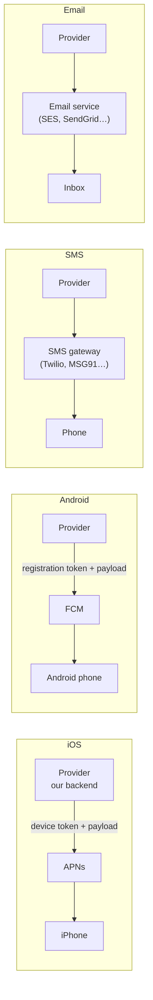
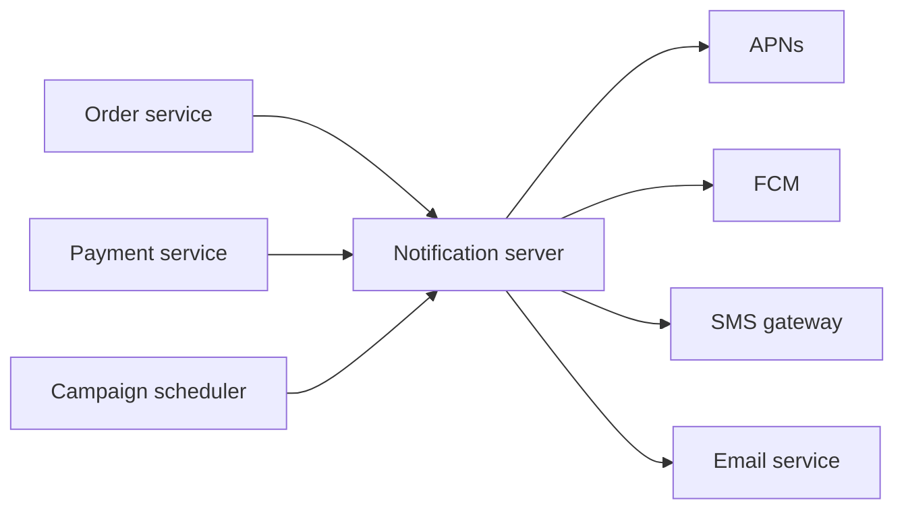
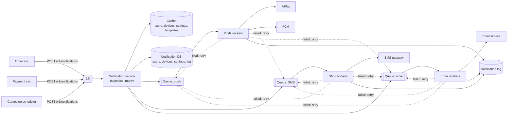
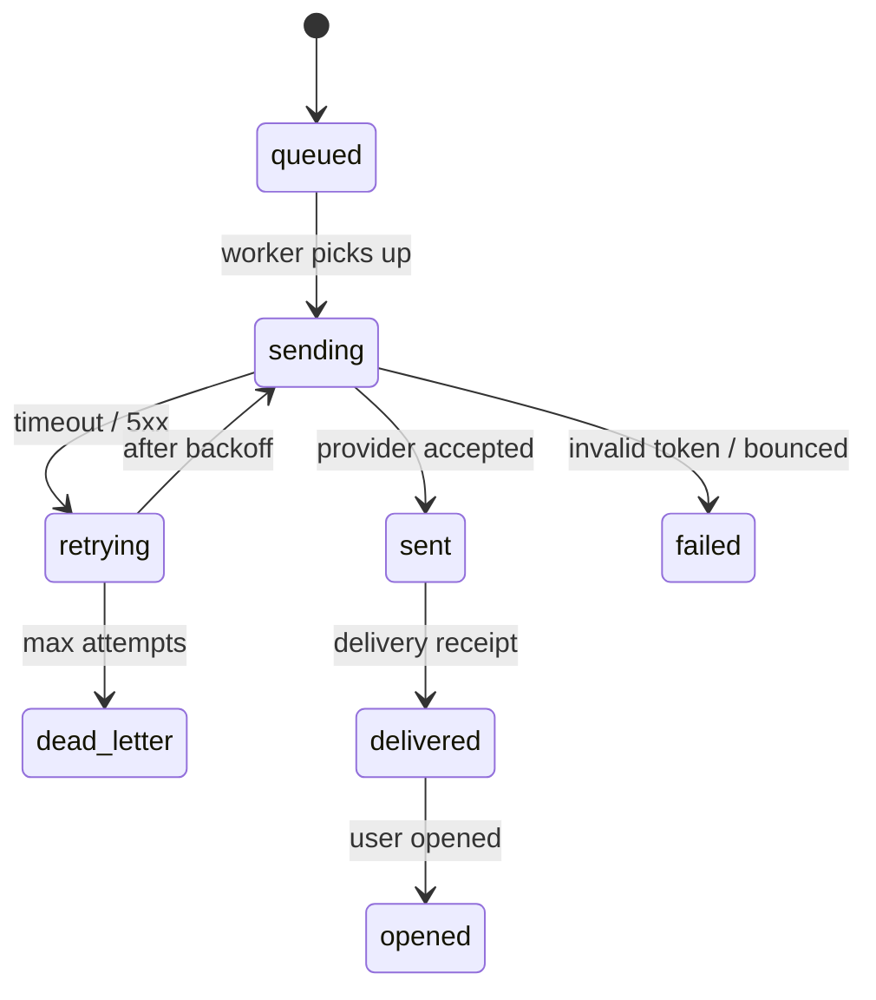
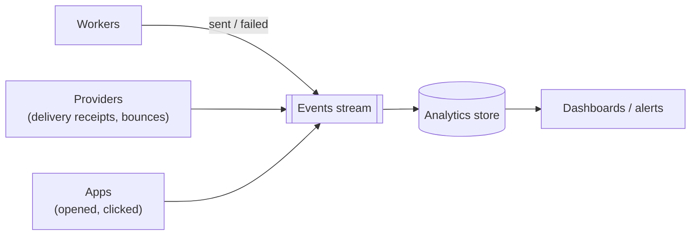
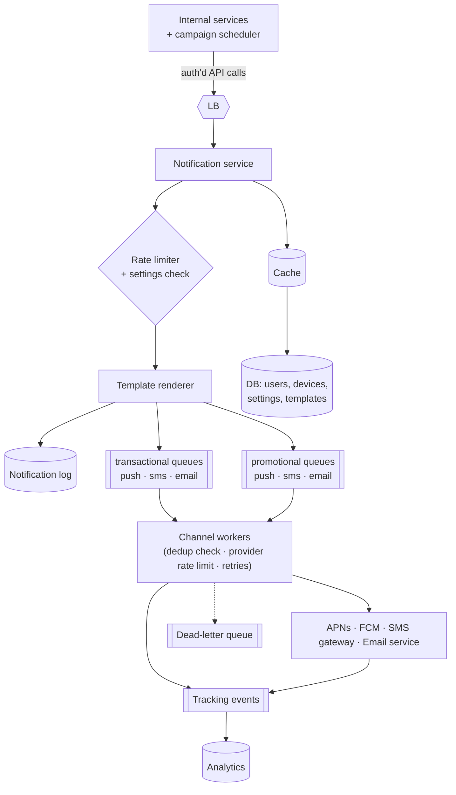

# 10 · Design a Notification System

<div class="chapter-meta" markdown>
<span>⏱ 40 min read</span>
<span class="hot">🔥 Classic "async pipeline" design</span>
<span>Book: Chapter 10</span>
</div>

!!! abstract "TL;DR"
    - Notifications go out through **third-party providers**: **APNs** (iOS push), **FCM** (Android/web push), **SMS gateways** (Twilio, MSG91…), **email services** (SES, SendGrid…). We don't deliver to devices ourselves.
    - Services call a **notification service** (API) that validates, checks **user preferences** and **rate limits**, renders a **template**, and puts the job on a **per-channel queue**.
    - **Workers** per channel pull from queues and call providers; failures are **retried with backoff**; permanent failures go to a **dead-letter queue**.
    - Guarantees: **at-least-once** delivery (persist before sending) + **dedup by event ID** to avoid double-sends. Exactly-once isn't achievable end-to-end.
    - Extras that make it production-grade: device-token lifecycle, opt-outs, quiet hours, priority lanes (OTP ≫ marketing), analytics (sent → delivered → opened → clicked).

## The intuition: the post office sorting room

A company drops all its outgoing mail into a sorting room. Clerks check each letter's address and whether the
recipient asked to stop receiving that kind of mail, put it in the right tray — speed post, courier,
ordinary post — and the trays are emptied by different delivery partners at their own pace. If a courier can't
deliver, the letter comes back to a "retry" tray. Urgent letters (OTPs!) go in a separate tray that's always
emptied first.

---

## Step 1 · Scope

!!! example "Clarifying conversation"
    **You:** Which channels? — **Interviewer:** Mobile push, SMS and email.
    **You:** Real-time? — **I:** Soft real-time: OTPs within seconds; other notifications can be a little late under load.
    **You:** Devices? — **I:** iOS, Android, and desktop browsers.
    **You:** Who triggers notifications? — **I:** Our backend services (orders, payments, social) and scheduled marketing campaigns.
    **You:** Can users opt out? — **I:** Yes, per channel and per category; transactional messages (OTP) can't be disabled.
    **You:** Volume? — **I:** ~30M push, ~5M SMS and ~20M emails per day.

**Functional:** send push/SMS/email; support templates; respect user settings; support immediate and scheduled sends; report delivery status.
**Non-functional:** high reliability (no lost notifications), low latency for critical ones, scalable to spikes (a sale announcement to 50M users), no duplicates where possible.

### Estimates

| Channel | Per day | Avg/s | Peak (campaign bursts) |
|---|---|---|---|
| Push | 30 M | ~350 | 50K+/s for a broadcast |
| SMS | 5 M | ~60 | ~2K/s (provider-limited) |
| Email | 20 M | ~230 | 10K+/s for a newsletter |

The averages are tiny; **bursts** and **provider limits** drive the design → queues.

---

## Step 2 · How each channel works



**Push (iOS / APNs):**

- **Device token** — a unique identifier APNs gives an app install; the app sends it to our backend at login/startup.
- **Payload** — JSON like:

```json
{
  "aps": {
    "alert": { "title": "Order shipped 📦", "body": "Your kurta is on the way. Track it now." },
    "badge": 1,
    "sound": "default"
  },
  "order_id": "OD-77812"
}
```

- Our server authenticates to APNs (token-based JWT or certificate) and sends `(device token, payload)`.

**Push (Android / web — FCM):** the same idea with an FCM **registration token**. (In some regions FCM isn't available — e.g. mainland China — and vendors' own push services are used instead.)

**SMS:** third-party gateways. In India, commercial SMS also needs **DLT registration** (pre-approved sender IDs and templates) — a real-world constraint that makes templates mandatory.

**Email:** a commercial email service gives deliverability (SPF/DKIM/DMARC setup, IP reputation, bounce handling) and analytics — much better than running your own SMTP servers.

### Gathering contact info

At sign-up / app install / login, the app sends phone, email and device tokens to an API that stores them.

```sql
users(user_id PK, email, phone_e164, country_code, created_at)
devices(device_id PK, user_id FK, platform /* ios|android|web */, push_token,
        app_version, last_seen_at, is_active)
-- one user ↔ many devices
```

Tokens **change and expire** (app reinstall, OS update). When APNs/FCM says a token is invalid, mark it inactive;
also refresh tokens on every app start.

---

## Step 2 · High-level design

### First draft (and why it's not enough)



Problems:

- **Single point of failure** — one notification server.
- **Hard to scale** — DB, cache and sending all in one box; can't scale them independently.
- **Performance bottleneck** — rendering HTML and waiting on slow providers inside the request path blocks everything; a spike overwhelms it.
- **One slow provider stalls all channels** (e.g. SMS gateway timeouts back up push too).

### Improved design



What changed:

- Notification service is **stateless and horizontally scaled** behind a load balancer.
- **DB + cache** hold users, devices, settings, templates — cached because every send needs them.
- **One queue per channel** — an SMS provider outage only backs up the SMS queue; push and email keep flowing. Queues also absorb bursts.
- **Workers** per channel pull jobs and call providers at a rate the provider allows.

### The flow of one notification

1. A service calls `POST /v1/notifications` with the user ID(s), template ID, data, and channels/priority.
2. The notification service **authenticates** the caller and **validates** the request.
3. It fetches user contact info, device tokens and **notification settings** (cache → DB).
4. It drops channels the user opted out of, applies **rate limits**, renders the **template**.
5. It writes the notification to the **log** (status = `queued`) and publishes an event to each channel queue.
6. Workers consume events, call APNs/FCM/SMS/email, and update status (`sent` / `failed`).
7. Providers deliver to devices; delivery receipts and opens/clicks flow back as events.

```http
POST /v1/notifications
{
  "event_id": "order-shipped:OD-77812",          ← idempotency key
  "user_ids": [123456],
  "template": "order_shipped",
  "data": { "order_id": "OD-77812", "item": "kurta" },
  "channels": ["push", "email"],
  "priority": "transactional"                      ← vs "promotional"
}
```

---

## Step 3 · Deep dive

### Reliability: never lose a notification

**Persist before you send.** The notification is written to a durable store (the log DB) and a durable queue
(Kafka/SQS with replication) **before** acknowledging the caller. If a worker crashes mid-send, the message is
redelivered and retried.



**Retries:** exponential backoff with jitter (e.g. 1s, 2s, 4s… up to N attempts). Distinguish **retryable**
(timeouts, 5xx, throttling) from **permanent** errors (invalid token, unsubscribed, hard bounce) — don't retry
the latter, and clean up the bad token/address.

### Will users get the same notification twice?

With at-least-once delivery, **duplicates are possible** — e.g. a worker sends the push, then crashes before
acking the queue, so the message is redelivered. Exactly-once across a third-party provider is impossible to
guarantee, but we can make duplicates rare:

- Each notification carries an **event ID** (idempotency key).
- Before sending, a worker checks a **dedup store** (e.g. Redis `SET event_id:channel:user NX EX 86400`). If the key already exists, skip.
- The API itself is idempotent: the same `event_id` posted twice creates one notification.

```java
boolean firstTime = redis.set("sent:" + eventId + ":" + channel + ":" + userId, "1",
                              SetParams.setParams().nx().ex(86_400)) != null;
if (!firstTime) return;                 // already handled → skip
provider.send(payload);                 // a crash right here can still cause a rare duplicate
```

### Notification templates

Most notifications share a shape. A **template** with placeholders avoids rebuilding every message, keeps
formatting consistent, and (for SMS in India) is legally required anyway.

```text
template: order_shipped (en)
  push.title: "Order shipped 📦"
  push.body : "Your {{item}} is on the way. Track it now."
  email.subject: "Your order {{order_id}} has shipped"
  email.html: <layout> … {{item}} … <a href="{{track_url}}">Track</a> … </layout>
template: order_shipped (hi)
  push.body : "Aapka {{item}} raste mein hai. Abhi track karein."
```

Store templates with versions and locales; cache rendered pieces.

### Notification settings (preferences)

Users must control what they get. Store per user, per channel, per category:

```sql
notification_settings(
  user_id   BIGINT,
  channel   VARCHAR(10),     -- push | sms | email
  category  VARCHAR(30),     -- transactional | social | promotions | reminders
  opted_in  BOOLEAN,
  quiet_from TIME NULL, quiet_to TIME NULL,
  PRIMARY KEY (user_id, channel, category)
)
```

Check settings **before** queuing. Transactional messages (OTP, payment alerts) bypass opt-outs but still
respect sanity limits; promotional ones respect quiet hours and local regulations.

### Rate limiting (protect users and providers)

- **Per user:** e.g. max 3 promotional pushes/day — too many and users disable notifications entirely (or uninstall).
- **Per provider:** SMS gateways and APNs/FCM have throughput limits; workers use token buckets (Chapter 4) to stay under them.
- **Per caller service:** one buggy service in a loop shouldn't flood users.

### Priorities

OTPs can't wait behind a 50M-user marketing blast. Use **separate queues (or topics) per priority**:
`transactional` with dedicated workers and capacity, `promotional` drained with whatever capacity is left.

### Security

Only authenticated internal services (mTLS, service tokens, or `appKey/appSecret`) may call the notification
API. Validate that a caller may send a given template category. Never put secrets or full PII in push payloads —
they show on lock screens.

### Monitoring & tracking

- **Queue depth / consumer lag** per channel — the key health signal. Growing lag → add workers or check the provider.
- **Provider error rates and latency**, invalid-token rates.
- **Funnel analytics:** created → sent → delivered → opened → clicked, per template — product teams live on this.



### The final design



---

## Interviewer follow-ups

??? question "How would you send one push to 50 million users quickly?"
    Don't fan out inside the API request. The campaign service creates **one campaign job**; a fan-out stage reads the target
    segment in pages (e.g. 10K user IDs per page) and enqueues batched jobs; many workers send in parallel, using provider batch
    APIs where available (FCM topics/multicast). Throttle to provider limits; spread over minutes rather than seconds if the
    message isn't urgent; send from the promotional lane so OTPs aren't delayed.

??? question "How do you deal with stale device tokens?"
    Refresh tokens on every app launch/login; store `last_seen_at`; when APNs/FCM return "unregistered/invalid token", mark the
    device inactive immediately; periodically purge devices not seen for N months. Sending to dead tokens wastes capacity and can
    hurt your sender reputation.

??? question "Push failed because the phone is offline. Do we retry?"
    No — APNs/FCM themselves store and forward to offline devices (with a TTL/collapse key you set). Our job ends when the provider
    accepts the message. We retry only when the **provider** call fails. Use collapse keys so a phone coming online gets the latest
    "3 new messages" rather than 3 separate stale pushes.

??? question "How do you schedule a reminder for tomorrow 9 AM in each user's time zone?"
    Store scheduled notifications with an absolute UTC send time computed per user's time zone. A scheduler (time-bucketed table or
    a delay queue) wakes up each minute, fetches due notifications and pushes them into the normal pipeline. Re-check preferences at
    send time — the user might have opted out since.

??? question "Can we guarantee exactly-once delivery?"
    Not end-to-end: once we hand a message to APNs or an SMS gateway, a timeout leaves us unsure whether it was delivered. We get
    at-least-once with dedup — persist first, idempotent API, dedup key per (event, channel, user) — which makes duplicates rare
    but not impossible. For SMS/OTP, a duplicate is harmless; for money-related emails, include a stable reference so users can
    recognise repeats.

---

## Practice

??? example "Practice 1 — Size the SMS workers"
    The SMS gateway allows 500 requests/s per account and each call takes ~200 ms. You must send 1.8M OTP+transactional SMS during
    a 2-hour peak. How many concurrent worker threads, and is the gateway limit enough?

    **Solution.** Rate needed = 1.8M / 7,200 s = **250 SMS/s** — under the 500/s limit ✓. Concurrency = rate × latency = 250 × 0.2 s
    = **50 in-flight calls**; with headroom for 2× bursts, ~100 threads across a few worker instances.

??? example "Practice 2 — Design the settings check"
    A promotional push should go only to users who opted in to `promotions` on `push`, aren't in quiet hours locally, and haven't
    received ≥ 3 promotional pushes today. Write the decision order and data you need.

    **Solution.** (1) settings lookup (cache) for `(user, push, promotions)` → opted_in? (2) user's time zone + quiet hours → now
    allowed? if not, schedule for the end of quiet hours; (3) per-user daily counter in Redis `promo:push:{user}:{date}` → `INCR`
    and compare with 3 (atomic); (4) only then enqueue. Do cheap checks first.

??? example "Practice 3 — Spot the bug"
    A worker does: `send to provider → mark as sent in DB → ack the queue message`. Under what failure do users get duplicates, and
    how do you reduce it?

    **Solution.** If the worker crashes after sending but before acking, the message is redelivered and sent again. Reduce with a
    dedup key checked/set **before** sending (`SET NX`), and record provider message IDs. A small window remains (crash between
    provider call and dedup write) — acceptable for notifications.

---

## Revision checklist

- [ ] I can explain how APNs, FCM, SMS gateways and email services fit in, and what a device token is.
- [ ] I can design the contact-info tables and token lifecycle.
- [ ] I can explain why the first draft fails and how per-channel queues + workers fix it.
- [ ] I can walk a notification through the full flow.
- [ ] I can explain at-least-once + dedup, retries with backoff, and dead-letter queues.
- [ ] I can design templates, user settings, rate limits, priorities, security and tracking.

[Next: 11 · News Feed :material-arrow-right:](11-news-feed.md){ .md-button .md-button--primary }
