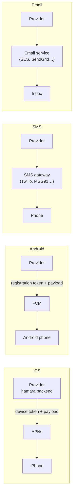
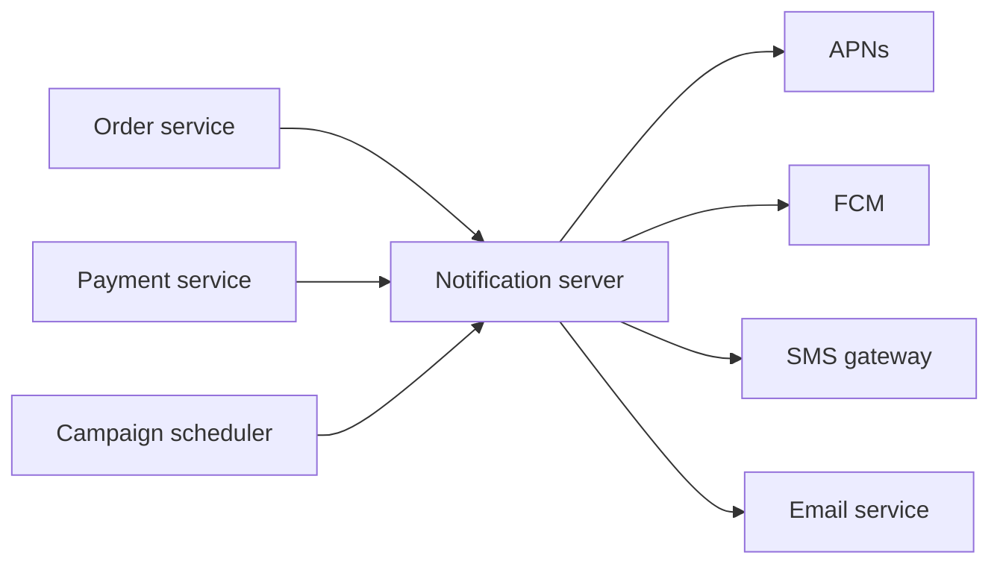
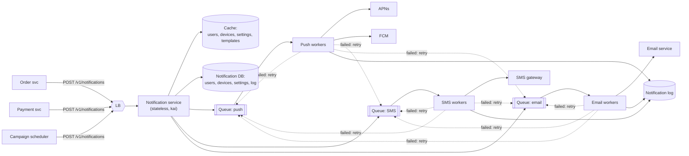
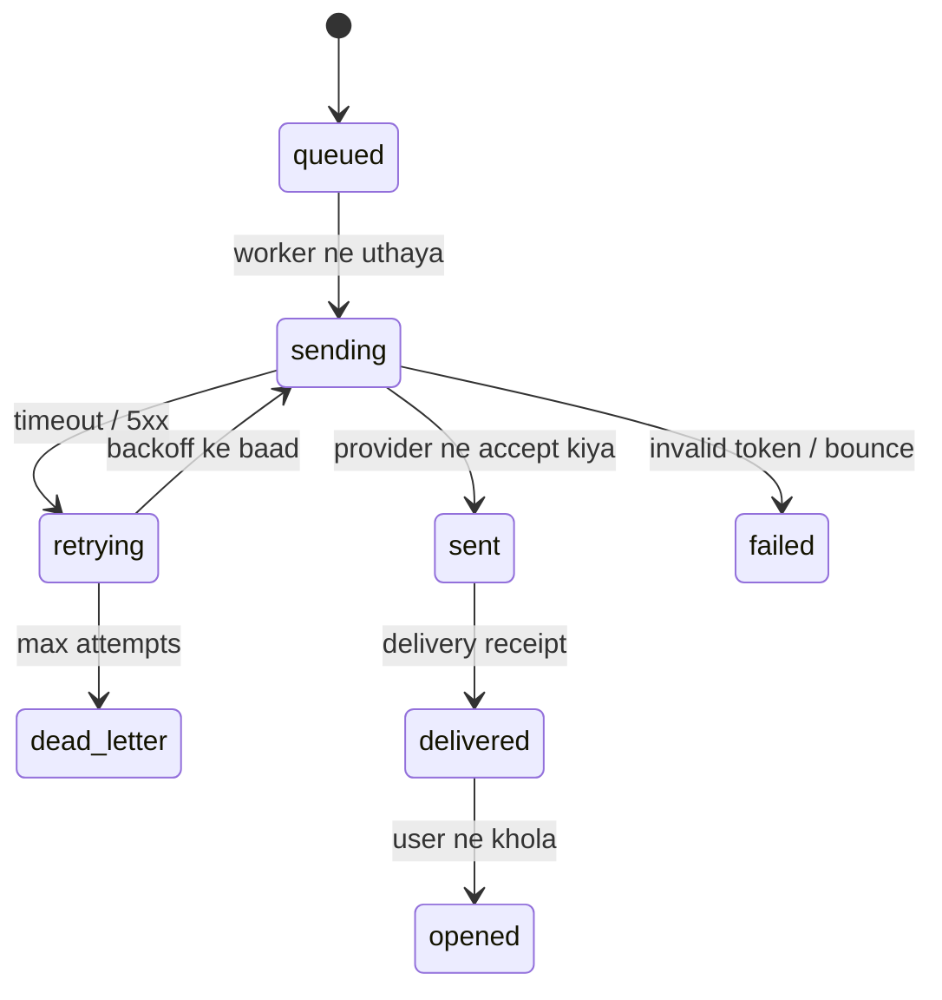
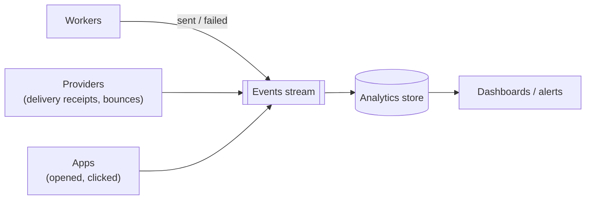
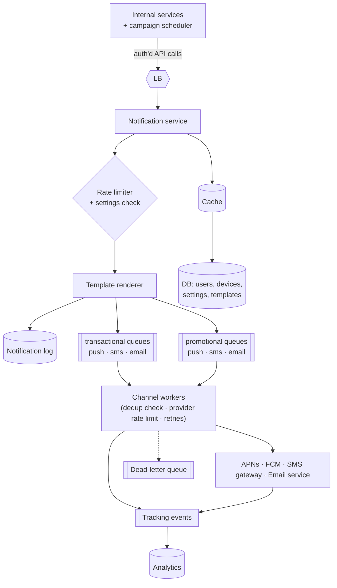

# 10 · Notification System Design karo

<div class="chapter-meta" markdown>
<span>⏱ 40 min read</span>
<span class="hot">🔥 Classic "async pipeline" design</span>
<span>Book: Chapter 10</span>
</div>

!!! abstract "TL;DR"
    - Notifications **third-party providers** se jaati hain: **APNs** (iOS push), **FCM** (Android/web push), **SMS gateways** (Twilio, MSG91…), **email services** (SES, SendGrid…). Devices tak hum khud deliver nahi karte.
    - Services ek **notification service** (API) ko call karti hain jo validate karti hai, **user preferences** aur **rate limits** check karti hai, **template** render karti hai, aur job ko **har channel ki queue** mein daalti hai.
    - Har channel ke **workers** queues se uthate hain aur providers ko call karte hain; failures **backoff ke saath retry**; permanent failures **dead-letter queue** mein.
    - Guarantees: **at-least-once** delivery (bhejne se pehle persist) + double-send se bachne ke liye **event ID se dedup**. End-to-end exactly-once possible nahi.
    - Production-grade banane waale extras: device-token lifecycle, opt-outs, quiet hours, priority lanes (OTP ≫ marketing), analytics (sent → delivered → opened → clicked).

## Intuition: post office ka sorting room

Ek company apni saari outgoing daak ek sorting room mein daalti hai. Clerks har chitthi ka address check karte hain aur dekhte hain ki
receiver ne us tarah ki daak band karwayi hai ya nahi, use sahi tray mein daalte hain — speed post, courier, normal post — aur trays alag
delivery partners apni speed se khaali karte hain. Courier deliver na kar paaye toh chitthi "retry" tray mein wapas. Urgent chitthiyan (OTPs!)
alag tray mein jo hamesha pehle khaali hoti hai.

---

## Step 1 · Scope

!!! example "Clarifying baatcheet"
    **Tum:** Kaunse channels? — **Interviewer:** Mobile push, SMS aur email.
    **Tum:** Real-time? — **I:** Soft real-time: OTPs seconds mein; baaki load mein thodi late chalegi.
    **Tum:** Devices? — **I:** iOS, Android, aur desktop browsers.
    **Tum:** Notifications trigger kaun karta hai? — **I:** Hamari backend services (orders, payments, social) aur scheduled marketing campaigns.
    **Tum:** Users opt out kar sakte hain? — **I:** Haan, har channel aur har category ke liye; transactional messages (OTP) band nahi ho sakte.
    **Tum:** Volume? — **I:** Roz ~30M push, ~5M SMS aur ~20M emails.

**Functional:** push/SMS/email bhejo; templates support karo; user settings maano; immediate aur scheduled sends; delivery status report karo.
**Non-functional:** high reliability (koi notification na khoye), critical waalon ke liye low latency, spikes tak scalable (50M users ko sale announcement), jahan ho sake duplicates nahi.

### Estimates

| Channel | Per din | Avg/s | Peak (campaign bursts) |
|---|---|---|---|
| Push | 30 M | ~350 | broadcast pe 50K+/s |
| SMS | 5 M | ~60 | ~2K/s (provider-limited) |
| Email | 20 M | ~230 | newsletter pe 10K+/s |

Averages bahut chhote hain; design ko **bursts** aur **provider limits** chalate hain → queues.

---

## Step 2 · Har channel kaise kaam karta hai



**Push (iOS / APNs):**

- **Device token** — APNs har app install ko ek unique identifier deta hai; app login/startup pe ise hamare backend ko bhejta hai.
- **Payload** — JSON, jaise:

```json
{
  "aps": {
    "alert": { "title": "Order shipped 📦", "body": "Aapka kurta raste mein hai. Abhi track karein." },
    "badge": 1,
    "sound": "default"
  },
  "order_id": "OD-77812"
}
```

- Hamara server APNs pe authenticate karta hai (token-based JWT ya certificate) aur `(device token, payload)` bhejta hai.

**Push (Android / web — FCM):** same idea, FCM **registration token** ke saath. (Kuch regions mein FCM available nahi — jaise mainland China — wahan vendors ki apni push services use hoti hain.)

**SMS:** third-party gateways. India mein commercial SMS ke liye **DLT registration** bhi chahiye (pre-approved sender IDs aur templates) — ek asli-duniya ka constraint jo templates ko zaroori bana deta hai.

**Email:** commercial email service deliverability (SPF/DKIM/DMARC setup, IP reputation, bounce handling) aur analytics deti hai — apne SMTP servers chalane se kahin better.

### Contact info jama karna

Sign-up / app install / login pe app phone, email aur device tokens ek API ko bhejta hai jo unhe store karti hai.

```sql
users(user_id PK, email, phone_e164, country_code, created_at)
devices(device_id PK, user_id FK, platform /* ios|android|web */, push_token,
        app_version, last_seen_at, is_active)
-- ek user ↔ kai devices
```

Tokens **badalte aur expire hote hain** (app reinstall, OS update). Jab APNs/FCM bole token invalid hai, use inactive mark karo; har app start
pe bhi tokens refresh karo.

---

## Step 2 · High-level design

### Pehla draft (aur yeh kaafi kyun nahi)



Problems:

- **Single point of failure** — ek notification server.
- **Scale karna mushkil** — DB, cache aur sending sab ek box mein; alag-alag scale nahi kar sakte.
- **Performance bottleneck** — HTML render karna aur slow providers ka wait request path ke andar sab block karta hai; spike use dabaa deta hai.
- **Ek slow provider saare channels rok deta hai** (jaise SMS gateway timeouts push ko bhi atka dete hain).

### Behtar design



Kya badla:

- Notification service **stateless aur horizontally scaled** hai, load balancer ke peeche.
- **DB + cache** users, devices, settings, templates rakhte hain — cached kyunki har send ko yeh chahiye.
- **Har channel ki ek queue** — SMS provider outage sirf SMS queue atkaata hai; push aur email chalte rehte hain. Queues bursts bhi sokhti hain.
- Har channel ke **workers** jobs uthate hain aur providers ko unki allowed rate pe call karte hain.

### Ek notification ka flow

1. Koi service user ID(s), template ID, data, aur channels/priority ke saath `POST /v1/notifications` call karti hai.
2. Notification service caller ko **authenticate** aur request ko **validate** karti hai.
3. User contact info, device tokens aur **notification settings** laati hai (cache → DB).
4. Jin channels se user ne opt out kiya unhe hatati hai, **rate limits** lagati hai, **template** render karti hai.
5. Notification ko **log** mein likhti hai (status = `queued`) aur har channel queue pe event publish karti hai.
6. Workers events uthate hain, APNs/FCM/SMS/email call karte hain, aur status update karte hain (`sent` / `failed`).
7. Providers devices tak deliver karte hain; delivery receipts aur opens/clicks events ki tarah wapas aate hain.

```http
POST /v1/notifications
{
  "event_id": "order-shipped:OD-77812",          ← idempotency key
  "user_ids": [123456],
  "template": "order_shipped",
  "data": { "order_id": "OD-77812", "item": "kurta" },
  "channels": ["push", "email"],
  "priority": "transactional"                      ← vs "promotional"
}
```

---

## Step 3 · Deep dive

### Reliability: koi notification kabhi na khoye

**Bhejne se pehle persist karo.** Caller ko acknowledge karne se **pehle** notification durable store (log DB) aur durable queue (replication
waala Kafka/SQS) mein likhi jaati hai. Worker beech mein crash ho toh message dobara deliver hota hai aur retry hota hai.



**Retries:** jitter ke saath exponential backoff (jaise 1s, 2s, 4s… N attempts tak). **Retryable** (timeouts, 5xx, throttling) aur **permanent**
errors (invalid token, unsubscribed, hard bounce) mein fark karo — permanent waalon ko retry mat karo, aur kharab token/address saaf karo.

### Kya users ko same notification do baar milegi?

At-least-once delivery mein **duplicates ho sakte hain** — jaise worker push bhejta hai, phir queue ko ack karne se pehle crash, toh message
dobara deliver. Third-party provider ke across exactly-once guarantee karna impossible hai, par duplicates ko rare bana sakte hain:

- Har notification ke saath ek **event ID** (idempotency key).
- Bhejne se pehle worker ek **dedup store** check karta hai (jaise Redis `SET event_id:channel:user NX EX 86400`). Key pehle se hai toh skip.
- API khud idempotent: same `event_id` do baar post ho toh ek hi notification banti hai.

```java
boolean firstTime = redis.set("sent:" + eventId + ":" + channel + ":" + userId, "1",
                              SetParams.setParams().nx().ex(86_400)) != null;
if (!firstTime) return;                 // pehle handle ho chuka → skip
provider.send(payload);                 // yahin crash hua toh ab bhi rare duplicate ho sakta hai
```

### Notification templates

Zyada tar notifications ka shape same hota hai. Placeholders waala **template** har message dobara banane se bachata hai, formatting consistent
rakhta hai, aur (India mein SMS ke liye) waise bhi kanoonan zaroori hai.

```text
template: order_shipped (en)
  push.title: "Order shipped 📦"
  push.body : "Your {{item}} is on the way. Track it now."
  email.subject: "Your order {{order_id}} has shipped"
  email.html: <layout> … {{item}} … <a href="{{track_url}}">Track</a> … </layout>
template: order_shipped (hi)
  push.body : "Aapka {{item}} raste mein hai. Abhi track karein."
```

Templates versions aur locales ke saath store karo; rendered tukde cache karo.

### Notification settings (preferences)

Users ko control hona chahiye ki unhe kya mile. Har user, har channel, har category ke liye store karo:

```sql
notification_settings(
  user_id   BIGINT,
  channel   VARCHAR(10),     -- push | sms | email
  category  VARCHAR(30),     -- transactional | social | promotions | reminders
  opted_in  BOOLEAN,
  quiet_from TIME NULL, quiet_to TIME NULL,
  PRIMARY KEY (user_id, channel, category)
)
```

Queue karne se **pehle** settings check karo. Transactional messages (OTP, payment alerts) opt-outs bypass karte hain par sanity limits maante
hain; promotional waale quiet hours aur local regulations maante hain.

### Rate limiting (users aur providers dono ki raksha)

- **Per user:** jaise din mein max 3 promotional pushes — zyada hue toh users notifications hi band kar dete hain (ya app uninstall).
- **Per provider:** SMS gateways aur APNs/FCM ki throughput limits hain; workers unke neeche rehne ke liye token buckets (Chapter 4) use karte hain.
- **Per caller service:** loop mein phasi ek buggy service users ko flood na kare.

### Priorities

OTPs 5 crore users ke marketing blast ke peeche wait nahi kar sakte. **Har priority ki alag queues (ya topics)** rakho: `transactional` ke
dedicated workers aur capacity, `promotional` bachi hui capacity se khaali hoti hai.

### Security

Sirf authenticated internal services (mTLS, service tokens, ya `appKey/appSecret`) notification API call kar sakein. Validate karo ki caller
kisi template category ko bhej sakta hai ya nahi. Push payloads mein kabhi secrets ya poori PII mat daalo — woh lock screen pe dikhte hain.

### Monitoring & tracking

- Har channel ki **queue depth / consumer lag** — sabse key health signal. Lag badh raha hai → workers badhao ya provider check karo.
- **Provider error rates aur latency**, invalid-token rates.
- **Funnel analytics:** created → sent → delivered → opened → clicked, har template ke liye — product teams isi pe jeeti hain.



### Final design



---

## Interviewer follow-ups

??? question "5 crore users ko ek push jaldi kaise bhejoge?"
    API request ke andar fan out mat karo. Campaign service **ek campaign job** banati hai; fan-out stage target segment ko pages mein padhta hai
    (jaise har page 10K user IDs) aur batched jobs enqueue karta hai; kai workers parallel bhejte hain, jahan ho sake provider batch APIs (FCM
    topics/multicast) use karke. Provider limits tak throttle karo; message urgent nahi toh seconds ki jagah minutes mein phailao; promotional
    lane se bhejo taaki OTPs late na hon.

??? question "Stale device tokens ka kya karoge?"
    Har app launch/login pe tokens refresh karo; `last_seen_at` store karo; jab APNs/FCM "unregistered/invalid token" bolein, device ko turant
    inactive mark karo; N mahine se na dikhe devices samay-samay pe purge karo. Mare hue tokens pe bhejna capacity barbaad karta hai aur sender
    reputation kharab kar sakta hai.

??? question "Phone offline tha isliye push fail hua. Retry karein?"
    Nahi — APNs/FCM khud offline devices ke liye store-and-forward karte hain (tumhare set kiye TTL/collapse key ke saath). Provider ne message
    accept kar liya toh hamara kaam khatam. Retry sirf tab jab **provider** call fail ho. Collapse keys use karo taaki online aane pe phone ko 3
    alag stale pushes ki jagah latest "3 naye messages" mile.

??? question "Har user ke time zone mein kal subah 9 baje ka reminder kaise schedule karoge?"
    Scheduled notifications ko har user ke time zone se nikaale absolute UTC send time ke saath store karo. Ek scheduler (time-bucketed table ya
    delay queue) har minute jaagta hai, due notifications uthata hai aur normal pipeline mein daalta hai. Send time pe preferences dobara check
    karo — ho sakta hai user ne beech mein opt out kar diya ho.

??? question "Kya exactly-once delivery guarantee kar sakte hain?"
    End-to-end nahi: APNs ya SMS gateway ko message dene ke baad timeout aaye toh pakka nahi pata ki deliver hua ya nahi. Hume dedup ke saath
    at-least-once milta hai — pehle persist, idempotent API, har (event, channel, user) ki dedup key — jo duplicates ko rare banata hai par
    impossible nahi. SMS/OTP ke liye duplicate harmless hai; paise waali emails mein stable reference daalo taaki users repeat pehchan sakein.

---

## Practice

??? example "Practice 1 — SMS workers ka size"
    SMS gateway har account pe 500 requests/s allow karta hai aur har call ~200 ms leti hai. 2-ghante ke peak mein 18 lakh OTP+transactional SMS
    bhejne hain. Kitne concurrent worker threads, aur kya gateway limit kaafi hai?

    **Solution.** Zaroori rate = 1.8M / 7,200 s = **250 SMS/s** — 500/s limit ke neeche ✓. Concurrency = rate × latency = 250 × 0.2 s =
    **50 in-flight calls**; 2× bursts ke headroom ke saath, kuch worker instances mein ~100 threads.

??? example "Practice 2 — Settings check design karo"
    Promotional push sirf un users ko jaana chahiye jinhone `push` pe `promotions` opt in kiya hai, local quiet hours mein nahi hain, aur aaj ≥ 3
    promotional pushes nahi mile. Decision order aur zaroori data likho.

    **Solution.** (1) `(user, push, promotions)` ka settings lookup (cache) → opted_in? (2) user ka time zone + quiet hours → abhi allowed? nahi
    toh quiet hours khatam hone pe schedule; (3) Redis mein per-user daily counter `promo:push:{user}:{date}` → `INCR` karke 3 se compare
    (atomic); (4) tabhi enqueue. Saste checks pehle.

??? example "Practice 3 — Bug pakdo"
    Ek worker karta hai: `provider ko bhejo → DB mein sent mark karo → queue message ack karo`. Kis failure pe users ko duplicates milenge, aur kaise kam karoge?

    **Solution.** Bhejne ke baad aur ack se pehle worker crash hua toh message dobara deliver hoga aur dobara jaayega. Bhejne se **pehle** check/set
    hone waali dedup key (`SET NX`) se kam karo, aur provider message IDs record karo. Ek chhoti window bachti hai (provider call aur dedup write ke
    beech crash) — notifications ke liye acceptable.

---

## Revision checklist

- [ ] APNs, FCM, SMS gateways aur email services kahan fit hote hain, aur device token kya hai — samjha sakta hoon.
- [ ] Contact-info tables aur token lifecycle design kar sakta hoon.
- [ ] Pehla draft kyun fail hota hai aur per-channel queues + workers kaise fix karte hain — samjha sakta hoon.
- [ ] Ek notification ko poore flow se guzaar sakta hoon.
- [ ] At-least-once + dedup, backoff ke saath retries, aur dead-letter queues samjha sakta hoon.
- [ ] Templates, user settings, rate limits, priorities, security aur tracking design kar sakta hoon.

[Aage: 11 · News Feed :material-arrow-right:](11-news-feed.md){ .md-button .md-button--primary }
