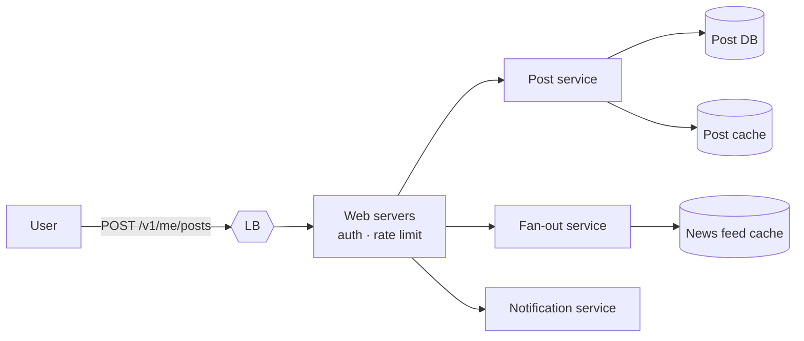
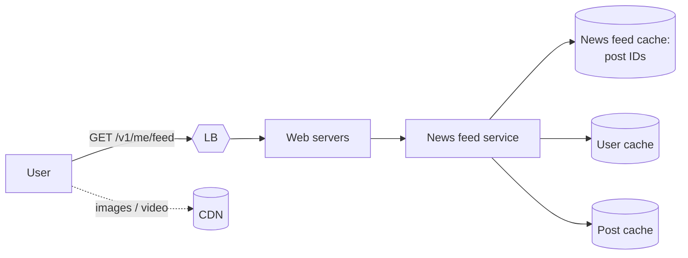
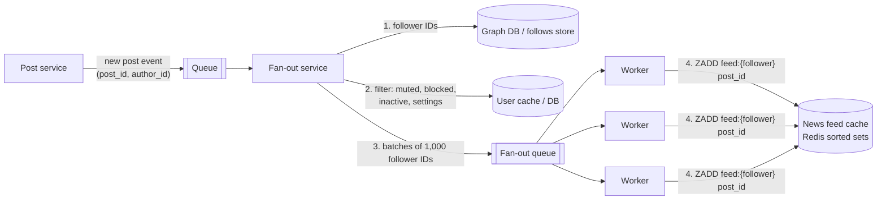
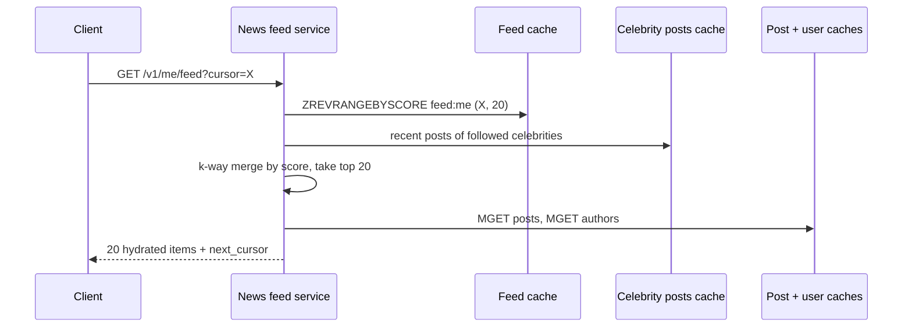

# 11 · Design a News Feed System

<div class="chapter-meta" markdown>
<span>⏱ 45 min read</span>
<span class="hot">🔥 Top-5 most asked; the fan-out trade-off is the whole interview</span>
<span>Book: Chapter 11</span>
</div>

!!! abstract "TL;DR"
    - Two flows: **publishing** (store the post, distribute it to followers' feeds) and **retrieval** (read the precomputed feed, hydrate it with post/user data).
    - **Fan-out on write (push):** at post time, insert the post ID into every follower's feed cache → reads are instant; writes explode for accounts with millions of followers.
    - **Fan-out on read (pull):** build the feed when it's requested by merging recent posts of everyone you follow → cheap writes, slow reads.
    - **Hybrid** (what real systems do): push for normal accounts, **pull for celebrities**, merge at read time; skip pushing to inactive users.
    - The feed cache stores only **IDs** (e.g. a Redis sorted set of the last ~800 post IDs per user); the actual posts and users come from their own caches (**hydration**). Paginate with **cursors**, not offsets.

## The intuition: the newspaper vendor

Two ways a newspaper vendor can serve 1,000 households:

- **Deliver every morning** (push): bundle each house's papers at the depot and drop them off. Reading at home is instant — but if one magazine has a million subscribers, the depot drowns every time it publishes.
- **Let people come to the stall** (pull): nothing is pre-bundled; each person picks up their selection when they visit. Publishing is free — but every visit takes longer, especially for someone who follows 500 magazines.

A sensible vendor delivers the ordinary papers and keeps the hugely popular magazine at the stall, where everyone
grabs a copy when they come by. That's the hybrid.

---

## Step 1 · Scope

!!! example "Clarifying conversation"
    **You:** Follow model — mutual friends, or one-way follows? — **Interviewer:** One-way follows, like Instagram/X. Some accounts have tens of millions of followers.
    **You:** What's in the feed? — **I:** Posts from accounts you follow: text, images, short videos.
    **You:** Ordering? — **I:** Reverse-chronological for now; we may add ranking later.
    **You:** Scale? — **I:** 25M DAU; users follow ~300 accounts on average, max 7,500 follows.
    **You:** Platforms? — **I:** Mobile apps and web.
    **You:** How fresh must it be? — **I:** A new post should appear in followers' feeds within a few seconds; slightly stale is fine.

### Estimates

| Quantity | Value |
|---|---|
| Posts | 25M DAU × 0.5 posts/day = 12.5M/day → ~150/s, peak ~500/s |
| Feed loads | 25M × 12 opens/day = 300M/day → ~3.5K/s, peak ~10K/s |
| Fan-out writes (push, avg 300 followers) | 150 posts/s × 300 = **45K feed inserts/s** average |
| One celebrity post (30M followers) | **30M inserts** for a single post ← the problem |
| Feed cache | 25M users × 800 IDs × ~16 B (ID + score) ≈ **320 GB** |

---

## Step 2 · High-level design

### APIs

```http
POST /v1/me/posts       { "text": "...", "media_ids": ["m_91f"] }      Authorization: Bearer <token>
  → 201 { "post_id": "1849302018273" }

GET  /v1/me/feed?cursor=<opaque>&limit=20                             Authorization: Bearer <token>
  → 200 { "items": [ {post…, author…}, … ], "next_cursor": "..." }
```

### Feed publishing



- **Web servers** authenticate the user and **rate-limit** posting (stops spam).
- **Post service** persists the post (DB + cache).
- **Fan-out service** pushes the post ID into followers' feeds.
- **Notification service** tells followers who opted in (Chapter 10).

### Feed retrieval



The news feed service reads the list of post IDs, then **hydrates** them — author name/avatar, text, media URLs,
like counts — and returns JSON. Media itself streams from the CDN.

---

## Step 3 · Deep dive

### Fan-out on write vs fan-out on read

| | **Fan-out on write (push)** | **Fan-out on read (pull)** |
|---|---|---|
| When work happens | At post time | At read time |
| Read latency | ✅ Very fast — feed is precomputed | ❌ Slow — merge N timelines per request |
| Write cost | ❌ O(followers) per post; **celebrity = millions of writes** | ✅ O(1) — just store the post |
| Wasted work | ❌ Pushes to inactive users who never read | ✅ Only active readers pay |
| Freshness | Near-real-time | Real-time (computed on demand) |
| Best for | Normal users, read-heavy apps | Celebrities, rarely-active users |

**Hybrid:**

- Users with **≤ N followers** (say 100K): **push** to followers' feeds.
- **Celebrities** (> N followers): **don't push**. At read time, fetch their recent posts and **merge** them in.
- Skip pushing to followers who haven't been active for, say, 30 days; rebuild their feed on their next visit.
- Consistent hashing (Chapter 5) on user ID spreads feed-cache keys and limits hotspots.

### The fan-out service in detail



1. Fetch the author's follower IDs from the follows store (a graph DB, or a sharded `follows` table keyed by `followee_id`).
2. Filter out followers who muted/blocked the author, are inactive, or chose not to see this content.
3. Split followers into batches and enqueue — so a 50K-follower post becomes 50 independent jobs processed in parallel.
4. Workers insert `post_id` into each follower's feed cache.

**What's stored per user:** only `(post_id, score)` — not the post. Keep it bounded: the last ~800 entries. Users rarely
scroll past that; older items can be rebuilt from the DB if needed.

```java
/** Fan-out worker: push one post into a batch of followers' feeds (Redis sorted sets). */
void fanOut(long postId, long createdAtMs, List<Long> followerIds) {
    try (Pipeline p = jedis.pipelined()) {
        for (long f : followerIds) {
            String key = "feed:" + f;
            p.zadd(key, createdAtMs, Long.toString(postId));   // score = time (or the Snowflake ID itself)
            p.zremrangeByRank(key, 0, -801);                   // keep only the newest 800
        }
        p.sync();
    }
}
```

!!! tip "Snowflake IDs make great scores"
    If post IDs are Snowflake IDs (Chapter 7), they're already time-ordered — use the ID as the sort score and as the
    pagination cursor.

### Feed retrieval in detail

1. Client calls `GET /v1/me/feed?cursor=…`.
2. News feed service reads post IDs from `feed:{me}` with `ZREVRANGEBYSCORE feed:{me} (cursor -inf LIMIT 0 20`.
3. **Merge celebrity posts:** for each celebrity the user follows, fetch their recent post IDs (cached per celebrity — one copy shared by all their followers) and merge by score.
4. **Hydrate:** multi-get posts from the post cache and authors from the user cache (fall back to DB on misses).
5. Filter anything deleted or now-blocked; build the response with `next_cursor` = score of the last item.



**Why cursors, not `?page=3`?** New posts arrive at the top while you scroll; offset pagination would show
duplicates or skip items. A cursor ("everything older than ID X") is stable.

### The cache layers

| Layer | What it holds | Notes |
|---|---|---|
| **News feed** | Post IDs per user | Bounded sorted sets; the output of fan-out |
| **Content** | Post bodies | Hot posts in a separate hot tier (a viral post is read millions of times) |
| **Social graph** | Followers / following lists | Used by fan-out and by "who do I follow" (celebrity merge) |
| **Action** | Did *I* like / repost / comment on this post? | Needed to render the heart icon correctly |
| **Counters** | Like, comment, repost, follower counts | High-write; often approximate and batched (increment in Redis, flush periodically) |

### Edits, deletes and privacy

- **Delete:** mark the post deleted in the post store; don't chase it through millions of feed caches — hydration simply drops it.
- **Edit:** feeds hold only IDs, so the next hydration shows the new text automatically.
- **Unfollow / block:** filter at read time immediately; lazily clean the feed cache.
- **Private accounts:** fan-out only to approved followers; check permissions again at hydration for safety.

### Failure handling

- Fan-out is **async** — a post is "published" once stored; fan-out delays mean feeds lag by seconds, not lost posts. Queues are durable and workers retry.
- If the feed cache is lost (node failure), **rebuild on demand**: pull recent posts of followed accounts from the post store (fan-out on read as fallback), then repopulate.
- Protect the DB from cache-miss storms with request coalescing and rate limits (Chapter 1).

### Going beyond reverse-chronological

Ranked feeds add a stage after candidate generation: gather candidates (the chronological feed + celebrity posts +
recommendations), score them with an ML model (predicted engagement), re-rank, then hydrate. The fan-out
architecture stays the same — it now produces **candidates**, not the final order.

---

## Step 4 · Wrap-up — scaling the rest

- **Database:** posts sharded by `post_id`; follows sharded by user; read replicas; SQL vs NoSQL per access pattern (Chapter 1).
- **Stateless web tier** + aggressive caching; **CDN** for all media.
- **Multiple data centers** with the feed caches rebuilt per region from the replicated post store.
- **Decouple with queues** (publishing, fan-out, notifications, counters).
- **Monitor:** QPS at peak, feed latency p99, fan-out lag (time from post to appearing in feeds), cache hit ratios.

---

## Interviewer follow-ups

??? question "A celebrity with 40M followers posts. Walk me through what happens."
    The post is stored. Because the author is above the celebrity threshold, **no fan-out** happens; the post ID is appended to the
    celebrity's own "recent posts" list (cached, replicated, very hot). When any follower loads their feed, the feed service merges
    their precomputed feed with the recent posts of the celebrities they follow. Cost moves from 40M writes at post time to a cheap
    cached read per feed load. Notifications to followers who opted in go through the notification pipeline with throttling.

??? question "How do you choose the celebrity threshold?"
    Balance fan-out write cost vs read-time merge cost. Measure: fan-out lag and worker cost per post vs added feed latency from merging
    K celebrity lists. Typical thresholds are tens to hundreds of thousands of followers. Also consider *posting frequency* — a
    100K-follower account posting 100 times a day costs more than a 1M account posting weekly.

??? question "A user follows 7,500 accounts and hasn't opened the app in 3 months. What happens when they return?"
    We stopped pushing to them after 30 days of inactivity, so their feed cache is stale/empty. On return, run fan-out on read once:
    fetch recent posts from followed accounts (using per-author recent-post caches), merge, store the result as their feed cache, and
    resume push fan-out. Show a quick first page while the rest builds.

??? question "How would you show 'liked by you' and accurate like counts at scale?"
    'Liked by you' comes from the **action cache** keyed by `(user, post)` (or a Bloom-ish set of the user's recent likes). Counts come
    from **counter caches**: increment in Redis on each like, persist asynchronously in batches. Exact counts aren't needed in real time;
    for huge posts, approximate/batched counters are fine.

??? question "Why store only post IDs in the feed cache?"
    Memory: an ID is ~8 bytes, a hydrated post is kilobytes — 800 posts × 25M users would be terabytes. Also consistency: edits and deletes
    take effect immediately at hydration time, without rewriting millions of feeds. Content is cached once in the post cache and shared.

---

## Practice

??? example "Practice 1 — Fan-out cost"
    1M posts/day from normal users with a median of 200 followers (mean 400), and 50 celebrities posting 5 times a day each with
    20M followers on average. Compute daily feed inserts with pure push vs hybrid.

    **Solution.** Normal users: 1M × 400 = **400M** inserts/day either way. Celebrities with push: 50 × 5 × 20M = **5B**/day (12× all
    normal traffic!). Hybrid: celebrities contribute 0 inserts — instead, followers' reads merge 250 cached posts. Hybrid total
    **400M/day** ≈ 4.6K inserts/s.

??? example "Practice 2 — Feed cache memory"
    40M active users, keep 500 post IDs each in Redis sorted sets. Each entry costs ~64 bytes in Redis (member + score + skiplist
    overhead). How much memory? How many 64 GB nodes at 70% utilisation?

    **Solution.** 40M × 500 × 64 B = **1.28 TB**. Usable per node = 45 GB → ~29 nodes (plus replicas → ~58). Trimming to 300 entries
    or skipping inactive users cuts this sharply.

??? example "Practice 3 — Pagination bug"
    The app uses `GET /feed?page=2&size=20`. Users complain about seeing the same post twice while scrolling. Explain and fix.

    **Solution.** Between fetching page 1 and page 2, new posts were inserted at the top, shifting everything down by k positions — so
    page 2 starts with the last k items of page 1. Use cursor-based pagination: `next_cursor` = score/ID of the last item; the next
    request asks for items strictly older than it.

---

## Revision checklist

- [ ] I can draw the publishing and retrieval flows and name each service.
- [ ] I can compare fan-out on write vs read and explain the hybrid with numbers.
- [ ] I can describe the fan-out service steps and the bounded ID-only feed cache.
- [ ] I can explain hydration, the celebrity merge at read time, and cursor pagination.
- [ ] I can list the five cache layers and what each holds.
- [ ] I can handle deletes, edits, blocks, inactive users and cache loss.

[Next: 12 · Chat System :material-arrow-right:](12-chat-system.md){ .md-button .md-button--primary }
