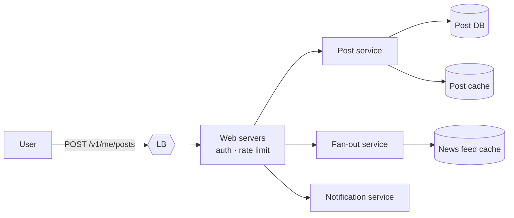
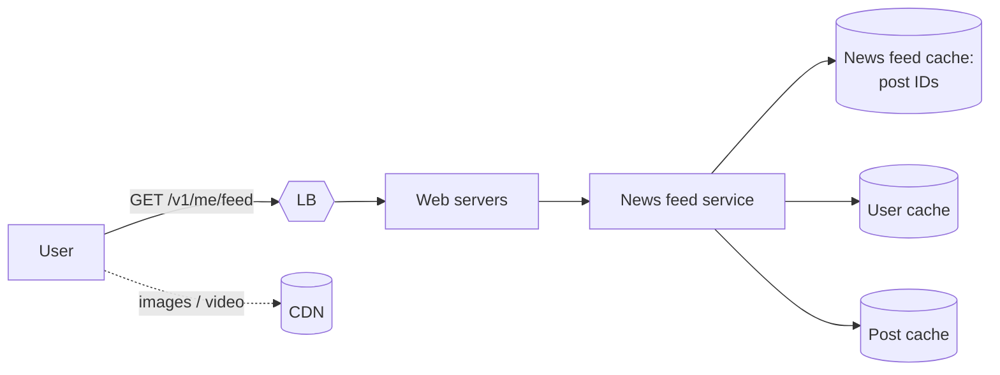
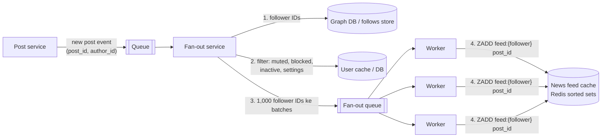
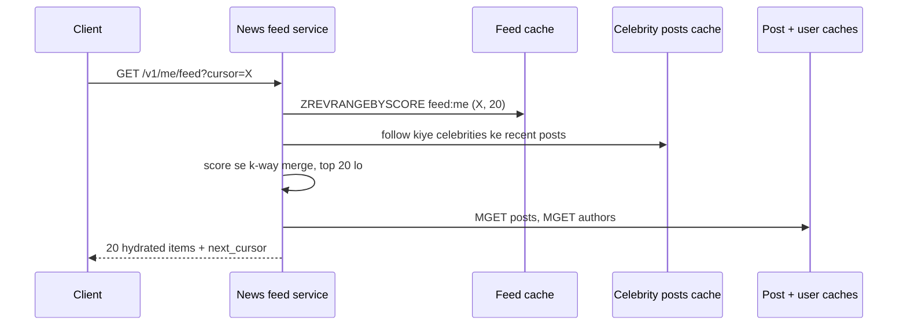

# 11 · News Feed System Design karo

<div class="chapter-meta" markdown>
<span>⏱ 45 min read</span>
<span class="hot">🔥 Top-5 sabse zyada poochha jaane waala; fan-out trade-off hi poora interview hai</span>
<span>Book: Chapter 11</span>
</div>

!!! abstract "TL;DR"
    - Do flows: **publishing** (post store karo, followers ke feeds mein baanto) aur **retrieval** (precomputed feed padho, post/user data se hydrate karo).
    - **Fan-out on write (push):** post ke time har follower ke feed cache mein post ID daalo → reads instant; lakhon followers waale accounts ke liye writes phat jaate hain.
    - **Fan-out on read (pull):** feed maangne pe banao — jinhe follow karte ho unke recent posts merge karke → writes saste, reads slow.
    - **Hybrid** (asli systems yahi karte hain): normal accounts ke liye push, **celebrities ke liye pull**, read time pe merge; inactive users ko push mat karo.
    - Feed cache sirf **IDs** rakhta hai (jaise har user ke last ~800 post IDs ka Redis sorted set); asli posts aur users apne caches se aate hain (**hydration**). **Cursors** se paginate karo, offsets se nahi.

## Intuition: akhbaar waala

Ek akhbaar waala 1,000 gharon ko do tarah serve kar sakta hai:

- **Har subah ghar pahunchao** (push): depot pe har ghar ke akhbaar bundle karo aur daal do. Ghar pe padhna instant — par agar ek magazine ke
  10 lakh subscribers hain, toh har baar chhapne pe depot doob jaata hai.
- **Logon ko stall pe aane do** (pull): kuch pre-bundle nahi; har banda aate hi apna selection utha leta hai. Chhaapna free — par har visit lambi,
  khaaskar us bande ke liye jo 500 magazines follow karta hai.

Samajhdaar akhbaar waala normal akhbaar ghar pahunchata hai aur bahut popular magazine stall pe rakhta hai, jahan har koi aate hi copy utha
leta hai. Yahi hybrid hai.

---

## Step 1 · Scope

!!! example "Clarifying baatcheet"
    **Tum:** Follow model — mutual dost, ya one-way follows? — **Interviewer:** One-way follows, Instagram/X jaisa. Kuch accounts ke crore se zyada followers hain.
    **Tum:** Feed mein kya hai? — **I:** Jinhe follow karte ho unke posts: text, images, short videos.
    **Tum:** Order? — **I:** Abhi reverse-chronological; baad mein ranking aa sakti hai.
    **Tum:** Scale? — **I:** 25M DAU; users average ~300 accounts follow karte hain, max 7,500.
    **Tum:** Platforms? — **I:** Mobile apps aur web.
    **Tum:** Kitna fresh hona chahiye? — **I:** Naya post followers ke feeds mein kuch seconds mein dikhe; thoda stale chalega.

### Estimates

| Cheez | Value |
|---|---|
| Posts | 25M DAU × 0.5 posts/din = 12.5M/din → ~150/s, peak ~500/s |
| Feed loads | 25M × 12 opens/din = 300M/din → ~3.5K/s, peak ~10K/s |
| Fan-out writes (push, avg 300 followers) | 150 posts/s × 300 = average **45K feed inserts/s** |
| Ek celebrity post (30M followers) | Ek hi post ke **30M inserts** ← yahi problem hai |
| Feed cache | 25M users × 800 IDs × ~16 B (ID + score) ≈ **320 GB** |

---

## Step 2 · High-level design

### APIs

```http
POST /v1/me/posts       { "text": "...", "media_ids": ["m_91f"] }      Authorization: Bearer <token>
  → 201 { "post_id": "1849302018273" }

GET  /v1/me/feed?cursor=<opaque>&limit=20                             Authorization: Bearer <token>
  → 200 { "items": [ {post…, author…}, … ], "next_cursor": "..." }
```

### Feed publishing



- **Web servers** user ko authenticate karte hain aur posting ko **rate-limit** karte hain (spam rokta hai).
- **Post service** post persist karti hai (DB + cache).
- **Fan-out service** post ID ko followers ke feeds mein dhakelti hai.
- **Notification service** opt-in waale followers ko batati hai (Chapter 10).

### Feed retrieval



News feed service post IDs ki list padhti hai, phir unhe **hydrate** karti hai — author ka naam/avatar, text, media URLs, like counts — aur
JSON return karti hai. Media khud CDN se stream hota hai.

---

## Step 3 · Deep dive

### Fan-out on write vs fan-out on read

| | **Fan-out on write (push)** | **Fan-out on read (pull)** |
|---|---|---|
| Kaam kab hota hai | Post ke time | Read ke time |
| Read latency | ✅ Bahut tez — feed precomputed | ❌ Slow — har request pe N timelines merge |
| Write cost | ❌ Har post pe O(followers); **celebrity = lakhon writes** | ✅ O(1) — bas post store karo |
| Barbaad kaam | ❌ Un inactive users ko push jo kabhi padhte nahi | ✅ Sirf active readers kharcha karte hain |
| Freshness | Near-real-time | Real-time (maangne pe compute) |
| Best for | Normal users, read-heavy apps | Celebrities, kam active users |

**Hybrid:**

- **≤ N followers** waale users (maan lo 100K): followers ke feeds mein **push**.
- **Celebrities** (> N followers): **push mat karo**. Read time pe unke recent posts laao aur **merge** karo.
- Jo followers 30 din se active nahi unhe push skip karo; agli visit pe unka feed rebuild karo.
- User ID pe consistent hashing (Chapter 5) feed-cache keys phailata hai aur hotspots kam karta hai.

### Fan-out service detail mein



1. Author ke follower IDs follows store se laao (graph DB, ya `followee_id` se keyed sharded `follows` table).
2. Woh followers filter karo jinhone author ko mute/block kiya, jo inactive hain, ya jinhone yeh content na dekhne ka chuna.
3. Followers ko batches mein todo aur enqueue karo — taaki 50K-follower post 50 independent jobs ban jaaye jo parallel process hon.
4. Workers har follower ke feed cache mein `post_id` daalte hain.

**Har user ke liye kya store hota hai:** sirf `(post_id, score)` — post nahi. Bounded rakho: last ~800 entries. Users shaayad hi usse aage scroll
karte hain; purane items zaroorat pe DB se rebuild ho sakte hain.

```java
/** Fan-out worker: ek post ko followers ke ek batch ke feeds mein daalo (Redis sorted sets). */
void fanOut(long postId, long createdAtMs, List<Long> followerIds) {
    try (Pipeline p = jedis.pipelined()) {
        for (long f : followerIds) {
            String key = "feed:" + f;
            p.zadd(key, createdAtMs, Long.toString(postId));   // score = time (ya khud Snowflake ID)
            p.zremrangeByRank(key, 0, -801);                   // sirf naye 800 rakho
        }
        p.sync();
    }
}
```

!!! tip "Snowflake IDs achhe scores banti hain"
    Agar post IDs Snowflake IDs hain (Chapter 7), toh woh pehle se time-ordered hain — ID ko hi sort score aur pagination cursor bana do.

### Feed retrieval detail mein

1. Client `GET /v1/me/feed?cursor=…` call karta hai.
2. News feed service `feed:{me}` se post IDs padhti hai: `ZREVRANGEBYSCORE feed:{me} (cursor -inf LIMIT 0 20`.
3. **Celebrity posts merge karo:** user jin celebrities ko follow karta hai, har ek ke recent post IDs laao (har celebrity ka ek cached copy — uske saare followers share karte hain) aur score se merge karo.
4. **Hydrate:** post cache se posts aur user cache se authors multi-get karo (miss pe DB).
5. Jo delete ho gaya ya ab blocked hai use filter karo; `next_cursor` = aakhri item ka score ke saath response banao.



**`?page=3` ki jagah cursors kyun?** Scroll karte hue upar naye posts aate rehte hain; offset pagination duplicates dikhayega ya items skip karega.
Cursor ("ID X se purana sab kuch") stable hai.

### Cache layers

| Layer | Kya rakhta hai | Notes |
|---|---|---|
| **News feed** | Har user ke post IDs | Bounded sorted sets; fan-out ka output |
| **Content** | Post bodies | Hot posts alag hot tier mein (viral post lakhon baar padha jaata hai) |
| **Social graph** | Followers / following lists | Fan-out aur "main kise follow karta hoon" (celebrity merge) dono use karte hain |
| **Action** | Kya *maine* is post ko like / repost / comment kiya? | Heart icon sahi dikhane ke liye zaroori |
| **Counters** | Like, comment, repost, follower counts | High-write; aksar approximate aur batched (Redis mein increment, samay-samay pe flush) |

### Edits, deletes aur privacy

- **Delete:** post store mein post ko deleted mark karo; use lakhon feed caches mein dhoondhte mat phiro — hydration bas use gira deta hai.
- **Edit:** feeds sirf IDs rakhte hain, toh agli hydration naya text apne aap dikhati hai.
- **Unfollow / block:** read time pe turant filter; feed cache lazily saaf karo.
- **Private accounts:** fan-out sirf approved followers ko; safety ke liye hydration pe permissions dobara check karo.

### Failure handling

- Fan-out **async** hai — post store hote hi "published"; fan-out delays ka matlab feeds seconds peeche, posts khona nahi. Queues durable hain aur workers retry karte hain.
- Feed cache kho gaya (node failure) toh **maangne pe rebuild**: followed accounts ke recent posts post store se kheencho (fallback ki tarah fan-out on read), phir repopulate.
- Request coalescing aur rate limits se DB ko cache-miss storms se bachao (Chapter 1).

### Reverse-chronological se aage

Ranked feeds candidate generation ke baad ek stage jodte hain: candidates jama karo (chronological feed + celebrity posts + recommendations), ML model
se score karo (predicted engagement), re-rank karo, phir hydrate. Fan-out architecture wahi rehta hai — bas ab woh final order ki jagah **candidates** banata hai.

---

## Step 4 · Wrap-up — baaki ko scale karna

- **Database:** posts `post_id` se sharded; follows user se sharded; read replicas; access pattern ke hisaab se SQL vs NoSQL (Chapter 1).
- **Stateless web tier** + aggressive caching; saare media ke liye **CDN**.
- **Multiple data centers**, har region mein feed caches replicated post store se rebuild.
- **Queues se decouple** (publishing, fan-out, notifications, counters).
- **Monitor:** peak pe QPS, feed latency p99, fan-out lag (post se feed mein dikhne tak ka time), cache hit ratios.

---

## Interviewer follow-ups

??? question "4 crore followers waala celebrity post karta hai. Kya hota hai, step by step batao."
    Post store hota hai. Author celebrity threshold ke upar hai, toh **fan-out nahi** hota; post ID celebrity ki apni "recent posts" list mein jud
    jaata hai (cached, replicated, bahut hot). Jab koi follower feed load karta hai, feed service uske precomputed feed ko uske follow kiye celebrities
    ke recent posts ke saath merge karti hai. Kharcha post time ke 4 crore writes se har feed load pe ek saste cached read pe aa jaata hai.
    Opt-in followers ko notifications throttling ke saath notification pipeline se jaati hain.

??? question "Celebrity threshold kaise chunoge?"
    Fan-out write cost vs read-time merge cost balance karo. Naapo: har post ka fan-out lag aur worker cost vs K celebrity lists merge karne se badhi
    feed latency. Typical thresholds das hazaar se lakhon followers ke beech hote hain. *Posting frequency* bhi dekho — din mein 100 baar post karne
    waala 100K-follower account hafte mein ek baar post karne waale 1M account se mehenga hai.

??? question "Ek user 7,500 accounts follow karta hai aur 3 mahine se app nahi khola. Wapas aane pe kya hota hai?"
    30 din inactivity ke baad humne use push band kar diya, toh uska feed cache stale/khaali hai. Wapas aane pe ek baar fan-out on read chalao:
    followed accounts ke recent posts laao (per-author recent-post caches se), merge karo, result ko uska feed cache bana do, aur push fan-out phir
    shuru. Baaki banne tak jaldi se pehla page dikha do.

??? question "Scale pe 'liked by you' aur sahi like counts kaise dikhaoge?"
    'Liked by you' `(user, post)` se keyed **action cache** se aata hai (ya user ke recent likes ka Bloom-ish set). Counts **counter caches** se: har
    like pe Redis mein increment, batches mein asynchronously persist. Real time mein exact counts zaroori nahi; bahut bade posts ke liye
    approximate/batched counters theek hain.

??? question "Feed cache mein sirf post IDs kyun?"
    Memory: ID ~8 bytes hai, hydrated post kilobytes — 800 posts × 25M users terabytes ho jaayenge. Consistency bhi: edits aur deletes hydration ke
    time turant lagu hote hain, lakhon feeds dobara likhe bina. Content post cache mein ek baar cached hai aur share hota hai.

---

## Practice

??? example "Practice 1 — Fan-out cost"
    Normal users se roz 1M posts, median 200 followers (mean 400), aur 50 celebrities jo har din 5 baar post karte hain, average 20M followers.
    Pure push vs hybrid mein roz ke feed inserts nikalo.

    **Solution.** Normal users: dono tarah 1M × 400 = **400M** inserts/din. Push ke saath celebrities: 50 × 5 × 20M = **5B**/din (saare normal
    traffic ka 12×!). Hybrid: celebrities 0 inserts — iski jagah followers ke reads 250 cached posts merge karte hain. Hybrid total
    **400M/din** ≈ 4.6K inserts/s.

??? example "Practice 2 — Feed cache memory"
    40M active users, har ek ke 500 post IDs Redis sorted sets mein. Redis mein har entry ~64 bytes (member + score + skiplist overhead). Kitni memory?
    70% utilisation pe 64 GB ke kitne nodes?

    **Solution.** 40M × 500 × 64 B = **1.28 TB**. Har node pe usable = 45 GB → ~29 nodes (replicas ke saath → ~58). 300 entries tak trim karna ya
    inactive users skip karna ise kaafi kam kar deta hai.

??? example "Practice 3 — Pagination bug"
    App `GET /feed?page=2&size=20` use karti hai. Users shikayat karte hain ki scroll karte hue same post do baar dikhta hai. Samjhao aur fix karo.

    **Solution.** Page 1 aur page 2 fetch karne ke beech upar naye posts aa gaye, sab kuch k positions neeche khisak gaya — toh page 2 page 1 ke aakhri
    k items se shuru hota hai. Cursor-based pagination use karo: `next_cursor` = aakhri item ka score/ID; agli request usse strictly purane items maangti hai.

---

## Revision checklist

- [ ] Publishing aur retrieval flows bana ke har service ka naam bata sakta hoon.
- [ ] Fan-out on write vs read compare kar sakta hoon aur numbers ke saath hybrid samjha sakta hoon.
- [ ] Fan-out service ke steps aur bounded ID-only feed cache describe kar sakta hoon.
- [ ] Hydration, read time pe celebrity merge, aur cursor pagination samjha sakta hoon.
- [ ] Paancho cache layers aur har ek kya rakhta hai bata sakta hoon.
- [ ] Deletes, edits, blocks, inactive users aur cache loss handle kar sakta hoon.

[Aage: 12 · Chat System :material-arrow-right:](12-chat-system.md){ .md-button .md-button--primary }
