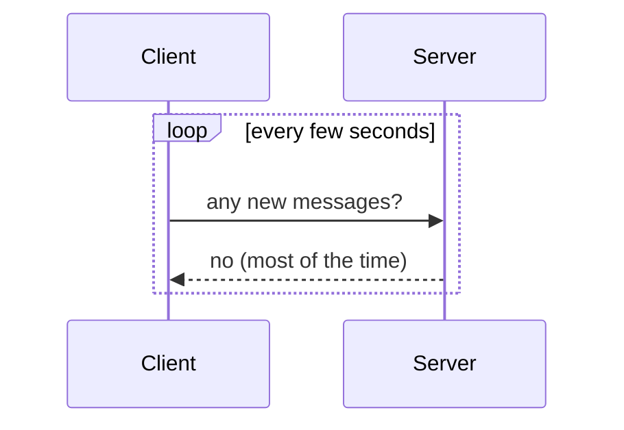
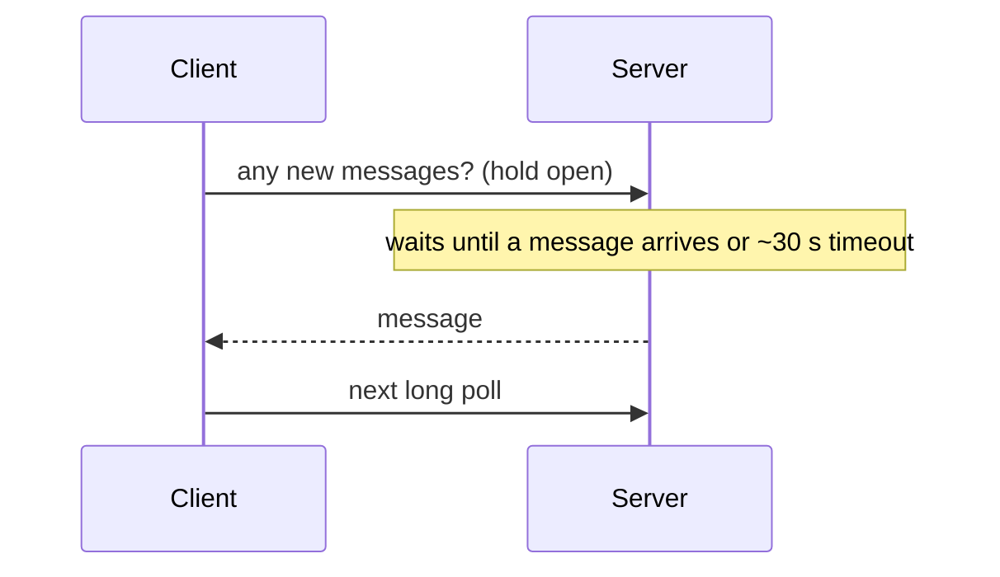
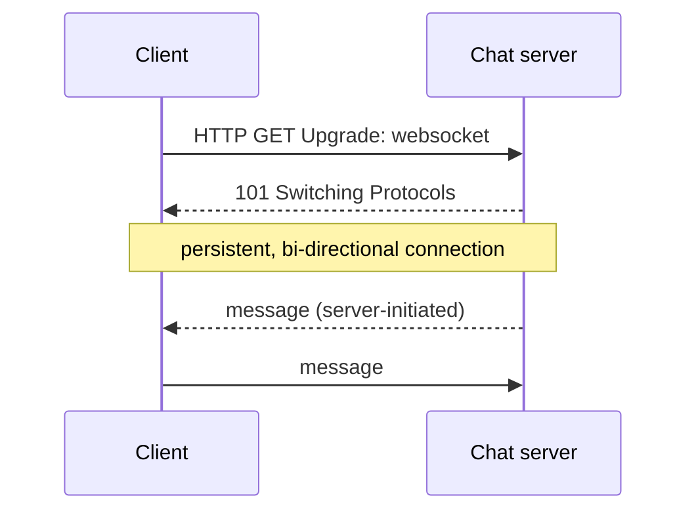
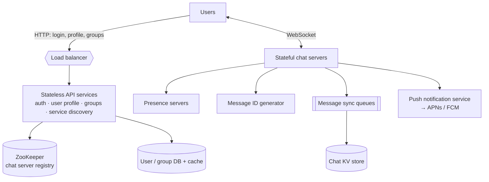
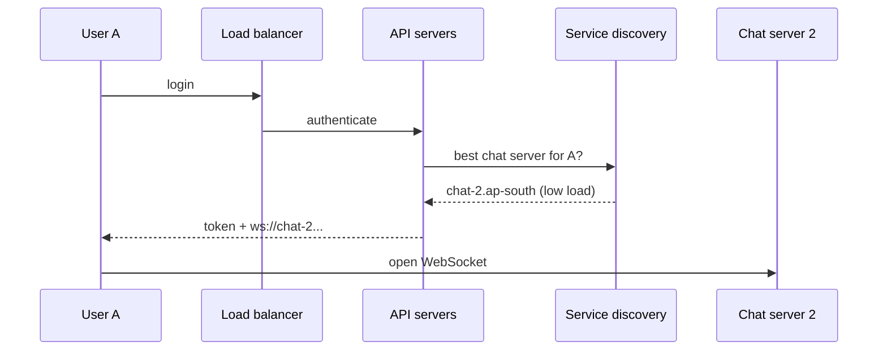
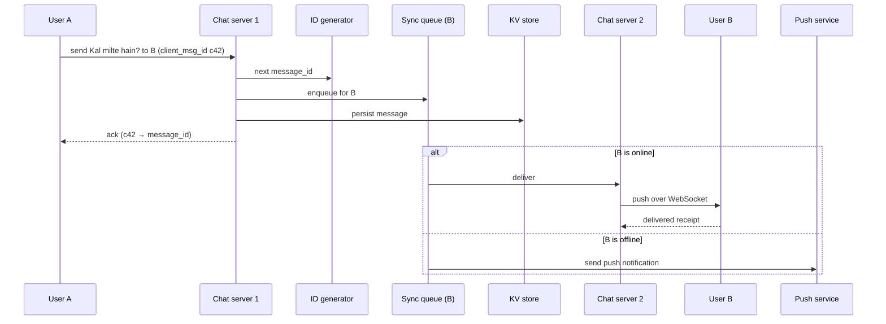
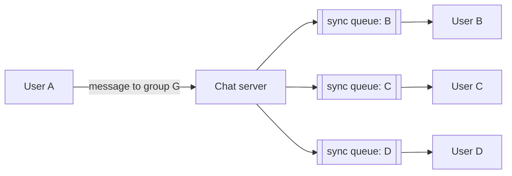
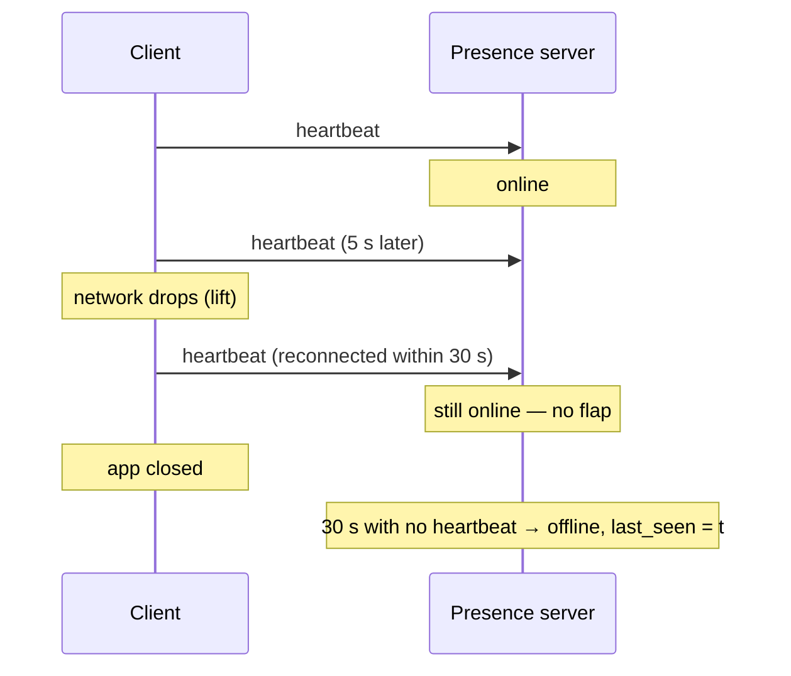

# 12 · Design a Chat System

<div class="chapter-meta" markdown>
<span>⏱ 50 min read</span>
<span class="hot">🔥 Top-5 most asked; tests real-time + storage + ordering</span>
<span>Book: Chapter 12</span>
</div>

!!! abstract "TL;DR"
    - Clients need **server-initiated** delivery → use **WebSockets** (bi-directional, persistent) rather than polling or long polling.
    - Split services: **stateless** (login, profiles, groups — behind a load balancer), **stateful chat servers** (hold each user's WebSocket), and **third-party push** (APNs/FCM for offline users).
    - **Service discovery** (e.g. ZooKeeper) assigns a user to a healthy, nearby chat server at login.
    - Store messages in a **wide-column / key-value store** (Cassandra, HBase): huge write volume, reads are "latest N messages in a chat". Key = `(chat_id, message_id)` with **time-sortable IDs**.
    - Each device keeps a `last_seen_message_id` → **multi-device sync** is "give me everything after X". Presence uses **heartbeats** + pub/sub to friends.

## The intuition: a telephone exchange

Old telephone exchanges kept a **live line** open between two phones for the whole call. Neither side had to keep
asking "any news?" — speech flowed both ways the moment someone spoke. If a phone was off the hook somewhere else,
the operator took a message and rang later.

A chat server is that exchange: each phone keeps one live line (a WebSocket) to its chat server; messages flow
instantly in both directions; if you're offline, a **push notification** is the operator's call-back, and the
message waits in storage until you reconnect.

---

## Step 1 · Scope

!!! example "Clarifying conversation"
    **You:** 1:1, groups, or both? — **Interviewer:** Both. Groups up to 256 members.
    **You:** Mobile, web or both? — **I:** Both; a user can be logged in on several devices at once.
    **You:** Scale? — **I:** 80M DAU.
    **You:** Message types? — **I:** Text only for now (up to 64 KB). Media later.
    **You:** Features beyond messaging? — **I:** Online/last-seen indicator, delivery and read receipts, push notifications when offline.
    **You:** History retention? — **I:** Keep chat history for 2 years.
    **You:** End-to-end encryption? — **I:** Not in scope for the design, but mention it.

### Estimates

| Quantity | Value |
|---|---|
| DAU | 80M; ~25% online at peak → **20M concurrent WebSockets** |
| Messages | 80M × 40/day = 3.2B/day → **~37K/s**, peak ~100K/s |
| Group fan-out | avg group 20 members → group messages multiply deliveries ~20× |
| Storage | 3.2B × ~150 B ≈ **480 GB/day** → 2 years ≈ **350 TB** (+ replicas) |
| Chat servers | at ~500K connections per tuned server → **~40 servers** just for connections (run 2× for headroom) |

---

## Step 2 · High-level design

### How does the server push a message to the receiver?

HTTP is client-initiated. The **sender** can just `POST` (or send over its socket). The hard part is the
**receiver**: the server must push to them. Three options:

#### Option 1 · Polling


Simple, but wasteful: most requests return nothing, and latency = polling interval.

#### Option 2 · Long polling


Better latency, but: the server holding the connection may not be the one that receives the sender's
message (stateless LB routing); the server can't tell if a client disconnected; inactive users still
reconnect every timeout.

#### Option 3 · WebSocket ✅


Starts as HTTP and **upgrades**; works over ports 80/443 so it passes firewalls; full-duplex. Use it for
**both sending and receiving** — one connection, simpler client.

### Service architecture



| Kind | Components | Notes |
|---|---|---|
| **Stateless** | Login/auth, user profiles, group management, **service discovery** | Classic request/response behind a LB; scale freely |
| **Stateful** | **Chat servers** | Each client keeps a persistent connection to one chat server; a user only moves server if it fails |
| **Third-party** | **Push notifications** (APNs/FCM) | How offline users learn about new messages (Chapter 10) |

**Scalability:** a single giant server holding 20M connections is a fantasy-level SPOF; we shard connections across
many chat servers, and keep everything else stateless.

### Storage: which database?

Two kinds of data:

1. **Generic data** — users, profiles, settings, friend lists, groups. Relational DB with replicas and sharding is fine.
2. **Chat history** — the unique part. Its properties:
    - **Enormous write volume** (tens of billions of messages per day at WhatsApp/Messenger scale).
    - Reads are mostly **recent**: "open chat → show the latest 50", then scroll back occasionally.
    - Access is **by chat and time**, rarely by content (search is a separate index).
    - Read:write ratio is near 1:1 for 1:1 chats.

→ A **wide-column / key-value store** (Cassandra, HBase, ScyllaDB) partitioned by chat. Easy horizontal scaling,
very low latency, and battle-tested for chat (Facebook Messenger historically used HBase; Discord uses Cassandra/ScyllaDB).

### Data model

```text
-- 1:1 messages (partition by the pair, so a conversation lives together)
messages_1to1
  chat_id      (partition key)  = min(user_a, user_b) + ":" + max(user_a, user_b)
  message_id   (clustering key, DESC)   -- time-sortable
  from_user_id
  content
  created_at

-- group messages
messages_group
  group_id     (partition key)
  message_id   (clustering key, DESC)
  from_user_id
  content
  created_at
```

**Message IDs** must be **unique and sortable by time** — ordering in a chat depends on them. `created_at` alone
isn't enough (two messages in the same ms). Options:

- A global **Snowflake** ID (Chapter 7) — easy, globally roughly ordered.
- A **per-chat sequence** (local ID generator): IDs only need to be ordered *within one chat*, which is much easier to guarantee (e.g. a counter per chat partition).

---

## Step 3 · Deep dive

### Service discovery

When a user logs in, which chat server should they connect to? **ZooKeeper** (or etcd/Consul) keeps a registry of
live chat servers with their load and location; the API picks the best one (nearby, least loaded) and returns its
address.



A **session registry** (Redis: `user_id → {chat_server, device}`) records where each user is currently connected,
so other servers can route messages to them.

### 1:1 message flow



1. A sends a message over its WebSocket to chat server 1, with a **client-generated ID** (`c42`) for dedup on retries.
2. Chat server 1 gets a `message_id` and **persists** the message (KV store) — the source of truth.
3. It enqueues the message on B's **message sync queue** (think: B's inbox).
4. It **acks** A (A's UI shows one tick ✓).
5. If B is online (session registry says chat server 2), the message is delivered over B's WebSocket; B's app acks → **delivered** (✓✓).
6. If B is offline, the **push notification** service sends an APNs/FCM alert; the message waits in storage.

### Multi-device sync

User B has a phone and a laptop. Each device keeps its own **`cur_max_message_id`** — the latest message ID it has
seen for each chat. A new message is "new" for a device if:

- the recipient is the logged-in user, and
- `message_id > cur_max_message_id` of that device.

On reconnect, a device asks "everything after `cur_max_message_id` for my chats", fetches it from the KV store, and
updates its pointer. With separate pointers per device, each one catches up independently.

### Small group chat



For small groups (≤ a few hundred), **copy the message (or its ID) into each member's sync queue / inbox**. Each
recipient then only checks one inbox for everything — simple and fast. The cost is N copies per message, which is
fine for groups of 256 but **not** for channels with 100K members — there, readers **pull** from the group's own
message stream instead (the same push-vs-pull trade-off as Chapter 11).

On the receiving side, one user's inbox gets messages from many senders and groups, merged in order.

### Online presence

Show a green dot when a friend is online, and "last seen" otherwise.

- **Login:** after the WebSocket is established, the presence server sets `status = online, last_active_at = now` in a KV store.
- **Logout:** set `status = offline`.
- **Disconnects** are messy: mobile networks drop constantly (lift, tunnel). Flipping offline/online on every blip is noisy and expensive. Use a **heartbeat**: the client sends one every ~5 s; if none arrives for ~30 s, mark the user offline.



**Fan-out of status changes:** use **pub/sub** — each user has a channel; friends subscribe to it (A→B, A→C…).
When A goes offline, the presence server publishes once and subscribers' chat servers push the update. This works
for small friend lists/groups; for large groups (say 50K members), **don't push presence** — fetch it only when a
user opens the group or a member's profile.

### Receipts: sent ✓, delivered ✓✓, read 🔵

- **Sent**: server persisted the message (ack to sender).
- **Delivered**: recipient's device acked receipt → server updates status and notifies the sender.
- **Read**: recipient opened the chat → device sends "read up to message_id X" (one event covers many messages).
In groups, track per member and aggregate ("read by 12").

### Failure handling

- **Chat server dies:** clients notice the closed WebSocket, ask service discovery for a new server, reconnect, and **resync** from `cur_max_message_id` — nothing is lost because messages were persisted before acking.
- **Message retry:** if the sender gets no ack, it resends with the same `client_msg_id`; the server dedups → no duplicates.
- **Ordering:** order by `message_id` within a chat; the client inserts late arrivals into the right position.
- **Queue backlog / slow consumers:** sync queues are durable; recipients catch up on reconnect.

### End-to-end encryption (mention)

With E2EE (Signal protocol, used by WhatsApp), messages are encrypted on the sender's device with keys only
recipient devices hold. The server stores and forwards **ciphertext** — it can't read, search, or moderate content,
and multi-device sync needs per-device keys. The architecture above still works; only payloads become opaque.

---

## Interviewer follow-ups

??? question "Why not just use long polling instead of WebSockets?"
    Long polling works but has drawbacks at our scale: connections are re-established constantly (every message and every timeout),
    the server holding a client's poll may not be the one receiving the sender's message (needs extra routing), and it's hard to detect
    disconnects. WebSockets give one persistent full-duplex connection per device — lower latency and overhead for 20M concurrent users.

??? question "How do you route a message from chat server 1 to the user connected on chat server 7?"
    Look up the recipient in the **session registry** (`user_id → chat server(s)`), then send via an internal message bus — e.g. each chat
    server consumes its own queue/topic, or servers talk over internal RPC. Kafka topics partitioned by recipient, or Redis pub/sub
    channels per chat server, are common choices.

??? question "How do you guarantee message order in a chat?"
    Assign IDs that are strictly increasing **within a chat** — e.g. a per-chat sequence number from the partition that owns the chat — and
    have clients sort by it. Global ordering across chats isn't needed. Snowflake IDs are roughly ordered globally but can invert by a few ms
    across servers; per-chat sequences avoid that.

??? question "A group has 100,000 members. What changes?"
    Stop copying messages into every member's inbox (100K writes per message). Store the message once in the group's stream; members
    **pull** recent messages when they open the group, and receive a lightweight notification/badge rather than the full message. Don't fan
    out presence or typing indicators; rate-limit who can post (announcement-style channels).

??? question "How would you add message search?"
    The KV store is optimised for "latest messages by chat", not text search. Stream messages (asynchronously) into a search index
    (Elasticsearch/OpenSearch) partitioned by user, and query it per user. With E2EE, server-side search is impossible — search runs on the
    device over its local copy.

---

## Practice

??? example "Practice 1 — Size the chat-server fleet"
    35M concurrent connections at peak. A chat server handles 400K connections at 60% CPU. You want N+2 redundancy per region across 3 regions
    with traffic split 50/30/20. How many servers per region?

    **Solution.** Region connections: 17.5M, 10.5M, 7M → ÷ 400K = 44, 27, 18 servers → +2 each → **46, 29, 20** (95 total). Also plan
    capacity for one region failing over to the others.

??? example "Practice 2 — Multi-device catch-up"
    B's phone has `cur_max_message_id = 9100` and laptop `= 9180` for chat X. Messages 9101–9200 exist. The phone reconnects. What's fetched,
    and what happens to the laptop?

    **Solution.** Phone queries chat X for `message_id > 9100` → 100 messages, updates its pointer to 9200. The laptop is unaffected until it
    reconnects/receives live messages; it would fetch `> 9180` → 20 messages. Read receipts are per-user, so if the phone marks "read up to
    9200", the laptop's UI can clear unread badges via a sync event.

??? example "Practice 3 — Presence traffic"
    20M online users send a heartbeat every 5 s. What's the heartbeat QPS? How could you cut it?

    **Solution.** 20M / 5 = **4M heartbeats/s** — significant. Reduce by: sending heartbeats over the existing WebSocket (no new connections),
    letting the chat server treat any message as a heartbeat, increasing the interval to 15–30 s with a 60–90 s timeout, and updating the
    presence store only on state changes (online ↔ offline) rather than on every heartbeat.

---

## Revision checklist

- [ ] I can compare polling, long polling and WebSockets and justify WebSockets.
- [ ] I can separate stateless, stateful and third-party services and explain service discovery.
- [ ] I can justify a wide-column/KV store for messages and design the 1:1 and group data model.
- [ ] I know why message IDs must be time-sortable and two ways to generate them.
- [ ] I can walk through 1:1 delivery (online/offline), multi-device sync, and small-group fan-out.
- [ ] I can design presence with heartbeats and pub/sub, receipts, and failure recovery.

[Next: 13 · Search Autocomplete :material-arrow-right:](13-search-autocomplete.md){ .md-button .md-button--primary }
