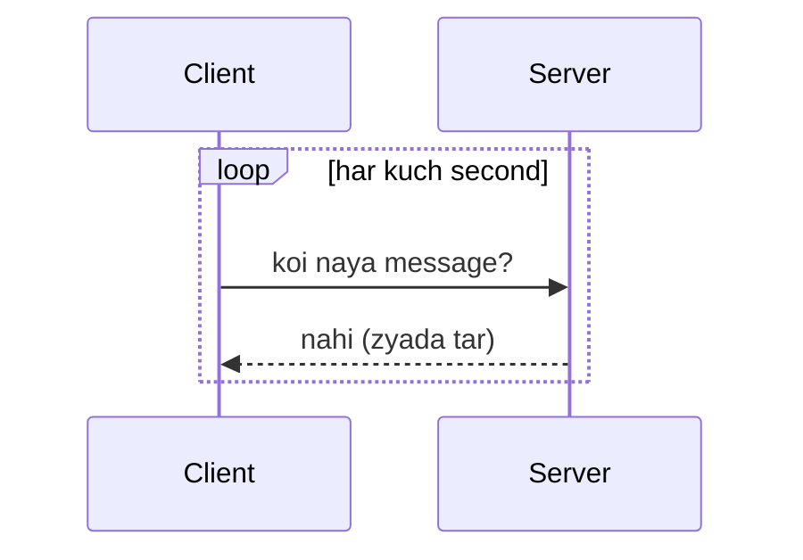
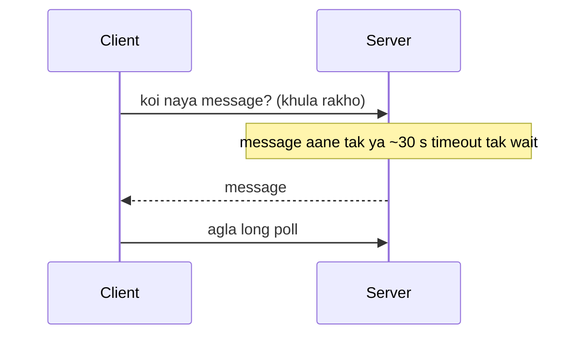
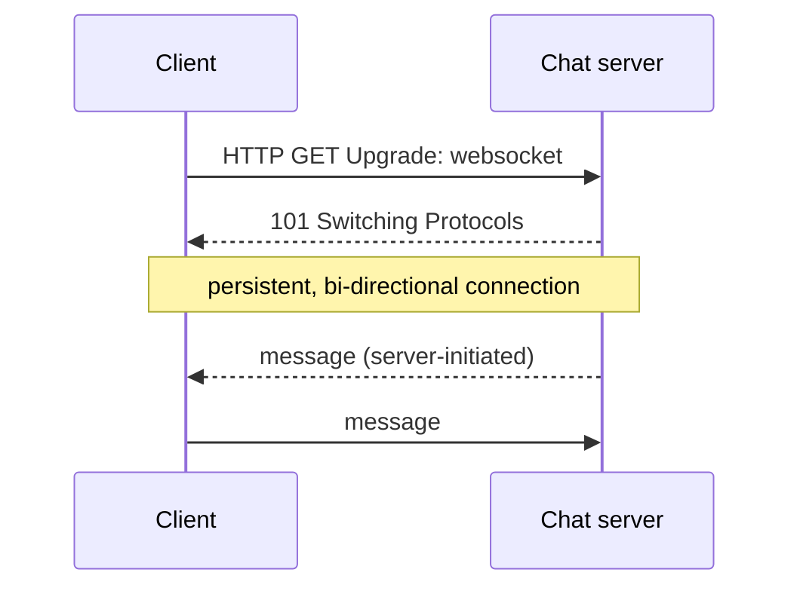
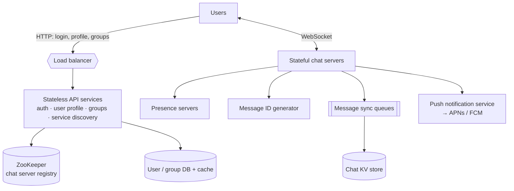
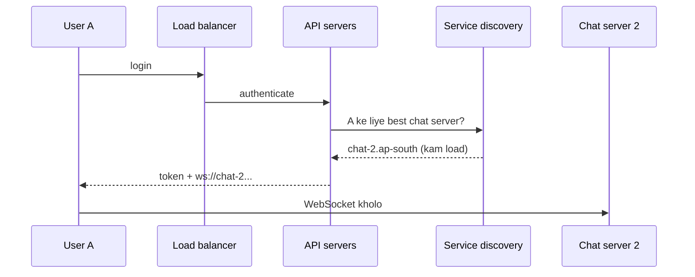
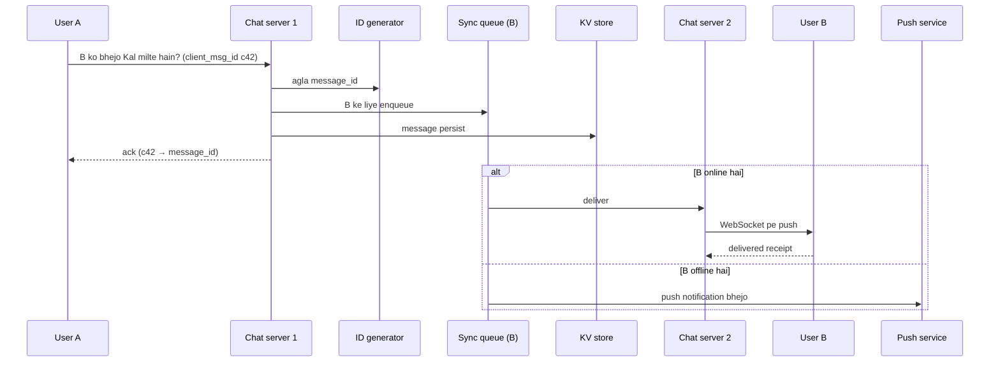
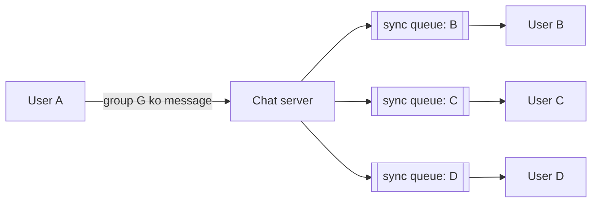
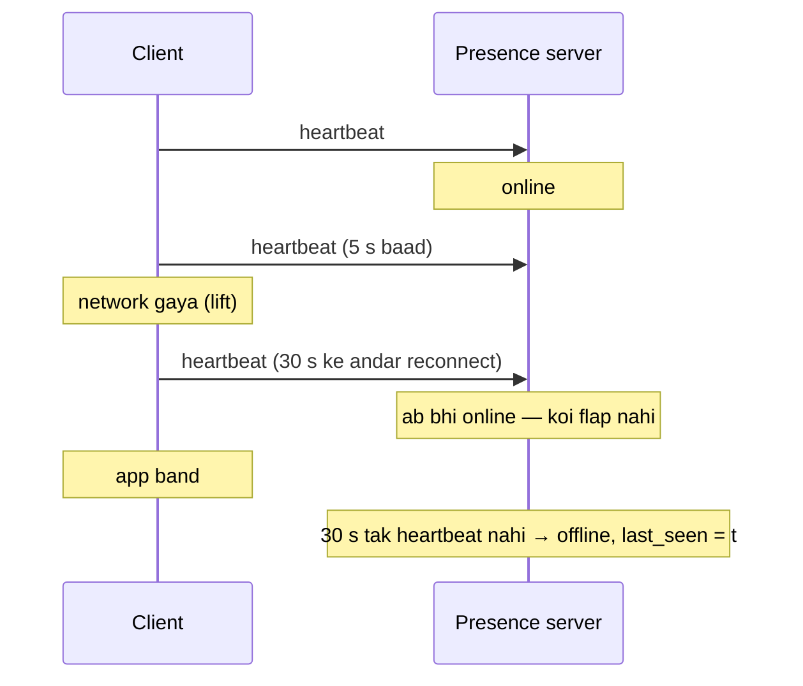

# 12 · Chat System Design karo

<div class="chapter-meta" markdown>
<span>⏱ 50 min read</span>
<span class="hot">🔥 Top-5 sabse zyada poochha jaane waala; real-time + storage + ordering test karta hai</span>
<span>Book: Chapter 12</span>
</div>

!!! abstract "TL;DR"
    - Clients ko **server-initiated** delivery chahiye → polling ya long polling ki jagah **WebSockets** (bi-directional, persistent).
    - Services baanto: **stateless** (login, profiles, groups — load balancer ke peeche), **stateful chat servers** (har user ka WebSocket rakhte hain), aur **third-party push** (offline users ke liye APNs/FCM).
    - **Service discovery** (jaise ZooKeeper) login pe user ko ek healthy, paas waala chat server assign karti hai.
    - Messages **wide-column / key-value store** (Cassandra, HBase) mein: bahut zyada write volume, reads "chat ke latest N messages" jaise. Key = `(chat_id, message_id)`, **time-sortable IDs** ke saath.
    - Har device ek `last_seen_message_id` rakhta hai → **multi-device sync** matlab "X ke baad ka sab do". Presence **heartbeats** + dosto ko pub/sub se.

## Intuition: telephone exchange

Purane telephone exchanges poori call ke liye do phones ke beech ek **live line** khuli rakhte the. Kisi ko baar-baar "kuch naya?" poochna nahi
padta tha — jaise hi koi bolta, awaaz dono taraf behti. Agar phone kahin aur off the hook hota, operator message le leta aur baad mein ghanti bajata.

Chat server wahi exchange hai: har phone apne chat server se ek live line (WebSocket) rakhta hai; messages turant dono taraf behte hain; agar tum
offline ho, toh **push notification** operator ka call-back hai, aur message tumhare reconnect hone tak storage mein intezaar karta hai.

---

## Step 1 · Scope

!!! example "Clarifying baatcheet"
    **Tum:** 1:1, groups, ya dono? — **Interviewer:** Dono. Groups mein 256 members tak.
    **Tum:** Mobile, web ya dono? — **I:** Dono; ek user ek saath kai devices pe logged in ho sakta hai.
    **Tum:** Scale? — **I:** 80M DAU.
    **Tum:** Message types? — **I:** Abhi sirf text (64 KB tak). Media baad mein.
    **Tum:** Messaging ke alawa features? — **I:** Online/last-seen indicator, delivery aur read receipts, offline hone pe push notifications.
    **Tum:** History kitne time? — **I:** Chat history 2 saal rakho.
    **Tum:** End-to-end encryption? — **I:** Design ke scope mein nahi, par mention karo.

### Estimates

| Cheez | Value |
|---|---|
| DAU | 80M; peak pe ~25% online → **20M concurrent WebSockets** |
| Messages | 80M × 40/din = 3.2B/din → **~37K/s**, peak ~100K/s |
| Group fan-out | average group 20 members → group messages deliveries ko ~20× badhate hain |
| Storage | 3.2B × ~150 B ≈ **480 GB/din** → 2 saal ≈ **350 TB** (+ replicas) |
| Chat servers | ek tuned server pe ~500K connections → sirf connections ke liye **~40 servers** (headroom ke liye 2× chalao) |

---

## Step 2 · High-level design

### Server receiver ko message push kaise karega?

HTTP client-initiated hai. **Sender** seedha `POST` kar sakta hai (ya apne socket pe bhej sakta hai). Mushkil hissa hai **receiver**: server ko
unhe push karna hai. Teen options:

#### Option 1 · Polling


Simple, par barbaadi: zyada tar requests khaali lautti hain, aur latency = polling interval.

#### Option 2 · Long polling


Latency better, par: jo server connection pakde hai, zaroori nahi wahi sender ka message receive kare (stateless LB routing); server ko pata nahi
chalta client disconnect hua ya nahi; inactive users bhi har timeout pe reconnect karte hain.

#### Option 3 · WebSocket ✅


HTTP se shuru hota hai aur **upgrade** hota hai; ports 80/443 pe chalta hai toh firewalls paar kar leta hai; full-duplex. **Bhejne aur paane
dono** ke liye isi ko use karo — ek connection, simple client.

### Service architecture



| Kind | Components | Notes |
|---|---|---|
| **Stateless** | Login/auth, user profiles, group management, **service discovery** | LB ke peeche classic request/response; freely scale |
| **Stateful** | **Chat servers** | Har client ek chat server se persistent connection rakhta hai; user tabhi server badalta hai jab woh fail ho |
| **Third-party** | **Push notifications** (APNs/FCM) | Offline users ko naye messages ka pata aise chalta hai (Chapter 10) |

**Scalability:** 20M connections pakadne waala ek giant server sapnon jaisa SPOF hai; hum connections ko kai chat servers mein shard karte hain,
aur baaki sab stateless rakhte hain.

### Storage: kaunsa database?

Do tarah ka data:

1. **Generic data** — users, profiles, settings, friend lists, groups. Replicas aur sharding ke saath relational DB theek hai.
2. **Chat history** — unique hissa. Iski properties:
    - **Bahut zyada write volume** (WhatsApp/Messenger scale pe roz das-hazaaron crore messages).
    - Reads zyada tar **recent**: "chat kholo → latest 50 dikhao", phir kabhi-kabhi peeche scroll.
    - Access **chat aur time se**, content se kam hi (search alag index hai).
    - 1:1 chats ke liye read:write ratio lagbhag 1:1.

→ Chat se partitioned **wide-column / key-value store** (Cassandra, HBase, ScyllaDB). Aasaan horizontal scaling, bahut low latency, aur chat ke
liye battle-tested (Facebook Messenger ne historically HBase use kiya; Discord Cassandra/ScyllaDB use karta hai).

### Data model

```text
-- 1:1 messages (pair se partition, taaki ek conversation saath rahe)
messages_1to1
  chat_id      (partition key)  = min(user_a, user_b) + ":" + max(user_a, user_b)
  message_id   (clustering key, DESC)   -- time-sortable
  from_user_id
  content
  created_at

-- group messages
messages_group
  group_id     (partition key)
  message_id   (clustering key, DESC)
  from_user_id
  content
  created_at
```

**Message IDs** **unique aur time se sortable** honi chahiye — chat mein ordering inhi pe depend karti hai. Sirf `created_at` kaafi nahi (same ms
mein do messages). Options:

- Global **Snowflake** ID (Chapter 7) — aasaan, globally roughly ordered.
- **Per-chat sequence** (local ID generator): IDs ko sirf *ek chat ke andar* ordered hona hai, jo guarantee karna kahin aasaan hai (jaise har chat partition ka counter).

---

## Step 3 · Deep dive

### Service discovery

User login karta hai toh kis chat server se connect kare? **ZooKeeper** (ya etcd/Consul) live chat servers ki registry unke load aur location ke
saath rakhta hai; API best waala chunti hai (paas ka, kam load waala) aur uska address return karti hai.



Ek **session registry** (Redis: `user_id → {chat_server, device}`) record karti hai ki har user abhi kahan connected hai, taaki doosre servers
messages unhe route kar sakein.

### 1:1 message flow



1. A apne WebSocket pe chat server 1 ko message bhejta hai, retries pe dedup ke liye ek **client-generated ID** (`c42`) ke saath.
2. Chat server 1 `message_id` leta hai aur message **persist** karta hai (KV store) — source of truth.
3. Message ko B ki **message sync queue** pe daalta hai (socho: B ka inbox).
4. A ko **ack** karta hai (A ke UI mein ek tick ✓).
5. B online hai (session registry bolti hai chat server 2) toh message B ke WebSocket pe deliver hota hai; B ka app ack karta hai → **delivered** (✓✓).
6. B offline hai toh **push notification** service APNs/FCM alert bhejti hai; message storage mein intezaar karta hai.

### Multi-device sync

User B ke paas phone aur laptop hai. Har device apna **`cur_max_message_id`** rakhta hai — har chat ke liye usne dekha latest message ID. Ek naya
message device ke liye "naya" hai agar:

- recipient logged-in user hai, aur
- `message_id > us device ka cur_max_message_id`.

Reconnect pe device poochta hai "meri chats ka `cur_max_message_id` ke baad ka sab kuch", KV store se laata hai, aur apna pointer update karta hai.
Har device ka alag pointer hai, toh har ek apne aap catch up karta hai.

### Chhota group chat



Chhote groups (≤ kuch sau) ke liye, **message (ya uski ID) ko har member ki sync queue / inbox mein copy karo**. Har recipient ko phir sab kuch ke
liye sirf ek inbox dekhna hai — simple aur tez. Keemat hai har message ki N copies, jo 256 ke groups ke liye theek hai par 100K members waale
channels ke liye **nahi** — wahan readers group ki apni message stream se **pull** karte hain (Chapter 11 jaisa hi push-vs-pull trade-off).

Receiving side pe ek user ke inbox mein kai senders aur groups ke messages order mein merge hokar aate hain.

### Online presence

Dost online ho toh hara dot, warna "last seen".

- **Login:** WebSocket bante hi presence server KV store mein `status = online, last_active_at = now` set karta hai.
- **Logout:** `status = offline` set.
- **Disconnects** gande hain: mobile networks lagatar toot-te hain (lift, tunnel). Har jhatke pe offline/online flip karna noisy aur mehenga hai. **Heartbeat** use karo: client har ~5 s bhejta hai; ~30 s tak koi na aaye toh user offline mark karo.



**Status changes ka fan-out:** **pub/sub** use karo — har user ka ek channel; dost usse subscribe karte hain (A→B, A→C…). A offline hota hai toh
presence server ek baar publish karta hai aur subscribers ke chat servers update push karte hain. Chhoti friend lists/groups ke liye chalta hai;
bade groups (jaise 50K members) ke liye **presence push mat karo** — sirf tab laao jab user group ya kisi member ki profile khole.

### Receipts: sent ✓, delivered ✓✓, read 🔵

- **Sent**: server ne message persist kiya (sender ko ack).
- **Delivered**: recipient ke device ne receive ack kiya → server status update karke sender ko batata hai.
- **Read**: recipient ne chat kholi → device bhejta hai "message_id X tak padh liya" (ek event kai messages cover karta hai).
Groups mein har member ka track karo aur aggregate karo ("12 ne padha").

### Failure handling

- **Chat server mar gaya:** clients band WebSocket notice karte hain, service discovery se naya server maangte hain, reconnect karte hain, aur `cur_max_message_id` se **resync** — kuch nahi khota kyunki messages ack se pehle persist hue the.
- **Message retry:** sender ko ack na mile toh same `client_msg_id` ke saath dobara bhejta hai; server dedup karta hai → duplicates nahi.
- **Ordering:** chat ke andar `message_id` se order; client late aane waale messages ko sahi jagah daal deta hai.
- **Queue backlog / slow consumers:** sync queues durable hain; recipients reconnect pe catch up karte hain.

### End-to-end encryption (mention)

E2EE (Signal protocol, WhatsApp use karta hai) ke saath messages sender ke device pe un keys se encrypt hote hain jo sirf recipient devices ke paas
hain. Server **ciphertext** store aur forward karta hai — content padh, search ya moderate nahi kar sakta, aur multi-device sync ke liye per-device
keys chahiye. Upar ka architecture ab bhi chalta hai; bas payloads opaque ho jaate hain.

---

## Interviewer follow-ups

??? question "WebSockets ki jagah long polling kyun nahi?"
    Long polling chalta hai par hamare scale pe kamiyan hain: connections lagatar dobara bante hain (har message aur har timeout pe), jo server
    client ka poll pakde hai woh shayad sender ka message receive karne waala na ho (extra routing chahiye), aur disconnects detect karna mushkil.
    WebSockets har device ka ek persistent full-duplex connection dete hain — 20M concurrent users ke liye kam latency aur overhead.

??? question "Chat server 1 se message us user tak kaise route karoge jo chat server 7 pe connected hai?"
    **Session registry** (`user_id → chat server(s)`) mein recipient dekho, phir internal message bus se bhejo — jaise har chat server apni queue/topic
    consume kare, ya servers internal RPC se baat karein. Recipient se partitioned Kafka topics, ya har chat server ka Redis pub/sub channel, common choices hain.

??? question "Chat mein message order kaise guarantee karoge?"
    Aisi IDs do jo **chat ke andar** strictly badhti hon — jaise chat own karne waale partition ka per-chat sequence number — aur clients usi se sort
    karein. Chats ke across global ordering zaroori nahi. Snowflake IDs globally roughly ordered hain par servers ke across kuch ms ulat sakti hain;
    per-chat sequences isse bachate hain.

??? question "Ek group mein 1,00,000 members hain. Kya badlega?"
    Har member ke inbox mein message copy karna band karo (har message pe 100K writes). Message group ki stream mein ek baar store karo; members group
    kholne pe recent messages **pull** karte hain, aur poore message ki jagah halka notification/badge milta hai. Presence ya typing indicators fan out
    mat karo; kaun post kar sakta hai use rate-limit karo (announcement-style channels).

??? question "Message search kaise jodoge?"
    KV store "chat ke latest messages" ke liye optimised hai, text search ke liye nahi. Messages ko (asynchronously) user se partitioned search index
    (Elasticsearch/OpenSearch) mein stream karo, aur har user ke liye query karo. E2EE ke saath server-side search impossible hai — search device pe
    uski local copy pe chalta hai.

---

## Practice

??? example "Practice 1 — Chat-server fleet ka size"
    Peak pe 35M concurrent connections. Ek chat server 60% CPU pe 400K connections sambhalta hai. 3 regions mein traffic 50/30/20 bata hai aur har region
    mein N+2 redundancy chahiye. Har region mein kitne servers?

    **Solution.** Region connections: 17.5M, 10.5M, 7M → ÷ 400K = 44, 27, 18 servers → har ek +2 → **46, 29, 20** (total 95). Ek region ke doosron pe
    fail over hone ki capacity bhi plan karo.

??? example "Practice 2 — Multi-device catch-up"
    Chat X ke liye B ke phone ka `cur_max_message_id = 9100` aur laptop ka `= 9180`. Messages 9101–9200 hain. Phone reconnect karta hai. Kya fetch hoga,
    aur laptop ka kya?

    **Solution.** Phone chat X mein `message_id > 9100` query karta hai → 100 messages, pointer 9200 pe update. Laptop pe tab tak asar nahi jab tak woh
    reconnect na kare/live messages na paaye; woh `> 9180` laayega → 20 messages. Read receipts per-user hain, toh phone "9200 tak read" mark kare toh
    laptop ka UI sync event se unread badges saaf kar sakta hai.

??? example "Practice 3 — Presence traffic"
    20M online users har 5 s heartbeat bhejte hain. Heartbeat QPS kya hai? Kaise kam karoge?

    **Solution.** 20M / 5 = **4M heartbeats/s** — kaafi zyada. Kam karne ke tareeke: heartbeats existing WebSocket pe bhejo (naye connections nahi), chat
    server kisi bhi message ko heartbeat maane, interval 15–30 s aur timeout 60–90 s karo, aur presence store sirf state badalne pe (online ↔ offline)
    update karo, har heartbeat pe nahi.

---

## Revision checklist

- [ ] Polling, long polling aur WebSockets compare karke WebSockets justify kar sakta hoon.
- [ ] Stateless, stateful aur third-party services alag kar sakta hoon aur service discovery samjha sakta hoon.
- [ ] Messages ke liye wide-column/KV store justify kar sakta hoon aur 1:1 aur group data model design kar sakta hoon.
- [ ] Pata hai message IDs time-sortable kyun honi chahiye aur unhe banane ke do tareeke.
- [ ] 1:1 delivery (online/offline), multi-device sync, aur small-group fan-out samjha sakta hoon.
- [ ] Heartbeats aur pub/sub se presence, receipts, aur failure recovery design kar sakta hoon.

[Aage: 13 · Search Autocomplete :material-arrow-right:](13-search-autocomplete.md){ .md-button .md-button--primary }
