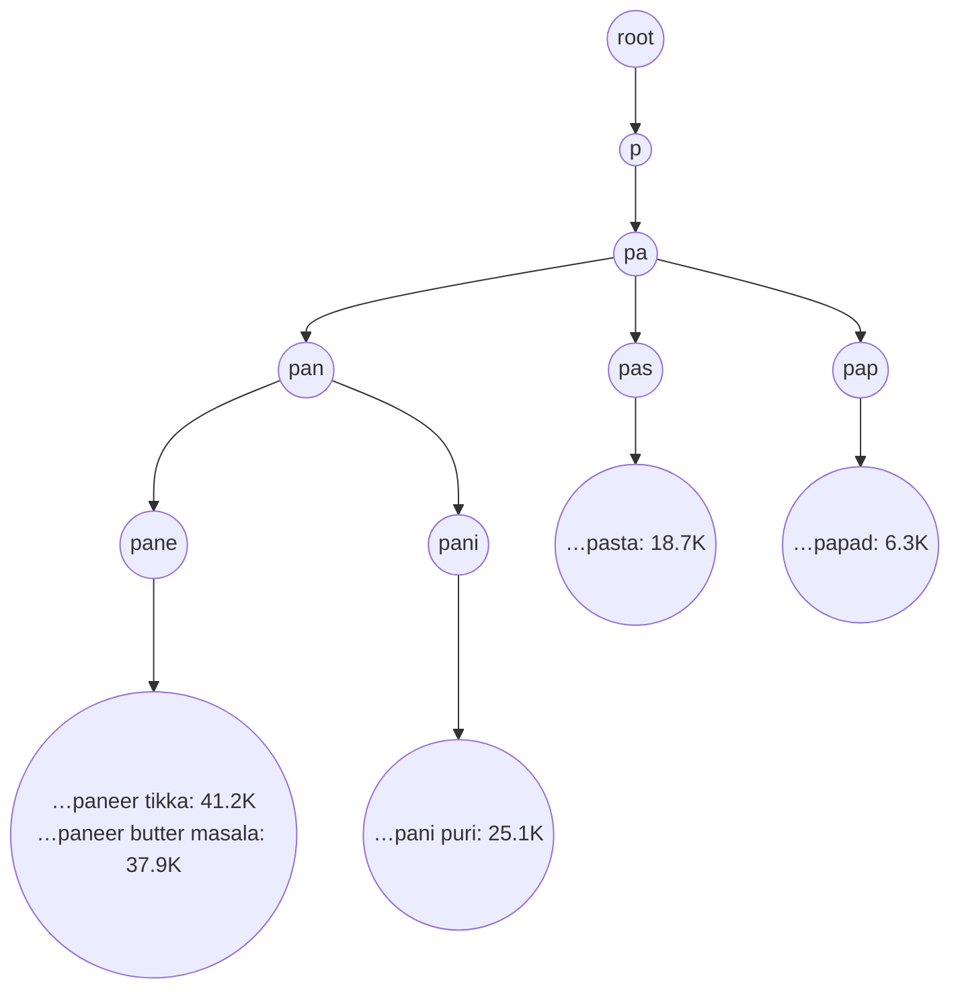
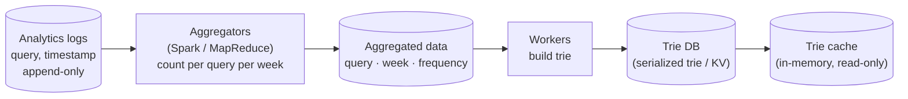
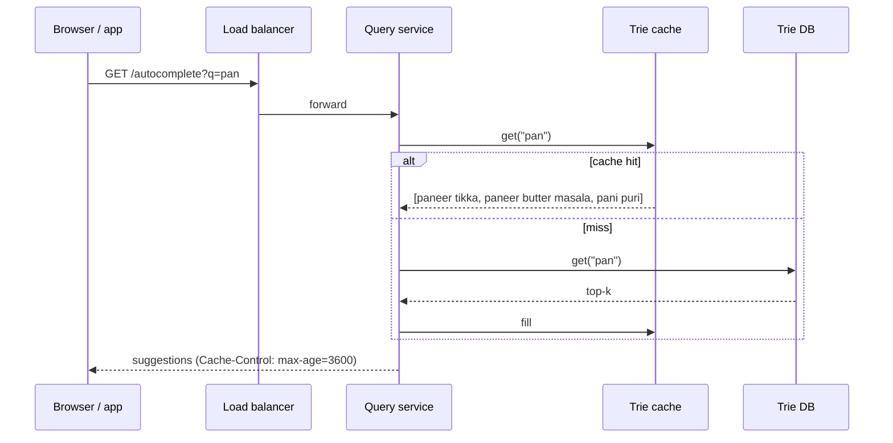
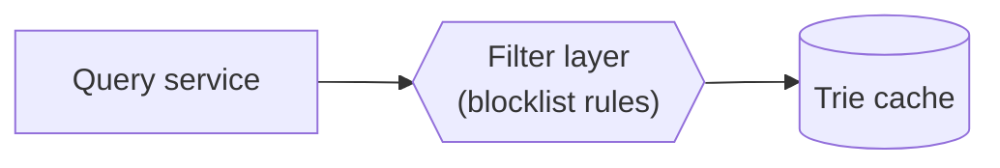
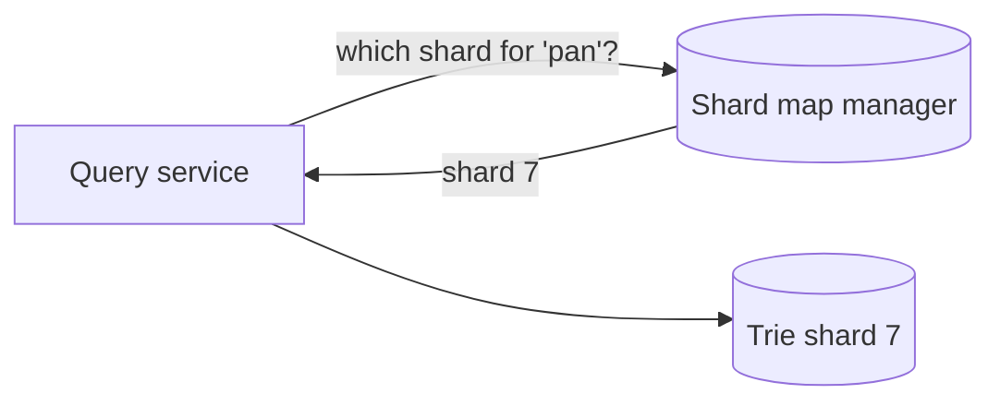

# 13 · Design a Search Autocomplete System

<div class="chapter-meta" markdown>
<span>⏱ 40 min read</span>
<span class="hot">🔥 Tests data structures + offline/online split</span>
<span>Book: Chapter 13</span>
</div>

!!! abstract "TL;DR"
    - Return the **top-k most popular queries** that start with what the user typed — in **< 100 ms**, on **every keystroke**.
    - Core structure: a **trie**. Make lookups O(prefix length) by (1) **capping prefix length** and (2) **caching the top-k completions at every node**.
    - Split into **two systems**: a **data-gathering service** (offline: query logs → aggregate → rebuild trie weekly/daily) and a **query service** (online: read-only trie in memory/cache).
    - Cut traffic with **debouncing** on the client, **browser caching** (`Cache-Control`), and sampling logs.
    - Scale the trie by **sharding on prefix**, using a **shard map** that balances uneven letter frequencies. Remove bad suggestions with a **filter layer**.

## The intuition: the chaiwala who knows your order

You walk into your regular tea stall and say "ek ad—" and the chaiwala is already pouring **adrak chai**, because
that's what most people who start with "ad" order. He doesn't think through his whole menu each time; he's
memorised the most popular finish for each beginning. And he updates that memory slowly — over weeks, as tastes
change — not with every single customer.

That's the design: **precomputed** "most popular completions per prefix", **refreshed periodically** from history.

---

## Step 1 · Scope

!!! example "Clarifying conversation"
    **You:** Match only at the beginning of the query, or anywhere? — **Interviewer:** Beginning only (prefix match).
    **You:** How many suggestions? — **I:** 10.
    **You:** Ranked how? — **I:** By how often the full query has been searched (popularity).
    **You:** Spell correction? Personalisation? — **I:** Not now; mention as extensions.
    **You:** Language? — **I:** English and Hinglish/Hindi queries in Roman script; design for Unicode later.
    **You:** Capitalisation and special characters? — **I:** Lower-case alphanumerics only.
    **You:** Scale? — **I:** 30M DAU.

**Requirements:** fast (< 100 ms end-to-end, or typing feels laggy) · relevant (results start with the prefix) ·
sorted by popularity · scalable · highly available.

### Estimates

| Quantity | Value |
|---|---|
| Searches | 30M DAU × 8 searches/day = 240M/day |
| Requests per search | ~6 (a request per keystroke after debounce, avg query ~20 chars) |
| QPS | 240M × 6 / 10⁵ ≈ **14,400/s** avg, ~**30K/s** peak |
| New query data | 240M × ~25 B = 6 GB/day of logs; ~20% are new unique queries → **~1.2 GB/day** of new trie content |

---

## Step 2 · High-level design

Two independent services:

- **Data gathering service** — collects user queries and aggregates them into a frequency table / trie. Offline, batch.
- **Query service** — given a prefix, returns the top 10 most frequent queries. Online, read-only, fast.

### The naive version (to see why it fails)

A frequency table in a relational DB:

| query | frequency |
|---|---|
| paneer tikka | 41,200 |
| paneer butter masala | 37,900 |
| pani puri | 25,100 |
| pasta | 18,700 |
| papad | 6,300 |

```sql
SELECT query FROM frequency_table
WHERE query LIKE 'pa%'
ORDER BY frequency DESC
LIMIT 10;
```

Fine for thousands of rows. At billions of rows, scanning every `LIKE 'pa%'` match and sorting on each keystroke is far too
slow. We need a structure built for prefix lookups.

---

## Step 3 · Deep dive

### The trie (prefix tree)

- The root is the empty string.
- Each node stores **one character** and has up to 26 (or 36) children.
- Each node represents a **prefix**; nodes that complete a real query store its **frequency**.



**Naive top-k lookup:**

1. Walk down to the prefix node — O(p), p = prefix length.
2. Traverse its whole subtree to collect all completions — O(c), c = number of descendant nodes.
3. Sort and take top k — O(c log c).

Step 2 is the killer: for the prefix "p", the subtree is a large fraction of the whole trie.

**Two optimisations make it O(p) ≈ O(1):**

1. **Limit the prefix length.** People rarely type 50-character prefixes before picking a suggestion. Cap at, say, 50 chars → walking to the node is O(1).
2. **Cache top-k at every node.** Each node stores its own precomputed list of the top 10 completions (with frequencies). Lookup = walk to the node, return its list — **no subtree traversal**.

The cost: more memory (each query string appears in the top-k lists of all its prefixes). Usually worth it — fast
responses are the whole point.

Try it — every node in this widget stores its own top-k list:

<div class="sd-widget" data-widget="trie"></div>

```java
final class AutocompleteTrie {
    private static final int K = 10;
    private static final class Node {
        final Map<Character, Node> kids = new HashMap<>();
        final List<Map.Entry<String, Long>> topK = new ArrayList<>();   // cached top-k at this prefix
    }
    private final Node root = new Node();

    /** Offline build: called once per (query, frequency) from the aggregated table. */
    void insert(String query, long freq) {
        Node n = root;
        offer(n, query, freq);
        for (char c : query.toCharArray()) {
            n = n.kids.computeIfAbsent(c, x -> new Node());
            offer(n, query, freq);
        }
    }

    private static void offer(Node n, String q, long f) {
        n.topK.add(Map.entry(q, f));
        n.topK.sort((a, b) -> Long.compare(b.getValue(), a.getValue()));
        if (n.topK.size() > K) n.topK.remove(K);
    }

    /** Online: O(prefix length). */
    List<String> suggest(String prefix) {
        Node n = root;
        for (char c : prefix.toCharArray()) { n = n.kids.get(c); if (n == null) return List.of(); }
        return n.topK.stream().map(Map.Entry::getKey).toList();
    }
}
```

### Data gathering service

Updating the trie on **every** search (billions/day) is pointless and expensive: top suggestions barely change
minute to minute. Instead, a batch pipeline:



1. **Analytics logs** — raw, append-only records of searches (`query`, `timestamp`). Not indexed.
2. **Aggregators** — periodically roll logs up into `(query, time-window, frequency)`. How often depends on the product: weekly is fine for most search; Twitter-style trending needs near-real-time (see below).
3. **Workers** — asynchronously build a fresh trie from aggregated data and store it in the **Trie DB**.
4. **Trie cache** — a distributed cache holding the trie in memory for fast reads; refreshed by snapshotting the DB after each rebuild.

**Where to store the trie?**

- **Document store** — serialise the whole trie (or each shard) as a snapshot blob, e.g. in MongoDB/S3. Simple to swap atomically.
- **Key-value store** — map each **prefix → node data (top-k list)**. Every trie node becomes one key: `"pa" → ["paneer tikka", …]`. Lookups become a single `GET`. This is also very convenient for sharding and caching.

| key (prefix) | value (top-k) |
|---|---|
| `p` | paneer tikka, paneer butter masala, pani puri, pasta, … |
| `pa` | paneer tikka, paneer butter masala, pani puri, pasta, papad |
| `pan` | paneer tikka, paneer butter masala, pani puri |
| `pas` | pasta |

### Query service



Making it **lightning fast**:

- **AJAX / fetch** from the page — no full-page reloads.
- **Debounce** on the client: wait ~100–150 ms after the last keystroke before sending, and cancel in-flight requests that are now stale.
- **Browser caching**: suggestions for a prefix change slowly, so respond with `Cache-Control: private, max-age=3600` — the browser answers repeat prefixes itself (Google does something similar).
- **Data sampling**: logging every query at full scale costs a lot of processing; logging 1 in N still captures popularity accurately.

### Trie operations

- **Create** — workers build it from aggregated data.
- **Update** — either (1) **rebuild** periodically and swap the new trie in (preferred), or (2) update individual nodes in place — and then every ancestor's top-k list must be updated too (expensive; fine only for small tries).
- **Delete** — hateful, violent, sexually explicit or dangerous suggestions must disappear **immediately**, not at the next weekly rebuild. Put a **filter layer** in front of the trie cache that drops blocklisted results; remove them physically from the trie at the next rebuild.



### Scaling the storage

When the trie outgrows one server, **shard by prefix**:

- Naive: 2 shards `a–m` and `n–z`; 26 shards = one per first letter; beyond 26, shard on the second letter (`aa–ag`, `ah–an`, …).
- Problem: letters aren't evenly used — far more English words start with `s` than with `x`. Equal-letter ranges create **hot, uneven shards**.
- Fix: analyse historical distribution and use a **shard map manager** (a lookup DB) that maps ranges to shards so each holds a similar load — e.g. `s` alone gets a shard, while `u–z` share one.



---

## Step 4 · Wrap-up — extensions

??? question "How do you support multiple languages (Hindi, Tamil, Japanese…)?"
    Store **Unicode** characters in trie nodes instead of a 26-letter alphabet (children become a map, not an array). Normalise input
    (Unicode NFC, lower-casing where it applies). For Roman-script Hinglish, transliteration variants ("paneer"/"panir") may need to be
    merged as synonyms.

??? question "Different top queries per country?"
    Build **separate tries per country/region** from region-filtered logs, and store them in CDNs/edges near those users. Route
    requests by user locale.

??? question "How do you support trending (real-time) queries — e.g. breaking news?"
    Weekly rebuilds can't catch a query that exploded 10 minutes ago. Options: a **streaming pipeline** (Kafka → Flink/Spark Streaming)
    counting recent queries in sliding windows; give **recent queries more weight** (time-decayed scores); keep a small real-time
    "trending" trie that's merged with the main trie's results at query time. Reduce the working set by sharding.

??? question "How would you add personalisation?"
    Blend global suggestions with the user's own recent searches (stored per user, small) and context (location, time of day). The
    query service fetches both and re-ranks — the global trie stays the same.

??? question "What about typos — 'panner' should still suggest 'paneer'?"
    Prefix tries are exact-match. Add fuzzy matching: query the trie with prefixes within edit distance 1–2 (bounded search over the
    trie), or maintain a spelling-correction model that rewrites the prefix first. Costlier — apply only when the exact prefix returns
    few results.

---

## Practice

??? example "Practice 1 — Memory of top-k caching"
    A trie has 50M nodes. Each node caches its top 10 completions as 8-byte query IDs plus 8-byte frequencies. How much memory do the
    cached lists add?

    **Solution.** 50M × 10 × 16 B = **8 GB** — plus the query-ID → string dictionary stored once. Manageable, and sharding splits it
    further. (Storing full strings in each list instead could be 5–10× more.)

??? example "Practice 2 — Browser cache savings"
    Users type on average 6 prefixes per search, and 40% of prefixes repeat a prefix that user requested within the last hour. With a
    1-hour browser cache, how much does server QPS drop?

    **Solution.** 40% of requests are served by the browser → server QPS drops from ~14.4K to **~8.6K/s** average. Combined with
    debouncing (e.g. 6 → 4 requests per search), QPS can fall to ~5.8K/s.

??? example "Practice 3 — Uneven shards"
    You have 6 shards and this traffic share by first letter: s 12%, c 9%, p 8%, m 7%, b 6%, t 6%, a 6%, d 5%, others 41% spread evenly
    over 18 letters. Propose a balanced split.

    **Solution.** Target ≈ 16.7% per shard. One assignment: S1 = {s, a} 18%; S2 = {c, p} 17%; S3 = {m, b, i, l} 7+6+2.3+2.3 ≈ 17.6%;
    S4 = {t, d, f, g, h, k} 6+5+2.3×4 ≈ 20%; S5 and S6 split the remaining 12 letters (~27% → ~13.7% each). Not perfect — S4 runs
    hot, so move one of its small letters to S5 — then tune with real data. The **shard map manager** stores whatever ranges you end up with.

---

## Revision checklist

- [ ] I can state the requirements and estimate QPS for per-keystroke requests.
- [ ] I can explain why the SQL `LIKE` approach fails and how a trie works.
- [ ] I can apply the two optimisations (prefix cap + cached top-k) and state the resulting complexity.
- [ ] I can draw the data-gathering pipeline and the query service, and explain why updates are batched.
- [ ] I know trie storage options (snapshot vs prefix→top-k KV), update/delete strategies and the filter layer.
- [ ] I can shard by prefix with a shard map, and discuss languages, regions, trending and typos.

[Next: 14 · YouTube :material-arrow-right:](14-youtube.md){ .md-button .md-button--primary }
