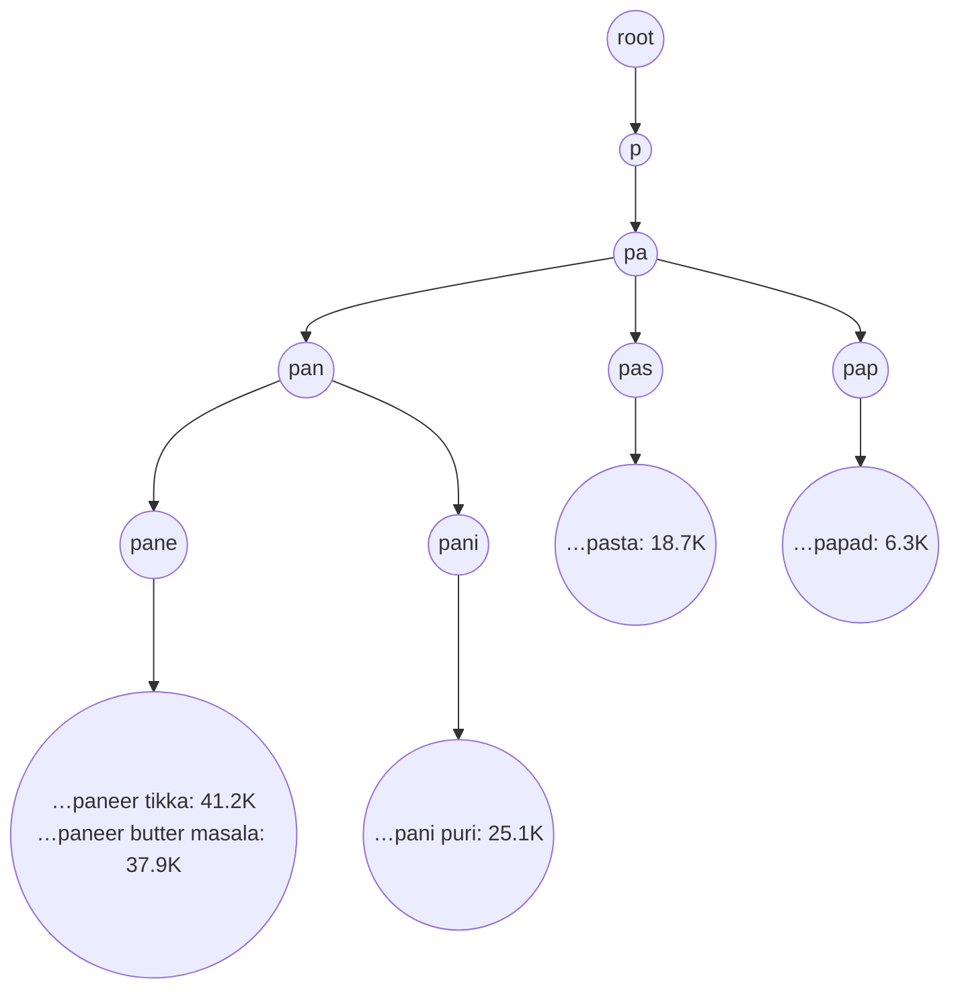
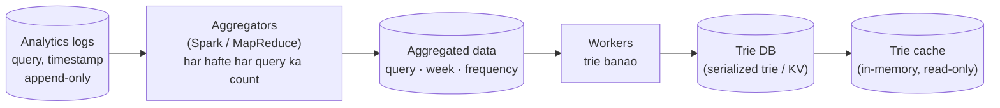
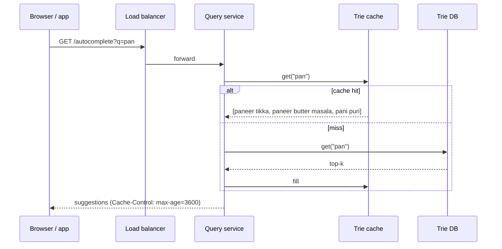
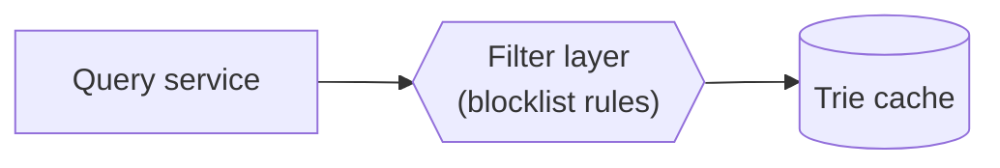
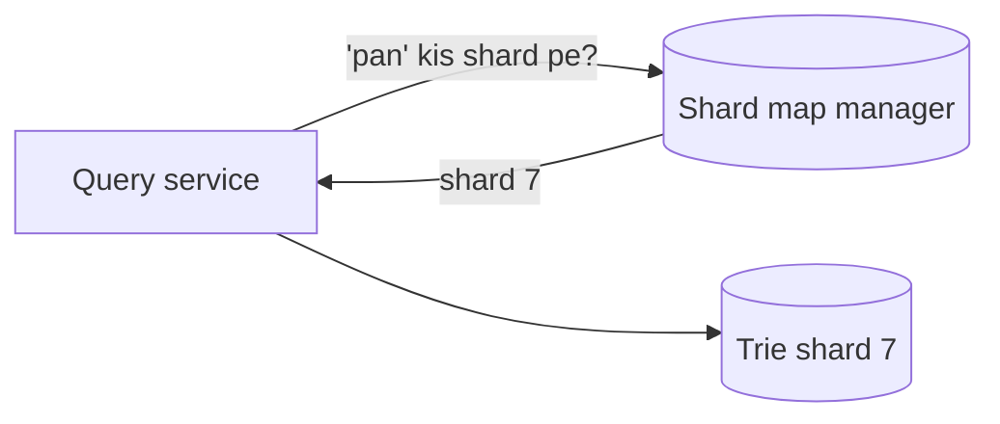

# 13 · Search Autocomplete System Design karo

<div class="chapter-meta" markdown>
<span>⏱ 40 min read</span>
<span class="hot">🔥 Data structures + offline/online split test karta hai</span>
<span>Book: Chapter 13</span>
</div>

!!! abstract "TL;DR"
    - User ne jo type kiya usse shuru hone waali **top-k sabse popular queries** do — **< 100 ms** mein, **har keystroke** pe.
    - Core structure: **trie**. Lookups ko O(prefix length) banao: (1) **prefix length cap** karke aur (2) **har node pe top-k completions cache** karke.
    - **Do systems** mein baanto: **data-gathering service** (offline: query logs → aggregate → trie ko weekly/daily rebuild) aur **query service** (online: memory/cache mein read-only trie).
    - Traffic kam karo: client pe **debouncing**, **browser caching** (`Cache-Control`), aur logs ki sampling.
    - Trie ko **prefix pe shard** karke scale karo, ek **shard map** ke saath jo letters ki uneven frequency balance kare. Kharab suggestions ek **filter layer** se hatao.

## Intuition: chaiwala jo tumhara order jaanta hai

Tum apni roz ki chai ki tapri pe jaake bolte ho "ek ad—" aur chaiwala pehle se **adrak chai** daal raha hota hai, kyunki "ad" se shuru karne
waale zyada tar log wahi maangte hain. Woh har baar poora menu nahi sochta; usne har shuruaat ka sabse popular ant yaad kar rakha hai. Aur woh
yaad dheere-dheere update karta hai — hafton mein, jaise taste badalta hai — har customer ke saath nahi.

Yahi design hai: har prefix ke liye **pehle se nikaale** "sabse popular completions", history se **samay-samay pe refresh**.

---

## Step 1 · Scope

!!! example "Clarifying baatcheet"
    **Tum:** Sirf query ki shuruaat se match, ya kahin bhi? — **Interviewer:** Sirf shuruaat se (prefix match).
    **Tum:** Kitne suggestions? — **I:** 10.
    **Tum:** Ranking kaise? — **I:** Poori query kitni baar search hui (popularity).
    **Tum:** Spell correction? Personalisation? — **I:** Abhi nahi; extensions ki tarah batao.
    **Tum:** Language? — **I:** English aur Roman script mein Hinglish/Hindi queries; Unicode ke liye baad mein design karo.
    **Tum:** Capitalisation aur special characters? — **I:** Sirf lower-case alphanumerics.
    **Tum:** Scale? — **I:** 30M DAU.

**Requirements:** tez (< 100 ms end-to-end, warna typing atki hui lagti hai) · relevant (results prefix se shuru) · popularity se sorted ·
scalable · highly available.

### Estimates

| Cheez | Value |
|---|---|
| Searches | 30M DAU × 8 searches/din = 240M/din |
| Har search pe requests | ~6 (debounce ke baad har keystroke pe ek request, average query ~20 chars) |
| QPS | 240M × 6 / 10⁵ ≈ **14,400/s** avg, ~**30K/s** peak |
| Naya query data | 240M × ~25 B = roz 6 GB logs; ~20% nayi unique queries → roz **~1.2 GB** naya trie content |

---

## Step 2 · High-level design

Do independent services:

- **Data gathering service** — user queries jama karke unhe frequency table / trie mein aggregate karti hai. Offline, batch.
- **Query service** — prefix diya, top 10 sabse frequent queries return. Online, read-only, tez.

### Naive version (yeh dekhne ke liye ki kyun fail hota hai)

Relational DB mein frequency table:

| query | frequency |
|---|---|
| paneer tikka | 41,200 |
| paneer butter masala | 37,900 |
| pani puri | 25,100 |
| pasta | 18,700 |
| papad | 6,300 |

```sql
SELECT query FROM frequency_table
WHERE query LIKE 'pa%'
ORDER BY frequency DESC
LIMIT 10;
```

Hazaaron rows ke liye theek. Billions rows pe, har keystroke pe har `LIKE 'pa%'` match scan karke sort karna bahut slow. Prefix lookups ke liye
bana structure chahiye.

---

## Step 3 · Deep dive

### Trie (prefix tree)

- Root khaali string hai.
- Har node **ek character** rakhta hai aur uske 26 (ya 36) tak children hote hain.
- Har node ek **prefix** represent karta hai; jo nodes asli query poori karte hain woh uski **frequency** rakhte hain.



**Naive top-k lookup:**

1. Prefix node tak neeche chalo — O(p), p = prefix length.
2. Saare completions jama karne ke liye uska poora subtree traverse karo — O(c), c = descendant nodes ki ginti.
3. Sort karke top k lo — O(c log c).

Step 2 jaan leta hai: prefix "p" ke liye subtree poore trie ka bada hissa hai.

**Do optimisations ise O(p) ≈ O(1) banati hain:**

1. **Prefix length limit karo.** Log suggestion chunne se pehle 50-character prefixes shaayad hi type karte hain. Maan lo 50 chars pe cap → node tak jaana O(1).
2. **Har node pe top-k cache karo.** Har node apni precomputed top 10 completions ki list rakhta hai (frequencies ke saath). Lookup = node tak jao, uski list return — **koi subtree traversal nahi**.

Keemat: zyada memory (har query string apne saare prefixes ki top-k lists mein aati hai). Aam taur pe worth it — tez responses hi poora point hai.

Try karo — is widget ka har node apni top-k list rakhta hai:

<div class="sd-widget" data-widget="trie"></div>

```java
final class AutocompleteTrie {
    private static final int K = 10;
    private static final class Node {
        final Map<Character, Node> kids = new HashMap<>();
        final List<Map.Entry<String, Long>> topK = new ArrayList<>();   // is prefix pe cached top-k
    }
    private final Node root = new Node();

    /** Offline build: aggregated table ke har (query, frequency) ke liye ek baar call. */
    void insert(String query, long freq) {
        Node n = root;
        offer(n, query, freq);
        for (char c : query.toCharArray()) {
            n = n.kids.computeIfAbsent(c, x -> new Node());
            offer(n, query, freq);
        }
    }

    private static void offer(Node n, String q, long f) {
        n.topK.add(Map.entry(q, f));
        n.topK.sort((a, b) -> Long.compare(b.getValue(), a.getValue()));
        if (n.topK.size() > K) n.topK.remove(K);
    }

    /** Online: O(prefix length). */
    List<String> suggest(String prefix) {
        Node n = root;
        for (char c : prefix.toCharArray()) { n = n.kids.get(c); if (n == null) return List.of(); }
        return n.topK.stream().map(Map.Entry::getKey).toList();
    }
}
```

### Data gathering service

**Har** search pe trie update karna (roz billions) bekaar aur mehenga hai: top suggestions minute-minute mein mushkil se badalte hain. Iski jagah
batch pipeline:



1. **Analytics logs** — searches ke raw, append-only records (`query`, `timestamp`). Indexed nahi.
2. **Aggregators** — samay-samay pe logs ko `(query, time-window, frequency)` mein roll up karte hain. Kitni baar, product pe depend: zyada tar search ke liye weekly theek; Twitter-style trending ko near-real-time chahiye (neeche dekho).
3. **Workers** — aggregated data se asynchronously naya trie banate hain aur **Trie DB** mein store karte hain.
4. **Trie cache** — distributed cache jo tez reads ke liye trie memory mein rakhta hai; har rebuild ke baad DB ka snapshot leke refresh.

**Trie kahan store karein?**

- **Document store** — poore trie (ya har shard) ko snapshot blob ki tarah serialise karo, jaise MongoDB/S3 mein. Atomically swap karna aasaan.
- **Key-value store** — har **prefix → node data (top-k list)** map karo. Har trie node ek key ban jaata hai: `"pa" → ["paneer tikka", …]`. Lookups ek `GET` ban jaate hain. Sharding aur caching ke liye bhi bahut convenient.

| key (prefix) | value (top-k) |
|---|---|
| `p` | paneer tikka, paneer butter masala, pani puri, pasta, … |
| `pa` | paneer tikka, paneer butter masala, pani puri, pasta, papad |
| `pan` | paneer tikka, paneer butter masala, pani puri |
| `pas` | pasta |

### Query service



Ise **bijli jaisa tez** banana:

- Page se **AJAX / fetch** — full-page reloads nahi.
- Client pe **debounce**: aakhri keystroke ke ~100–150 ms baad bhejo, aur ab bekaar ho chuki in-flight requests cancel karo.
- **Browser caching**: prefix ke suggestions dheere badalte hain, toh `Cache-Control: private, max-age=3600` ke saath respond karo — repeat prefixes browser khud answer karta hai (Google bhi kuch aisa karta hai).
- **Data sampling**: full scale pe har query log karna processing mein bahut mehenga; N mein se 1 log karna bhi popularity sahi pakad leta hai.

### Trie operations

- **Create** — workers aggregated data se banate hain.
- **Update** — ya toh (1) samay-samay pe **rebuild** karke naya trie swap karo (preferred), ya (2) individual nodes in place update karo — aur phir har ancestor ki top-k list bhi update karni padegi (mehenga; sirf chhote tries ke liye theek).
- **Delete** — nafrat bhare, hinsak, sexually explicit ya khatarnak suggestions **turant** gayab hone chahiye, agle weekly rebuild pe nahi. Trie cache ke aage ek **filter layer** lagao jo blocklisted results gira de; agle rebuild pe unhe trie se physically hatao.



### Storage scale karna

Jab trie ek server se bada ho jaaye, **prefix se shard** karo:

- Naive: 2 shards `a–m` aur `n–z`; 26 shards = har pehle letter ka ek; 26 se aage doosre letter pe shard (`aa–ag`, `ah–an`, …).
- Problem: letters barabar use nahi hote — English mein `s` se shuru hone waale words `x` se kahin zyada hain. Barabar-letter ranges **hot, uneven shards** banati hain.
- Fix: historical distribution analyse karo aur ek **shard map manager** (lookup DB) use karo jo ranges ko shards pe aise map kare ki har ek pe milta-julta load ho — jaise `s` akela ek shard, jabki `u–z` ek share karein.



---

## Step 4 · Wrap-up — extensions

??? question "Kai languages (Hindi, Tamil, Japanese…) kaise support karoge?"
    26-letter alphabet ki jagah trie nodes mein **Unicode** characters store karo (children array nahi, map ban jaate hain). Input normalise karo
    (Unicode NFC, jahan lagu ho lower-casing). Roman-script Hinglish ke liye transliteration variants ("paneer"/"panir") ko synonyms ki tarah merge
    karna pad sakta hai.

??? question "Har desh ke alag top queries?"
    Region-filtered logs se **har desh/region ke alag tries** banao, aur unhe un users ke paas CDNs/edges pe rakho. User locale se requests route karo.

??? question "Trending (real-time) queries kaise support karoge — jaise breaking news?"
    Weekly rebuilds 10 minute pehle phooti query nahi pakad sakte. Options: **streaming pipeline** (Kafka → Flink/Spark Streaming) jo sliding windows
    mein recent queries gine; **recent queries ko zyada weight** do (time-decayed scores); ek chhota real-time "trending" trie rakho jo query time pe
    main trie ke results ke saath merge ho. Sharding se working set kam karo.

??? question "Personalisation kaise jodoge?"
    Global suggestions ko user ki apni recent searches (per user store, chhoti) aur context (location, din ka time) ke saath blend karo. Query service
    dono laake re-rank karti hai — global trie wahi rehta hai.

??? question "Typos ka kya — 'panner' pe bhi 'paneer' suggest hona chahiye?"
    Prefix tries exact-match hain. Fuzzy matching jodo: edit distance 1–2 ke andar ke prefixes se trie query karo (trie pe bounded search), ya ek
    spelling-correction model rakho jo pehle prefix ko rewrite kare. Mehenga hai — sirf tab lagao jab exact prefix kam results de.

---

## Practice

??? example "Practice 1 — Top-k caching ki memory"
    Ek trie mein 50M nodes hain. Har node apni top 10 completions ko 8-byte query IDs plus 8-byte frequencies ki tarah cache karta hai. Cached lists
    kitni memory jodti hain?

    **Solution.** 50M × 10 × 16 B = **8 GB** — plus query-ID → string dictionary jo ek baar store hoti hai. Manageable, aur sharding ise aur todti hai.
    (Har list mein poori strings rakhne se 5–10× zyada ho sakta hai.)

??? example "Practice 2 — Browser cache ki bachat"
    Users har search pe average 6 prefixes type karte hain, aur 40% prefixes woh hote hain jo us user ne pichle ek ghante mein maange the. 1-ghante
    browser cache ke saath server QPS kitna girega?

    **Solution.** 40% requests browser serve karta hai → server QPS ~14.4K se **~8.6K/s** average. Debouncing ke saath (jaise har search 6 → 4
    requests), QPS ~5.8K/s tak gir sakta hai.

??? example "Practice 3 — Uneven shards"
    6 shards hain aur pehle letter se traffic share: s 12%, c 9%, p 8%, m 7%, b 6%, t 6%, a 6%, d 5%, baaki 41% 18 letters mein barabar. Balanced split propose karo.

    **Solution.** Target ≈ har shard 16.7%. Ek assignment: S1 = {s, a} 18%; S2 = {c, p} 17%; S3 = {m, b, i, l} 7+6+2.3+2.3 ≈ 17.6%;
    S4 = {t, d, f, g, h, k} 6+5+2.3×4 ≈ 20%; S5 aur S6 bache 12 letters baant-te hain (~27% → har ek ~13.7%). Perfect nahi — S4 garam chalta hai,
    toh uska ek chhota letter S5 pe le jao — phir real data se tune karo. **Shard map manager** jo bhi ranges bane unhe store karta hai.

---

## Revision checklist

- [ ] Requirements bata sakta hoon aur per-keystroke requests ke liye QPS estimate kar sakta hoon.
- [ ] SQL `LIKE` approach kyun fail hota hai aur trie kaise kaam karta hai — samjha sakta hoon.
- [ ] Do optimisations (prefix cap + cached top-k) laga ke resulting complexity bata sakta hoon.
- [ ] Data-gathering pipeline aur query service bana sakta hoon, aur updates batch kyun hote hain samjha sakta hoon.
- [ ] Trie storage options (snapshot vs prefix→top-k KV), update/delete strategies aur filter layer pata hai.
- [ ] Shard map ke saath prefix se shard kar sakta hoon, aur languages, regions, trending aur typos discuss kar sakta hoon.

[Aage: 14 · YouTube :material-arrow-right:](14-youtube.md){ .md-button .md-button--primary }
