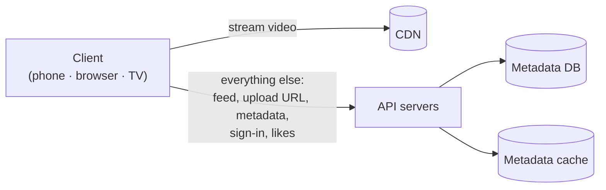
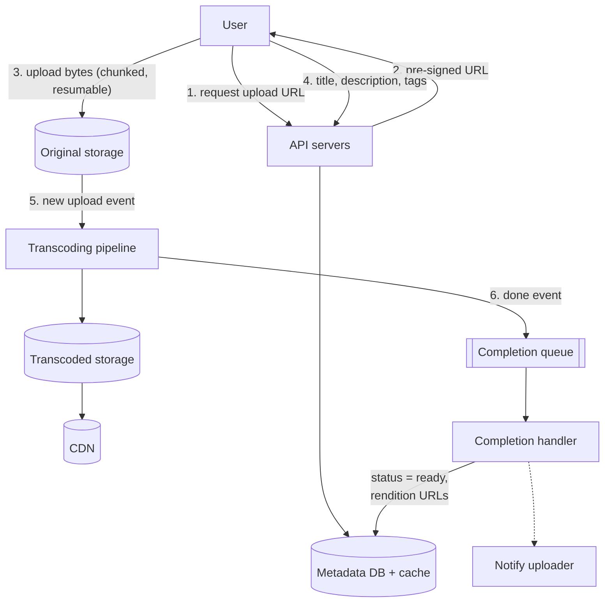
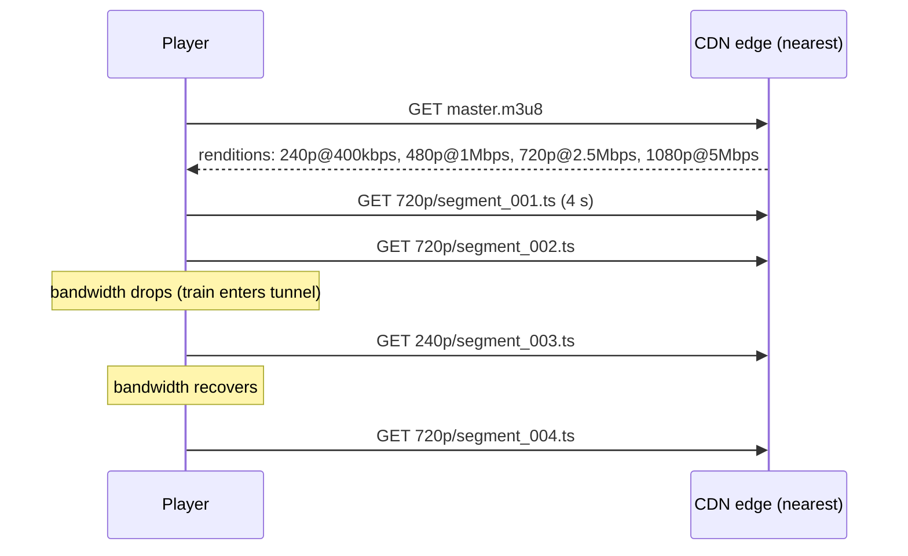
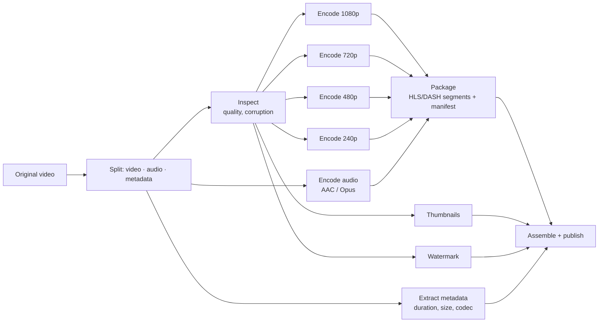
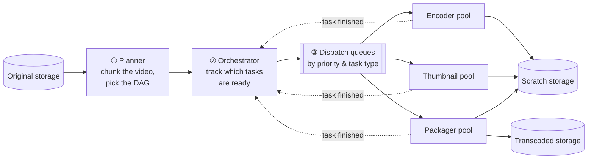

# 14 · Design YouTube

<div class="chapter-meta" markdown>
<span>⏱ 50 min read</span>
<span class="hot">🔥 Big, open-ended — focus on upload pipeline + CDN cost</span>
<span>Book: Chapter 14</span>
</div>

!!! abstract "TL;DR"
    - Two big flows: **upload** (client → object storage → **transcoding pipeline** → CDN + metadata) and **streaming** (client ← nearest **CDN edge**, adaptive bitrate).
    - Upload straight to blob storage with a **pre-signed URL**; split large files into chunks for **parallel, resumable** uploads.
    - Transcoding is a **DAG** of tasks (inspect, encode to many resolutions/codecs, thumbnails, watermark, audio) scheduled onto workers via queues.
    - Stream with **HLS/DASH**: video is cut into few-second segments at several bitrates; the player switches quality as bandwidth changes.
    - The biggest bill is **CDN egress**. Serve only popular videos from the CDN, the long tail from your own storage; encode rarely-watched videos lazily; place content regionally.

## The intuition: a film distributor

A filmmaker delivers one master print to a distributor. The distributor makes copies in different formats
(IMAX, 2K, a dubbed version, a trailer, a poster), checks the print for damage, and ships copies to cinemas
**close to audiences**. Blockbusters go to every cinema; an art-house film only to a few, and is fetched from
the warehouse when someone asks for it.

Uploading = delivering the master print. Transcoding = making all the formats. CDN = the cinemas. Cost control =
not shipping art-house films to every multiplex.

---

## Step 1 · Scope

!!! example "Clarifying conversation"
    **You:** Long-form, short vertical clips, or live? — **Interviewer:** Long-form and short clips. Live is out of scope.
    **You:** Where are viewers, and on what networks? — **I:** Mostly India and South-East Asia, a lot of it on patchy mobile data.
    **You:** How big is it? — **I:** 20M daily viewers watching ~40 minutes each; about 2% upload something on a given day.
    **You:** What do creators upload? — **I:** Phone and camera files in most formats, up to 4 GB.
    **You:** What quality do we stream? — **I:** 144p to 1080p for now.
    **You:** Build or buy storage and CDN? — **I:** Use cloud object storage and a commercial CDN.
    **You:** Paid/premium content? — **I:** Some — mention how you'd protect it.

**Focus:** fast uploads, smooth streaming, quality switching, low infrastructure cost, high availability, scalability, reliability.

### Estimates

| Quantity | Value |
|---|---|
| Uploads | 2% of DAU upload 1 video/day → **400K videos/day** (~5/s) |
| Raw upload size | avg 400 MB → **160 TB/day** of originals |
| Stored renditions | ~1.5× original across all resolutions → **~240 TB/day** more |
| Watch volume | 20M × 40 min = 800M minutes/day; at ~2.5 Mbps ≈ 19 MB/min → **~15 PB/day** egress |
| CDN cost | at $0.01–0.02 per GB → **$150K–300K per day** ← the dominant cost |

Those numbers already tell you where the deep dive should go: **the transcoding pipeline** (correctness + throughput)
and **CDN cost**.

---

## Step 2 · High-level design

Lean on cloud building blocks:

- **Blob/object storage** (S3/GCS) for original and transcoded videos.
- **CDN** for streaming.
- Our own: **API servers**, **metadata DB + cache**, **transcoding pipeline**.



### Upload flow



Two things happen **in parallel**:

**a) Uploading the actual video**

1. The client asks the API for an upload URL. The API returns a **pre-signed URL** — a time-limited URL that grants permission to write one specific object directly to object storage. Our API servers never touch the gigabytes.
2. The client uploads to **original storage**.
3. A "new upload" event triggers the **transcoding pipeline**: the video is converted to multiple formats/resolutions.
4. Transcoded files land in **transcoded storage** and are distributed to / pulled by the **CDN**.
5. When transcoding finishes, an event goes onto the **completion queue**; **completion handlers** update the metadata DB/cache (status = ready, rendition URLs, duration, thumbnails) and notify the uploader.

**b) Updating metadata**

While the file uploads, the client sends the title, description, tags, visibility, etc. to the API, which writes them to the metadata DB and cache.

### Streaming flow

**Streaming** means the player starts after downloading a few seconds and keeps fetching while you watch — no full
download first. It relies on **streaming protocols**:

| Protocol | Notes |
|---|---|
| **HLS** (HTTP Live Streaming, Apple) | Most widely supported; `.m3u8` playlists + segments |
| **MPEG-DASH** | Open standard; similar idea, `.mpd` manifest |
| **Microsoft Smooth Streaming**, Adobe HDS | Older / niche |

How adaptive bitrate (ABR) streaming works:



Videos are cut into **2–6 second segments** per resolution; a **manifest** lists them. The player measures throughput
and buffer level and picks the bitrate for the **next** segment — that's why quality changes mid-video instead of
buffering. Segments are plain HTTP files → perfect for CDNs.

---

## Step 3 · Deep dive

### Why transcode at all?

- **Raw video is enormous** — an hour of high-bitrate camera footage can be hundreds of GB.
- **Devices and browsers support different formats/codecs.**
- **Networks differ** — someone on 4G in a moving train needs 360p; someone on fibre wants 1080p+.
- **Mobile conditions change** mid-video → you need several bitrates to switch between.

Terms: a video file is a **container** (`.mp4`, `.webm`, `.mov`, `.mkv`) holding **streams** encoded with **codecs**
(video: H.264/AVC, H.265/HEVC, VP9, AV1; audio: AAC, Opus). Newer codecs (VP9, AV1) give similar quality at
30–50% fewer bits — saving CDN money — but cost more CPU to encode and need device support.

### The transcoding DAG

Different creators need different processing (thumbnails, watermarks, HD vs SD only…). Model the work as a
**directed acyclic graph** of tasks (Facebook's SVE and Netflix's pipelines use this idea):



- **Inspect** — make sure the video is valid and not malformed.
- **Encode** — produce each resolution/codec/bitrate rendition.
- **Thumbnails** — auto-generated or uploaded by the user.
- **Watermark** — overlay identifying info.

### Running the DAG at scale

Think of the pipeline as four roles. Different companies name them differently; what matters is the job each does.



**① Planner.** Reads the upload, cuts it into **GOP-aligned chunks** (a GOP — *group of pictures* — is a run of
frames that starts with a keyframe and can be decoded on its own, so each chunk can be encoded independently).
It also chooses which DAG to run from configuration: a 15-second clip from a new creator might get a small DAG
(360p + 720p + thumbnail); a premium upload gets the full ladder, two codecs and a watermark. Chunks and
metadata go to scratch storage so any task can be retried without re-reading the original.

**② Orchestrator.** Holds the DAG's state: which tasks are done, which are waiting on inputs, which are ready.
When a task finishes it marks dependents ready and hands them to dispatch. Because every chunk of every rendition
is its own task, a 10-minute video can fan out into hundreds of small parallel jobs.

**③ Dispatch.** Ready tasks wait in queues split by **priority** (a paying creator's upload before a bulk
re-encode) and by **task type** (encode tasks need big CPU/GPU boxes; thumbnails are cheap). Workers pull from the
queues they're built for — pull-based dispatch naturally balances load: an idle worker just takes the next task.

**④ Worker pools.** Stateless processes (encoders, thumbnailers, watermarkers, packagers) that read inputs from
scratch storage and write outputs back. They're ideal for **spot/preemptible** machines: if one disappears, its
task times out and another worker picks it up.

```java
/** Run a transcoding DAG: tasks become runnable when all their dependencies have finished. */
void runDag(Map<String, List<String>> deps, ExecutorService workers) throws InterruptedException {
    Map<String, Integer> pending = new ConcurrentHashMap<>();
    Map<String, List<String>> dependents = new HashMap<>();
    deps.forEach((task, ds) -> {
        pending.put(task, ds.size());
        ds.forEach(d -> dependents.computeIfAbsent(d, k -> new ArrayList<>()).add(task));
    });
    CountDownLatch done = new CountDownLatch(deps.size());
    Consumer<String>[] submit = new Consumer[1];
    submit[0] = task -> workers.submit(() -> {
        execute(task);                                   // encode / thumbnail / watermark …
        for (String next : dependents.getOrDefault(task, List.of()))
            if (pending.merge(next, -1, Integer::sum) == 0) submit[0].accept(next);
        done.countDown();
    });
    pending.forEach((t, n) -> { if (n == 0) submit[0].accept(t); });   // no dependencies → start now
    done.await();
}
```

### Making uploads and processing fast

| Bottleneck | What we do | Why it works |
|---|---|---|
| One big upload over a weak link | Client splits the file into parts, uploads several at once, retries only failed parts, resumes after a crash | A dropped connection costs one part, not the whole file |
| Distance to the upload endpoint | Regional upload endpoints (often CDN POPs) accept the bytes, then forward to storage over the backbone | The slow "last mile" leg is short |
| Stages waiting on each other | A queue between every stage (fetch → encode → package → publish) | Each stage scales on its own; a slow stage builds a backlog instead of stalling everyone |
| Time-to-first-play | Publish a small rendition set first, add the rest later | Viewers can watch within minutes of upload |

### Protecting uploads and content

- **Who can upload what:** the API signs a short-lived URL for exactly one object key, tied to the authenticated user — nobody can overwrite someone else's video.
- **Who can watch what:** private and paid videos are served through **signed CDN URLs/cookies** that expire.
- **Stopping copying of premium content:** encrypt segments (AES) and deliver keys through a **DRM** system (Widevine on Android/Chrome, FairPlay on Apple, PlayReady on Windows/TVs); add visible or forensic **watermarks** so leaks can be traced.

### Where the money goes — and how to spend less

Egress is the bill. Views follow a **long tail**, so treat popular and unpopular videos differently:

| Lever | Saving | Trade-off |
|---|---|---|
| Keep only the head (popular videos) on CDN edges; serve the tail from origin storage | Big — most bytes are head bytes, most *videos* are tail | First viewer of a tail video gets slower start |
| Produce extra renditions lazily, when a video starts getting views | Encoding CPU and storage for videos nobody watches | Short delay before HD exists for a sudden hit |
| Distribute by region of popularity | Don't pay to pre-position a regional hit worldwide | Need per-region analytics |
| Efficient codecs (VP9/AV1) for popular videos | 30–50% fewer bytes on every view | Encoding is several times more expensive; device support varies |
| Own edge caches inside ISPs (at very large scale) | Cheaper bandwidth, lower latency | A major infrastructure programme |

All of these depend on good **analytics**: what's watched, where, and how quickly views are growing.

### When things fail

Separate failures you can **retry** from ones you **can't**:

- **Retry (idempotent, chunk-level):** a part upload that timed out; an encode task whose worker vanished; a write to scratch storage that failed. Because tasks work on chunks and write to deterministic paths, rerunning them is safe.
- **Don't retry:** a corrupt or unsupported file, or a video that fails policy checks — mark the upload **failed** with a clear reason and tell the creator.
- **Lose a planner/orchestrator instance:** its state (the DAG and task status) lives in a durable store, so another instance resumes it.
- **Serving path:** API servers are stateless behind a load balancer; the metadata cache and DB are replicated with automatic failover (Chapters 1 and 6); if an edge cache misses or fails, the CDN falls back to origin.

---

## Step 4 · Wrap-up — what else

- **Scale the API tier** — stateless, horizontal.
- **Scale the metadata DB** — replication + sharding (by video ID).
- **Live streaming** — same building blocks (encode, package, CDN) but much **lower latency** targets, so you need different protocols (low-latency HLS, WebRTC), smaller segments, less parallelism in processing, and different failure handling (you can't "retry" a live moment).
- **Takedowns** — copyright/abuse removals must delete or block content from storage **and** invalidate CDN caches.
- **Recommendations, comments, view counts** — separate systems; view counts are high-write counters (batched, approximate in real time).

---

## Interviewer follow-ups

??? question "Why use a pre-signed URL rather than uploading through the API servers?"
    Uploads are huge (GBs) and slow. Routing them through API servers would tie up their bandwidth, memory and connections for minutes
    each. A pre-signed URL lets the client write directly to object storage (which is built for this), while the API still controls
    **who** may upload **what** and **until when**.

??? question "A user uploads a 4 GB video over a flaky mobile network. How do you make it work?"
    Chunked, resumable uploads (e.g. 8 MB parts via S3 multipart or the tus protocol). The client uploads parts in parallel, retries only
    failed parts, and after an app restart asks the server which parts already arrived and continues. The server assembles the parts when
    all have arrived (or the pipeline processes GOP chunks directly).

??? question "How many renditions should you produce, and when?"
    A typical ladder: 144p/240p/360p/480p/720p/1080p (+4K for capable sources), in one or two codecs. For a new upload produce a small
    fast set first (e.g. 360p + 720p H.264) so the video goes live quickly; add the rest asynchronously, and add AV1/VP9 only once a video
    proves popular.

??? question "How do you decide which videos go on the CDN?"
    Use view-count predictions and recent popularity per region: push/keep the top N% of videos on edges, let the rest be fetched from
    origin (pull-through with short TTLs). Re-evaluate continuously; viral videos get promoted quickly based on view velocity.

??? question "How does the player know which quality to pick?"
    The player downloads the manifest listing all renditions, then for each segment uses estimated bandwidth and current buffer to pick a
    bitrate (ABR algorithms like throughput-based or buffer-based/BOLA). It starts low for a fast start and climbs as the buffer grows.

---

## Practice

??? example "Practice 1 — Transcoding fleet"
    400K uploads/day, average length 8 minutes. Encoding all renditions takes ~2 CPU-minutes per minute of video. How many 32-core
    machines do you need at steady state, at 70% utilisation?

    **Solution.** Video minutes/day = 3.2M. CPU-minutes = 6.4M/day ÷ 1,440 = ~4,444 cores busy on average. At 70% of 32 cores (22.4 usable)
    → **~200 machines** average; peaks need more (or a queue that absorbs the burst). Spot/preemptible instances fit well because tasks are retryable.

??? example "Practice 2 — CDN vs origin split"
    15 PB/day egress. 80% of views go to the top 10% of videos. CDN costs $0.02/GB, serving from origin costs $0.008/GB but only works for
    the long tail. What's the daily saving vs serving everything from CDN?

    **Solution.** All CDN: 15M GB × $0.02 = **$300K/day**. Split: 12 PB via CDN = $240K; 3 PB from origin = $24K → **$264K/day**. Saving ≈
    **$36K/day (~$13M/year)**.

??? example "Practice 3 — Segment maths"
    A 10-minute video, 6 renditions, 4-second segments. How many segment files? If the player picks a new bitrate every segment, how often
    can quality change?

    **Solution.** 600 s / 4 s = 150 segments × 6 = **900 files** (+ 7 playlists). Quality can change **every 4 seconds**.

---

## Revision checklist

- [ ] I can estimate storage and CDN egress and explain why CDN cost dominates.
- [ ] I can draw the upload flow (pre-signed URL, original storage, pipeline, completion queue, metadata) and the streaming flow.
- [ ] I can explain containers vs codecs and why we transcode into several renditions.
- [ ] I can explain HLS/DASH and adaptive bitrate with segments and manifests.
- [ ] I can describe the transcoding DAG and the planner → orchestrator → dispatch queues → worker pools roles.
- [ ] I know the speed, security and cost optimisations and how to handle errors.

[Next: 15 · Google Drive :material-arrow-right:](15-google-drive.md){ .md-button .md-button--primary }
