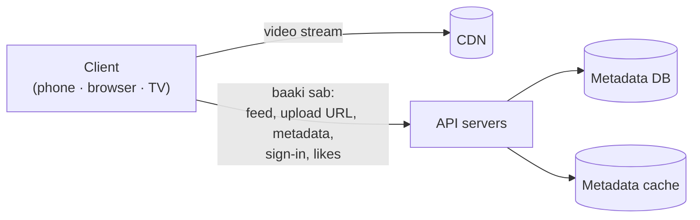
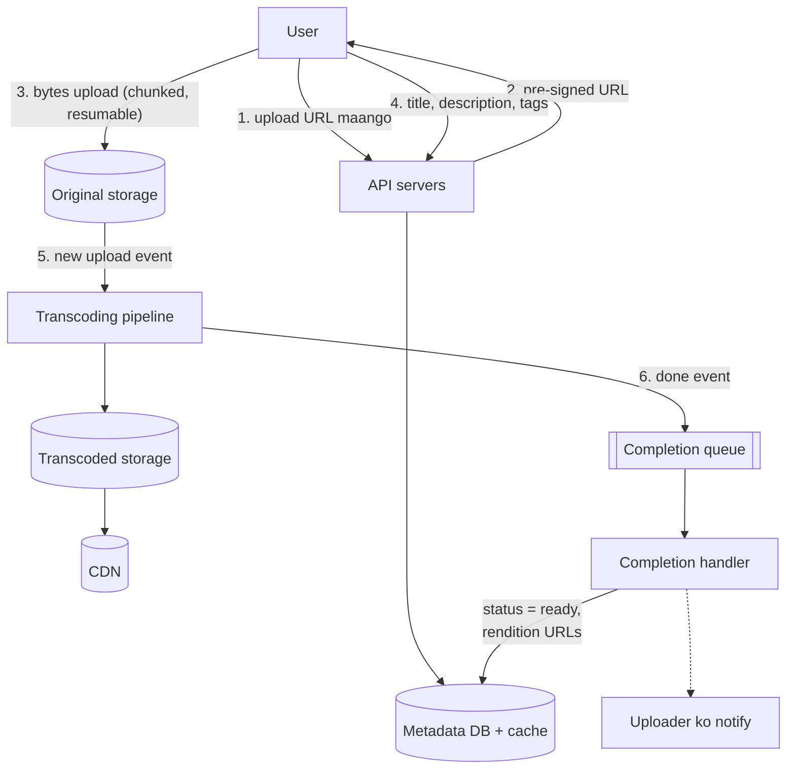
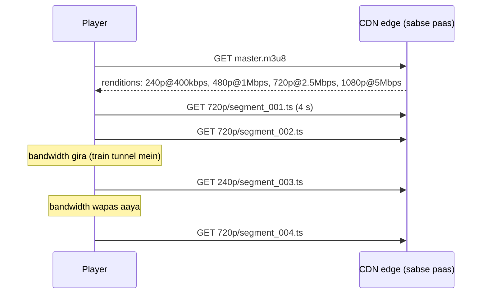
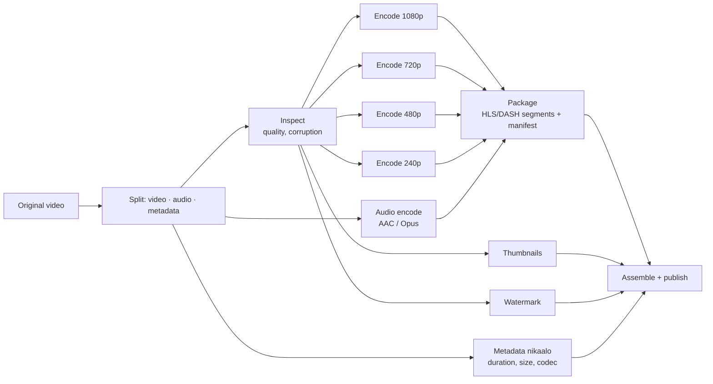
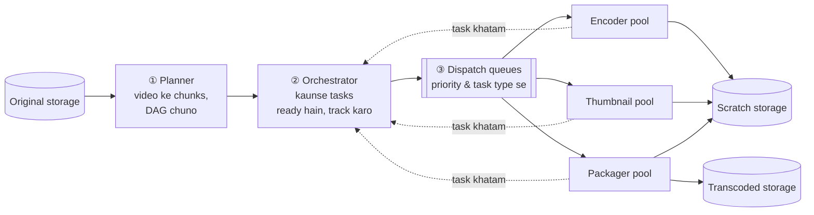

# 14 · YouTube Design karo

<div class="chapter-meta" markdown>
<span>⏱ 50 min read</span>
<span class="hot">🔥 Bada, open-ended — upload pipeline + CDN cost pe focus karo</span>
<span>Book: Chapter 14</span>
</div>

!!! abstract "TL;DR"
    - Do bade flows: **upload** (client → object storage → **transcoding pipeline** → CDN + metadata) aur **streaming** (client ← sabse paas ka **CDN edge**, adaptive bitrate).
    - **Pre-signed URL** se seedha blob storage pe upload karo; badi files ko chunks mein todo taaki upload **parallel aur resumable** ho.
    - Transcoding tasks ka ek **DAG** hai (inspect, kai resolutions/codecs mein encode, thumbnails, watermark, audio), jo queues se workers pe schedule hote hain.
    - **HLS/DASH** se stream: video kuch-second ke segments mein kai bitrates pe kat-ta hai; player bandwidth badalne pe quality switch karta hai.
    - Sabse bada bill **CDN egress** hai. CDN se sirf popular videos, long tail apne storage se; kam dekhe jaane waale videos lazily encode; content regionally rakho.

## Intuition: film distributor

Ek filmmaker distributor ko ek master print deta hai. Distributor alag formats mein copies banata hai (IMAX, 2K, dubbed version, trailer, poster),
print mein damage check karta hai, aur copies **darshakon ke paas waale** cinemas tak bhejta hai. Blockbusters har cinema mein jaati hain; art-house
film sirf kuch mein, aur koi maange toh godown se mangwayi jaati hai.

Upload = master print dena. Transcoding = saare formats banana. CDN = cinemas. Cost control = art-house films har multiplex mein na bhejna.

---

## Step 1 · Scope

!!! example "Clarifying baatcheet"
    **Tum:** Long-form, short vertical clips, ya live? — **Interviewer:** Long-form aur short clips. Live scope se bahar.
    **Tum:** Viewers kahan hain, aur kaunse networks pe? — **I:** Zyada tar India aur South-East Asia, bahut saara patchy mobile data pe.
    **Tum:** Kitna bada? — **I:** Roz 20M viewers, har ek ~40 minute dekhta hai; kisi bhi din ~2% kuch upload karte hain.
    **Tum:** Creators kya upload karte hain? — **I:** Phone aur camera files, zyada tar formats mein, 4 GB tak.
    **Tum:** Kis quality mein stream karein? — **I:** Abhi 144p se 1080p.
    **Tum:** Storage aur CDN banayein ya khareedein? — **I:** Cloud object storage aur commercial CDN use karo.
    **Tum:** Paid/premium content? — **I:** Thoda — batao kaise protect karoge.

**Focus:** tez uploads, smooth streaming, quality switching, kam infrastructure cost, high availability, scalability, reliability.

### Estimates

| Cheez | Value |
|---|---|
| Uploads | DAU ka 2% roz 1 video → **400K videos/din** (~5/s) |
| Raw upload size | avg 400 MB → roz **160 TB** originals |
| Stored renditions | saari resolutions milake original ka ~1.5× → roz **~240 TB** aur |
| Watch volume | 20M × 40 min = roz 800M minutes; ~2.5 Mbps ≈ 19 MB/min pe → roz **~15 PB** egress |
| CDN cost | $0.01–0.02 per GB pe → **roz $150K–300K** ← sabse bada kharcha |

Yeh numbers pehle hi bata dete hain ki deep dive kahan jaana chahiye: **transcoding pipeline** (correctness + throughput) aur **CDN cost**.

---

## Step 2 · High-level design

Cloud building blocks pe tiko:

- Original aur transcoded videos ke liye **blob/object storage** (S3/GCS).
- Streaming ke liye **CDN**.
- Apne: **API servers**, **metadata DB + cache**, **transcoding pipeline**.



### Upload flow



Do cheezein **parallel** mein hoti hain:

**a) Asli video upload**

1. Client API se upload URL maangta hai. API ek **pre-signed URL** deti hai — time-limited URL jo ek specific object ko seedha object storage mein likhne ki permission deta hai. Hamare API servers gigabytes ko chhoote bhi nahi.
2. Client **original storage** mein upload karta hai.
3. "New upload" event **transcoding pipeline** chalata hai: video kai formats/resolutions mein badalta hai.
4. Transcoded files **transcoded storage** mein aati hain aur **CDN** tak jaati hain / CDN unhe kheenchta hai.
5. Transcoding khatam hone pe event **completion queue** pe jaata hai; **completion handlers** metadata DB/cache update karte hain (status = ready, rendition URLs, duration, thumbnails) aur uploader ko batate hain.

**b) Metadata update**

File upload hote hue client title, description, tags, visibility waghera API ko bhejta hai, jo unhe metadata DB aur cache mein likhti hai.

### Streaming flow

**Streaming** ka matlab player kuch seconds download karke shuru ho jaata hai aur dekhte hue laata rehta hai — pehle poora download nahi. Yeh
**streaming protocols** pe tika hai:

| Protocol | Notes |
|---|---|
| **HLS** (HTTP Live Streaming, Apple) | Sabse zyada supported; `.m3u8` playlists + segments |
| **MPEG-DASH** | Open standard; same idea, `.mpd` manifest |
| **Microsoft Smooth Streaming**, Adobe HDS | Purane / niche |

Adaptive bitrate (ABR) streaming kaise kaam karta hai:



Videos har resolution ke liye **2–6 second ke segments** mein kat-te hain; ek **manifest** unhe list karta hai. Player throughput aur buffer level
naapta hai aur **agle** segment ka bitrate chunta hai — isliye buffering ki jagah beech video quality badalti hai. Segments plain HTTP files hain →
CDNs ke liye perfect.

---

## Step 3 · Deep dive

### Transcode kyun karna?

- **Raw video bahut bada hota hai** — high-bitrate camera footage ka ek ghanta saikdon GB ho sakta hai.
- **Devices aur browsers alag formats/codecs support karte hain.**
- **Networks alag hain** — chalti train mein 4G waale ko 360p chahiye; fibre waale ko 1080p+.
- **Mobile conditions** beech video badalti hain → switch karne ke liye kai bitrates chahiye.

Terms: video file ek **container** hai (`.mp4`, `.webm`, `.mov`, `.mkv`) jisme **codecs** se encoded **streams** hote hain (video: H.264/AVC,
H.265/HEVC, VP9, AV1; audio: AAC, Opus). Naye codecs (VP9, AV1) 30–50% kam bits mein milti-julti quality dete hain — CDN ka paisa bachta hai — par
encode karne mein zyada CPU lagta hai aur device support chahiye.

### Transcoding DAG

Alag creators ko alag processing chahiye (thumbnails, watermarks, sirf HD vs SD…). Kaam ko tasks ke **directed acyclic graph** ki tarah model karo
(Facebook ka SVE aur Netflix ki pipelines yahi idea use karti hain):



- **Inspect** — pakka karo ki video valid hai aur toota nahi.
- **Encode** — har resolution/codec/bitrate rendition banao.
- **Thumbnails** — auto-generated ya user ne upload kiye.
- **Watermark** — pehchaan waali info overlay.

### Scale pe DAG chalana

Pipeline ko chaar roles ki tarah socho. Companies inhe alag naam deti hain; matter karta hai har ek ka kaam.



**① Planner.** Upload padhta hai, use **GOP-aligned chunks** mein kaat-ta hai (GOP — *group of pictures* — frames ka ek run jo keyframe se shuru
hota hai aur khud decode ho sakta hai, toh har chunk independently encode ho sakta hai). Config se kaunsa DAG chalana hai yeh bhi chunta hai: naye
creator ki 15-second clip ko chhota DAG mil sakta hai (360p + 720p + thumbnail); premium upload ko poori ladder, do codecs aur watermark. Chunks
aur metadata scratch storage mein jaate hain taaki koi bhi task original dobara padhe bina retry ho sake.

**② Orchestrator.** DAG ka state rakhta hai: kaunse tasks ho gaye, kaunse inputs ka wait kar rahe hain, kaunse ready hain. Task khatam hone pe
dependents ko ready mark karke dispatch ko deta hai. Kyunki har rendition ka har chunk apna task hai, 10-minute video saikdon chhote parallel jobs
mein phail sakta hai.

**③ Dispatch.** Ready tasks queues mein wait karte hain jo **priority** se bati hain (paying creator ka upload bulk re-encode se pehle) aur **task
type** se (encode tasks ko bade CPU/GPU boxes chahiye; thumbnails saste hain). Workers sirf un queues se kheenchte hain jinke liye bane hain —
pull-based dispatch load ko naturally balance karta hai: idle worker bas agla task utha leta hai.

**④ Worker pools.** Stateless processes (encoders, thumbnailers, watermarkers, packagers) jo scratch storage se inputs padhte hain aur outputs
wapas likhte hain. **Spot/preemptible** machines ke liye ideal: ek gayab ho jaaye toh uska task time out hota hai aur doosra worker utha leta hai.

```java
/** Transcoding DAG chalao: tasks tab runnable jab unki saari dependencies khatam ho jaayein. */
void runDag(Map<String, List<String>> deps, ExecutorService workers) throws InterruptedException {
    Map<String, Integer> pending = new ConcurrentHashMap<>();
    Map<String, List<String>> dependents = new HashMap<>();
    deps.forEach((task, ds) -> {
        pending.put(task, ds.size());
        ds.forEach(d -> dependents.computeIfAbsent(d, k -> new ArrayList<>()).add(task));
    });
    CountDownLatch done = new CountDownLatch(deps.size());
    Consumer<String>[] submit = new Consumer[1];
    submit[0] = task -> workers.submit(() -> {
        execute(task);                                   // encode / thumbnail / watermark …
        for (String next : dependents.getOrDefault(task, List.of()))
            if (pending.merge(next, -1, Integer::sum) == 0) submit[0].accept(next);
        done.countDown();
    });
    pending.forEach((t, n) -> { if (n == 0) submit[0].accept(t); });   // koi dependency nahi → abhi shuru
    done.await();
}
```

### Uploads aur processing tez banana

| Bottleneck | Hum kya karte hain | Kyun kaam karta hai |
|---|---|---|
| Kamzor link pe ek bada upload | Client file ko parts mein todta hai, kai ek saath upload karta hai, sirf fail hue parts retry, crash ke baad resume | Toota connection ek part ka nuksaan, poori file ka nahi |
| Upload endpoint ki doori | Regional upload endpoints (aksar CDN POPs) bytes lete hain, phir backbone se storage tak | Slow "last mile" leg chhota |
| Stages ek-doosre ka wait | Har stage ke beech queue (fetch → encode → package → publish) | Har stage apne aap scale; slow stage sabko rokne ki jagah backlog banata hai |
| Pehle play tak ka time | Pehle chhota rendition set publish, baaki baad mein | Viewers upload ke minutes mein dekh sakte hain |

### Uploads aur content ki raksha

- **Kaun kya upload kare:** API authenticated user se jude exactly ek object key ke liye short-lived URL sign karti hai — koi kisi aur ka video overwrite nahi kar sakta.
- **Kaun kya dekhe:** private aur paid videos expire hone waale **signed CDN URLs/cookies** se serve hote hain.
- **Premium content copy hone se rokna:** segments encrypt karo (AES) aur keys **DRM** system se do (Android/Chrome pe Widevine, Apple pe FairPlay, Windows/TVs pe PlayReady); visible ya forensic **watermarks** jodo taaki leaks trace ho sakein.

### Paisa kahan jaata hai — aur kam kaise kharchein

Egress hi bill hai. Views **long tail** follow karte hain, toh popular aur unpopular videos ko alag treat karo:

| Lever | Bachat | Trade-off |
|---|---|---|
| Sirf head (popular videos) CDN edges pe; tail origin storage se | Badi — zyada bytes head ke, zyada *videos* tail ke | Tail video ke pehle viewer ko slow start |
| Extra renditions lazily, jab video ko views milne lagein | Jinhe koi nahi dekhta un videos ka encoding CPU aur storage | Achanak hit pe HD aane mein thoda delay |
| Popularity ke region ke hisaab se distribute | Regional hit ko duniya bhar mein pre-position karne ka kharcha nahi | Per-region analytics chahiye |
| Popular videos ke liye efficient codecs (VP9/AV1) | Har view pe 30–50% kam bytes | Encoding kai guna mehengi; device support alag-alag |
| ISPs ke andar apne edge caches (bahut bade scale pe) | Sasti bandwidth, kam latency | Ek bada infrastructure programme |

Yeh sab achhe **analytics** pe tike hain: kya dekha ja raha hai, kahan, aur views kitni tezi se badh rahe hain.

### Jab cheezein fail hon

Jo failures **retry** ho sakte hain unhe un se alag karo jo **nahi** ho sakte:

- **Retry (idempotent, chunk-level):** time out hua part upload; encode task jiska worker gayab ho gaya; scratch storage pe fail hua write. Tasks chunks pe kaam karte hain aur deterministic paths pe likhte hain, toh dobara chalana safe hai.
- **Retry mat karo:** corrupt ya unsupported file, ya policy checks fail karne waala video — upload ko saaf reason ke saath **failed** mark karo aur creator ko batao.
- **Planner/orchestrator instance kho gaya:** uska state (DAG aur task status) durable store mein hai, toh doosra instance resume kar leta hai.
- **Serving path:** API servers load balancer ke peeche stateless; metadata cache aur DB automatic failover ke saath replicated (Chapters 1 aur 6); edge cache miss ya fail ho toh CDN origin pe fall back karta hai.

---

## Step 4 · Wrap-up — aur kya

- **API tier scale karo** — stateless, horizontal.
- **Metadata DB scale karo** — replication + sharding (video ID se).
- **Live streaming** — same building blocks (encode, package, CDN) par bahut **kam latency** targets, toh alag protocols (low-latency HLS, WebRTC), chhote segments, processing mein kam parallelism, aur alag failure handling chahiye (live pal ko "retry" nahi kar sakte).
- **Takedowns** — copyright/abuse removals ko storage se content delete/block **aur** CDN caches invalidate karne padte hain.
- **Recommendations, comments, view counts** — alag systems; view counts high-write counters hain (batched, real time mein approximate).

---

## Interviewer follow-ups

??? question "API servers se upload karne ki jagah pre-signed URL kyun?"
    Uploads bahut bade (GBs) aur slow hain. Unhe API servers se guzaarne se har ek ki bandwidth, memory aur connections minutes tak bandh jaayenge.
    Pre-signed URL client ko seedha object storage mein likhne deta hai (jo isi ke liye bana hai), jabki API ab bhi control karti hai ki **kaun**,
    **kya**, aur **kab tak** upload kar sakta hai.

??? question "User flaky mobile network pe 4 GB video upload karta hai. Kaise chalega?"
    Chunked, resumable uploads (jaise S3 multipart ya tus protocol se 8 MB parts). Client parts parallel upload karta hai, sirf fail hue parts retry
    karta hai, aur app restart ke baad server se poochta hai kaunse parts aa chuke aur aage badhta hai. Saare parts aane pe server unhe jodta hai (ya
    pipeline seedha GOP chunks process karti hai).

??? question "Kitne renditions banane chahiye, aur kab?"
    Typical ladder: 144p/240p/360p/480p/720p/1080p (+ capable sources ke liye 4K), ek ya do codecs mein. Naye upload ke liye pehle ek chhota tez set
    banao (jaise 360p + 720p H.264) taaki video jaldi live ho; baaki asynchronously jodo, aur AV1/VP9 sirf tab jab video popular saabit ho.

??? question "Kaunse videos CDN pe jaayein, kaise decide karoge?"
    Har region ke liye view-count predictions aur recent popularity use karo: top N% videos edges pe push/rakho, baaki origin se fetch hone do
    (chhote TTLs ke saath pull-through). Lagatar re-evaluate karo; viral videos view velocity ke basis pe jaldi promote hote hain.

??? question "Player ko kaise pata chalta hai kaunsi quality chunni hai?"
    Player saare renditions waala manifest download karta hai, phir har segment ke liye estimated bandwidth aur current buffer se bitrate chunta hai
    (ABR algorithms jaise throughput-based ya buffer-based/BOLA). Tez start ke liye low se shuru karta hai aur buffer badhne pe upar chadhta hai.

---

## Practice

??? example "Practice 1 — Transcoding fleet"
    Roz 400K uploads, average length 8 minute. Saare renditions encode karne mein video ke har minute pe ~2 CPU-minutes lagte hain. 70% utilisation pe
    steady state mein 32-core ki kitni machines chahiye?

    **Solution.** Video minutes/din = 3.2M. CPU-minutes = 6.4M/din ÷ 1,440 = average ~4,444 cores busy. 32 cores ke 70% pe (22.4 usable) → average
    **~200 machines**; peaks ko zyada chahiye (ya burst sokhne waali queue). Spot/preemptible instances achhe fit hain kyunki tasks retryable hain.

??? example "Practice 2 — CDN vs origin split"
    Roz 15 PB egress. 80% views top 10% videos ko jaate hain. CDN $0.02/GB leta hai, origin se serve karna $0.008/GB par sirf long tail ke liye chalta
    hai. Sab CDN se serve karne ke muqable roz kitni bachat?

    **Solution.** Sab CDN: 15M GB × $0.02 = **$300K/din**. Split: 12 PB CDN se = $240K; 3 PB origin se = $24K → **$264K/din**. Bachat ≈
    **$36K/din (~$13M/saal)**.

??? example "Practice 3 — Segment ka hisaab"
    10-minute video, 6 renditions, 4-second segments. Kitni segment files? Agar player har segment pe naya bitrate chune, toh quality kitni baar badal
    sakti hai?

    **Solution.** 600 s / 4 s = 150 segments × 6 = **900 files** (+ 7 playlists). Quality **har 4 second** badal sakti hai.

---

## Revision checklist

- [ ] Storage aur CDN egress estimate kar sakta hoon aur samjha sakta hoon ki CDN cost kyun haavi hai.
- [ ] Upload flow (pre-signed URL, original storage, pipeline, completion queue, metadata) aur streaming flow bana sakta hoon.
- [ ] Containers vs codecs, aur hum kai renditions mein transcode kyun karte hain — samjha sakta hoon.
- [ ] Segments aur manifests ke saath HLS/DASH aur adaptive bitrate samjha sakta hoon.
- [ ] Transcoding DAG aur planner → orchestrator → dispatch queues → worker pools roles describe kar sakta hoon.
- [ ] Speed, security aur cost optimisations aur errors handle karna pata hai.

[Aage: 15 · Google Drive :material-arrow-right:](15-google-drive.md){ .md-button .md-button--primary }
