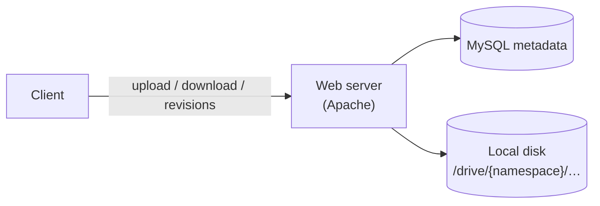
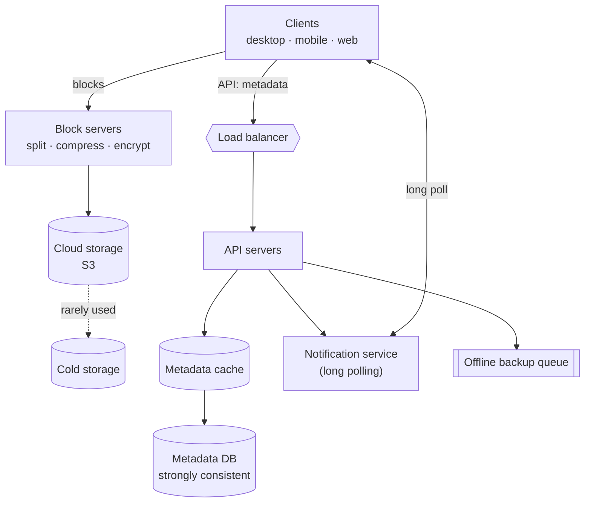
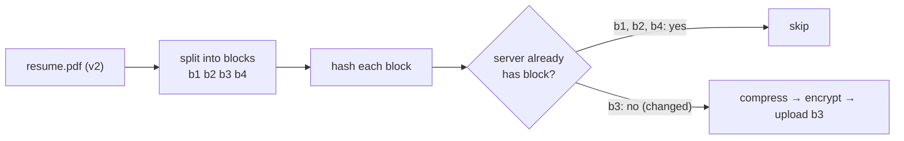
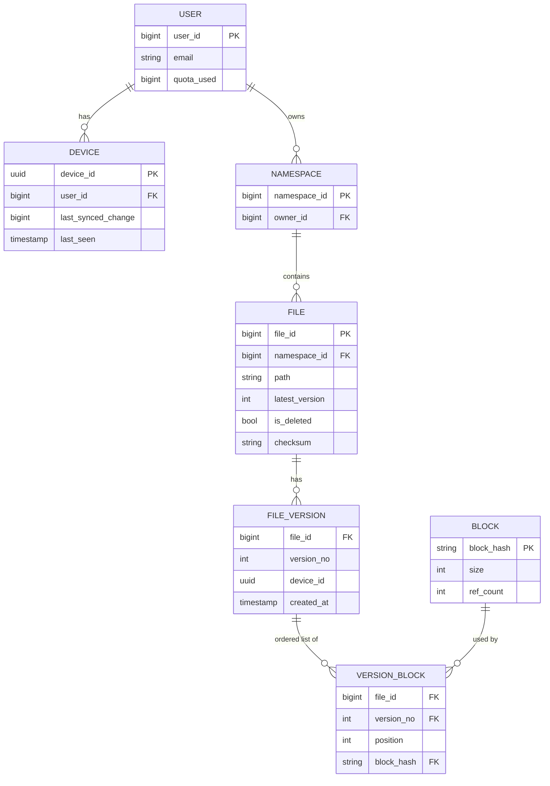
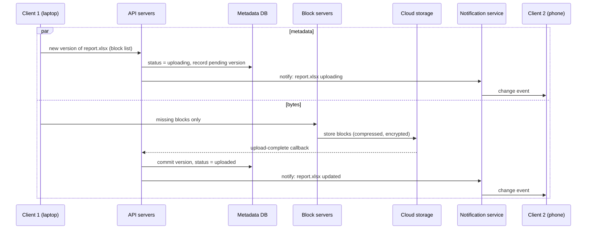
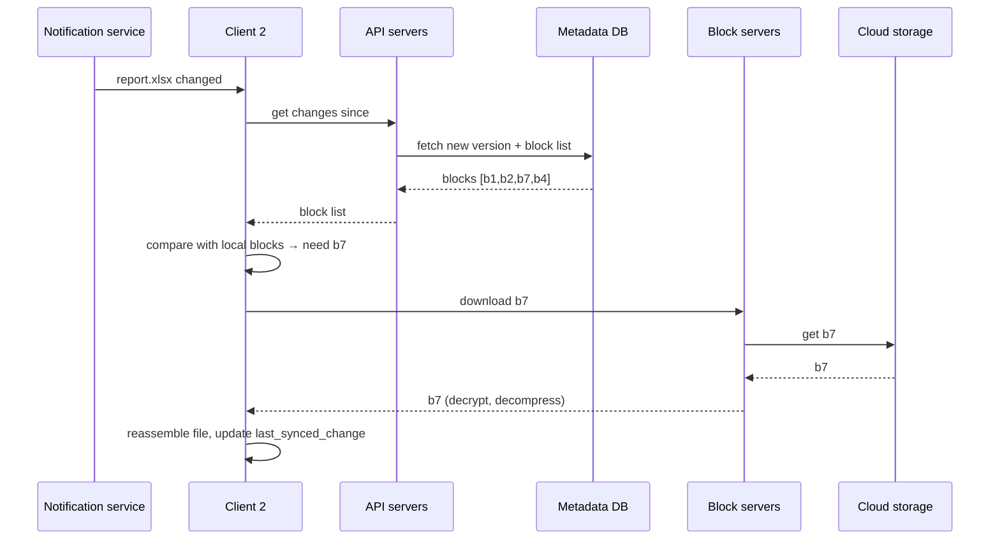

# 15 · Design Google Drive

<div class="chapter-meta" markdown>
<span>⏱ 45 min read</span>
<span class="hot">🔥 Tests sync, consistency and storage efficiency</span>
<span>Book: Chapter 15</span>
</div>

!!! abstract "TL;DR"
    - Files are split into **blocks** (e.g. 4 MB), each identified by its **content hash**. Upload/download only blocks that changed → **delta sync**; identical blocks are stored once → **dedup**.
    - Bytes live in **object storage** (S3) via **block servers**; everything else — users, devices, files, versions, block lists — lives in a **strongly consistent metadata DB** (relational, ACID).
    - When a file changes, **notification service** (long polling) tells the user's other devices; they fetch the new block list and download only missing blocks. **Offline devices** catch up from an offline backup queue / change log.
    - **Conflicts**: the first version to commit wins; the other becomes a "conflicted copy" the user resolves.
    - Control cost with dedup, limited version history (and thinning old versions), and **cold storage** for rarely accessed data.

## The intuition: a shared almirah with a register

Imagine a family almirah where everyone keeps documents, and a **register** at the front lists every document,
its pages, and who changed it last. To update a 100-page file where only page 37 changed, you don't replace the
whole file — you swap page 37 and update the register. If two people edit the same page at once, whoever writes
in the register first wins; the other's version is kept as "copy 2". Family members in other cities get a phone
call: "register updated" — and they fetch only the new page.

Pages = blocks. Register = metadata DB. Phone call = notification service.

---

## Step 1 · Scope

!!! example "Clarifying conversation"
    **You:** Is this personal storage, team storage, or both? — **Interviewer:** Personal first, with folder sharing.
    **You:** What must "sync" mean — every device always mirrors the cloud? — **I:** Yes, desktop clients keep a local mirror; phones fetch on demand.
    **You:** How big can files get? — **I:** Up to 5 GB.
    **You:** Free quota? — **I:** 10 GB per user.
    **You:** How many users? — **I:** 40M registered, 8M active daily.
    **You:** Do we keep old versions? — **I:** Yes, users must be able to restore earlier versions.
    **You:** Security expectations? — **I:** Encrypted in transit and at rest.

**Out of scope** (mention only): real-time collaborative editing (that's Google Docs — operational transforms/CRDTs, a different problem).

**Non-functional:** **reliability** (never lose data — the #1 requirement), **fast sync**, **low bandwidth** (mobile data is expensive), scalability, high availability.

### Estimates

| Quantity | Value |
|---|---|
| Allocated storage | 40M × 10 GB = **400 PB** allocated (actual use maybe 30–40% → ~140 PB) |
| Uploads | 8M DAU × 3 files/day = 24M/day → ~**280/s**, peak ~600/s |
| Average file | ~1 MB → ~24 TB/day of new data before dedup |
| Metadata reads | sync checks, listing folders: ~10× uploads → ~3K/s |

---

## Step 2 · High-level design

### Start simple: one server



APIs:

```http
POST /files/upload?uploadType=resumable      # start a resumable upload → returns upload session URL
PUT  <session URL>  (bytes, Content-Range)   # send data; resume after failures
GET  /files/download?path=/docs/resume.pdf
GET  /files/list_revisions?path=/docs/resume.pdf&limit=20
```

- **Simple upload** for small files; **resumable upload** for large ones — survive a dropped connection without restarting.
- All endpoints require auth (OAuth tokens) over HTTPS.

It works until the disk fills up. Now scale it.

### Scaling out

- **Storage** → move files to **object storage** (S3): replicated within a region; enable **cross-region replication** so a regional disaster doesn't lose data.
- **Load balancer** + **many stateless web/API servers**.
- **Metadata DB** → separate, replicated (and later sharded) relational DB.
- **Block servers** split files into blocks before upload to storage.

### The full design



| Component | Role |
|---|---|
| **Block servers** | Split files into blocks, compress, encrypt, and upload to cloud storage; on download, reassemble. Each block has an ID = hash of its content. |
| **Cloud storage** | Holds the blocks (immutable objects). |
| **Cold storage** | Cheaper tier for inactive files (e.g. S3 Glacier). |
| **API servers** | Everything except bytes: auth, profiles, file metadata, sharing, versions. |
| **Metadata DB** | Users, devices, files, versions, block lists, sharing. **Strong consistency.** |
| **Metadata cache** | Hot metadata for fast reads. |
| **Notification service** | Publishes "something changed" to clients (long polling). |
| **Offline backup queue** | Stores changes for devices that are offline, so they can sync later. |

---

## Step 3 · Deep dive

### Block servers: delta sync and compression

Uploading a whole 2 GB file because one paragraph changed wastes bandwidth. So:

1. Split the file into **blocks** (Dropbox famously used 4 MB max).
2. Hash each block (SHA-256) → **block ID**.
3. Ask the server which block IDs it **already has**; upload only the missing ones (**delta sync**).
4. **Compress** each block (gzip/zstd for text; images/video are already compressed) and **encrypt** it before sending.



**Fixed vs content-defined chunking.** With fixed-size blocks, inserting one byte at the start shifts **every**
block boundary → every block hash changes. **Content-defined chunking** (rolling hash, e.g. Rabin fingerprints)
cuts blocks where the content itself has certain patterns, so an insertion only changes the block around it.

```java
/** Fixed-size chunking with SHA-256 block IDs (content-defined chunking would replace the split rule). */
static List<String> blockIds(Path file, int blockSize) throws Exception {
    List<String> ids = new ArrayList<>();
    MessageDigest sha = MessageDigest.getInstance("SHA-256");
    try (InputStream in = Files.newInputStream(file)) {
        byte[] buf = new byte[blockSize];
        int n;
        while ((n = in.readNBytes(buf, 0, blockSize)) > 0) {
            ids.add(HexFormat.of().formatHex(sha.digest(Arrays.copyOf(buf, n))));
        }
    }
    return ids;   // the file's version = this ordered list of block IDs
}
```

### Why strong consistency for metadata

If two devices see different versions of the same file's block list, they'll show different content — or worse,
overwrite each other. The **metadata** must be strongly consistent (any read after a commit sees the commit), even
if that costs some availability.

- Use a **relational DB** with ACID transactions — committing a new version (insert version row + block list +
  update "latest" pointer) is one transaction.
- **Caches** must be kept consistent: replicas of the cache agree with the master; **invalidate** the cache on
  every metadata write.
- Many NoSQL stores default to eventual consistency → would need extra care. The bytes (blocks) don't need this —
  they're **immutable** and content-addressed, so they can never be "inconsistent".

### Metadata schema



- **Namespace** = a user's root folder (or a shared folder).
- **File versions are immutable rows** — never updated, only appended → full history for "restore previous version".
- A version is an **ordered list of block hashes**. Blocks have a `ref_count` for dedup and garbage collection.

### Upload flow



Two requests in parallel: (1) add file **metadata** (status `pending/uploading`), and (2) upload **blocks**. When
storage confirms all blocks, the version is committed (status `uploaded`) and other devices are notified.

### Download / sync flow

How does a device learn something changed?

- **Online:** the notification service tells it.
- **Offline:** changes accumulate (in the offline backup queue / change log); on reconnect it asks "what changed since change #N?" (`last_synced_change`).



### Notification service: why long polling?

| | Long polling | WebSocket |
|---|---|---|
| Direction needed | Server → client only, infrequent | Bi-directional, frequent |
| Fit for Drive | ✅ changes are occasional bursts; client then calls normal APIs | Overkill |
| Fit for chat (Ch. 12) | Weaker | ✅ |

Each client holds a long-poll connection; when a change arrives (or the poll times out), the server responds; the
client fetches metadata changes and reconnects. Connections are cheap to hold but numerous — millions per cluster.
If a notification server dies, clients reconnect to another one (they can't lose data — they'll fetch the change log).

### Conflicts

Two devices edit the same file before syncing. **The first version to commit wins**; the second is saved as a
**conflicted copy** (`report (Asha's laptop's conflicted copy 2026-11-17).xlsx`) and the user merges manually.
(Automatic merging only works for formats with structure — that's collaborative editing, out of scope.)

Implement "first wins" with optimistic concurrency: a commit says "new version based on version 7"; if latest is
no longer 7, the commit is rejected as a conflict.

### Saving storage space

Storage grows forever unless you design against it. Four levers, from biggest to smallest win in a typical deployment:

1. **Content-addressed blocks give dedup for free.** Same hash → same object; just increment `ref_count`. Per-account dedup is safe; *global* dedup across users saves more but can reveal whether some other user already holds a file, so apply it carefully.
2. **Versions are cheap but not free.** Because a new version only adds the changed blocks, history costs little — but an app that auto-saves every few seconds can still create thousands of versions. **Thin history as it ages** (dense recent versions, sparse old ones) and cap retention per plan.
3. **Tiering.** Data nobody has opened for months moves to an archive tier at a fraction of the price; restoring it is slower, which users rarely notice for old files.
4. **Garbage collection.** When versions expire or files are deleted, blocks whose `ref_count` hits zero are removed — after a grace period, in case of bugs or restores.

### Failure handling

Sort failures by **what's at risk**:

**Could we lose data?** This is the one that matters most.

- Blocks are written to object storage that replicates within a region, and we replicate to a **second region**; a version is only committed after all its blocks are durably stored — so a crash mid-upload leaves an uncommitted version, never a corrupt file.
- The metadata DB runs with synchronous replicas and automatic leader failover; regular backups and point-in-time recovery protect against bad writes (bugs, accidental mass deletes).

**Could sync stall?**

- If a notification server dies, its clients' long polls drop; they reconnect elsewhere and ask "what changed since my last sync?" — the change log makes missed notifications harmless.
- Change events for offline devices sit in replicated queues/logs, so a broker failure delays sync but loses nothing.

**Could requests fail?**

- API servers and block servers are stateless behind redundant load balancers; an unfinished block job is simply retried by another server (block uploads are idempotent — same hash, same object).
- The metadata cache is replicated; a lost node only means more DB reads until it's replaced.

## Step 4 · Wrap-up — other directions

- **Where should chunking happen?** We put splitting/compression/encryption in block servers so the logic lives in one trusted place. The alternative — clients upload blocks straight to object storage with signed URLs — removes a hop and server cost, but every client platform (Windows, macOS, iOS, Android, web) must implement the same chunking and crypto correctly, and a buggy or tampered client can upload bad data. Many real systems do a hybrid: clients chunk and hash, servers verify.
- **Selective sync / on-demand files.** Desktop clients show placeholders and download content only when opened — essential once users have more cloud data than laptop disk.
- **Sharing and permissions.** ACLs per namespace/file, expiring share links, and permission checks on every metadata and block request.
- **Search.** Index file names (and optionally contents) asynchronously into a search service, respecting permissions.
- **Presence.** If other features need "who's online", split it out of the notification service into its own service.

---

## Interviewer follow-ups

??? question "A user changes 1 byte in a 1 GB file. What gets uploaded?"
    With 4 MB fixed blocks, the block containing that byte changes → upload ~4 MB (compressed), not 1 GB. If bytes were **inserted**
    (not modified), fixed chunking would shift every later block; content-defined chunking keeps the change local, so still only one or
    two blocks are uploaded.

??? question "Why not use eventual consistency for metadata, like Dynamo?"
    Because divergent metadata means devices disagree on which blocks make up a file — users would see different content or silently
    overwrite each other's changes. Sync correctness needs a single, linearizable view of "latest version" and atomic commits; we accept
    the availability/latency cost for metadata while keeping the bulky, immutable blocks in a highly available store.

??? question "How do you make the upload resumable?"
    The client first registers the upload (gets a session ID and the list of blocks the server still needs). Each block is uploaded
    independently and acknowledged. After a crash or disconnect, the client asks the session which blocks are still missing and sends only
    those. The version commits only when all blocks are confirmed.

??? question "How does a phone that was offline for a week catch up efficiently?"
    It sends `last_synced_change = N`; the server returns the change log entries since N (file IDs and their latest versions — not every
    intermediate version). The phone downloads only block lists for those files and only blocks it doesn't have. For huge backlogs, it
    can sync folders the user actually opens first (selective sync).

??? question "How would you implement sharing a folder with another user?"
    Shared folders are namespaces with an ACL (owner, editors, viewers). The recipient's device subscribes to notifications for that
    namespace; metadata queries include all namespaces the user can access. Permission checks happen in the API servers and block servers
    (signed, scoped block URLs) on every access.

---

## Practice

??? example "Practice 1 — Delta sync bandwidth"
    A designer saves a 200 MB PSD 30 times a day; each save changes ~5% of the file, scattered across ~6 blocks of 4 MB. How much is
    uploaded per day with full-file upload vs block-level delta sync?

    **Solution.** Full: 30 × 200 MB = **6 GB/day**. Delta: 30 × 6 × 4 MB = **720 MB/day** (≈ 8× less, before compression).

??? example "Practice 2 — Dedup savings"
    A company has 10,000 employees; each has the same 300 MB onboarding folder in their Drive. Storage with and without per-company dedup?

    **Solution.** Without: 10,000 × 300 MB = **3 TB**. With dedup: **300 MB** (+ metadata and ref counts). This is why block-level,
    content-addressed storage is so effective in workplaces.

??? example "Practice 3 — Version thinning"
    A file is auto-saved every 30 seconds for 8 hours a day, every day. Design a retention policy that keeps the last hour minute-by-minute,
    the last week hourly, and older history daily up to 30 days. How many versions are kept at most?

    **Solution.** Last hour: 60; last week (excluding last hour): ~7 × 24 = 168; days 8–30: 23 → **~251 versions** instead of
    960/day × 30 = 28,800.

---

## Revision checklist

- [ ] I can state requirements and estimate storage and upload QPS.
- [ ] I can evolve the single-server design into the full architecture and explain each component.
- [ ] I can explain block splitting, hashing, delta sync, compression, encryption — and content-defined chunking.
- [ ] I can justify strong consistency for metadata and design the metadata schema.
- [ ] I can walk through the upload and download/sync flows, including offline devices.
- [ ] I can explain long polling for notifications, conflict handling, storage savings and failure handling.

[Next: 16 · Revision Cheat Sheet :material-arrow-right:](../revise/16-cheat-sheet.md){ .md-button .md-button--primary }
