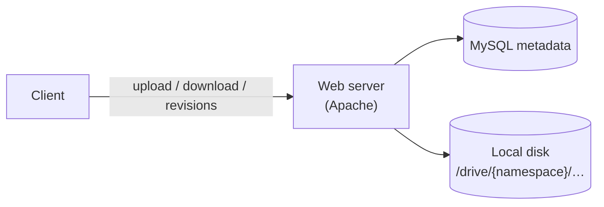
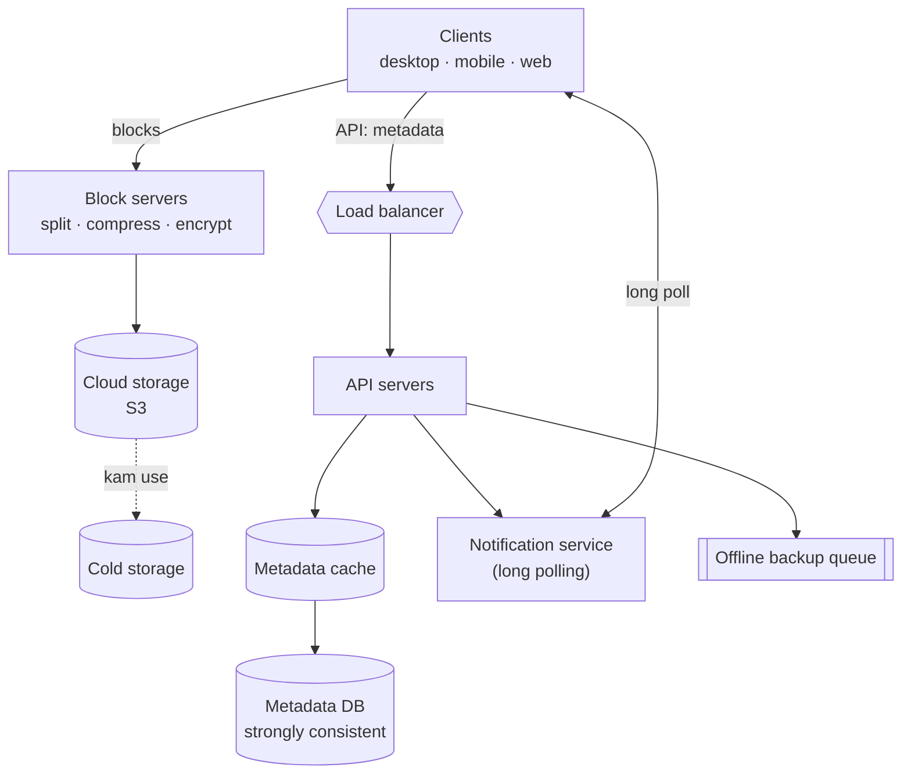
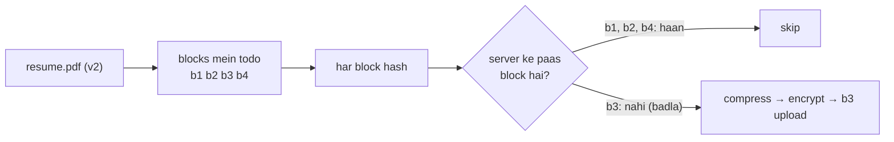
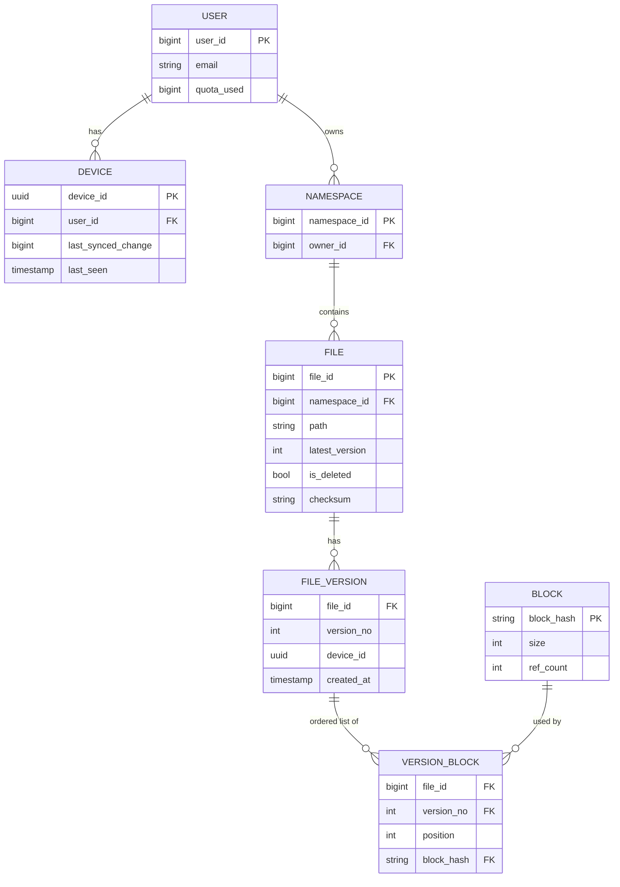
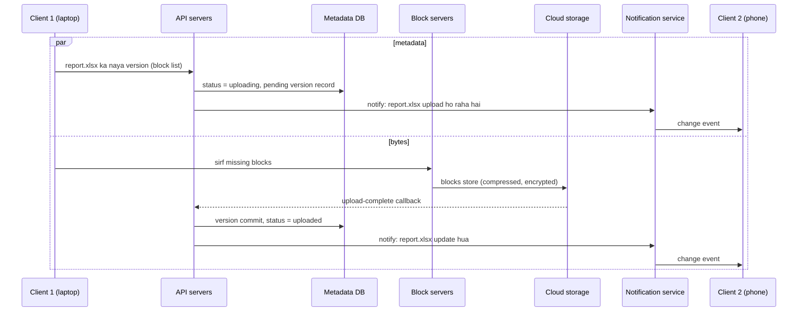
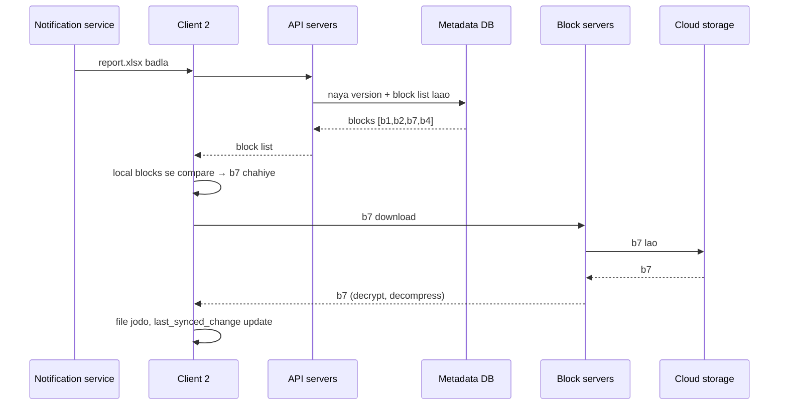

# 15 · Google Drive Design karo

<div class="chapter-meta" markdown>
<span>⏱ 45 min read</span>
<span class="hot">🔥 Sync, consistency aur storage efficiency test karta hai</span>
<span>Book: Chapter 15</span>
</div>

!!! abstract "TL;DR"
    - Files **blocks** mein toot-ti hain (jaise 4 MB), har ek ki pehchaan uska **content hash**. Sirf badle hue blocks upload/download → **delta sync**; identical blocks ek hi baar store → **dedup**.
    - Bytes **block servers** ke through **object storage** (S3) mein; baaki sab — users, devices, files, versions, block lists — **strongly consistent metadata DB** (relational, ACID) mein.
    - File badalne pe **notification service** (long polling) user ke baaki devices ko batati hai; woh nayi block list laate hain aur sirf missing blocks download karte hain. **Offline devices** offline backup queue / change log se catch up karte hain.
    - **Conflicts**: jo version pehle commit hua woh jeetta hai; doosra "conflicted copy" ban jaata hai jo user resolve karta hai.
    - Cost control: dedup, limited version history (aur purane versions patle karna), aur kam access hone waale data ke liye **cold storage**.

## Intuition: register waali saanjhi almaari

Socho ek ghar ki almaari jisme sab documents rakhte hain, aur aage ek **register** hai jo har document, uske pages, aur aakhri baar kisne badla, list
karta hai. 100-page file mein sirf page 37 badla toh poori file nahi badalte — page 37 badlo aur register update karo. Do log ek saath same page edit
karein, toh jo register mein pehle likhe woh jeetta hai; doosre ka version "copy 2" ki tarah rakh liya jaata hai. Doosre shehron mein rehne waale
family members ko phone aata hai: "register update hua" — aur woh sirf naya page mangwaate hain.

Pages = blocks. Register = metadata DB. Phone call = notification service.

---

## Step 1 · Scope

!!! example "Clarifying baatcheet"
    **Tum:** Personal storage hai, team storage, ya dono? — **Interviewer:** Pehle personal, folder sharing ke saath.
    **Tum:** "Sync" ka matlab kya — har device hamesha cloud ka mirror? — **I:** Haan, desktop clients local mirror rakhte hain; phones zaroorat pe laate hain.
    **Tum:** Files kitni badi ho sakti hain? — **I:** 5 GB tak.
    **Tum:** Free quota? — **I:** Har user 10 GB.
    **Tum:** Kitne users? — **I:** 40M registered, roz 8M active.
    **Tum:** Purane versions rakhne hain? — **I:** Haan, users purane versions restore kar sakein.
    **Tum:** Security expectations? — **I:** Transit mein aur at rest encrypted.

**Scope se bahar** (sirf mention): real-time collaborative editing (woh Google Docs hai — operational transforms/CRDTs, alag problem).

**Non-functional:** **reliability** (data kabhi na khoye — #1 requirement), **tez sync**, **kam bandwidth** (mobile data mehenga hai), scalability, high availability.

### Estimates

| Cheez | Value |
|---|---|
| Allocated storage | 40M × 10 GB = **400 PB** allocated (asli use shayad 30–40% → ~140 PB) |
| Uploads | 8M DAU × 3 files/din = 24M/din → ~**280/s**, peak ~600/s |
| Average file | ~1 MB → dedup se pehle roz ~24 TB naya data |
| Metadata reads | sync checks, folders list karna: uploads ka ~10× → ~3K/s |

---

## Step 2 · High-level design

### Simple shuruaat: ek server



APIs:

```http
POST /files/upload?uploadType=resumable      # resumable upload shuru → upload session URL milta hai
PUT  <session URL>  (bytes, Content-Range)   # data bhejo; failures ke baad resume
GET  /files/download?path=/docs/resume.pdf
GET  /files/list_revisions?path=/docs/resume.pdf&limit=20
```

- Chhoti files ke liye **simple upload**; badi files ke liye **resumable upload** — toota connection jhel lo bina dobara shuru kiye.
- Saare endpoints HTTPS pe auth (OAuth tokens) maangte hain.

Disk bharne tak chalta hai. Ab scale karo.

### Scale out

- **Storage** → files ko **object storage** (S3) pe le jao: region ke andar replicated; **cross-region replication** on karo taaki regional disaster mein data na khoye.
- **Load balancer** + **kai stateless web/API servers**.
- **Metadata DB** → alag, replicated (aur baad mein sharded) relational DB.
- **Block servers** storage pe upload se pehle files ko blocks mein todte hain.

### Poora design



| Component | Role |
|---|---|
| **Block servers** | Files ko blocks mein todo, compress, encrypt, aur cloud storage pe upload; download pe wapas jodo. Har block ki ID = uske content ka hash. |
| **Cloud storage** | Blocks rakhta hai (immutable objects). |
| **Cold storage** | Inactive files ke liye sasta tier (jaise S3 Glacier). |
| **API servers** | Bytes ke alawa sab: auth, profiles, file metadata, sharing, versions. |
| **Metadata DB** | Users, devices, files, versions, block lists, sharing. **Strong consistency.** |
| **Metadata cache** | Tez reads ke liye hot metadata. |
| **Notification service** | Clients ko "kuch badla" publish karti hai (long polling). |
| **Offline backup queue** | Offline devices ke liye changes rakhti hai, taaki baad mein sync kar sakein. |

---

## Step 3 · Deep dive

### Block servers: delta sync aur compression

Ek paragraph badalne pe poori 2 GB file upload karna bandwidth ki barbaadi hai. Toh:

1. File ko **blocks** mein todo (Dropbox famously max 4 MB use karta tha).
2. Har block hash karo (SHA-256) → **block ID**.
3. Server se poochho kaunsi block IDs uske paas **pehle se** hain; sirf missing upload karo (**delta sync**).
4. Har block ko bhejne se pehle **compress** (text ke liye gzip/zstd; images/video pehle se compressed) aur **encrypt** karo.



**Fixed vs content-defined chunking.** Fixed-size blocks mein shuruaat mein ek byte daalne se **har** block boundary khisak jaati hai → har block ka hash
badal jaata hai. **Content-defined chunking** (rolling hash, jaise Rabin fingerprints) blocks wahan kaat-ta hai jahan content mein khaas patterns hain,
toh insertion sirf apne aas-paas ka block badalta hai.

```java
/** SHA-256 block IDs ke saath fixed-size chunking (content-defined chunking split rule badal dega). */
static List<String> blockIds(Path file, int blockSize) throws Exception {
    List<String> ids = new ArrayList<>();
    MessageDigest sha = MessageDigest.getInstance("SHA-256");
    try (InputStream in = Files.newInputStream(file)) {
        byte[] buf = new byte[blockSize];
        int n;
        while ((n = in.readNBytes(buf, 0, blockSize)) > 0) {
            ids.add(HexFormat.of().formatHex(sha.digest(Arrays.copyOf(buf, n))));
        }
    }
    return ids;   // file ka version = block IDs ki yeh ordered list
}
```

### Metadata ke liye strong consistency kyun

Agar do devices same file ki block list ke alag versions dekhein, toh woh alag content dikhayenge — ya badtar, ek-doosre ko overwrite kar denge.
**Metadata** strongly consistent hona chahiye (commit ke baad har read commit dekhe), chahe thodi availability ki keemat lage.

- ACID transactions waala **relational DB** use karo — naya version commit karna (version row + block list insert + "latest" pointer update) ek transaction hai.
- **Caches** consistent rakhne padte hain: cache ke replicas master se agree karein; har metadata write pe cache **invalidate** karo.
- Kai NoSQL stores default mein eventual consistency dete hain → extra dhyaan chahiye. Bytes (blocks) ko iski zaroorat nahi — woh **immutable** aur content-addressed hain, kabhi "inconsistent" ho hi nahi sakte.

### Metadata schema



- **Namespace** = user ka root folder (ya shared folder).
- **File versions immutable rows hain** — kabhi update nahi, sirf append → "pichla version restore" ke liye poori history.
- Version **block hashes ki ordered list** hai. Dedup aur garbage collection ke liye blocks ka `ref_count` hai.

### Upload flow



Do requests parallel mein: (1) file **metadata** jodo (status `pending/uploading`), aur (2) **blocks** upload karo. Storage saare blocks confirm kare toh
version commit hota hai (status `uploaded`) aur baaki devices ko notify kiya jaata hai.

### Download / sync flow

Device ko kaise pata chale ki kuch badla?

- **Online:** notification service batati hai.
- **Offline:** changes jama hote rehte hain (offline backup queue / change log mein); reconnect pe device poochta hai "change #N ke baad kya badla?" (`last_synced_change`).



### Notification service: long polling kyun?

| | Long polling | WebSocket |
|---|---|---|
| Kis direction ki zaroorat | Sirf server → client, kabhi-kabhi | Bi-directional, baar-baar |
| Drive ke liye fit | ✅ changes kabhi-kabhi bursts mein; client phir normal APIs call karta hai | Zaroorat se zyada |
| Chat ke liye fit (Ch. 12) | Kamzor | ✅ |

Har client ek long-poll connection rakhta hai; change aaye (ya poll time out ho) toh server respond karta hai; client metadata changes laata hai aur
reconnect karta hai. Connections pakadna sasta hai par bahut saare — har cluster pe lakhon. Notification server mare toh clients doosre se reconnect
karte hain (data nahi kho sakte — woh change log le aayenge).

### Conflicts

Do devices sync se pehle same file edit karte hain. **Jo version pehle commit hua woh jeetta hai**; doosra **conflicted copy** ki tarah save hota hai
(`report (Asha's laptop's conflicted copy 2026-11-17).xlsx`) aur user haath se merge karta hai. (Automatic merging sirf structured formats ke liye
chalta hai — woh collaborative editing hai, scope se bahar.)

"Pehla jeetta hai" optimistic concurrency se implement karo: commit bolta hai "version 7 pe based naya version"; agar latest ab 7 nahi, toh commit
conflict ki tarah reject.

### Storage space bachana

Storage hamesha badhta rehta hai jab tak uske khilaaf design na karo. Chaar levers, typical deployment mein sabse badi jeet se chhoti tak:

1. **Content-addressed blocks dedup muft mein dete hain.** Same hash → same object; bas `ref_count` badhao. Per-account dedup safe hai; users ke across *global* dedup zyada bachata hai par yeh bata sakta hai ki kisi aur user ke paas pehle se file hai, toh dhyaan se lagao.
2. **Versions saste hain par muft nahi.** Naya version sirf badle blocks jodta hai, toh history ka kharcha kam — par har kuch second auto-save karne waala app phir bhi hazaaron versions bana sakta hai. **Umar ke saath history patli karo** (recent versions ghane, purane virle) aur har plan ki retention cap karo.
3. **Tiering.** Jo data mahino se kisi ne nahi khola woh kahin saste archive tier pe jaata hai; restore slow hota hai, jo purani files ke liye users shaayad hi notice karte hain.
4. **Garbage collection.** Versions expire ya files delete hone pe jin blocks ka `ref_count` zero ho jaaye woh hata do — grace period ke baad, bugs ya restores ke case mein.

### Failure handling

Failures ko **kya daav pe hai** se sort karo:

**Kya data kho sakta hai?** Sabse important yahi hai.

- Blocks region ke andar replicate hone waale object storage mein likhe jaate hain, aur hum **doosre region** mein bhi replicate karte hain; version tabhi commit hota hai jab uske saare blocks durably store ho jaayein — toh upload ke beech crash ek uncommitted version chhodta hai, kabhi corrupt file nahi.
- Metadata DB synchronous replicas aur automatic leader failover ke saath chalta hai; regular backups aur point-in-time recovery galat writes (bugs, galti se mass deletes) se bachate hain.

**Kya sync atak sakta hai?**

- Notification server mare toh uske clients ke long polls toot-te hain; woh kahin aur reconnect karke poochte hain "mere aakhri sync ke baad kya badla?" — change log chhoote notifications ko harmless bana deta hai.
- Offline devices ke change events replicated queues/logs mein rehte hain, toh broker failure sync ko late karta hai par kuch nahi khota.

**Kya requests fail ho sakti hain?**

- API servers aur block servers redundant load balancers ke peeche stateless hain; adhoora block job doosra server bas retry kar leta hai (block uploads idempotent hain — same hash, same object).
- Metadata cache replicated hai; ek node khone ka matlab bas replace hone tak zyada DB reads.

---

## Step 4 · Wrap-up — aur directions

- **Chunking kahan honi chahiye?** Humne splitting/compression/encryption block servers mein rakha taaki logic ek trusted jagah rahe. Alternative — clients signed URLs se seedha object storage pe blocks upload karein — ek hop aur server cost hatata hai, par har client platform (Windows, macOS, iOS, Android, web) ko same chunking aur crypto sahi implement karna padega, aur buggy ya tampered client kharab data upload kar sakta hai. Kai asli systems hybrid karte hain: clients chunk aur hash karte hain, servers verify.
- **Selective sync / on-demand files.** Desktop clients placeholders dikhate hain aur content sirf khulne pe download karte hain — zaroori jab users ka cloud data laptop disk se zyada ho jaaye.
- **Sharing aur permissions.** Har namespace/file ke ACLs, expire hone waale share links, aur har metadata aur block request pe permission checks.
- **Search.** File names (aur optionally contents) ko asynchronously search service mein index karo, permissions ka dhyaan rakhte hue.
- **Presence.** Agar doosre features ko "kaun online hai" chahiye, toh use notification service se nikaal ke apni service banao.

---

## Interviewer follow-ups

??? question "User 1 GB file mein 1 byte badalta hai. Kya upload hota hai?"
    4 MB fixed blocks ke saath, us byte waala block badalta hai → ~4 MB (compressed) upload, 1 GB nahi. Agar bytes **insert** hue (modify nahi), toh fixed
    chunking har baad waale block ko khiska degi; content-defined chunking change ko local rakhti hai, toh ab bhi sirf ek-do blocks upload hote hain.

??? question "Metadata ke liye Dynamo jaisi eventual consistency kyun nahi?"
    Kyunki diverge hua metadata matlab devices is baat pe asehmat hain ki file kin blocks se bani hai — users alag content dekhenge ya chupchaap ek-doosre
    ke changes overwrite karenge. Sync correctness ko "latest version" ka ek, linearizable view aur atomic commits chahiye; metadata ke liye hum
    availability/latency ki keemat maante hain jabki bhaari, immutable blocks highly available store mein rehte hain.

??? question "Upload resumable kaise banaoge?"
    Client pehle upload register karta hai (session ID aur un blocks ki list milti hai jo server ko abhi chahiye). Har block alag upload aur acknowledge
    hota hai. Crash ya disconnect ke baad client session se poochta hai kaunse blocks abhi missing hain aur sirf wahi bhejta hai. Version tabhi commit hota
    hai jab saare blocks confirm ho jaayein.

??? question "Ek hafte se offline phone efficiently kaise catch up karega?"
    Woh `last_synced_change = N` bhejta hai; server N ke baad ki change log entries return karta hai (file IDs aur unke latest versions — har beech ka version
    nahi). Phone sirf un files ki block lists aur sirf woh blocks download karta hai jo uske paas nahi. Bade backlog ke liye pehle woh folders sync kar sakta
    hai jo user sach mein kholta hai (selective sync).

??? question "Folder ko doosre user ke saath share karna kaise implement karoge?"
    Shared folders ACL (owner, editors, viewers) waale namespaces hain. Recipient ka device us namespace ke notifications subscribe karta hai; metadata queries
    mein woh saare namespaces shaamil hote hain jinhe user access kar sakta hai. Permission checks API servers aur block servers (signed, scoped block URLs) mein
    har access pe hote hain.

---

## Practice

??? example "Practice 1 — Delta sync bandwidth"
    Ek designer 200 MB ki PSD din mein 30 baar save karta hai; har save file ka ~5% badalta hai, ~6 blocks (4 MB) mein bikhra hua. Full-file upload vs
    block-level delta sync mein roz kitna upload hota hai?

    **Solution.** Full: 30 × 200 MB = **6 GB/din**. Delta: 30 × 6 × 4 MB = **720 MB/din** (compression se pehle ≈ 8× kam).

??? example "Practice 2 — Dedup ki bachat"
    Ek company ke 10,000 employees hain; har ek ki Drive mein same 300 MB ka onboarding folder hai. Per-company dedup ke saath aur bina storage?

    **Solution.** Bina: 10,000 × 300 MB = **3 TB**. Dedup ke saath: **300 MB** (+ metadata aur ref counts). Isliye workplaces mein block-level,
    content-addressed storage itna effective hai.

??? example "Practice 3 — Version thinning"
    Ek file roz 8 ghante har 30 second auto-save hoti hai. Aisi retention policy design karo jo pichla ghanta minute-by-minute, pichla hafta hourly, aur 30
    din tak purani history daily rakhe. Max kitne versions rakhe jaayenge?

    **Solution.** Pichla ghanta: 60; pichla hafta (pichle ghante ke alawa): ~7 × 24 = 168; din 8–30: 23 → 960/din × 30 = 28,800 ki jagah **~251 versions**.

---

## Revision checklist

- [ ] Requirements bata sakta hoon aur storage aur upload QPS estimate kar sakta hoon.
- [ ] Single-server design ko poore architecture mein badal ke har component samjha sakta hoon.
- [ ] Block splitting, hashing, delta sync, compression, encryption — aur content-defined chunking samjha sakta hoon.
- [ ] Metadata ke liye strong consistency justify kar sakta hoon aur metadata schema design kar sakta hoon.
- [ ] Offline devices samet upload aur download/sync flows samjha sakta hoon.
- [ ] Notifications ke liye long polling, conflict handling, storage savings aur failure handling samjha sakta hoon.

[Aage: 16 · Revision Cheat Sheet :material-arrow-right:](../revise/16-cheat-sheet.md){ .md-button .md-button--primary }
