# 01 · Scale from Zero to Millions of Users

<div class="chapter-meta" markdown>
<span>⏱ 45 min read</span>
<span class="hot">🔥 Foundation for every other chapter</span>
<span>Book: Chapter 1</span>
</div>

!!! abstract "TL;DR"
    - Start with **one server**, then peel pieces off it as each one becomes the bottleneck: database → web tier → cache → static files → sessions → data centers → async work → the database again.
    - **Scale out, not up**: add more machines behind a **load balancer** and keep the web tier **stateless** so any server can handle any request.
    - **Replicate** the database (one leader for writes, many followers for reads), put a **cache** in front of it, and push static files to a **CDN**.
    - Use **message queues** to decouple slow work, and **multiple data centers** with geo-routing for availability.
    - When one database can't hold the data any more, **shard** it — choosing the shard key is the most important decision, and hotspots/resharding/joins are the price.

## The intuition: a dhaba that becomes a chain

Picture a roadside dhaba run by one person. They take orders, cook, serve and handle cash. That's a
**single server**. It works until the lunch rush.

- First they hire a **separate cook** so the person at the counter only takes orders → *separate the database from the web server*.
- Then they open **more counters** and put a person at the door saying "go to counter 3" → *load balancer + more web servers*.
- The cook writes the **recipe book** once and gives copies to helpers who can only read it → *database replication*.
- The most popular dishes are **pre-cooked and kept warm** → *cache*.
- Packaged drinks are sold from **stalls near each colony** instead of the main kitchen → *CDN*.
- Order slips go on a **rail** and cooks pick them up when free → *message queue*.
- Eventually there are **branches in different cities** → *multiple data centers*, and the menu is split across **specialised kitchens** → *sharding*.

Every technique in this chapter is just that story, told with computers.

---

## Stage 0 · A single server

Everything — the web app, the database, the cache — runs on one machine. Let's trace one request,
because every later design is a variation of this flow.

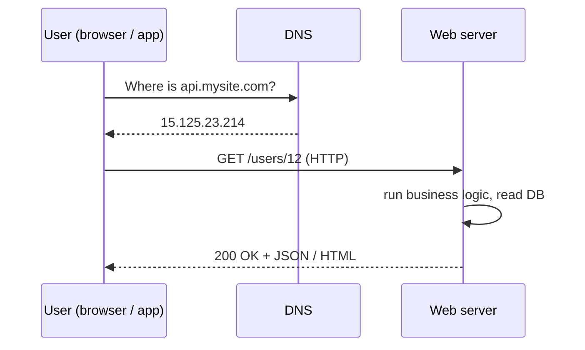

1. The user types a domain. **DNS** (usually a paid third-party service like Route 53 or Cloudflare) translates it to an IP address.
2. The client sends an **HTTP request** straight to that IP.
3. The server returns **HTML** (for browsers) or **JSON** (for mobile apps and SPAs).

Traffic comes from two kinds of clients: **web apps** (server-side code in Java/Python/Go plus HTML/JS in the browser) and **mobile apps** (talk to the server over HTTP, usually exchanging JSON, e.g. `GET /users/12 → {"id":12,"name":"Asha"}`).

!!! warning "Why this can't last"
    One machine = one **single point of failure (SPOF)**. If it reboots, the product is down. And
    CPU, RAM and disk are shared by the web app and the database, so they fight each other.

---

## Stage 1 · Separate the database

Move the database onto its own machine. Now the **web tier** (handles requests) and the **data tier**
(stores data) can be **scaled independently** — you'll soon want 20 web servers but still 1 primary database.

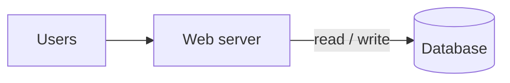

### Which database? SQL vs NoSQL

This is a decision you'll make in every design, so let's do it properly.

| | Relational (SQL) | Non-relational (NoSQL) |
|---|---|---|
| **Examples** | MySQL, PostgreSQL, Oracle | Cassandra, DynamoDB, MongoDB, HBase, Redis, Neo4j |
| **Data model** | Tables, rows, fixed schema | Key-value, document, wide-column, graph |
| **Joins** | Yes, powerful SQL | Usually no (you denormalise instead) |
| **Transactions** | Full ACID across rows/tables | Often limited to one key / one partition |
| **Scaling writes** | Hard beyond one primary (needs sharding) | Built to partition across many nodes |
| **Best for** | Money, orders, inventory, anything relational with integrity rules | Huge volume, simple access patterns, flexible schema, low latency |

**Default to SQL.** It has decades of tooling and correctness guarantees. Reach for NoSQL when one of these is true:

- You need **very low latency** at very high scale for simple lookups (e.g. session store, feature flags).
- Your data is **unstructured / semi-structured** or the schema changes often (product catalogs with wildly different attributes).
- You mostly **serialise and deserialise blobs** (JSON documents) by key.
- You must store a **massive amount** of data (billions of rows, petabytes) and write throughput matters more than joins.

The four NoSQL families, with one sentence each:

| Family | Mental model | Example use |
|---|---|---|
| **Key-value** | A giant distributed `HashMap<String, byte[]>` | Sessions, carts, caches (Redis, DynamoDB) |
| **Document** | Key → JSON document you can query inside | User profiles, catalogs (MongoDB) |
| **Wide-column** | Row key → sorted map of columns, built for heavy writes | Chat messages, time series (Cassandra, HBase) |
| **Graph** | Nodes + edges with fast traversal | Social graph, recommendations (Neo4j) |

!!! interview "In an interview"
    Don't say "NoSQL because it scales". Say **what access pattern** you have and why that store fits it:
    *"Messages are written constantly and read by (channel, time range), so a wide-column store like
    Cassandra partitioned by channel_id and clustered by message_id fits perfectly."*

---

## Stage 2 · Vertical vs horizontal scaling

| | Vertical ("scale up") | Horizontal ("scale out") |
|---|---|---|
| **What** | Bigger machine: more CPU, RAM, faster disk | More machines sharing the load |
| **Pros** | Dead simple, no code changes, no distributed-systems problems | Practically unlimited, failure of one machine is survivable |
| **Cons** | Hard ceiling; cost grows super-linearly; still one SPOF; upgrades need downtime | Needs load balancing, stateless servers, data partitioning |
| **Use when** | Traffic is low/moderate, or for the database early on | Large scale, high availability required |

Vertical scaling is not "bad" — it's often the right first move for a database (a single big
Postgres box goes surprisingly far). But for the **web tier** you want horizontal scaling from early on,
and that needs a load balancer.

---

## Stage 3 · Load balancer

A **load balancer (LB)** sits in front of a pool of web servers and spreads requests across them.

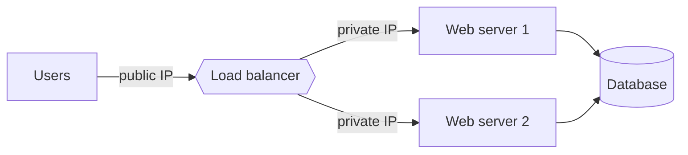

- Users only know the LB's **public IP**. Servers sit on **private IPs** (reachable inside the network, not from the internet) — better security.
- If server 1 dies, the LB's **health checks** notice and send everything to server 2 → **failover**.
- If traffic grows, add server 3, 4, 5 to the pool → the LB starts using them automatically.

### How does the LB pick a server?

| Algorithm | How | Good for |
|---|---|---|
| **Round robin** | 1, 2, 3, 1, 2, 3… | Identical servers, similar requests |
| **Weighted round robin** | Bigger servers get more turns | Mixed hardware |
| **Least connections** | Send to the server with fewest active connections | Long-lived or uneven requests (WebSockets, uploads) |
| **Least response time** | Fastest-responding healthy server | Latency-sensitive APIs |
| **IP hash / consistent hashing** | `hash(client IP or key) → server` | Stickiness, cache locality |

### L4 vs L7 load balancing

- **Layer 4** (transport): routes on IP + port only, never reads the HTTP request. Extremely fast, protocol-agnostic. *Example:* AWS NLB.
- **Layer 7** (application): reads the HTTP request — path, headers, cookies — so it can route `/api/*` to API servers and `/static/*` elsewhere, terminate TLS, do auth, rate limiting. *Example:* NGINX, Envoy, AWS ALB.

!!! question "\"Isn't the load balancer itself a single point of failure?\""
    Yes, if there's only one. Real setups run LBs in **pairs** (active-passive with a floating/virtual IP,
    or active-active), and DNS can return multiple LB IPs. Managed cloud LBs are already replicated across
    availability zones.

---

## Stage 4 · Database replication

The web tier now survives failures. The database doesn't. **Replication** keeps copies of the
data on several servers.

The classic setup is **leader–follower** (the book uses the older *master–slave* terms):

- The **leader** (primary) accepts **all writes** — INSERT, UPDATE, DELETE.
- **Followers** (replicas) receive a copy of every change and serve **reads**.
- Most apps read far more than they write (often 10:1 to 100:1), so you run **one leader, many followers**.

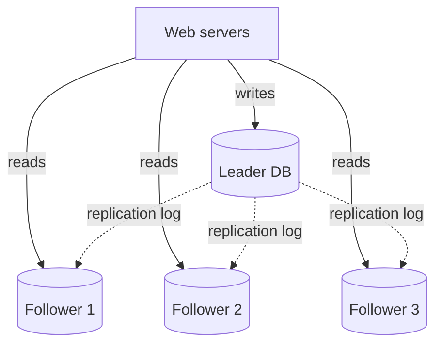

**What you gain**

- **Performance** — reads are spread over many machines and run in parallel.
- **Reliability** — data survives a disk failure, even a whole data center burning down, if replicas are elsewhere.
- **Availability** — if one DB machine is down, others still answer.

**What happens when something fails**

- **A follower dies** → reads go to other followers (or temporarily to the leader); a new follower is created from a snapshot + the log.
- **The leader dies** → a follower is **promoted** to leader (*failover*). The hard part: that follower may be slightly **behind**, so the last few writes can be missing. Production systems use consensus (e.g. Raft in etcd, Orchestrator for MySQL) and careful recovery to decide who's freshest.

### Going deeper: sync vs async replication and lag

| Mode | Leader waits for… | Upside | Downside |
|---|---|---|---|
| **Synchronous** | Follower to confirm before telling client "OK" | Follower is never behind | One slow follower slows every write |
| **Asynchronous** | Nothing — replies immediately | Fast writes | **Replication lag**: followers can be seconds behind |
| **Semi-sync** | At least one follower | Good compromise | Slightly slower writes |

**Replication lag** causes real bugs. Classic example — *read-your-own-writes*:

> Riya updates her profile photo (write → leader). The page reloads and reads from a follower that hasn't
> received the change yet. She sees her **old** photo and thinks the upload failed.

Fixes: read the user's **own** data from the leader for a short time after they write; or track the
replication position and only read from followers that have caught up; or route by user so a user sticks to one replica.

!!! tip "Beyond leader–follower"
    **Multi-leader** (several DCs accept writes, then sync) and **leaderless** (Dynamo-style, any node accepts
    writes, quorums decide) exist. They trade simplicity for availability and bring **write conflicts**.
    Chapter 6 (Key-Value Store) goes deep on leaderless replication.

---

## Stage 5 · Cache

Every page load hits the database several times. A **cache** keeps the results of expensive or
frequent reads **in memory**, which is roughly **100–1000× faster** than going to a database on disk.

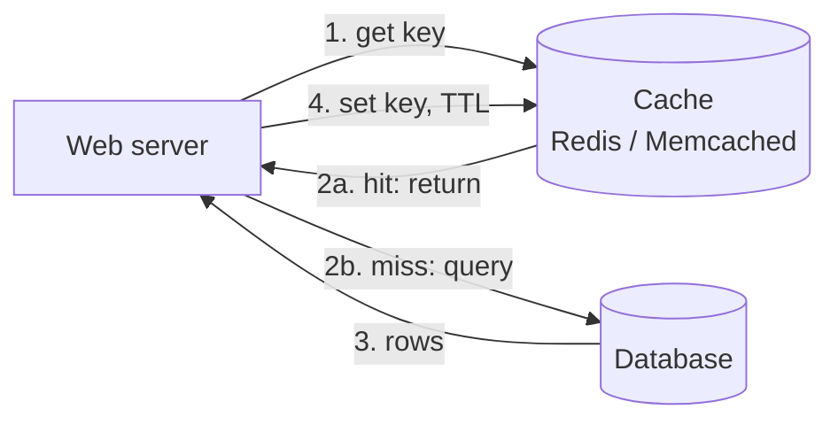

The flow above — check cache, on a miss read the DB and fill the cache — is the most common pattern.
The book calls it a *read-through* cache; many engineers call this exact flow **cache-aside**
(the application does the filling). Here it is in Java:

```java
public User getUser(long id) {
    String key = "user:" + id;
    User cached = cache.get(key);              // 1. try the cache
    if (cached != null) return cached;         // 2a. hit

    User fromDb = userRepository.findById(id); // 2b. miss → database
    if (fromDb != null) {
        cache.set(key, fromDb, Duration.ofMinutes(10)); // 3. populate with a TTL
    }
    return fromDb;
}

public void updateUser(User u) {
    userRepository.save(u);         // write the source of truth first
    cache.delete("user:" + u.id()); // then invalidate (don't update) the cached copy
}
```

### Caching strategies — the full menu

| Strategy | Read path | Write path | Use when |
|---|---|---|---|
| **Cache-aside** (lazy loading) | App checks cache, on miss loads from DB and fills | App writes DB, deletes cache key | Default for read-heavy apps |
| **Read-through** | Cache library itself loads from DB on a miss | — | You want loading logic in the cache layer |
| **Write-through** | — | Write cache *and* DB synchronously | Data must be in cache right after write |
| **Write-behind** (write-back) | — | Write cache now, flush to DB later in batches | Very write-heavy, can tolerate small loss (counters, likes) |
| **Write-around** | — | Write DB only; cache filled on next read | Data written once, rarely re-read |

### Things to think about before adding a cache

1. **When to cache.** Data that's **read often, changed rarely**. Never treat the cache as the only copy — it lives in volatile memory and a restart wipes it.
2. **Expiration (TTL).** Without one, stale data lives forever and memory fills up. Too short → you hammer the DB reloading; too long → users see stale data. Minutes to hours is typical; tune per data type.
3. **Consistency.** The DB write and the cache update are **not one transaction**, so they can drift (especially across regions). Deleting the key on write (as above) is safer than updating it, because two concurrent updates can't leave the wrong value behind. Facebook's *Scaling Memcache* paper is the classic reference on how hard this gets.
4. **Failure.** One cache server is a SPOF. Run several (across zones / DCs) and **over-provision memory** so a node loss or growth spike doesn't cause mass eviction.
5. **Eviction policy.** When memory is full, something must go:
    - **LRU** (least recently used) — the usual default.
    - **LFU** (least frequently used) — better when popularity is stable.
    - **FIFO** — simplest, rarely the best.

!!! danger "Cache stampede (thundering herd)"
    A hot key (say, the home-page feed) expires. 10,000 requests miss at the same instant and **all** hit the
    database together, which falls over. Fixes: let only one request rebuild the key (a lock or *single-flight*),
    serve the stale value while one worker refreshes it, and add **random jitter** to TTLs so keys don't all
    expire at the same second.

---

## Stage 6 · Content Delivery Network (CDN)

Images, videos, CSS and JS are **static** — the same bytes for every user. Serving them from your
web servers wastes their CPU and bandwidth and is slow for far-away users. A **CDN** is a network of
servers spread around the world (**edge locations**) that cache static content close to users.

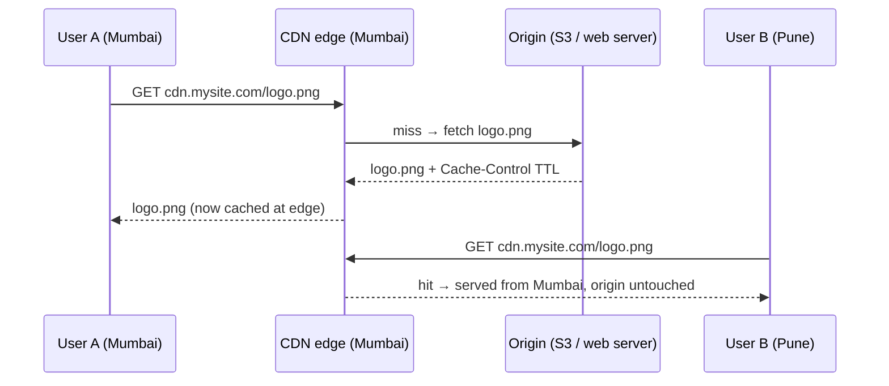

- The URL points at the CDN's domain (e.g. `mysite.cloudfront.net/...`).
- On a **miss**, the edge fetches from the **origin** (your server or S3), caches it for the **TTL** the origin specifies, and returns it.
- Every later request in that region is a **hit** until the TTL expires.

**Pull vs push CDN.** *Pull* (above) fetches lazily on first request — easy, good for most sites.
*Push* means you upload content to the CDN ahead of time — useful for big files you know will be popular (a new movie release).

**Things to think about**

- **Cost** — you pay per GB transferred. Don't put rarely-accessed files on the CDN.
- **Expiry** — time-sensitive content needs a sensible TTL.
- **CDN outage** — the client/app should be able to fall back to the origin.
- **Invalidation** — to remove a file early, call the vendor's invalidation API, or better, use **versioned URLs** (`app.css?v=42` or `app.3f9a1c.css`). A new URL is a new object, so there's nothing to invalidate.

After stages 5 and 6, the web servers no longer serve static files, and the DB is protected by the cache.

---

## Stage 7 · Stateless web tier

To add and remove web servers freely (auto-scaling), **no web server may hold user state** like
session data.

**Stateful** — user A's session lives in server 1's memory. Every request from A **must** reach server 1.
LBs can do this with **sticky sessions**, but then adding/removing servers or losing a server breaks
sessions, and load spreads unevenly.

**Stateless** — session data lives in a **shared store** (Redis, a NoSQL DB, or an RDBMS). Any server
can handle any request; servers are interchangeable "cattle", not "pets".

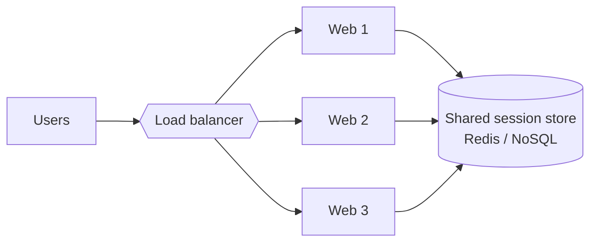

Now **auto-scaling** is trivial: a rule like *"if average CPU > 70% for 5 minutes, add 2 servers"*
just works, because a new server needs nothing from the old ones.

!!! tip "Going deeper: tokens instead of sessions"
    Another way to be stateless is to put the state **in the client**: a signed token (e.g. a JWT) that each
    server can verify with a shared key, without any lookup. Trade-off: you can't easily revoke a token before
    it expires, so it's often combined with short expiry + a small revocation list.

---

## Stage 8 · Multiple data centers

As users spread across the world, one data center means high latency for distant users and a
total outage if that DC fails. So we run **two or more**.

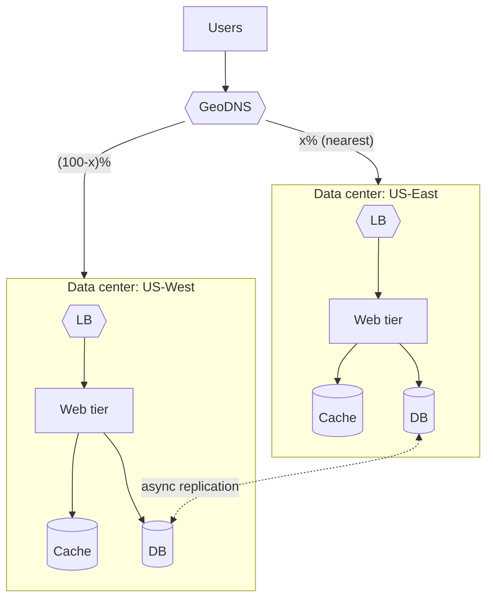

- **GeoDNS** resolves the domain to a different IP depending on where the user is, sending them to the nearest DC.
- If DC2 goes down, DNS sends **100%** of traffic to DC1.

What makes this hard:

1. **Traffic redirection** — tools (GeoDNS, anycast, global LBs) to steer users and to fail over quickly. DNS caching means failover isn't instant; keep TTLs low.
2. **Data synchronisation** — after failover, users land in a DC that must already have their data. Data is replicated **across DCs**, usually **asynchronously** (so a few seconds of writes can be lost in a disaster). Netflix's active-active multi-region setup is the well-known example.
3. **Testing and deployment** — every DC must run the same code and config. Automated deployment is mandatory.

**Active-passive vs active-active:** in active-passive, the second DC is a warm standby. In active-active,
both serve live traffic — better utilisation and faster failover, but you must handle concurrent writes to
the same data in two places.

---

## Stage 9 · Message queue

Some work is slow (resizing images, sending emails, transcoding video) and shouldn't block the user's
request. A **message queue** is a durable buffer between services that enables **asynchronous** communication.

- **Producers** publish messages to the queue.
- **Consumers** pull messages and do the work.
- Neither needs the other to be up at the same moment → **decoupling**.

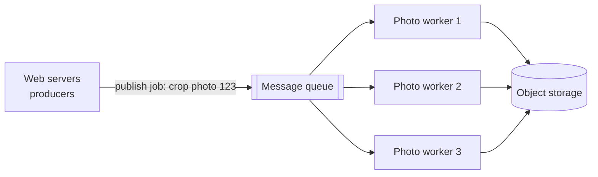

**Example:** a photo app lets users crop, sharpen and blur. The web server just drops a job in the queue and
replies "processing…" immediately. Workers pick jobs up at their own pace. If the queue grows, add workers;
if it's usually empty, remove some. Producers and consumers **scale independently**.

### Going deeper

- **Delivery guarantees.** *At-most-once* (may lose messages), *at-least-once* (may duplicate — the common default), *exactly-once* (expensive, limited). With at-least-once, make consumers **idempotent**: processing the same message twice must be harmless (e.g. dedupe by message ID).
- **Queue vs log.** RabbitMQ/SQS-style queues delete a message once consumed. **Kafka** is a log: messages are retained, consumers track an offset, many consumer groups can replay the same stream.
- **Backpressure.** Queue depth is a key metric — growing depth means consumers can't keep up. It's also a natural auto-scaling signal.
- **Dead-letter queue (DLQ).** Messages that keep failing are moved aside instead of blocking everything.

---

## Stage 10 · Logging, metrics, automation

At a few servers these are nice-to-haves. At this scale they're mandatory.

- **Logging** — collect error logs from every server into one searchable place (ELK / OpenSearch, Loki, Cloud Logging).
- **Metrics** at three levels:
    - *Host*: CPU, memory, disk I/O, network.
    - *Aggregated/service*: DB tier latency, cache hit ratio, queue depth, error rate.
    - *Business*: daily active users, retention, revenue, sign-ups.
- **Automation** — CI (every commit is built and tested automatically), CD (automated, repeatable deploys), infrastructure as code.

!!! tip "The four golden signals"
    For any service, watch **latency**, **traffic**, **errors** and **saturation**. If you mention these
    by name in an interview, you sound like someone who has run production systems.

---

## Stage 11 · Scaling the database: sharding

Data keeps growing, and the single leader is overloaded. Two options again.

**Vertical:** buy a monster database server. Cloud providers offer machines with **terabytes of RAM**, and
Stack Overflow famously ran on a single primary database for years with ~10M monthly visitors. But: hard
hardware limits, still a SPOF, and very expensive.

**Horizontal = sharding:** split the data across many databases (**shards**). Every shard has the **same
schema** but holds a **different subset** of rows.

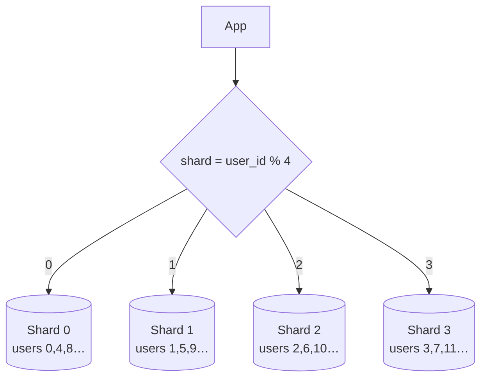

### Choosing the shard key (the most important decision)

The **shard key** (partition key) decides which shard a row lives on. A good key:

1. **Spreads data evenly** (high cardinality, no skew).
2. **Matches the main query** — the common request should hit **one** shard, not all of them.
3. **Rarely changes** — moving a row between shards is expensive.

Common sharding strategies:

| Strategy | How | Pro | Con |
|---|---|---|---|
| **Hash-based** | `hash(key) % N` (or consistent hashing) | Even spread | Range queries hit all shards; changing N moves most data |
| **Range-based** | `A–F` → shard 1, `G–M` → shard 2 … or by date | Range scans are cheap | Hotspots (all new data lands on the latest shard) |
| **Directory / lookup** | A table maps key → shard | Flexible, easy to rebalance | The lookup service is extra infra + possible SPOF |
| **Geo-based** | Users in India → shard IN | Data locality, data-residency laws | Uneven sizes |

### The new problems sharding brings

1. **Resharding.** A shard fills up (growth) or some shards fill faster (skew) → you must change the sharding function and **move data**. With `% N`, changing N relocates almost everything. **Consistent hashing** (Chapter 5) fixes this by moving only ~1/N of the keys.
2. **The celebrity / hotspot problem.** If Virat Kohli, Shah Rukh Khan and Taylor Swift land on the same shard, it melts under reads. Fixes: give hot keys **dedicated shards**, split a hot key further (e.g. `celebrity_id#1..#10`), and cache aggressively.
3. **Joins and transactions across shards.** A SQL join across shards is slow or impossible, and cross-shard transactions need two-phase commit. Common workaround: **denormalise** — store data so each query can be answered from one table on one shard.

Finally, move workloads that don't need relational features (e.g. activity logs, session data, counters)
into **NoSQL** stores to take load off the relational database.

---

## The final picture

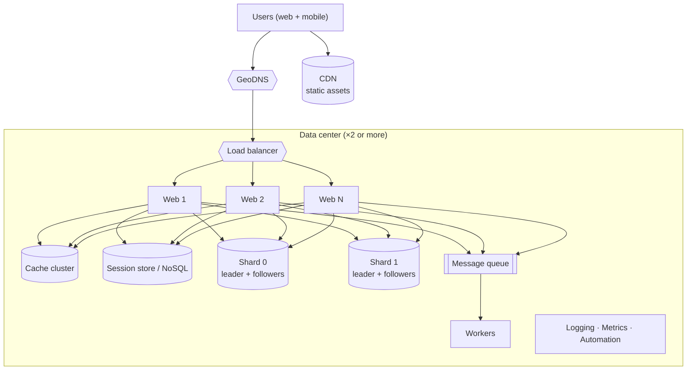

**The scaling checklist** (memorise this — it's your vocabulary for every later chapter):

- [x] Web tier is **stateless**; state lives in shared stores.
- [x] **Redundancy at every tier** — nothing important runs on exactly one machine.
- [x] **Cache** reads aggressively; put **static assets on a CDN**.
- [x] **Replicate** databases; **shard** them when one leader isn't enough.
- [x] **Multiple data centers** with geo-routing and failover.
- [x] **Decouple** with queues; split big apps into **independent services**.
- [x] **Monitor everything** and **automate** builds, tests and deploys.

---

## Trade-offs at a glance

| Technique | You gain | You pay |
|---|---|---|
| Load balancer | Availability, horizontal scale | Extra hop; LB must itself be redundant |
| Replication | Read scale, durability, failover | Replication lag, failover complexity |
| Cache | Latency, DB offload | Staleness, invalidation bugs, stampedes |
| CDN | Global latency, origin offload | Cost per GB, invalidation |
| Stateless tier | Easy auto-scaling, resilience | A shared state store to run |
| Multi-DC | Disaster tolerance, lower global latency | Cross-DC sync, possible data loss on failover, ops cost |
| Message queue | Decoupling, smoothing spikes | Eventual results, duplicates, another system to run |
| Sharding | Write + storage scale | Resharding, hotspots, no cross-shard joins/transactions |

---

## Interviewer follow-ups

??? question "Your read replicas are 5 seconds behind. A user edits a post and immediately sees the old version. What do you do?"
    This is a **read-your-own-writes** problem caused by async replication lag. Options:
    (1) for a few seconds after a user writes, route **that user's** reads to the leader;
    (2) record the leader's log position at write time and only read from replicas that have reached it;
    (3) update the client-side state optimistically so the UI shows the new version anyway.
    Mention that making replication synchronous would also fix it but would hurt write latency and availability.

??? question "The cache goes down completely. What happens and how do you protect the database?"
    Every read becomes a DB read — the DB may get 10–50× its normal load and fall over (a cascading failure).
    Protections: run the cache as a **replicated cluster** across zones; put a **circuit breaker / rate limit** on
    the path to the DB; **warm** a new cache before sending full traffic; serve degraded responses (e.g. a
    slightly stale feed) rather than failing completely.

??? question "Why delete the cache key on update instead of writing the new value into it?"
    Two concurrent writers can interleave: A writes DB=1, B writes DB=2, B sets cache=2, A sets cache=1 → the cache
    now holds a stale value **with no expiry in sight**. Deleting is idempotent and order-insensitive: the next
    reader reloads the true value. (There's still a small race with a concurrent reader; TTLs bound the damage.)

??? question "How would you pick a shard key for an e-commerce orders table?"
    Look at the dominant queries: "show my orders" (by `user_id`) and "get order X" (by `order_id`).
    Sharding by `user_id` keeps all of a user's orders on one shard (fast history page, no scatter-gather).
    Then embed the shard in the order ID (or keep a small `order_id → user_id` lookup) so direct lookups also
    hit one shard. Watch for skew from huge B2B customers — they may need their own shard.

??? question "When would you NOT add a cache?"
    When data is **write-heavy** or changes on almost every read (low hit ratio), when **strong consistency** is
    required and staleness is unacceptable (account balance during a transfer), or when the DB already meets the
    latency target — a cache adds an extra system to run and a new class of bugs.

??? question "Sticky sessions vs a shared session store — which and why?"
    Shared store. Sticky sessions break on server failure (users get logged out), make scale-in painful, and
    skew load. A shared store (Redis cluster) adds ~1 ms per request but makes servers interchangeable.
    Sticky sessions are acceptable only for short-lived, rebuildable state or as a cache-locality optimisation.

---

## Common mistakes

!!! warning "Avoid these"
    - Jumping straight to "microservices + Kafka + Cassandra" for a system with 1,000 users. **Scale to the stated requirements.**
    - Adding a cache without saying **what** is cached, the **TTL**, and how it's **invalidated**.
    - Saying "add replicas" without mentioning **replication lag** and what it breaks.
    - Sharding without naming the **shard key** and justifying it with the main query.
    - Forgetting that the **load balancer, cache and queue** also need redundancy.
    - Treating the cache as a database (data only in memory).

---

## Practice

??? example "Practice 1 — Order the steps"
    A startup's single server is at 90% CPU. The database and app share the box, all images are served by the app,
    and sessions are stored in server memory. List the first **four** changes you'd make, in order, and why.

    **Solution.**
    1. **Move the DB to its own machine** — biggest immediate relief; app and DB stop competing.
    2. **Put static images on a CDN / object storage** — removes a large share of bandwidth and CPU from the app.
    3. **Move sessions to Redis** — makes the web tier stateless, which is a prerequisite for…
    4. **Add a load balancer + a second web server** — horizontal scale and no single point of failure in the web tier.
    (Then: add a cache in front of the DB, then read replicas.)

??? example "Practice 2 — Cache sizing"
    A product catalog has 50M products, average 2 KB each. 80% of traffic hits the top 10% of products.
    How much memory to cache the hot set? How many 64 GB cache nodes (keep 30% headroom)?

    **Solution.** Hot set = 10% × 50M = 5M products × 2 KB = **10 GB**. With overhead (keys, data-structure
    metadata, fragmentation ~1.5×) ≈ 15 GB. With 30% headroom → ~21 GB. **One** 64 GB node fits it, but run
    **at least 2–3** nodes (replicas / across zones) so a node failure doesn't send everything to the DB.

??? example "Practice 3 — Hot shard"
    You shard tweets by `user_id`. A celebrity with 100M followers posts and their shard's CPU hits 100% from reads.
    Give three mitigations.

    **Solution.** (1) **Cache** the celebrity's recent tweets in a replicated cache tier so reads rarely reach the
    shard. (2) **Add read replicas** for that hot shard specifically. (3) **Split the hot key** — move the celebrity
    to a dedicated shard, or salt the key (`user_id#0..#9`) to spread their data across several shards and
    fan-in on read. (Bonus: for feeds, use a fan-out-on-read path for celebrities — see Chapter 11.)

??? example "Practice 4 — Availability maths"
    Your app needs the LB, web tier and DB to all be up. Each is 99.9% available. What's the overall availability?
    What changes if you run two independent DB replicas with automatic failover?

    **Solution.** In series: 0.999³ ≈ **99.7%** (~26 h downtime/year). Two DBs in parallel: 1 − (0.001)² =
    99.9999%, so total ≈ 0.999 × 0.999 × 0.999999 ≈ **99.8%**. Redundancy at **every** tier is what moves the
    number — try it in the widget in [Chapter 2](02-back-of-the-envelope.md).

---

## Revision checklist

- [ ] I can trace a request from DNS lookup to JSON response.
- [ ] I can explain SQL vs NoSQL with **access patterns**, not buzzwords, and name the four NoSQL families.
- [ ] I know why vertical scaling hits a wall and what horizontal scaling requires.
- [ ] I can name 4 load-balancing algorithms and explain L4 vs L7.
- [ ] I can explain leader–follower replication, failover, and **replication lag** with an example.
- [ ] I can write cache-aside code and compare 5 caching strategies; I know TTL, eviction, and stampede fixes.
- [ ] I know how a CDN serves content, pull vs push, and why versioned URLs beat invalidation.
- [ ] I can explain why the web tier must be stateless.
- [ ] I can describe a multi-DC setup and its three hard problems.
- [ ] I know what a message queue gives you, delivery guarantees, and why consumers must be idempotent.
- [ ] I can compare sharding strategies, pick a shard key, and explain resharding, hotspots and joins.

[Next: 02 · Back-of-the-Envelope Estimation :material-arrow-right:](02-back-of-the-envelope.md){ .md-button .md-button--primary }
