# 01 · Zero se Millions Users tak Scale

<div class="chapter-meta" markdown>
<span>⏱ 45 min read</span>
<span class="hot">🔥 Baaki har chapter ki neev</span>
<span>Book: Chapter 1</span>
</div>

!!! abstract "TL;DR"
    - Shuruaat **ek server** se karo, phir jo hissa bottleneck bane usse alag karte jao: database → web tier → cache → static files → sessions → data centers → async kaam → phir se database.
    - **Scale out karo, up nahi**: **load balancer** ke peeche zyada machines lagao aur web tier ko **stateless** rakho taaki koi bhi server koi bhi request handle kar sake.
    - Database ko **replicate** karo (writes ke liye ek leader, reads ke liye kai followers), uske aage **cache** lagao, aur static files **CDN** pe daalo.
    - Slow kaam ko **message queue** se decouple karo, aur availability ke liye **multiple data centers** + geo-routing use karo.
    - Jab ek database data sambhal na paaye, toh **shard** karo — shard key chunna sabse bada decision hai, aur hotspots/resharding/joins uski keemat hain.

## Intuition: ek dhaba jo chain ban jaata hai

Socho highway pe ek dhaba hai jo ek hi banda chalata hai. Wahi order leta hai, wahi khana banata hai, wahi
serve karta hai, wahi paisa leta hai. Yeh hai **single server**. Lunch rush tak sab theek chalta hai.

- Pehle woh ek **alag cook** rakhta hai, taaki counter waala sirf order le → *database ko web server se alag karna*.
- Phir **zyada counters** khulte hain, aur darwaze pe ek banda khada hai jo bolta hai "counter 3 pe jao" → *load balancer + zyada web servers*.
- Cook **recipe book** ek baar likhta hai aur helpers ko copies de deta hai, jo sirf padh sakte hain → *database replication*.
- Sabse popular dishes **pehle se bana ke garam rakhi jaati hain** → *cache*.
- Cold drinks main kitchen ki jagah **har colony ke paas stall** se bikti hain → *CDN*.
- Order slips ek **rail** pe lagti hain aur cooks free hote hi utha lete hain → *message queue*.
- Aakhir mein **alag-alag shehron mein branches** khulti hain → *multiple data centers*, aur menu **specialised kitchens** mein bant jaata hai → *sharding*.

Is chapter ki har technique bas yahi kahani hai, computers ke saath.

---

## Stage 0 · Ek single server

Sab kuch — web app, database, cache — ek hi machine pe. Ek request trace karte hain, kyunki aage ka har
design isi flow ka variation hai.

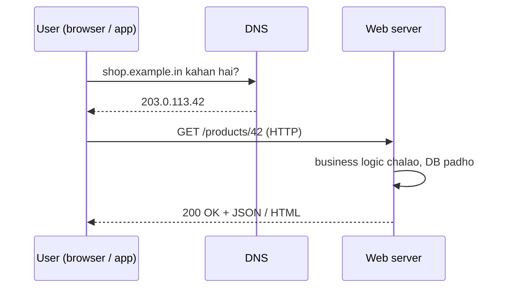

1. User domain type karta hai. **DNS** (aam taur pe Route 53 ya Cloudflare jaisi paid third-party service) usse IP address mein badalta hai.
2. Client us IP pe seedha **HTTP request** bhejta hai.
3. Server **HTML** (browser ke liye) ya **JSON** (mobile apps aur SPAs ke liye) wapas bhejta hai.

Traffic do tarah ke clients se aata hai: **web apps** (Java/Python/Go mein server-side code + browser mein HTML/JS) aur **mobile apps** (HTTP pe baat karte hain, mostly JSON — jaise `GET /products/42 → {"id":42,"name":"Kurta","price":899}`).

!!! warning "Yeh zyada din kyun nahi chalega"
    Ek machine = ek **single point of failure (SPOF)**. Woh reboot hui toh product band. Aur CPU, RAM, disk
    web app aur database dono share karte hain, toh dono aapas mein ladte hain.

---

## Stage 1 · Database alag karo

Database ko apni alag machine pe le jao. Ab **web tier** (requests handle karta hai) aur **data tier**
(data store karta hai) **alag-alag scale** ho sakte hain — jaldi hi tumhe 20 web servers chahiye honge, par primary database shayad ek hi.

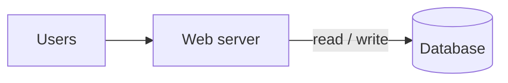

### Kaunsa database? SQL vs NoSQL

Yeh decision har design mein aayega, toh achhe se samajh lete hain.

| | Relational (SQL) | Non-relational (NoSQL) |
|---|---|---|
| **Examples** | MySQL, PostgreSQL, Oracle | Cassandra, DynamoDB, MongoDB, HBase, Redis, Neo4j |
| **Data model** | Tables, rows, fixed schema | Key-value, document, wide-column, graph |
| **Joins** | Haan, powerful SQL | Usually nahi (denormalise karte hain) |
| **Transactions** | Rows/tables ke across full ACID | Aksar ek key / ek partition tak limited |
| **Writes scale karna** | Ek primary ke aage mushkil (sharding chahiye) | Shuru se kai nodes pe partition hone ke liye bane hain |
| **Best for** | Paisa, orders, inventory — jahan relations aur integrity rules hon | Bahut bada volume, simple access patterns, flexible schema, low latency |

**Default SQL rakho.** Dashakon ki tooling aur correctness guarantees hain. NoSQL tab lo jab inme se kuch sach ho:

- Bahut bade scale pe simple lookups ke liye **bahut low latency** chahiye (session store, feature flags).
- Data **unstructured / semi-structured** hai ya schema baar-baar badalta hai (product catalog jahan har product ke attributes alag hain).
- Tum mostly key se **blobs serialize/deserialize** kar rahe ho (JSON documents).
- **Massive data** store karna hai (billions of rows, petabytes) aur joins se zyada write throughput important hai.

NoSQL ki chaar families, ek-ek line mein:

| Family | Mental model | Example use |
|---|---|---|
| **Key-value** | Ek giant distributed `HashMap<String, byte[]>` | Sessions, carts, caches (Redis, DynamoDB) |
| **Document** | Key → JSON document jiske andar query kar sakte ho | User profiles, catalogs (MongoDB) |
| **Wide-column** | Row key → columns ka sorted map, heavy writes ke liye bana | Chat messages, time series (Cassandra, HBase) |
| **Graph** | Nodes + edges, fast traversal | Social graph, recommendations (Neo4j) |

!!! interview "Interview mein"
    "NoSQL kyunki woh scale karta hai" mat bolo. Batao **access pattern** kya hai aur woh store usme kyun fit
    hota hai: *"Messages lagatar likhe jaate hain aur (channel, time range) se padhe jaate hain, isliye Cassandra
    jaisa wide-column store — channel_id se partitioned aur message_id se clustered — perfect fit hai."*

---

## Stage 2 · Vertical vs horizontal scaling

| | Vertical ("scale up") | Horizontal ("scale out") |
|---|---|---|
| **Kya** | Badi machine: zyada CPU, RAM, tez disk | Zyada machines jo load baant lein |
| **Fayde** | Ekdum simple, code change nahi, distributed-systems ki problems nahi | Practically unlimited, ek machine fail ho toh bhi chalta rahe |
| **Nuksaan** | Hard ceiling; cost tezi se badhti hai; phir bhi ek SPOF; upgrade mein downtime | Load balancing, stateless servers, data partitioning chahiye |
| **Kab** | Traffic kam/moderate ho, ya shuru mein database ke liye | Bada scale, high availability chahiye |

Vertical scaling "bura" nahi hai — database ke liye aksar pehla sahi step yahi hota hai (ek bada Postgres
box kaafi door tak le jaata hai). Par **web tier** ke liye jaldi se horizontal scaling chahiye, aur uske liye load balancer.

---

## Stage 3 · Load balancer

**Load balancer (LB)** web servers ke pool ke aage baithta hai aur requests unme baant-ta hai.

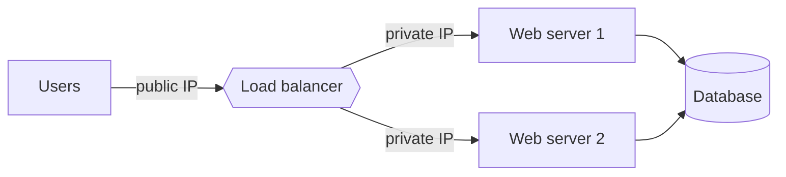

- Users ko sirf LB ka **public IP** pata hai. Servers **private IPs** pe hain (network ke andar reachable, internet se nahi) — security better.
- Server 1 mar gaya? LB ke **health checks** pakad lete hain aur sab traffic server 2 pe bhej dete hain → **failover**.
- Traffic badha? Pool mein server 3, 4, 5 daal do → LB automatically unhe use karna shuru kar deta hai.

### LB server kaise chunta hai?

| Algorithm | Kaise | Kiske liye achha |
|---|---|---|
| **Round robin** | 1, 2, 3, 1, 2, 3… | Same servers, similar requests |
| **Weighted round robin** | Bade servers ko zyada turns | Mixed hardware |
| **Least connections** | Jiske paas sabse kam active connections | Long-lived ya uneven requests (WebSockets, uploads) |
| **Least response time** | Sabse tez jawab dene waala healthy server | Latency-sensitive APIs |
| **IP hash / consistent hashing** | `hash(client IP ya key) → server` | Stickiness, cache locality |

### L4 vs L7 load balancing

- **Layer 4** (transport): sirf IP + port dekh ke route karta hai, HTTP request kabhi nahi padhta. Bahut tez, kisi bhi protocol ke saath chale. *Example:* AWS NLB.
- **Layer 7** (application): HTTP request padhta hai — path, headers, cookies — toh `/api/*` ko API servers pe aur `/static/*` ko kahin aur bhej sakta hai, TLS terminate kar sakta hai, auth aur rate limiting kar sakta hai. *Example:* NGINX, Envoy, AWS ALB.

!!! question "\"Toh kya load balancer khud single point of failure nahi hai?\""
    Haan, agar ek hi ho. Asli setups mein LBs **pairs** mein chalte hain (active-passive with floating/virtual IP,
    ya active-active), aur DNS kai LB IPs de sakta hai. Cloud ke managed LBs pehle se availability zones ke across replicated hote hain.

---

## Stage 4 · Database replication

Web tier ab failures jhel leta hai. Database nahi. **Replication** data ki copies kai servers pe rakhta hai.

Classic setup hai **leader–follower** (book purane *master–slave* words use karti hai):

- **Leader** (primary) **saare writes** leta hai — INSERT, UPDATE, DELETE.
- **Followers** (replicas) ko har change ki copy milti hai aur woh **reads** serve karte hain.
- Zyada tar apps likhne se kahin zyada padhte hain (aksar 10:1 se 100:1), toh **ek leader, kai followers**.

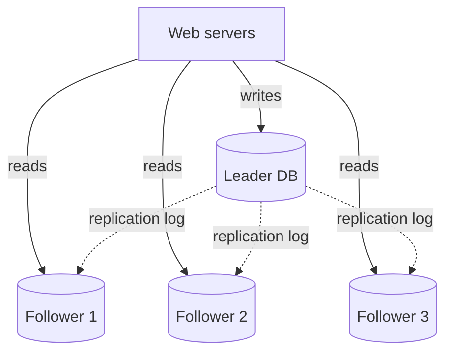

**Kya milta hai**

- **Performance** — reads kai machines pe bant jaate hain aur parallel chalte hain.
- **Reliability** — disk fail ho, ya poora data center jal jaaye, data bacha rahta hai agar replicas kahin aur hain.
- **Availability** — ek DB machine down ho toh baaki jawab dete rahte hain.

**Kuch fail ho toh kya hota hai**

- **Follower mar gaya** → reads baaki followers pe (ya kuch der leader pe); naya follower snapshot + log se banta hai.
- **Leader mar gaya** → ek follower ko **promote** karke leader banate hain (*failover*). Mushkil hissa: woh follower thoda **peeche** ho sakta hai, toh last kuch writes gayab ho sakte hain. Production systems consensus (jaise etcd mein Raft, MySQL ke liye Orchestrator) aur careful recovery use karte hain yeh decide karne ke liye ki sabse fresh kaun hai.

### Thoda gehraai mein: sync vs async replication aur lag

| Mode | Leader kiska wait karta hai… | Fayda | Nuksaan |
|---|---|---|---|
| **Synchronous** | Follower confirm kare, tab client ko "OK" | Follower kabhi peeche nahi | Ek slow follower har write slow kar deta hai |
| **Asynchronous** | Kisi ka nahi — turant reply | Tez writes | **Replication lag**: followers seconds peeche ho sakte hain |
| **Semi-sync** | Kam se kam ek follower | Achha compromise | Writes thode slow |

**Replication lag** asli bugs banata hai. Classic example — *read-your-own-writes*:

> Riya apni profile photo update karti hai (write → leader). Page reload hota hai aur ek follower se padhta hai
> jisko change abhi mila hi nahi. Usse **purani** photo dikhti hai aur woh sochti hai upload fail ho gaya.

Fixes: user ke **apne** data ko write ke baad thodi der tak leader se padho; ya replication position track karo
aur sirf un followers se padho jo catch-up kar chuke hain; ya user ke hisaab se route karo taaki user ek hi replica pe tike.

!!! tip "Leader–follower se aage"
    **Multi-leader** (kai DCs writes lete hain, phir sync karte hain) aur **leaderless** (Dynamo-style, koi bhi
    node write le sakta hai, quorum decide karta hai) bhi hote hain. Yeh simplicity deke availability lete hain,
    aur **write conflicts** laate hain. Chapter 6 (Key-Value Store) leaderless replication mein gehraai se jaata hai.

---

## Stage 5 · Cache

Har page load database ko kai baar hit karta hai. **Cache** mehnge ya baar-baar hone waale reads ke results ko
**memory mein** rakhta hai, jo disk-wale database se lagbhag **100–1000× tez** hai.

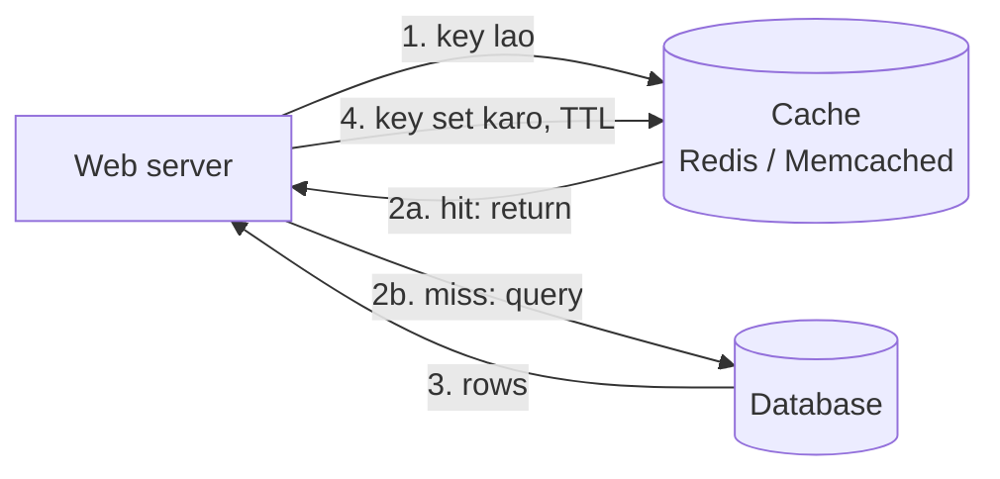

Upar waala flow — pehle cache check karo, miss pe DB padho aur cache bhar do — sabse common pattern hai. Book ise
*read-through* cache kehti hai; bahut engineers isi flow ko **cache-aside** kehte hain (application khud cache bharti hai).
Java mein:

```java
public User getUser(long id) {
    String key = "user:" + id;
    User cached = cache.get(key);              // 1. pehle cache try karo
    if (cached != null) return cached;         // 2a. hit

    User fromDb = userRepository.findById(id); // 2b. miss → database
    if (fromDb != null) {
        cache.set(key, fromDb, Duration.ofMinutes(10)); // 3. TTL ke saath bhar do
    }
    return fromDb;
}

public void updateUser(User u) {
    userRepository.save(u);         // pehle source of truth mein likho
    cache.delete("user:" + u.id()); // phir cached copy delete karo (update nahi)
}
```

### Caching strategies — poora menu

| Strategy | Read path | Write path | Kab use karein |
|---|---|---|---|
| **Cache-aside** (lazy loading) | App cache check kare, miss pe DB se laaye aur bhar de | App DB mein likhe, cache key delete kare | Read-heavy apps ka default |
| **Read-through** | Cache library khud miss pe DB se load kare | — | Loading logic cache layer mein chahiye |
| **Write-through** | — | Cache *aur* DB dono mein synchronously likho | Write ke turant baad data cache mein chahiye |
| **Write-behind** (write-back) | — | Abhi cache mein likho, baad mein batch mein DB mein flush | Bahut write-heavy, thoda loss chalega (counters, likes) |
| **Write-around** | — | Sirf DB mein likho; agle read pe cache bharega | Data ek baar likha, kam dobara padha jaata hai |

### Cache lagane se pehle kya sochna hai

1. **Kab cache karein.** Jo data **zyada padha, kam badla** jaata hai. Cache ko kabhi akeli copy mat samjho — volatile memory mein hai, restart hua toh sab gaya.
2. **Expiration (TTL).** Iske bina stale data hamesha pada rahega aur memory bhar jaayegi. Bahut chhota → DB ko baar-baar reload se pareshan karoge; bahut lamba → users ko purana data dikhega. Minutes se hours typical hai; har data type ke liye tune karo.
3. **Consistency.** DB write aur cache update **ek transaction nahi** hain, toh drift ho sakta hai (khaaskar regions ke across). Write pe key delete karna (upar jaisa) update karne se safe hai, kyunki do concurrent updates galat value nahi chhod sakte. Facebook ka *Scaling Memcache* paper isi mushkil ka classic reference hai.
4. **Failure.** Ek cache server = SPOF. Kai chalao (zones / DCs ke across) aur **memory over-provision** karo taaki node loss ya growth spike pe mass eviction na ho.
5. **Eviction policy.** Memory full hui toh kuch toh hatega:
    - **LRU** (least recently used) — usual default.
    - **LFU** (least frequently used) — jab popularity stable ho tab better.
    - **FIFO** — sabse simple, rarely best.

!!! danger "Cache stampede (thundering herd)"
    Ek hot key (jaise home-page feed) expire hui. 10,000 requests ek saath miss hui aur **sab** ek saath database pe
    gir padi — DB gir gaya. Fixes: sirf ek request ko key rebuild karne do (lock ya *single-flight*), jab tak ek
    worker refresh kare tab tak stale value serve karo, aur TTLs mein **random jitter** daalo taaki saari keys same second pe expire na hon.

---

## Stage 6 · Content Delivery Network (CDN)

Images, videos, CSS aur JS **static** hain — har user ke liye same bytes. Inhe web servers se serve karna unka
CPU aur bandwidth barbaad karta hai aur door ke users ke liye slow hai. **CDN** duniya bhar mein phaile servers ka
network hai (**edge locations**) jo static content users ke paas cache karta hai.

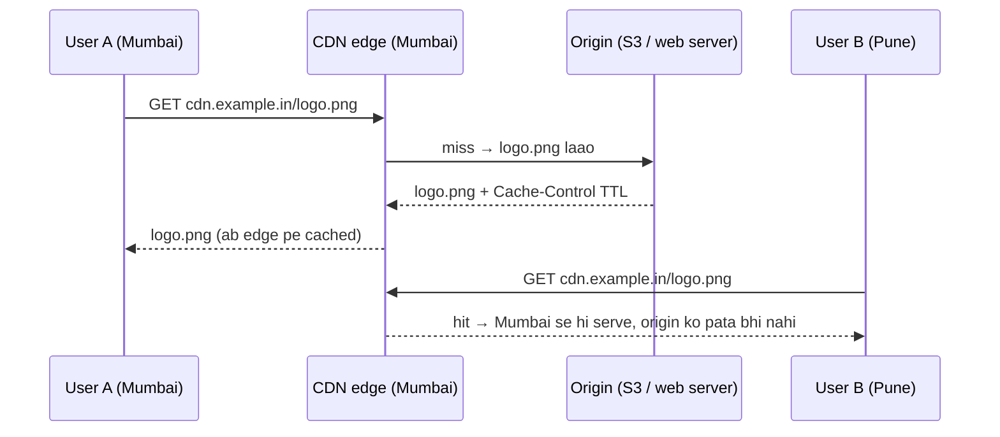

- URL CDN ke domain ki taraf point karta hai (jaise `cdn.example.in/...`, jo CDN provider pe mapped hai).
- **Miss** pe edge **origin** (tumhara server ya S3) se laata hai, origin ke bataye **TTL** tak cache karta hai, aur return karta hai.
- Us region ki har agli request TTL khatam hone tak **hit** hai.

**Pull vs push CDN.** *Pull* (upar waala) pehli request pe lazily laata hai — easy, zyada tar sites ke liye achha.
*Push* matlab tum content pehle se CDN pe upload karte ho — badi files ke liye kaam ka jo popular hone waali hain (nayi movie release).

**Kya sochna hai**

- **Cost** — per GB transfer ka paisa lagta hai. Kam access hone waali files CDN pe mat daalo.
- **Expiry** — time-sensitive content ko sensible TTL chahiye.
- **CDN outage** — client/app origin pe fall back kar sake.
- **Invalidation** — file jaldi hatani hai toh vendor ki invalidation API call karo, ya better, **versioned URLs** use karo (`app.css?v=42` ya `app.3f9a1c.css`). Naya URL = naya object, toh invalidate karne ko kuch bacha hi nahi.

Stage 5 aur 6 ke baad web servers static files serve nahi karte, aur DB cache ke peeche protected hai.

---

## Stage 7 · Stateless web tier

Web servers ko freely add/remove karne ke liye (auto-scaling), **koi bhi web server user ka state (jaise session) nahi rakh sakta**.

**Stateful** — user A ka session server 1 ki memory mein hai. A ki har request **server 1 pe hi** jaani chahiye.
LBs yeh **sticky sessions** se kar lete hain, par phir servers add/remove karna ya ek server khona sessions tod deta hai,
aur load uneven bant-ta hai.

**Stateless** — session data ek **shared store** mein hai (Redis, NoSQL DB, ya RDBMS). Koi bhi server koi bhi request
le sakta hai; servers interchangeable "cattle" hain, "pets" nahi.

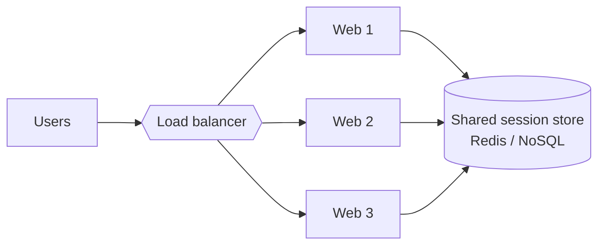

Ab **auto-scaling** bachchon ka khel hai: *"agar average CPU 5 minute tak 70% se upar ho toh 2 servers add karo"* jaisa
rule seedha kaam karta hai, kyunki naye server ko purane servers se kuch nahi chahiye.

!!! tip "Thoda gehraai mein: sessions ki jagah tokens"
    Stateless hone ka ek aur tareeka hai state ko **client mein** rakhna: ek signed token (jaise JWT) jo har server
    shared key se verify kar sake, bina kisi lookup ke. Trade-off: token ko expiry se pehle revoke karna mushkil hai,
    isliye aksar short expiry + chhoti revocation list ke saath use hota hai.

---

## Stage 8 · Multiple data centers

Jab users duniya bhar mein phail jaate hain, ek data center ka matlab door ke users ke liye high latency, aur woh DC
fail hua toh total outage. Toh hum **do ya zyada** chalate hain.

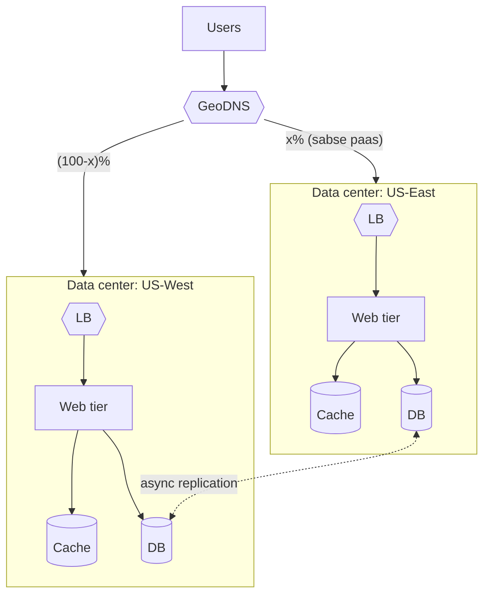

- **GeoDNS** user ki location ke hisaab se domain ko alag IP mein resolve karta hai, aur usse sabse paas waale DC pe bhejta hai.
- DC2 down hua toh DNS **100%** traffic DC1 pe bhej deta hai.

Mushkil kya hai:

1. **Traffic redirection** — users ko steer karne aur jaldi failover karne ke tools (GeoDNS, anycast, global LBs). DNS caching ki wajah se failover instant nahi hota; TTLs kam rakho.
2. **Data synchronisation** — failover ke baad user jis DC mein pahunche, wahan uska data pehle se hona chahiye. Data **DCs ke across** replicate hota hai, usually **asynchronously** (toh disaster mein kuch seconds ke writes kho sakte hain). Netflix ka active-active multi-region setup famous example hai.
3. **Testing aur deployment** — har DC mein same code aur config chalna chahiye. Automated deployment zaroori hai.

**Active-passive vs active-active:** active-passive mein doosra DC warm standby hai. Active-active mein dono live
traffic serve karte hain — better utilisation aur tez failover, par same data pe do jagah concurrent writes handle karne padte hain.

---

## Stage 9 · Message queue

Kuch kaam slow hote hain (images resize karna, emails bhejna, video transcode karna) aur unhe user ki request block
nahi karni chahiye. **Message queue** services ke beech ek durable buffer hai jo **asynchronous** communication enable karta hai.

- **Producers** messages queue mein publish karte hain.
- **Consumers** messages uthate hain aur kaam karte hain.
- Dono ko ek hi time pe zinda hone ki zaroorat nahi → **decoupling**.

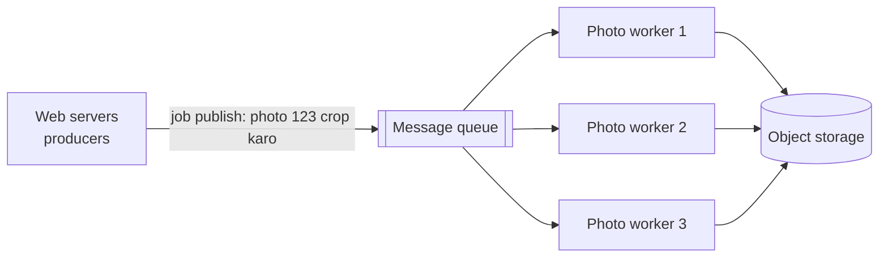

**Example:** ek photo app users ko crop, sharpen, blur karne deta hai. Web server bas queue mein job daal deta hai aur
turant "processing…" reply kar deta hai. Workers apni speed se jobs uthate hain. Queue badhi toh workers add karo;
mostly khaali rehti hai toh kuch hata do. Producers aur consumers **alag-alag scale** hote hain.

### Thoda gehraai mein

- **Delivery guarantees.** *At-most-once* (message kho sakta hai), *at-least-once* (duplicate ho sakta hai — common default), *exactly-once* (mehenga, limited). At-least-once ke saath consumers ko **idempotent** banao: same message do baar process ho toh bhi nuksaan na ho (message ID se dedupe).
- **Queue vs log.** RabbitMQ/SQS-style queues consume hone ke baad message delete kar dete hain. **Kafka** ek log hai: messages retain hote hain, consumers apna offset track karte hain, kai consumer groups same stream replay kar sakte hain.
- **Backpressure.** Queue depth key metric hai — depth badh rahi hai matlab consumers peeche reh gaye. Yeh auto-scaling ka natural signal bhi hai.
- **Dead-letter queue (DLQ).** Jo messages baar-baar fail hote hain unhe side mein kar do, taaki baaki sab block na ho.

---

## Stage 10 · Logging, metrics, automation

Kuch servers pe yeh nice-to-have hain. Is scale pe zaroori.

- **Logging** — har server ke error logs ek searchable jagah collect karo (ELK / OpenSearch, Loki, Cloud Logging).
- **Metrics** teen levels pe:
    - *Host*: CPU, memory, disk I/O, network.
    - *Aggregated/service*: DB tier latency, cache hit ratio, queue depth, error rate.
    - *Business*: daily active users, retention, revenue, sign-ups.
- **Automation** — CI (har commit automatically build aur test), CD (automated, repeatable deploys), infrastructure as code.

!!! tip "Four golden signals"
    Kisi bhi service ke liye dekho **latency**, **traffic**, **errors** aur **saturation**. Interview mein inka naam
    loge toh lagega tumne production systems chalaye hain.

---

## Stage 11 · Database scale karna: sharding

Data badhta ja raha hai, aur akela leader overloaded hai. Phir se do options.

**Vertical:** ek monster database server khareed lo. Cloud providers **terabytes RAM** waali machines dete hain, aur
Stack Overflow saalon tak ~10M monthly visitors ke saath ek hi primary database pe chala. Par: hardware ki hard limit,
phir bhi SPOF, aur bahut mehenga.

**Horizontal = sharding:** data ko kai databases (**shards**) mein tod do. Har shard ka **schema same** hai par har
ek mein rows ka **alag subset** hai.

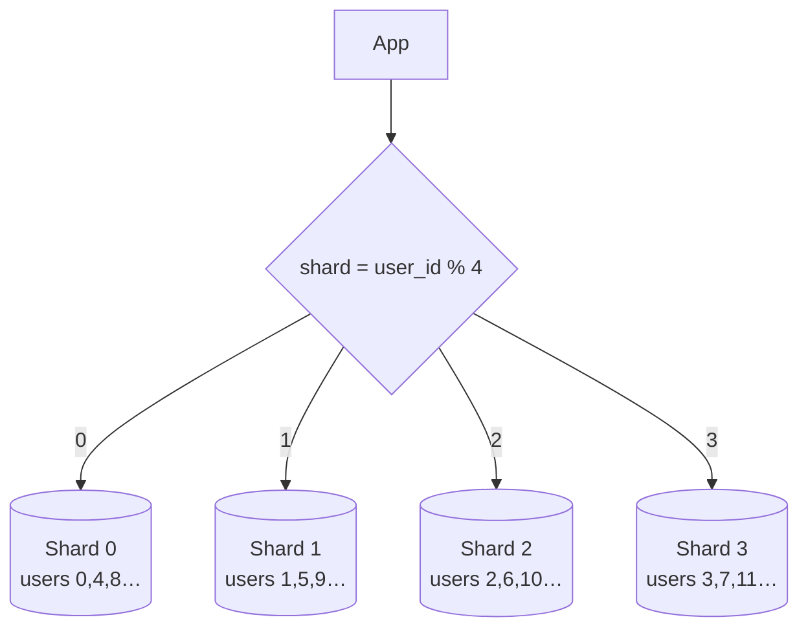

### Shard key chunna (sabse important decision)

**Shard key** (partition key) decide karti hai row kis shard pe jaayegi. Achhi key:

1. **Data barabar baant-ti hai** (high cardinality, koi skew nahi).
2. **Main query se match karti hai** — common request **ek** shard pe jaaye, saare shards pe nahi.
3. **Kam badalti hai** — row ko ek shard se doosre pe le jaana mehenga hai.

Common sharding strategies:

| Strategy | Kaise | Fayda | Nuksaan |
|---|---|---|---|
| **Hash-based** | `hash(key) % N` (ya consistent hashing) | Barabar spread | Range queries saare shards pe; N badla toh zyada data hilta hai |
| **Range-based** | `A–F` → shard 1, `G–M` → shard 2 … ya date se | Range scans saste | Hotspots (saara naya data latest shard pe) |
| **Directory / lookup** | Ek table key → shard map karti hai | Flexible, rebalance easy | Lookup service extra infra + SPOF ho sakti hai |
| **Geo-based** | India ke users → shard IN | Data locality, data-residency laws | Sizes uneven |

### Sharding jo nayi problems laati hai

1. **Resharding.** Ek shard bhar gaya (growth) ya kuch shards jaldi bhar gaye (skew) → sharding function badalna padega aur **data move** karna padega. `% N` ke saath N badla toh lagbhag sab relocate hota hai. **Consistent hashing** (Chapter 5) sirf ~1/N keys move karke yeh fix karta hai.
2. **Celebrity / hotspot problem.** Virat Kohli, Shah Rukh Khan aur Taylor Swift ek hi shard pe aa gaye toh reads se woh pighal jaayega. Fixes: hot keys ko **dedicated shards** do, hot key ko aur tod do (jaise `celebrity_id#1..#10`), aur aggressively cache karo.
3. **Shards ke across joins aur transactions.** Shards ke across SQL join slow ya impossible hai, aur cross-shard transactions ko two-phase commit chahiye. Common workaround: **denormalise** — data aise store karo ki har query ek shard ki ek table se answer ho jaaye.

Aakhir mein, jo workloads ko relational features nahi chahiye (activity logs, session data, counters) unhe **NoSQL**
stores mein le jao taaki relational database ka load kam ho.

---

## Final picture

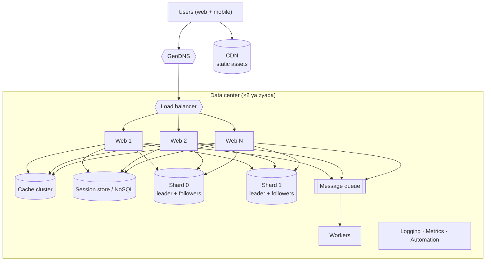

**Scaling checklist** (yaad kar lo — aage ke har chapter ki vocabulary yahi hai):

- [x] Web tier **stateless** hai; state shared stores mein hai.
- [x] **Har tier pe redundancy** — koi important cheez sirf ek machine pe nahi chalti.
- [x] Reads aggressively **cache** karo; **static assets CDN pe**.
- [x] Databases **replicate** karo; ek leader kaafi na ho toh **shard** karo.
- [x] Geo-routing aur failover ke saath **multiple data centers**.
- [x] Queues se **decouple** karo; badi apps ko **independent services** mein todo.
- [x] **Sab kuch monitor** karo aur builds, tests, deploys **automate** karo.

---

## Trade-offs ek nazar mein

| Technique | Kya milta hai | Kya dena padta hai |
|---|---|---|
| Load balancer | Availability, horizontal scale | Ek extra hop; LB khud redundant hona chahiye |
| Replication | Read scale, durability, failover | Replication lag, failover complexity |
| Cache | Latency, DB ka load kam | Staleness, invalidation bugs, stampedes |
| CDN | Global latency, origin ka load kam | Per GB cost, invalidation |
| Stateless tier | Easy auto-scaling, resilience | Ek shared state store chalana padta hai |
| Multi-DC | Disaster tolerance, kam global latency | Cross-DC sync, failover pe data loss possible, ops cost |
| Message queue | Decoupling, spikes smooth | Results baad mein, duplicates, ek aur system |
| Sharding | Write + storage scale | Resharding, hotspots, cross-shard joins/transactions nahi |

---

## Interviewer follow-ups

??? question "Tumhare read replicas 5 second peeche hain. User post edit karta hai aur turant purana version dekhta hai. Kya karoge?"
    Yeh async replication lag se hone waali **read-your-own-writes** problem hai. Options:
    (1) user ke write ke baad kuch seconds tak **usi user ke** reads leader pe bhejo;
    (2) write ke time leader ki log position note karo aur sirf un replicas se padho jo wahan tak pahunch gaye;
    (3) client-side state optimistically update kar do taaki UI naya version dikhaye.
    Batao ki replication ko synchronous karna bhi fix karega, par write latency aur availability kharab hogi.

??? question "Cache poora down ho gaya. Kya hoga aur database ko kaise bachaoge?"
    Har read DB read ban jaata hai — DB pe normal se 10–50× load aa sakta hai aur woh gir sakta hai (cascading failure).
    Bachav: cache ko zones ke across **replicated cluster** ki tarah chalao; DB ke raaste pe **circuit breaker / rate limit**
    lagao; full traffic bhejne se pehle naye cache ko **warm** karo; poora fail hone ki jagah degraded response do (jaise thoda stale feed).

??? question "Update pe cache key delete kyun karte ho, nayi value kyun nahi likhte?"
    Do concurrent writers interleave ho sakte hain: A ne DB=1 likha, B ne DB=2 likha, B ne cache=2 set kiya, A ne cache=1
    set kiya → cache mein ab stale value hai **aur expiry door tak nahi**. Delete idempotent hai aur order se fark nahi padta:
    agla reader sahi value reload kar lega. (Concurrent reader ke saath chhota sa race ab bhi hai; TTL damage limit karta hai.)

??? question "E-commerce orders table ke liye shard key kaise chunoge?"
    Dominant queries dekho: "meri orders dikhao" (`user_id` se) aur "order X do" (`order_id` se). `user_id` se shard karne
    se user ki saari orders ek shard pe rehti hain (fast history page, scatter-gather nahi). Phir order ID mein shard embed
    kar do (ya chhota `order_id → user_id` lookup rakho) taaki direct lookup bhi ek shard pe jaaye. Bade B2B customers ka
    skew dhyaan rakho — unhe apna shard chahiye ho sakta hai.

??? question "Cache kab NAHI lagaoge?"
    Jab data **write-heavy** ho ya lagbhag har read pe badalta ho (hit ratio kam), jab **strong consistency** chahiye aur
    staleness chalegi hi nahi (transfer ke time account balance), ya jab DB already latency target meet kar raha ho — cache ek
    aur system aur bugs ki ek nayi category laata hai.

??? question "Sticky sessions vs shared session store — kaunsa aur kyun?"
    Shared store. Sticky sessions server fail hone pe toot jaate hain (users logout ho jaate hain), scale-in painful banate
    hain, aur load skew karte hain. Shared store (Redis cluster) har request pe ~1 ms add karta hai par servers interchangeable
    bana deta hai. Sticky sessions sirf short-lived, dobara banne waale state ke liye ya cache-locality optimisation ke liye theek hain.

---

## Common mistakes

!!! warning "Inse bacho"
    - 1,000 users waale system ke liye seedha "microservices + Kafka + Cassandra" pe kood jaana. **Bataye gaye requirements tak scale karo.**
    - Cache add karna bina bataye ki **kya** cache hoga, **TTL** kya hai, aur **invalidate** kaise hoga.
    - "Replicas add karo" bolna bina **replication lag** aur usse kya tootta hai bataye.
    - **Shard key** ka naam liye bina aur main query se justify kiye bina sharding karna.
    - Bhool jaana ki **load balancer, cache aur queue** ko bhi redundancy chahiye.
    - Cache ko database samajhna (data sirf memory mein).

---

## Practice

??? example "Practice 1 — Steps ka order"
    Ek startup ka single server 90% CPU pe hai. Database aur app same box pe hain, saari images app serve karta hai,
    aur sessions server memory mein hain. Pehle **chaar** changes kis order mein karoge, aur kyun?

    **Solution.**
    1. **DB ko alag machine pe le jao** — sabse bada turant relief; app aur DB ladna band.
    2. **Static images CDN / object storage pe daalo** — app se bandwidth aur CPU ka bada hissa hat jaata hai.
    3. **Sessions Redis mein le jao** — web tier stateless ho jaata hai, jo agle step ki shart hai…
    4. **Load balancer + doosra web server** — horizontal scale aur web tier mein koi SPOF nahi.
    (Phir: DB ke aage cache, phir read replicas.)

??? example "Practice 2 — Cache sizing"
    Product catalog mein 50M products hain, average 2 KB each. 80% traffic top 10% products pe aata hai.
    Hot set cache karne ke liye kitni memory? 64 GB ke kitne cache nodes (30% headroom rakho)?

    **Solution.** Hot set = 10% × 50M = 5M products × 2 KB = **10 GB**. Overhead ke saath (keys, data-structure
    metadata, fragmentation ~1.5×) ≈ 15 GB. 30% headroom → ~21 GB. **Ek** 64 GB node mein fit, par **kam se kam
    2–3** nodes chalao (replicas / zones ke across) taaki ek node fail ho toh sab DB pe na gire.

??? example "Practice 3 — Hot shard"
    Tum tweets ko `user_id` se shard karte ho. 100M followers waala celebrity post karta hai aur uske shard ka CPU reads
    se 100% ho jaata hai. Teen mitigations batao.

    **Solution.** (1) Celebrity ke recent tweets ko replicated cache tier mein **cache** karo taaki reads shard tak kam
    pahunchein. (2) Us hot shard ke liye specially **read replicas** badhao. (3) **Hot key tod do** — celebrity ko dedicated
    shard pe le jao, ya key ko salt karo (`user_id#0..#9`) taaki data kai shards mein phaile aur read pe fan-in karo.
    (Bonus: feeds ke liye celebrities ka fan-out-on-read path — Chapter 11 dekho.)

??? example "Practice 4 — Availability ka hisaab"
    Tumhari app ko LB, web tier aur DB teeno up chahiye. Har ek 99.9% available hai. Overall availability kya hai?
    Agar automatic failover ke saath do independent DB replicas chalao toh kya badlega?

    **Solution.** Series mein: 0.999³ ≈ **99.7%** (~26 ghante downtime/saal). Do DBs parallel mein: 1 − (0.001)² =
    99.9999%, toh total ≈ 0.999 × 0.999 × 0.999999 ≈ **99.8%**. **Har** tier pe redundancy hi number badhati hai —
    [Chapter 2](02-back-of-the-envelope.md) ke widget mein try karo.

---

## Revision checklist

- [ ] DNS lookup se JSON response tak ek request trace kar sakta hoon.
- [ ] SQL vs NoSQL ko buzzwords se nahi, **access patterns** se samjha sakta hoon, aur chaar NoSQL families bata sakta hoon.
- [ ] Pata hai vertical scaling kyun deewar se takrata hai aur horizontal scaling ko kya chahiye.
- [ ] 4 load-balancing algorithms aur L4 vs L7 samjha sakta hoon.
- [ ] Leader–follower replication, failover, aur **replication lag** example ke saath samjha sakta hoon.
- [ ] Cache-aside code likh sakta hoon aur 5 caching strategies compare kar sakta hoon; TTL, eviction, stampede fixes pata hain.
- [ ] CDN content kaise serve karta hai, pull vs push, aur versioned URLs invalidation se better kyun hain — pata hai.
- [ ] Web tier stateless kyun hona chahiye, samjha sakta hoon.
- [ ] Multi-DC setup aur uski teen mushkil problems bata sakta hoon.
- [ ] Message queue kya deta hai, delivery guarantees, aur consumers idempotent kyun hone chahiye — pata hai.
- [ ] Sharding strategies compare kar sakta hoon, shard key chun sakta hoon, aur resharding, hotspots, joins samjha sakta hoon.

[Aage: 02 · Back-of-the-Envelope Estimation :material-arrow-right:](02-back-of-the-envelope.md){ .md-button .md-button--primary }
