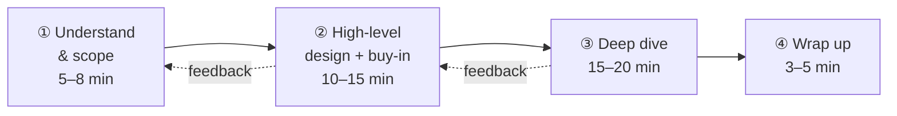
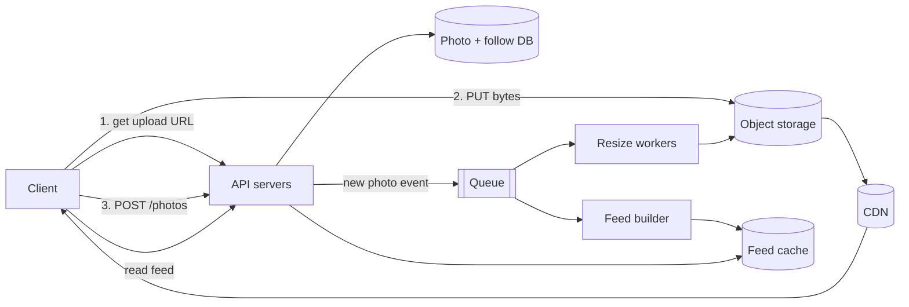

# 03 · A Framework for System Design Interviews

<div class="chapter-meta" markdown>
<span>⏱ 35 min read</span>
<span class="hot">🔥 The method you'll reuse in every case study</span>
<span>Book: Chapter 3</span>
</div>

!!! abstract "TL;DR"
    - The interview simulates **two colleagues solving a vague problem together**. The process matters more than the final diagram.
    - Use 4 steps: **(1) understand & scope** (~5–8 min) → **(2) high-level design + buy-in** (~10–15 min) → **(3) deep dive** (~15–20 min) → **(4) wrap up** (~3–5 min).
    - **Never jump to a solution.** Ask about features, users, scale, growth, constraints. Write the answers down.
    - Let the interviewer steer the deep dive, but come prepared with **the 2–3 hardest parts** of the problem.
    - Red flags: over-engineering, silence, stubbornness, ignoring trade-offs, getting lost in trivia.

## What the interviewer is really evaluating

Nobody expects you to design YouTube in 45 minutes — thousands of engineers took years. So what is being tested?

| Signal | What it looks like when you're strong |
|---|---|
| **Handling ambiguity** | You turn "design a chat app" into a crisp, agreed scope with numbers. |
| **Asking good questions** | Your questions change the design ("1:1 only, or groups of 500?"). |
| **Technical design** | Sensible components, clear data flow, correct use of caches/queues/DBs. |
| **Trade-off thinking** | You name alternatives and say *why* you picked one — and what it costs. |
| **Depth** | When pushed on one component, you can go 2–3 levels deeper. |
| **Communication & collaboration** | You think out loud, check in, take hints gracefully. |
| **Pragmatism** | You design for the stated scale, not for Google-scale by default. |

!!! danger "Red flags interviewers write down"
    - **Over-engineering** — 12 microservices and Kafka for 10K users. Complexity has real, compounding costs.
    - **Jumping to a solution** before understanding the problem.
    - **Narrow-mindedness / stubbornness** — defending a choice after a clear counter-argument.
    - **Long silences** — the interviewer can't score what they can't hear.
    - **Buzzword soup** — "we'll use microservices and NoSQL for scalability" with no reason.

---

## The 4-step framework



Times assume a 45-minute session. The arrows going back matter: you'll often revise the scope or the
high-level design as you learn more — that's normal and good.

---

## Step 1 · Understand the problem and establish scope

**Don't be the student who blurts out the answer first.** In a design interview, speed without understanding
is a negative signal. Slow down, ask, and write the answers on the board.

When you ask, the interviewer either answers or says "you decide". If it's the latter, **state an assumption
and write it down** — you'll refer back to it.

### The question bank

Pick the relevant ones — don't machine-gun all of them.

=== "Features (functional)"

    - What are the **core features** we must build? What's explicitly out of scope?
    - Who are the **users** — consumers, businesses, internal teams? Web, mobile, or both?
    - What's the most important **user journey**? (e.g. "post a photo" and "see my feed")
    - Any special requirements: search? notifications? analytics? edits/deletes?

=== "Scale"

    - How many **users** (MAU/DAU)? How many are **concurrent**?
    - **Read:write ratio**? Size of a typical object?
    - How fast are we **growing**? Expected scale in 3 / 6 / 12 months?
    - Is traffic **spiky** (sales, live events) or smooth? Global or one region?

=== "Quality (non-functional)"

    - **Latency** target? (e.g. p99 < 200 ms for reads)
    - **Availability** target? Is it OK to be briefly down, or briefly stale?
    - **Consistency** — must every read see the latest write? (bank balance vs like count)
    - **Durability** — can we ever lose data? How long do we keep it?

=== "Constraints"

    - Existing **tech stack** or services we can reuse (auth, payments, a blob store)?
    - Budget / cost sensitivity? On-prem or cloud?
    - Legal: data residency, privacy (GDPR / DPDP), content moderation?

### Turn answers into a requirements sheet

Here's how a short scoping conversation for **"design a photo-sharing app"** might go — notice that each
answer deletes a branch of the design:

!!! example "A good scoping conversation (photo sharing)"
    **You:** Who's posting — anyone, or verified creators only? — **Interviewer:** Anyone.
    **You:** Core actions? — **I:** Upload a photo with a caption, follow people, scroll a home feed.
    **You:** Is the home feed ranked or chronological? — **I:** Chronological for now.
    **You:** How big? — **I:** 50M DAU; a typical user uploads every few days but opens the feed ~8 times a day.
    **You:** Max photo size, and do we keep originals? — **I:** Up to 10 MB; keep originals plus resized versions.
    **You:** Any users with huge followings? — **I:** Yes, some accounts have tens of millions of followers.

    "Chronological" removes a ranking service. "Tens of millions of followers" warns you that pure fan-out-on-write
    will hurt. "Keep originals + resized" means an async image-processing pipeline, object storage and a CDN.

Write the result on the board — it's your contract with the interviewer:

```text
FUNCTIONAL
  1. Upload photo (≤10 MB) + caption
  2. Follow / unfollow
  3. Home feed of followed accounts, newest first
NON-FUNCTIONAL
  - 50M DAU; feed p99 < 300 ms; uploads may take a few seconds to appear
  - Availability over consistency for the feed; never lose an uploaded photo
OUT OF SCOPE
  - Ranking, stories, DMs, ads
ESTIMATES (Ch. 2)
  - Feed loads ≈ 50M × 8 / 10^5 = 4K QPS avg, ~10K peak
  - Uploads ≈ 50M × 0.3 / 10^5 = 150/s; 15M/day × ~3 MB stored (orig + sizes) ≈ 45 TB/day
```

---

## Step 2 · Propose a high-level design and get buy-in

Goal: a **blueprint both of you agree on** before going deep.

1. **Sketch the boxes**: clients → (DNS/CDN) → load balancer → services → cache → databases → queues/workers → object storage.
2. **Walk a request through it** — "a user uploads: the app gets a pre-signed URL, uploads straight to blob storage, then calls `POST /photos`…" Concrete use cases expose missing pieces.
3. **Sanity-check against your estimates** — "10K QPS of feed reads at peak — fine for a cache-backed feed service."
4. **Ask for feedback** — "Does this direction make sense before I go deeper?" Treat the interviewer as a teammate.

### APIs and data model — include them?

Depends on the problem. For "design web search" it's too low-level. For "design a URL shortener" or
"a multiplayer game backend", the API and schema *are* the design. When in doubt, sketch the 2–4 core APIs:

```http
POST /v1/photos/upload-url  → 200 { upload_url, photo_id }     # pre-signed URL to object storage
POST /v1/photos             { photo_id, caption }  → 201
GET  /v1/feed?cursor=...    → 200 { items[], next_cursor }
```

and the 2–3 core tables:

```text
users(user_id PK, handle, ...)
photos(photo_id PK, owner_id, caption, storage_key, created_at)
follows(follower_id, followee_id, created_at)   PK(follower_id, followee_id)
```

### Example: the photo-sharing high-level design



The upload path and the feed path are separate, and heavy work (resizing, feed building) happens
asynchronously behind a queue. That's enough detail to get agreement — Chapter 11 goes deep on feeds.

---

## Step 3 · Design deep dive

By now you've agreed on scope, drawn the blueprint, and received feedback. Now go deep where it matters.

**How to choose what to dive into:**

1. **Follow the interviewer's lead.** If they ask "how would the fan-out work for a celebrity?", that's your deep dive.
2. **Otherwise, pick what's unique to this problem** — the part that makes it *this* system and not a generic CRUD app:

| Problem | Typical deep dives |
|---|---|
| URL shortener | Hash/encode function, collisions, 301 vs 302, cache |
| Rate limiter | Algorithm choice, distributed counters, race conditions |
| Chat | WebSockets, message ordering/IDs, online presence, multi-device sync |
| News feed | Fan-out on write vs read, celebrity problem, feed cache |
| Web crawler | URL frontier (politeness + priority), dedup, traps |
| YouTube | Upload + transcoding pipeline, CDN cost, streaming protocols |
| Google Drive | Block-level sync, conflict resolution, consistency, notifications |

3. **Seniority changes the focus.** Junior: correct components and data flow. Senior: bottlenecks, capacity numbers, failure modes, operational concerns, cost.

**Time management:** it's easy to burn 10 minutes on something that shows nothing (e.g. explaining a ranking
algorithm's maths in detail). Keep asking yourself: *does this demonstrate that I can design a scalable system?*

---

## Step 4 · Wrap up

The interviewer may ask open-ended follow-ups or let you choose. Use these to show breadth:

- **Bottlenecks & improvements** — "The single fan-out queue is the bottleneck; I'd partition it by user_id." Never claim the design is perfect.
- **Recap** — 30 seconds summarising the design and the key trade-offs. Especially valuable if you went down several paths.
- **Failure cases** — server crash, network partition, cache loss, DC outage. What degrades, what's lost?
- **Operations** — metrics, logging, alerting, deployment/rollback.
- **Next 10× of scale** — "At 100M DAU I'd shard the post DB by post_id and add a second region."
- **Other refinements** — security, abuse/rate limiting, cost.

---

## Habits that score well — and ones that cost you

<div class="grid" markdown>

!!! success "Habits that score"
    - Treat every assumption as a question until the interviewer confirms it.
    - Say the requirements back before drawing anything.
    - Remember the "right" design depends on context — a 5-person startup and a hyperscaler make different calls.
    - Narrate your reasoning; the interviewer grades what they hear.
    - When there's a real fork, name both paths, pick one, and say what it costs.
    - Once the blueprint is agreed, spend time on the riskiest component first.
    - Use the interviewer as a collaborator — their hints are free signal.
    - Keep going when stuck; reasoning out loud still earns credit.

!!! failure "Habits that cost you"
    - Showing up without having practised the common problems.
    - Drawing before asking.
    - Polishing one box in detail while the rest of the system is still blank.
    - Sitting stuck in silence instead of asking for a nudge.
    - Treating the first diagram as "done" — keep checking in until the interviewer closes the session.

</div>

---

## A full mock walkthrough: "Design Pastebin"

A compressed example of all four steps, so you can hear the rhythm.

??? example "Step 1 — Scope (6 min)"
    **You:** Users paste text and get a shareable link — is that the core? Do we need accounts, editing, syntax highlighting?
    **I:** Core is paste + share link. Optional expiry. No editing. Accounts optional.
    **You:** Size limit per paste? — **I:** 1 MB max, most are a few KB.
    **You:** Scale? — **I:** 5M new pastes/day, reads 10× writes.
    **You:** Must links work forever? — **I:** Default expiry 1 year, user can choose shorter.

    *Board:* FR: create paste (≤1 MB, optional expiry), read by link. NFR: high read availability, low read latency,
    pastes are immutable. Estimates: writes 5M/10⁵ ≈ 60 QPS; reads ≈ 600 QPS (peak ~1.5K). Storage: 5M × 10 KB avg
    = 50 GB/day → 18 TB/year.

??? example "Step 2 — High-level design (12 min)"
    ```mermaid
    flowchart LR
        C[Client] --> LB{{LB}} --> API[Paste service]
        API -->|metadata| DB[(Metadata DB<br/>id, s3_key, expiry, owner)]
        API -->|content| S3[(Object storage)]
        API --> R[(Cache: hot pastes)]
        CL[Cleanup job] --> DB & S3
    ```
    `POST /pastes {content, expiry}` → generate a 7-char ID (base-62 of a unique ID — see Ch. 7/8), store content in
    object storage, metadata in DB, return the link. `GET /{id}` → cache → DB → object storage. Immutable data =
    trivially cacheable; put popular pastes behind a CDN.
    **You:** "Does this look right? I'd like to dive into ID generation and expiry next."

??? example "Step 3 — Deep dive (18 min)"
    - **ID generation:** random 7-char base-62 has 3.5 T space; with 1.8 B IDs/year, collision chance per insert is tiny
      but non-zero → use a unique numeric ID (Snowflake/ticket range) then base-62 encode → **no collisions, no DB check**.
    - **Expiry:** store `expires_at`; reads check it (lazy delete); a daily batch job deletes expired rows and S3 objects.
      Use S3 lifecycle rules for bulk cleanup.
    - **Hot pastes:** a paste shared on social media gets 100K hits in minutes → CDN with `Cache-Control: max-age` set
      to min(remaining expiry, 1 day).
    - **Abuse:** rate limit creates per IP (Ch. 4); size limit at the LB.

??? example "Step 4 — Wrap up (4 min)"
    "To recap: stateless paste service, metadata in a sharded KV/SQL store keyed by paste_id, content in object storage,
    cache + CDN for reads. Bottleneck at 10× would be metadata writes → shard by paste_id. Failure: if object storage is
    slow, we serve from cache/CDN; we'd monitor p99 read latency, 4xx/5xx, cache hit ratio. Next I'd add analytics via
    an async event stream."

---

## Phrases that help

| Situation | Say something like |
|---|---|
| Starting | "Before designing, I'd like to clarify a few requirements." |
| Assuming | "I'll assume X — let me write that down; tell me if it's off." |
| Choosing | "Two options here: A and B. A gives us…, costs us…; given our read-heavy load I'd pick A." |
| Checking in | "Does this level of detail work, or should I go deeper somewhere?" |
| Stuck | "I'm not sure about the best approach here — let me reason through it out loud." |
| Taking a hint | "Good point — that changes things. Let me revise this part." |
| Wrapping up | "Let me recap the design and the main trade-offs, then talk about bottlenecks." |

---

## Practice

??? example "Practice 1 — Write the scope"
    Prompt: *"Design a parking-lot reservation system for a city."* Write 6 clarifying questions and a requirements sheet
    (FR, NFR, out of scope) with assumed numbers.

    **Sample answer.** Questions: Which users — drivers, lot operators, both? Reserve ahead or only real-time?
    How many lots/spots? Peak times? Payments in scope? Must a reserved spot be guaranteed (no double booking)?
    *FR:* search spots by location/time, reserve, cancel, pay; operators manage inventory. *NFR:* **strong consistency on
    booking** (no double-booking), search can be slightly stale, p99 search < 300 ms. *Out:* dynamic pricing, navigation.
    *Numbers:* 2,000 lots × 200 spots = 400K spots; 1M reservations/day → ~12 writes/sec avg, peaks 10× at office hours.

??? example "Practice 2 — Spot the red flags"
    A candidate, given "design a URL shortener for an internal company tool (5K employees)", proposes Kafka, Cassandra,
    Kubernetes with 20 microservices, and a multi-region active-active setup. What feedback would you give?

    **Answer.** Over-engineering for the stated scale (5K users → a few QPS). A single service + Postgres + a small cache
    is enough, with backups. Complexity adds cost and failure modes. They should have estimated first and scaled the
    design to the numbers, while mentioning how they'd evolve it if usage grew.

??? example "Practice 3 — Choose the deep dives"
    For "design a ticket-booking system for concerts (like BookMyShow)", which 2–3 areas would you deep dive and why?

    **Answer.** (1) **Seat inventory & concurrency** — preventing double booking (row locks / optimistic concurrency /
    temporary holds with expiry). (2) **Flash-sale traffic** — a virtual waiting room / queue and rate limiting when a
    big concert opens. (3) **Payment flow & idempotency** — hold → pay → confirm, with timeouts that release the hold.

---

## Revision checklist

- [ ] I can list what interviewers evaluate and the top 5 red flags.
- [ ] I can recite the 4 steps with rough time budgets for a 45-min round.
- [ ] I have a mental question bank across features, scale, quality and constraints.
- [ ] I write requirements (FR / NFR / out of scope / estimates) on the board before designing.
- [ ] I know how to choose deep-dive topics and how seniority changes them.
- [ ] I can wrap up with bottlenecks, failures, monitoring, and the next 10× of scale.

[Next: 04 · Rate Limiter :material-arrow-right:](../building-blocks/04-rate-limiter.md){ .md-button .md-button--primary }
