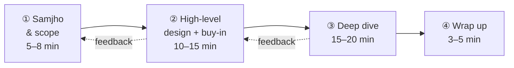
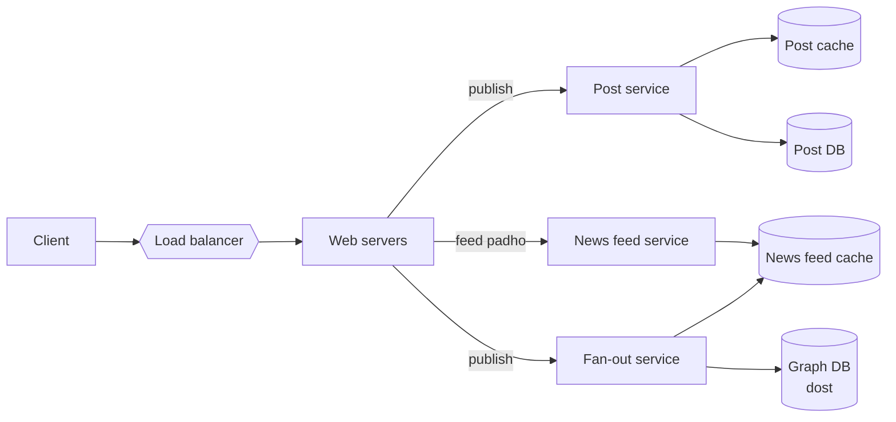

# 03 · System Design Interview ka Framework

<div class="chapter-meta" markdown>
<span>⏱ 35 min read</span>
<span class="hot">🔥 Har case study mein yahi method use hoga</span>
<span>Book: Chapter 3</span>
</div>

!!! abstract "TL;DR"
    - Interview **do colleagues ka milke ek vague problem solve karna** simulate karta hai. Final diagram se zyada process matter karta hai.
    - 4 steps: **(1) samjho & scope karo** (~5–8 min) → **(2) high-level design + buy-in** (~10–15 min) → **(3) deep dive** (~15–20 min) → **(4) wrap up** (~3–5 min).
    - **Kabhi seedha solution pe mat koodo.** Features, users, scale, growth, constraints poochho. Jawab likh lo.
    - Deep dive interviewer ko steer karne do, par problem ke **2–3 sabse mushkil hisse** pehle se tayyar rakho.
    - Red flags: over-engineering, chup rehna, ziddi hona, trade-offs ignore karna, chhoti baaton mein kho jaana.

## Interviewer asal mein kya judge kar raha hai

Koi expect nahi karta ki tum 45 minute mein YouTube design kar do — hazaaron engineers ko saal lage. Toh test kya ho raha hai?

| Signal | Strong ho toh kaisa dikhta hai |
|---|---|
| **Ambiguity handle karna** | "Chat app design karo" ko numbers ke saath ek saaf, agreed scope mein badal dete ho. |
| **Achhe sawaal** | Tumhare sawaal design badal dete hain ("sirf 1:1, ya 500 logon ke groups?"). |
| **Technical design** | Sensible components, saaf data flow, caches/queues/DBs ka sahi use. |
| **Trade-off thinking** | Alternatives batate ho aur *kyun* ek chuna — aur uski keemat kya hai. |
| **Depth** | Ek component pe dabaav pade toh 2–3 level aur andar ja sakte ho. |
| **Communication & collaboration** | Zor se sochte ho, check-in karte ho, hints achhe se lete ho. |
| **Pragmatism** | Bataye gaye scale ke liye design karte ho, by default Google-scale ke liye nahi. |

!!! danger "Red flags jo interviewer note karta hai"
    - **Over-engineering** — 10K users ke liye 12 microservices aur Kafka. Complexity ki asli, badhti hui keemat hoti hai.
    - Problem samajhne se pehle **solution pe koodna**.
    - **Tang nazariya / zid** — saaf counter-argument ke baad bhi apni choice defend karte rehna.
    - **Lambi khamoshi** — jo interviewer sun nahi sakta, use score nahi kar sakta.
    - **Buzzword soup** — "scalability ke liye microservices aur NoSQL use karenge", bina kisi reason ke.

---

## 4-step framework



Times 45-minute session ke hisaab se hain. Peeche jaate arrows important hain: zyada seekhte hue tum aksar scope ya
high-level design revise karoge — yeh normal aur achha hai.

---

## Step 1 · Problem samjho aur scope tay karo

**Woh student mat bano jo sabse pehle jawab chilla deta hai.** Design interview mein bina samjhe speed negative signal hai.
Dheere chalo, poochho, aur jawab board pe likho.

Jab tum poochte ho, interviewer ya toh jawab deta hai ya bolta hai "tum decide karo". Doosre case mein **assumption bolo aur
likh lo** — baad mein refer karoge.

### Question bank

Relevant waale chuno — saare ek saath machine-gun mat karo.

=== "Features (functional)"

    - **Core features** kaunse banane hain? Kya explicitly scope se bahar hai?
    - **Users** kaun hain — consumers, businesses, internal teams? Web, mobile, ya dono?
    - Sabse important **user journey** kya hai? (jaise "photo post karna" aur "apna feed dekhna")
    - Koi special requirement: search? notifications? analytics? edit/delete?

=== "Scale"

    - Kitne **users** (MAU/DAU)? Kitne **concurrent**?
    - **Read:write ratio**? Typical object ka size?
    - Kitni tezi se **badh** rahe hain? 3 / 6 / 12 mahine mein expected scale?
    - Traffic **spiky** hai (sales, live events) ya smooth? Global ya ek region?

=== "Quality (non-functional)"

    - **Latency** target? (jaise reads ke liye p99 < 200 ms)
    - **Availability** target? Thodi der down rehna chalega, ya thoda stale rehna?
    - **Consistency** — kya har read ko latest write dikhna zaroori hai? (bank balance vs like count)
    - **Durability** — kya kabhi data kho sakte hain? Kitne time tak rakhna hai?

=== "Constraints"

    - Existing **tech stack** ya services jo reuse kar sakein (auth, payments, blob store)?
    - Budget / cost sensitivity? On-prem ya cloud?
    - Legal: data residency, privacy (GDPR / DPDP), content moderation?

### Jawabon ko requirements sheet mein badlo

Yeh board pe likho — yeh interviewer ke saath tumhara contract hai.

```text
FUNCTIONAL
  1. Users text + images/videos post kar sakein
  2. Users dosto ke posts ka feed dekhein, naya pehle
NON-FUNCTIONAL
  - 10M DAU, har user ke 5,000 tak dost
  - Feed load p99 < 300 ms; consistency se zyada availability (kuch seconds stale chalega)
OUT OF SCOPE
  - Ranking/ML, ads, comments
ESTIMATES (Ch. 2)
  - Feed reads ≈ 10M × 10 / 10^5 = 1K QPS avg, ~3K peak
  - Posts ≈ 10M × 1 / 10^5 = 100 QPS
```

!!! example "Ek achhi scoping baatcheet (news feed)"
    **Tum:** Mobile, web, ya dono? — **Interviewer:** Dono.
    **Tum:** Must-have features kya hain? — **I:** Post publish karna, aur dosto ka feed dekhna.
    **Tum:** Feed newest-first hai ya relevance se ranked? — **I:** Simple rakho: newest first.
    **Tum:** Ek user ke kitne dost ho sakte hain? — **I:** 5,000 tak.
    **Tum:** Traffic? — **I:** 10M DAU.
    **Tum:** Sirf text, ya media bhi? — **I:** Images aur videos bhi.

    Dhyaan do, har sawaal **design ki ek branch kaat deta hai**: "newest first" matlab ranking service nahi; "5,000 dost"
    fan-out ko limit karta hai; "media" matlab object storage + CDN.

---

## Step 2 · High-level design propose karo aur buy-in lo

Goal: deep jaane se pehle **ek blueprint jis pe dono agree karo**.

1. **Boxes sketch karo**: clients → (DNS/CDN) → load balancer → services → cache → databases → queues/workers → object storage.
2. **Ek request ko usme se chalao** — "user photo post karta hai: app pre-signed URL se blob storage pe upload karta hai, phir `POST /posts` call karta hai…" Concrete use cases missing hisse dikha dete hain.
3. **Estimates se sanity-check** — "1K QPS feed reads — cache-backed service ke liye theek hai."
4. **Feedback maango** — "Aage gehraai mein jaane se pehle kya yeh direction sahi lag rahi hai?" Interviewer ko teammate samjho.

### APIs aur data model — daalein ya nahi?

Problem pe depend karta hai. "Google Search design karo" ke liye yeh bahut low-level hai. "URL shortener" ya
"multiplayer poker backend" ke liye API aur schema *hi* design hain. Doubt ho toh 2–4 core APIs sketch kar do:

```http
POST /v1/posts            { content, media_ids[] }        → 201 { post_id }
GET  /v1/feed?cursor=...  → 200 { posts[], next_cursor }
```

aur 2–3 core tables:

```text
users(user_id PK, name, ...)
posts(post_id PK, author_id, content, media_urls, created_at)
follows(follower_id, followee_id, created_at)   PK(follower_id, followee_id)
```

### Example: news-feed ka high-level design



Do flows: **feed publishing** (post likho, dosto ke feeds mein push karo) aur **feed building/retrieval** (precomputed feed
padho). Details Chapter 11 ka kaam hai — yahan dekho ki agreement ke liye kitni kam detail chahiye.

---

## Step 3 · Design deep dive

Ab tak scope agree ho chuka, blueprint ban chuka, feedback mil chuka. Ab jahan zaroori ho wahan gehraai mein jao.

**Deep dive ke liye kya chunein:**

1. **Interviewer ke peeche chalo.** Agar woh pooche "celebrity ke liye fan-out kaise chalega?", wahi tumhara deep dive hai.
2. **Warna woh chuno jo is problem mein unique hai** — jo isse *yeh* system banata hai, koi generic CRUD app nahi:

| Problem | Typical deep dives |
|---|---|
| URL shortener | Hash/encode function, collisions, 301 vs 302, cache |
| Rate limiter | Algorithm choice, distributed counters, race conditions |
| Chat | WebSockets, message ordering/IDs, online presence, multi-device sync |
| News feed | Fan-out on write vs read, celebrity problem, feed cache |
| Web crawler | URL frontier (politeness + priority), dedup, traps |
| YouTube | Upload + transcoding pipeline, CDN cost, streaming protocols |
| Google Drive | Block-level sync, conflict resolution, consistency, notifications |

3. **Seniority se focus badalta hai.** Junior: sahi components aur data flow. Senior: bottlenecks, capacity numbers, failure modes, operational concerns, cost.

**Time management:** kisi aisi cheez pe 10 minute jalana aasaan hai jo kuch dikhaati nahi (jaise ranking algorithm ka maths
detail mein samjhana). Khud se poochte raho: *kya isse dikh raha hai ki main scalable system design kar sakta hoon?*

---

## Step 4 · Wrap up

Interviewer open-ended follow-ups pooch sakta hai ya tumhe chunne de sakta hai. Inse breadth dikhao:

- **Bottlenecks & improvements** — "Single fan-out queue bottleneck hai; main ise user_id se partition karunga." Kabhi mat bolo ki design perfect hai.
- **Recap** — 30 second mein design aur key trade-offs summarise karo. Khaaskar tab kaam ka jab tum kai raaston pe gaye ho.
- **Failure cases** — server crash, network partition, cache loss, DC outage. Kya degrade hoga, kya khoyega?
- **Operations** — metrics, logging, alerting, deployment/rollback.
- **Agla 10× scale** — "100M DAU pe main post DB ko post_id se shard karunga aur doosra region add karunga."
- **Aur refinements** — security, abuse/rate limiting, cost.

---

## Kya karein, kya na karein

<div class="grid" markdown>

!!! success "Karo"
    - Clarification maango; kabhi mat maano ki tumhara assumption sahi hi hai.
    - Design se pehle requirements samjho.
    - Yaad rakho **ek hi sahi answer nahi hota** — startup aur big tech alag design karte hain.
    - **Zor se socho.** Lagatar communicate karo.
    - Jahan sense ho wahan multiple approaches do, phir reason ke saath ek chuno.
    - Blueprint agree hone ke baad sabse critical components pehle design karo.
    - Interviewer se ideas bounce karo — achha interviewer teammate ki tarah behave karta hai.
    - **Haar mat maano.**

!!! failure "Mat karo"
    - Typical questions ke liye bina tayyari ke jaana.
    - Bina clarify kiye solution mein koodna.
    - Big picture agree hone se pehle ek component mein bahut gehraai mein jaana.
    - Atak jao toh hint maangne mein jhijhakna.
    - Chup ho jaana.
    - Design bana diya toh interview khatam samajhna — interviewer jab tak na bole, khatam nahi hai. Jaldi aur baar-baar feedback maango.

</div>

---

## Poora mock walkthrough: "Pastebin design karo"

Chaaro steps ka ek compressed example, taaki rhythm samajh aaye.

??? example "Step 1 — Scope (6 min)"
    **Tum:** Users text paste karte hain aur shareable link milta hai — core yahi hai? Accounts, editing, syntax highlighting chahiye?
    **I:** Core hai paste + share link. Optional expiry. Editing nahi. Accounts optional.
    **Tum:** Per paste size limit? — **I:** Max 1 MB, zyada tar kuch KB.
    **Tum:** Scale? — **I:** 5M naye pastes/din, reads writes ke 10×.
    **Tum:** Kya links hamesha chalne chahiye? — **I:** Default expiry 1 saal, user chhoti chun sakta hai.

    *Board:* FR: paste banao (≤1 MB, optional expiry), link se padho. NFR: high read availability, low read latency,
    pastes immutable. Estimates: writes 5M/10⁵ ≈ 60 QPS; reads ≈ 600 QPS (peak ~1.5K). Storage: 5M × 10 KB avg
    = 50 GB/din → 18 TB/saal.

??? example "Step 2 — High-level design (12 min)"
    ```mermaid
    flowchart LR
        C[Client] --> LB{{LB}} --> API[Paste service]
        API -->|metadata| DB[(Metadata DB<br/>id, s3_key, expiry, owner)]
        API -->|content| S3[(Object storage)]
        API --> R[(Cache: hot pastes)]
        CL[Cleanup job] --> DB & S3
    ```
    `POST /pastes {content, expiry}` → 7-char ID banao (unique ID ka base-62 — Ch. 7/8 dekho), content object storage mein,
    metadata DB mein, link return. `GET /{id}` → cache → DB → object storage. Immutable data = cache karna bahut aasaan;
    popular pastes CDN ke peeche.
    **Tum:** "Kya yeh sahi lag raha hai? Aage main ID generation aur expiry mein jaana chahunga."

??? example "Step 3 — Deep dive (18 min)"
    - **ID generation:** random 7-char base-62 ka space 3.5 T hai; 1.8 B IDs/saal ke saath har insert pe collision ka chance
      bahut kam par zero nahi → unique numeric ID (Snowflake/ticket range) lo phir base-62 encode karo → **na collision, na DB check**.
    - **Expiry:** `expires_at` store karo; reads isse check karein (lazy delete); daily batch job expired rows aur S3 objects delete kare.
      Bulk cleanup ke liye S3 lifecycle rules.
    - **Hot pastes:** social media pe share hua paste minutes mein 100K hits laata hai → CDN, `Cache-Control: max-age` =
      min(bachi hui expiry, 1 din).
    - **Abuse:** per IP creates pe rate limit (Ch. 4); size limit LB pe.

??? example "Step 4 — Wrap up (4 min)"
    "Recap: stateless paste service, metadata paste_id se keyed sharded KV/SQL store mein, content object storage mein,
    reads ke liye cache + CDN. 10× pe bottleneck metadata writes honge → paste_id se shard. Failure: object storage slow ho
    toh cache/CDN se serve karenge; p99 read latency, 4xx/5xx, cache hit ratio monitor karenge. Aage async event stream
    se analytics add karunga."

---

## Kaam ke phrases

| Situation | Kuch aisa bolo |
|---|---|
| Shuruaat | "Design karne se pehle main kuch requirements clarify karna chahunga." |
| Assume karna | "Main X maan raha hoon — likh leta hoon; galat ho toh batana." |
| Chunna | "Yahan do options hain: A aur B. A se milta hai…, keemat hai…; hamara load read-heavy hai toh main A lunga." |
| Check-in | "Itni detail theek hai, ya kahin aur gehraai mein jaun?" |
| Atak gaye | "Yahan best approach ke baare mein sure nahi hoon — zor se reason karke dekhta hoon." |
| Hint lena | "Achha point hai — isse cheezein badalti hain. Yeh hissa revise karta hoon." |
| Wrap up | "Main design aur main trade-offs recap karta hoon, phir bottlenecks pe baat karte hain." |

---

## Practice

??? example "Practice 1 — Scope likho"
    Prompt: *"Ek shehar ke liye parking-lot reservation system design karo."* 6 clarifying questions aur ek requirements
    sheet likho (FR, NFR, out of scope) assumed numbers ke saath.

    **Sample answer.** Sawaal: Users kaun — drivers, lot operators, dono? Pehle se reserve ya sirf real-time? Kitne lots/spots?
    Peak times? Payments scope mein? Kya reserved spot guaranteed hona chahiye (double booking nahi)?
    *FR:* location/time se spots search, reserve, cancel, pay; operators inventory manage karein. *NFR:* **booking pe strong
    consistency** (double-booking nahi), search thoda stale chalega, p99 search < 300 ms. *Out:* dynamic pricing, navigation.
    *Numbers:* 2,000 lots × 200 spots = 400K spots; 1M reservations/din → ~12 writes/sec avg, office hours mein 10× peaks.

??? example "Practice 2 — Red flags pakdo"
    Ek candidate ko "internal company tool ke liye URL shortener (5K employees)" diya gaya, aur woh Kafka, Cassandra,
    20 microservices ke saath Kubernetes, aur multi-region active-active propose karta hai. Kya feedback doge?

    **Answer.** Bataye scale ke liye over-engineering (5K users → kuch QPS). Ek service + Postgres + chhota cache + backups
    kaafi hai. Complexity cost aur failure modes badhaati hai. Pehle estimate karna chahiye tha aur design ko numbers ke hisaab
    se scale karna chahiye tha, saath mein batana ki usage badhe toh kaise evolve karenge.

??? example "Practice 3 — Deep dives chuno"
    "Concerts ke liye ticket-booking system (BookMyShow jaisa) design karo" mein kaunse 2–3 areas ka deep dive karoge aur kyun?

    **Answer.** (1) **Seat inventory & concurrency** — double booking rokna (row locks / optimistic concurrency / expiry ke saath
    temporary holds). (2) **Flash-sale traffic** — bada concert khulte hi virtual waiting room / queue aur rate limiting.
    (3) **Payment flow & idempotency** — hold → pay → confirm, timeouts ke saath jo hold release kar dein.

---

## Revision checklist

- [ ] Interviewer kya evaluate karta hai aur top 5 red flags bata sakta hoon.
- [ ] 45-min round ke liye 4 steps rough time budgets ke saath bol sakta hoon.
- [ ] Features, scale, quality aur constraints ka mental question bank hai.
- [ ] Design se pehle board pe requirements (FR / NFR / out of scope / estimates) likhta hoon.
- [ ] Deep-dive topics kaise chunte hain aur seniority se kaise badalte hain, pata hai.
- [ ] Bottlenecks, failures, monitoring aur agle 10× scale ke saath wrap up kar sakta hoon.

[Aage: 04 · Rate Limiter :material-arrow-right:](../building-blocks/04-rate-limiter.md){ .md-button .md-button--primary }
