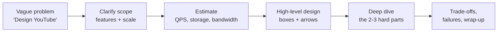

# Start Here

⏱ 10 min read
Read this first

## What system design actually is

Writing code solves a problem **for one request**. System design solves it **for millions of
requests, all at once, while machines fail, networks slow down, and data keeps growing**.

So a system design question is really four questions stacked on top of each other:

1. **What must the system do?** (functional requirements — "users can shorten a URL")
2. **How well must it do it?** (non-functional — latency, availability, consistency, cost)
3. **How big is it?** (scale — users, requests per second, bytes stored)
4. **What breaks first, and what do we do about it?** (bottlenecks, failures, trade-offs)

Every chapter on this site answers those four questions for one system or one component.

## How to use this site

!!! tip "The 3-pass method"
    1. **Pass 1 — understand.** Read the chapter top to bottom. Draw every diagram yourself on paper
       *before* looking at it closely. Play with the interactive widgets where they exist.
    2. **Pass 2 — reproduce.** Close the page. Set a 35-minute timer and design the system from scratch
       on a whiteboard or paper, talking out loud. Then compare with the chapter.
    3. **Pass 3 — defend.** Open the *Interviewer follow-ups* section and answer each question out loud
       before expanding the answer.

**English or Hinglish?** Both versions carry the same depth. Use whichever helps you *think*.
A useful trick: read in Hinglish to build intuition, then re-read the English version so you
can say it fluently in an interview.

## Suggested 4-week plan

| Week | Chapters | Goal |
|---|---|---|
| **1** | 01 Scale · 02 Estimation · 03 Framework | Vocabulary + the method. You should be able to draw the "millions of users" architecture from memory and estimate QPS/storage in under 3 minutes. |
| **2** | 04 Rate Limiter · 05 Consistent Hashing · 06 KV Store · 07 Unique IDs | The building blocks. These show up *inside* every later design — don't rush them. |
| **3** | 08 URL Shortener · 09 Crawler · 10 Notifications · 11 News Feed | First four case studies. Do each one timed (pass 2) at least once. |
| **4** | 12 Chat · 13 Autocomplete · 14 YouTube · 15 Google Drive · 16 Cheat Sheet | Last four case studies + revision. End with two full mock interviews. |

If you have only **one week**: do 01, 02, 03 fully, skim 05 and 06, then do 08, 11, 12 and 14 timed.

## The vocabulary you need on day one

You'll meet these words constantly. Each gets a proper explanation later, but here's the one-liner.
The [Glossary](revise/17-glossary.md) has 100+ more.

| Term | One-liner |
|---|---|
| **Latency** | How long one request takes (ms). |
| **Throughput / QPS** | How many requests the system handles per second. |
| **Availability** | Fraction of time the system is up and answering (99.9% = ~8.8 h downtime/year). |
| **Scalability** | Ability to handle more load by adding resources. |
| **Horizontal vs vertical scaling** | More machines vs a bigger machine. |
| **Replication** | Keeping copies of the same data on several machines. |
| **Sharding / partitioning** | Splitting data so each machine holds only a part. |
| **Cache** | A fast, small, temporary store that holds hot data to avoid slow work. |
| **Load balancer** | Spreads incoming requests across many servers. |
| **Message queue** | A buffer that lets producers and consumers work at different speeds. |
| **Consistency** | Whether every reader sees the latest write. |
| **Idempotency** | Doing the same operation twice has the same effect as doing it once. |

## A note on Java code

Code samples are in **Java** (the most common interview language). They're written to be
*readable and correct*, not production-hardened — think of them as executable explanations.

## Credits

This site is a companion to **Alex Xu, _System Design Interview – An Insider's Guide_ (2nd ed.)**.
The chapter order follows the book. All prose, diagrams, code and examples here are original;
nothing is copied from the book. Please buy it — it's worth it.

[Begin Chapter 1 :material-arrow-right:](foundations/01-scale-from-zero-to-millions.md){ .md-button .md-button--primary }
