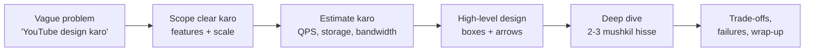

# Yahan se shuru karo

⏱ 10 min read
Sabse pehle yeh padho

## System design asal mein hai kya?

Code likhna ek problem ko **ek request ke liye** solve karta hai. System design wahi problem
**millions of requests ke liye, ek saath** solve karta hai — jab machines fail ho rahi hain,
network slow ho raha hai, aur data roz badh raha hai.

Toh ek system design question asal mein chaar sawaal ek ke upar ek rakhe hue hain:

1. **System ko karna kya hai?** (functional requirements — "user URL short kar sake")
2. **Kitna achha karna hai?** (non-functional — latency, availability, consistency, cost)
3. **Kitna bada hai?** (scale — users, requests per second, kitne bytes store honge)
4. **Sabse pehle kya tootega, aur tab kya karenge?** (bottlenecks, failures, trade-offs)

Is site ka har chapter yahi chaar sawaal ek system ya ek component ke liye answer karta hai.

## Is site ko use kaise karein

!!! tip "3-pass method"
    1. **Pass 1 — samjho.** Chapter upar se neeche tak padho. Har diagram ko dhyaan se dekhne se *pehle*
       khud paper pe banane ki koshish karo. Jahan interactive widgets hain, unse khelo.
    2. **Pass 2 — dobara banao.** Page band karo. 35 minute ka timer lagao aur system ko scratch se
       design karo — whiteboard ya paper pe, bol-bol ke. Phir chapter se compare karo.
    3. **Pass 3 — defend karo.** *Interviewer follow-ups* section kholo aur har sawaal ka jawab
       answer expand karne se pehle zor se bolo.

**English ya Hinglish?** Dono versions mein same depth hai. Jo tumhe *sochne* mein help kare, wahi use karo.
Ek kaam ka trick: intuition banane ke liye Hinglish mein padho, phir English version dobara padho
taaki interview mein fluently bol sako.

## 4-week plan

| Week | Chapters | Goal |
|---|---|---|
| **1** | 01 Scale · 02 Estimation · 03 Framework | Vocabulary + method. "Millions of users" waala architecture yaad se bana pao, aur QPS/storage 3 minute ke andar estimate kar pao. |
| **2** | 04 Rate Limiter · 05 Consistent Hashing · 06 KV Store · 07 Unique IDs | Building blocks. Yeh baad ke har design ke *andar* aate hain — jaldi mat karna. |
| **3** | 08 URL Shortener · 09 Crawler · 10 Notifications · 11 News Feed | Pehli chaar case studies. Har ek ko kam se kam ek baar timed (pass 2) karo. |
| **4** | 12 Chat · 13 Autocomplete · 14 YouTube · 15 Google Drive · 16 Cheat Sheet | Last chaar case studies + revision. End mein do full mock interviews. |

Agar sirf **ek hafta** hai: 01, 02, 03 poore karo, 05 aur 06 skim karo, phir 08, 11, 12 aur 14 timed karo.

## Pehle din se chahiye yeh vocabulary

Yeh words baar-baar aayenge. Har ek ka proper explanation baad mein hai, abhi ke liye one-liner.
[Glossary](revise/17-glossary.md) mein 100+ aur hain.

| Term | Ek line mein |
|---|---|
| **Latency** | Ek request mein kitna time lagta hai (ms). |
| **Throughput / QPS** | System ek second mein kitni requests handle karta hai. |
| **Availability** | Kitne % time system chalu hai aur jawab de raha hai (99.9% = saal mein ~8.8 ghante down). |
| **Scalability** | Resources add karke zyada load sambhalne ki capacity. |
| **Horizontal vs vertical scaling** | Zyada machines vs ek badi machine. |
| **Replication** | Same data ki copies kai machines pe rakhna. |
| **Sharding / partitioning** | Data ko tod dena taaki har machine pe sirf ek hissa ho. |
| **Cache** | Chhota, tez, temporary store jo hot data rakhta hai taaki slow kaam na karna pade. |
| **Load balancer** | Aane wali requests ko kai servers mein baant-ta hai. |
| **Message queue** | Ek buffer jisse producer aur consumer alag-alag speed pe kaam kar sakein. |
| **Consistency** | Kya har reader ko latest write dikhta hai? |
| **Idempotency** | Same operation do baar karo toh effect ek hi baar jaisa ho. |

## Java code ke baare mein

Code samples **Java** mein hain (interviews ki sabse common language). Yeh *readable aur correct*
hone ke liye likhe gaye hain, production-hardened nahi — inhe "chalne waale explanations" samjho.

## Credits

Yeh site **Alex Xu, _System Design Interview – An Insider's Guide_ (2nd ed.)** ka companion hai.
Chapter order book ke hisaab se hai. Yahan ka saara text, diagrams, code aur examples original hain;
book se kuch copy nahi kiya. Book khareedna — worth it hai.

[Chapter 1 shuru karo :material-arrow-right:](foundations/01-scale-from-zero-to-millions.md){ .md-button .md-button--primary }
